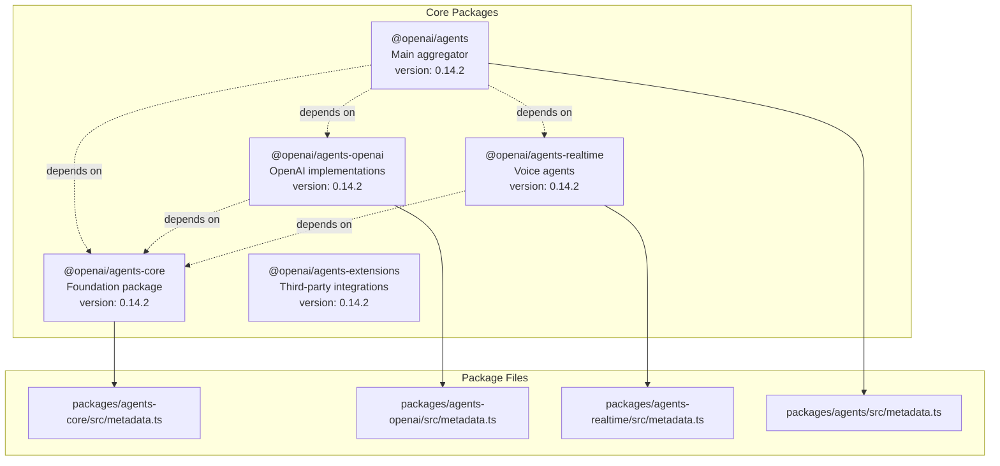
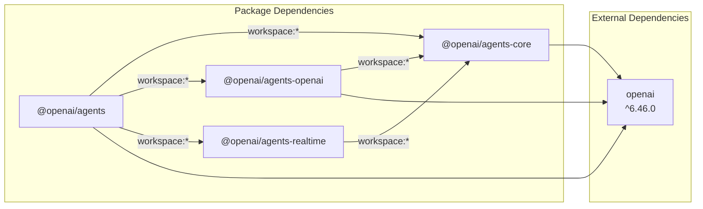
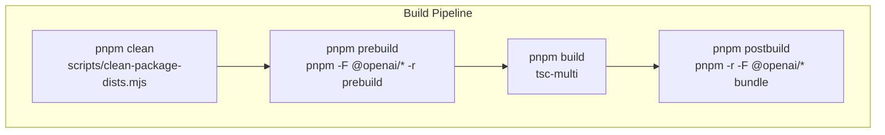
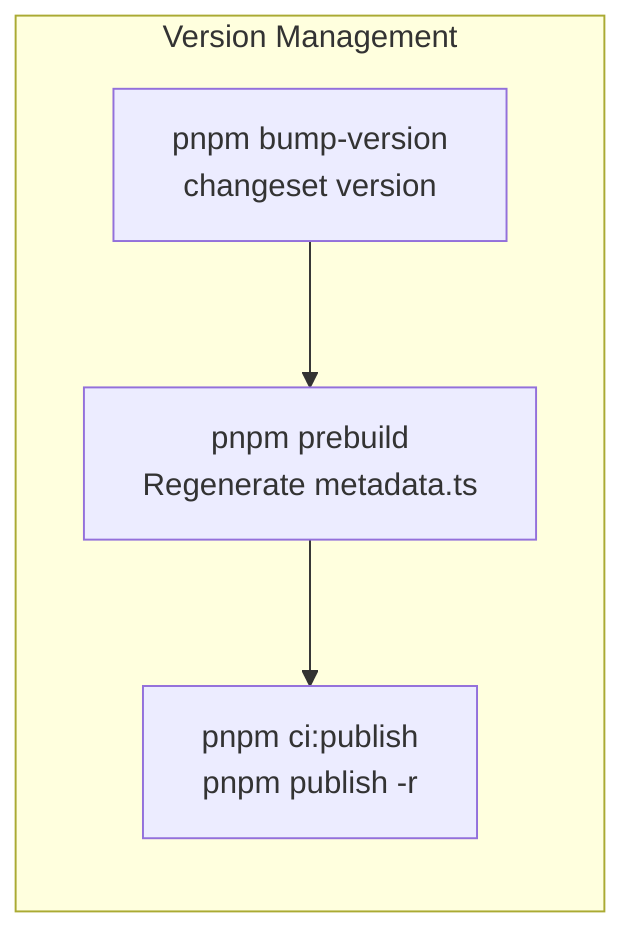
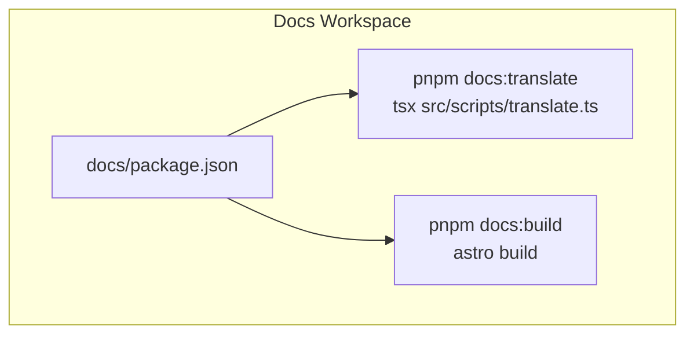

<!-- source: DeepWiki mcp.deepwiki.com · repo openai/openai-agents-js · page 6.1 Monorepo Structure · fetched 2026-10-26 -->

# Monorepo Structure

<details>
<summary>Relevant source files</summary>

The following files were used as context for generating this wiki page:

- [.github/dependabot.yml](.github/dependabot.yml)
- [.github/workflows/changeset.yml](.github/workflows/changeset.yml)
- [.github/workflows/docs.yml](.github/workflows/docs.yml)
- [.github/workflows/issues.yml](.github/workflows/issues.yml)
- [.github/workflows/release-tag.yml](.github/workflows/release-tag.yml)
- [.github/workflows/release.yml](.github/workflows/release.yml)
- [.github/workflows/test.yml](.github/workflows/test.yml)
- [docs/package.json](docs/package.json)
- [examples/ai-sdk-ui/package.json](examples/ai-sdk-ui/package.json)
- [examples/ai-sdk-v1/package.json](examples/ai-sdk-v1/package.json)
- [examples/ai-sdk/package.json](examples/ai-sdk/package.json)
- [examples/nextjs/package.json](examples/nextjs/package.json)
- [examples/realtime-demo/package.json](examples/realtime-demo/package.json)
- [examples/realtime-next/package.json](examples/realtime-next/package.json)
- [examples/realtime-twilio-sip/package.json](examples/realtime-twilio-sip/package.json)
- [examples/realtime-twilio/package.json](examples/realtime-twilio/package.json)
- [package.json](package.json)
- [packages/agents-core/src/metadata.ts](packages/agents-core/src/metadata.ts)
- [packages/agents-openai/src/metadata.ts](packages/agents-openai/src/metadata.ts)
- [packages/agents-realtime/src/metadata.ts](packages/agents-realtime/src/metadata.ts)
- [packages/agents/src/metadata.ts](packages/agents/src/metadata.ts)
- [pnpm-lock.yaml](pnpm-lock.yaml)

</details>


This document describes the physical organization of the OpenAI Agents SDK monorepo, including package layout, dependency relationships, build tooling, and development workflows. For conceptual package architecture and how the layers interact, see **1.1 Package Architecture**. For development environment setup procedures, see **6.2 Development Environment Setup**.

## Directory Layout

The repository uses a pnpm workspace monorepo structure with clearly separated concerns:

```
openai-agents-js/
├── packages/              # Publishable npm packages
│   ├── agents-core/      # Foundation layer
│   ├── agents-openai/    # OpenAI integration
│   ├── agents-realtime/  # Voice agents
│   ├── agents-extensions/# Third-party integrations
│   └── agents/           # Main aggregator package
├── examples/             # Demonstration applications
├── docs/                 # Documentation site (Astro)
├── scripts/              # Build and automation scripts
├── .github/              # CI/CD workflows
└── .agents/              # SDK-specific automation skills
```

The root `package.json` defines the workspace with `"private": true` at [package.json:2](), preventing accidental publication of the monorepo itself. Each subdirectory under `packages/` contains an independently publishable npm package.

**Sources:** [package.json:1-108]()

## Package Organization

The monorepo contains five core packages that share a synchronized version number (`0.14.2` as of latest):

Title: Package Metadata and Versions


Each package follows a consistent structure with an automatically generated `metadata.ts` file that exports package versioning and internal workspace dependencies.

| Package | Purpose | Metadata Reference |
|---------|---------|--------------------|
| `@openai/agents-core` | Foundation layer: Agent/Runner/Model/MCP | [packages/agents-core/src/metadata.ts:4-11]() |
| `@openai/agents-openai` | OpenAI specific models and hosted tools | [packages/agents-openai/src/metadata.ts:4-12]() |
| `@openai/agents-realtime` | Realtime voice agent implementations | [packages/agents-realtime/src/metadata.ts:4-11]() |
| `@openai/agents` | Main aggregator and convenience exports | [packages/agents/src/metadata.ts:4-14]() |

**Sources:** [packages/agents/src/metadata.ts:1-17](), [packages/agents-openai/src/metadata.ts:1-15](), [packages/agents-core/src/metadata.ts:1-14](), [packages/agents-realtime/src/metadata.ts:1-14]()

## Dependency Graph

Packages use the `workspace:*` protocol for internal dependencies, ensuring local development always uses the latest source. This protocol is visible in the generated metadata files.

Title: Workspace Dependencies (workspace:*)


The `workspace:*` notation at [packages/agents/src/metadata.ts:9-11]() ensures that the aggregator package and sub-packages resolve to the current monorepo versions during development. All core packages share a dependency on the primary `openai` SDK at version `^6.46.0`.

**Sources:** [packages/agents/src/metadata.ts:4-14](), [packages/agents-openai/src/metadata.ts:4-12](), [packages/agents-core/src/metadata.ts:4-11](), [packages/agents-realtime/src/metadata.ts:4-11]()

## Build System

The monorepo uses `tsc-multi` for parallel TypeScript compilation across packages and custom scripts for cleanup and metadata generation.

Title: Build Pipeline Implementation


The build process executes in stages defined in the root `package.json`:

1. **clean**: Runs `scripts/clean-package-dists.mjs` and `tsc-multi --clean` at [package.json:6]().
2. **prebuild**: Triggers the `prebuild` script for all `@openai/*` packages at [package.json:7](). This typically involves generating the `metadata.ts` files seen in the source.
3. **build**: Executes `tsc-multi` at [package.json:8]() to compile all TypeScript packages.
4. **postbuild**: Runs the `bundle` script for all packages at [package.json:10]().

**Sources:** [package.json:5-10]()

## Version Management and Changesets

The monorepo uses Changesets for version synchronization and automated changelog generation.

Title: Versioning and Publishing Flow


The versioning workflow is defined by:
- **`bump-version`**: Runs `changeset version` followed by a prebuild of all packages to update the `metadata.ts` files at [package.json:77]().
- **`ci:publish`**: Publishes all packages in the monorepo to the public npm registry at [package.json:76]().
- **Metadata Synchronization**: Files like [packages/agents/src/metadata.ts:6-12]() are "automatically generated" to reflect the new versions.

**Sources:** [package.json:76-77](), [packages/agents/src/metadata.ts:2-14]()

## Examples Directory

The `examples/` directory contains various implementation patterns and integrations. The root `package.json` provides direct scripts to run these examples:

| Category | Example Command | Script Reference |
|----------|-----------------|------------------|
| **Patterns** | `pnpm examples:agents-as-tools` | [package.json:32]() |
| | `pnpm examples:human-in-the-loop` | [package.json:37]() |
| | `pnpm examples:input-guardrails` | [package.json:38]() |
| **Tools** | `pnpm examples:tools-web-search` | [package.json:54]() |
| | `pnpm examples:tools-shell` | [package.json:55]() |
| **Realtime** | `pnpm examples:realtime-demo` | [package.json:44]() |
| **Sandbox** | `pnpm examples:sandbox-basic` | [package.json:59]() |
| | `pnpm examples:sandbox-coding-task` | [package.json:66]() |

The CI environment verifies these examples via `pnpm -r build-check` at [.github/workflows/test.yml:136]().

**Sources:** [package.json:31-70](), [.github/workflows/test.yml:135-136]()

## Documentation System

The documentation is built using Astro and Starlight, located in the `docs/` directory.

Title: Documentation Build and Translation


Key documentation features include:
- **Automated Translation**: Uses an LLM-based translation script at `docs/src/scripts/translate.ts` triggered by `pnpm docs:translate` at [docs/package.json:11]().
- **API Reference**: Integrated via `starlight-typedoc` at [docs/package.json:22]().
- **Typedoc Plugins**: Enhances documentation with `typedoc-plugin-markdown` [docs/package.json:24]() and `typedoc-plugin-zod` [docs/package.json:30]().

**Sources:** [docs/package.json:1-33]()

## CI/CD Workflows

The monorepo uses several GitHub Actions workflows for quality assurance and release:

### Test Workflow (`test.yml`)
Runs on push and pull requests. It performs:
1. **Matrix Testing**: Tests against Node.js versions 22 and 24.3.x at [.github/workflows/test.yml:98]().
2. **Package Building**: Runs `pnpm build:ci` at [.github/workflows/test.yml:124]().
3. **Linting**: Runs `pnpm lint` at [.github/workflows/test.yml:130]().
4. **Example Verification**: Compiles examples at [.github/workflows/test.yml:136]().
5. **Unit Testing**: Runs `pnpm test` at [.github/workflows/test.yml:139]().

### Release Workflow (`release.yml`)
Triggers after successful CI on the `main` branch.
1. **Versioning**: Uses `pnpm bump-version` to apply changesets at [.github/workflows/release.yml:58]().
2. **Publishing**: Uses `pnpm ci:publish` to release packages to npm at [.github/workflows/release.yml:59]().

### Changeset Validation (`changeset.yml`)
Performs automated checks on Pull Requests to ensure versioning metadata is correct.
1. **Lightweight Check**: Runs `pnpm changeset:validate-lite` at [.github/workflows/changeset.yml:65]().
2. **Label Syncing**: Automatically applies package labels (e.g., `package:agents-core`) based on changed files at [.github/workflows/changeset.yml:178-183]().

**Sources:** [.github/workflows/test.yml:1-140](), [.github/workflows/release.yml:1-64](), [.github/workflows/changeset.yml:1-183]()

## Local Development Tools

The monorepo includes infrastructure for local package testing:
- **Verdaccio**: A local npm registry configured for testing the publishing process.
  - `local-npm:start`: Starts the registry at [package.json:81]().
  - `local-npm:publish`: Publishes packages to the local registry at [package.json:82]().
- **Husky**: Pre-commit hooks for linting and formatting at [package.json:78]().

**Sources:** [package.json:78-82]()

---

