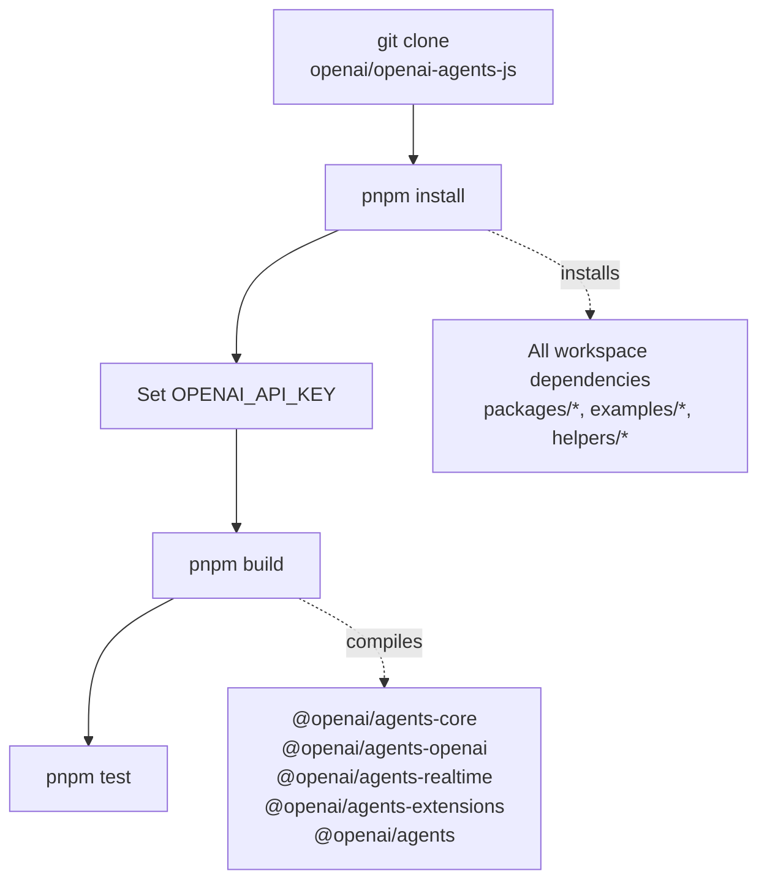
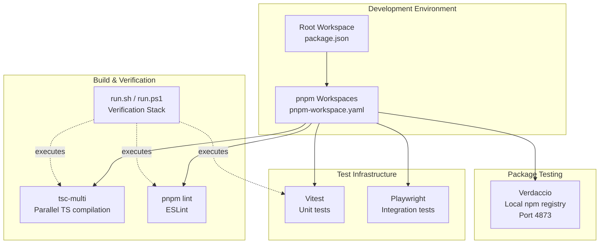
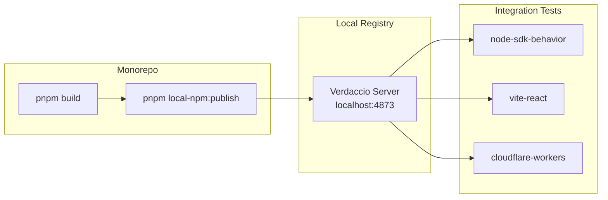

<!-- source: DeepWiki mcp.deepwiki.com · repo openai/openai-agents-js · page 6.2 Development Environment Setup · fetched 2026-10-26 -->

# Development Environment Setup

<details>
<summary>Relevant source files</summary>

The following files were used as context for generating this wiki page:

- [.agents/skills/code-change-verification/SKILL.md](.agents/skills/code-change-verification/SKILL.md)
- [.agents/skills/code-change-verification/scripts/run.mjs](.agents/skills/code-change-verification/scripts/run.mjs)
- [.agents/skills/implementation-strategy/SKILL.md](.agents/skills/implementation-strategy/SKILL.md)
- [.agents/skills/pr-draft-summary/SKILL.md](.agents/skills/pr-draft-summary/SKILL.md)
- [AGENTS.md](AGENTS.md)
- [CONTRIBUTING.md](CONTRIBUTING.md)
- [integration-tests/README.md](integration-tests/README.md)
- [integration-tests/node-sdk-behavior.test.ts](integration-tests/node-sdk-behavior.test.ts)
- [integration-tests/node-sdk-behavior/.npmrc](integration-tests/node-sdk-behavior/.npmrc)
- [integration-tests/node-sdk-behavior/package.json](integration-tests/node-sdk-behavior/package.json)
- [integration-tests/node-sdk-behavior/test/capabilities/execution-controls.test.mjs](integration-tests/node-sdk-behavior/test/capabilities/execution-controls.test.mjs)
- [integration-tests/node-sdk-behavior/test/capabilities/guardrails.test.mjs](integration-tests/node-sdk-behavior/test/capabilities/guardrails.test.mjs)
- [integration-tests/node-sdk-behavior/test/capabilities/hosted-multi-agent.test.mjs](integration-tests/node-sdk-behavior/test/capabilities/hosted-multi-agent.test.mjs)
- [integration-tests/node-sdk-behavior/test/capabilities/hosted-tools.test.mjs](integration-tests/node-sdk-behavior/test/capabilities/hosted-tools.test.mjs)
- [integration-tests/node-sdk-behavior/test/capabilities/programmatic-tool-calling.test.mjs](integration-tests/node-sdk-behavior/test/capabilities/programmatic-tool-calling.test.mjs)
- [integration-tests/node-sdk-behavior/test/capabilities/provider-parity.test.mjs](integration-tests/node-sdk-behavior/test/capabilities/provider-parity.test.mjs)
- [integration-tests/node-sdk-behavior/test/capabilities/tool-search.test.mjs](integration-tests/node-sdk-behavior/test/capabilities/tool-search.test.mjs)
- [scripts/prettier-changed.mjs](scripts/prettier-changed.mjs)

</details>


This page provides instructions for setting up a local development environment to contribute to the OpenAI Agents SDK. It covers prerequisites, installation steps, environment configuration, and local package testing workflows for developers working on the SDK itself.

For information about monorepo package organization and interdependencies, see [Monorepo Structure](#6.1). For build processes and testing procedures, see [Building and Testing](#6.3).

## Prerequisites

### Node.js Version Requirements

The SDK requires Node.js 22 or later for development [CONTRIBUTING.md:26](). The CI environment specifically tests against multiple versions to ensure cross-runtime compatibility.

| Node Version | Status | Notes |
|--------------|--------|-------|
| 22.x | Required | Minimum supported version [CONTRIBUTING.md:26]() |
| 22.x (LTS) | Recommended | Current LTS and recommended for local development [CONTRIBUTING.md:26]() |

**Sources:** [CONTRIBUTING.md:26]()

### Package Manager

The repository is a monorepo managed by **pnpm 10 or later** [CONTRIBUTING.md:27](). Do not use npm or yarn for installation as they will not correctly resolve the `workspace:*` protocols.

Install pnpm globally:

```bash
npm install -g pnpm@latest
```

**Sources:** [CONTRIBUTING.md:27]()

## Initial Setup

### Repository Clone and Installation

Title: Repository Setup Workflow


**Sources:** [CONTRIBUTING.md:31-46]()

### Step-by-Step Installation

1. **Clone the repository:**
   ```bash
   git clone https://github.com/openai/openai-agents-js.git
   cd openai-agents-js
   ```

2. **Install all dependencies:**
   ```bash
   pnpm install
   ```
   
   This installs dependencies for the root workspace and all packages. The install intentionally runs without forcing CI or prompt-confirmation settings locally to allow for configuration diagnosis if `node_modules` mismatches occur [.agents/skills/code-change-verification/SKILL.md:27]().

3. **Set environment variables:**
   ```bash
   export OPENAI_API_KEY=your_api_key_here
   ```
   
   This is required for running examples and integration tests [integration-tests/README.md:12]().

4. **Build all packages:**
   ```bash
   pnpm build
   ```
   
   This compiles TypeScript into `dist/` directories for each package [CONTRIBUTING.md:60-63]().

**Sources:** [CONTRIBUTING.md:31-46](), [CONTRIBUTING.md:55-63](), [.agents/skills/code-change-verification/SKILL.md:21-27]()

## Development Tools and Architecture

Title: Development Toolchain Mapping


**Sources:** [CONTRIBUTING.md:5-21](), [.agents/skills/code-change-verification/SKILL.md:23-35](), [integration-tests/README.md:20-24]()

### Verification Stack

The repository includes a mandatory verification stack that should be run before marking any work as complete [.agents/skills/code-change-verification/SKILL.md:10-12]().

The stack performs the following in sequence:
1. `pnpm i --frozen-lockfile`: Ensures dependencies are in sync [.agents/skills/code-change-verification/scripts/run.mjs:83-86]().
2. `pnpm build`: Compiles all packages [.agents/skills/code-change-verification/scripts/run.mjs:91]().
3. `concurrently`: Runs the following in parallel [.agents/skills/code-change-verification/scripts/run.mjs:96-105]():
   - `pnpm -r build-check`: Type checking including generated declarations.
   - `pnpm -r -F "@openai/*" dist:check`: Distribution artifact validation.
   - `pnpm lint`: Code style and unused import check.
   - `pnpm test`: Full test suite execution.
   - `pnpm format:check:changed`: Prettier formatting check on changed files.

**Sources:** [.agents/skills/code-change-verification/SKILL.md:23](), [.agents/skills/code-change-verification/scripts/run.mjs:11-24]()

## Running Examples

The repository includes example projects demonstrating basic and advanced usage [CONTRIBUTING.md:18]().

### Running Individual Examples

Use the scripts defined in the root or package `package.json`:

```bash
# Start the basic example
pnpm examples:basic
```

**Sources:** [CONTRIBUTING.md:50]()

## Local Package Testing with Verdaccio

For integration testing, the SDK uses **Verdaccio**, a local npm registry. This allows testing the published package behavior (e.g., ESM/CJS entry points, export maps) without publishing to the public registry [integration-tests/README.md:5]().

Title: Integration Registry Workflow


**Sources:** [integration-tests/README.md:1-30](), [integration-tests/node-sdk-behavior/.npmrc:1]()

### Verdaccio Workflow

1. **Start Registry**: Run `pnpm run local-npm:start` in a dedicated terminal and keep it running [integration-tests/README.md:24]().
2. **First Time Setup**: Run `npm adduser --registry http://localhost:4873/` (accepts any fake data) [integration-tests/README.md:26]().
3. **Publish Packages**: Build the packages (`pnpm build`) and then run `pnpm local-npm:publish` to push them to the local registry [integration-tests/README.md:30]().
4. **Run Tests**: Execute `pnpm test:integration` to run tests across Node.js, Bun, Deno, and Cloudflare Workers [integration-tests/README.md:36-37]().

**Sources:** [integration-tests/README.md:20-37]()

## Development Environment Variables

| Variable | Required | Purpose |
|----------|----------|---------|
| `OPENAI_API_KEY` | Yes | Primary API key for model access and examples [integration-tests/README.md:12](). |
| `OPENAI_AGENTS_INTEGRATION_MODEL` | No | Model used for Node.js published SDK behavior tests (defaults to `gpt-5.6`) [integration-tests/README.md:16](). |
| `OPENAI_AGENTS_INTEGRATION_MCP_SERVER_URL` | No | URL for hosted MCP integration tests [integration-tests/README.md:17](). |
| `OPENAI_AGENTS_RUN_STORAGE_MOUNT_INTEGRATION` | No | Set to `1` to enable Docker-based storage mount tests [integration-tests/README.md:18](). |

**Sources:** [integration-tests/README.md:9-19]()

## Mandatory Contribution Rules

Contributors must adhere to the following automated gates:

### Changesets and Versioning
This repository uses **Changesets** for version management. If you change anything under `packages/`, you must create a changeset [CONTRIBUTING.md:83-86]().
```bash
pnpm changeset
```
Follow the interactive prompts to describe the change as a `fix` or `feat` [CONTRIBUTING.md:86-89]().

### PR Summaries
Before completing a task, you must generate a PR-ready summary block using the `$pr-draft-summary` skill if the diff includes runtime code, tests, or build configuration [.agents/skills/pr-draft-summary/SKILL.md:14-16]().

**Sources:** [CONTRIBUTING.md:81-89](), [AGENTS.md:31-33](), [.agents/skills/pr-draft-summary/SKILL.md:1-17]()

---

