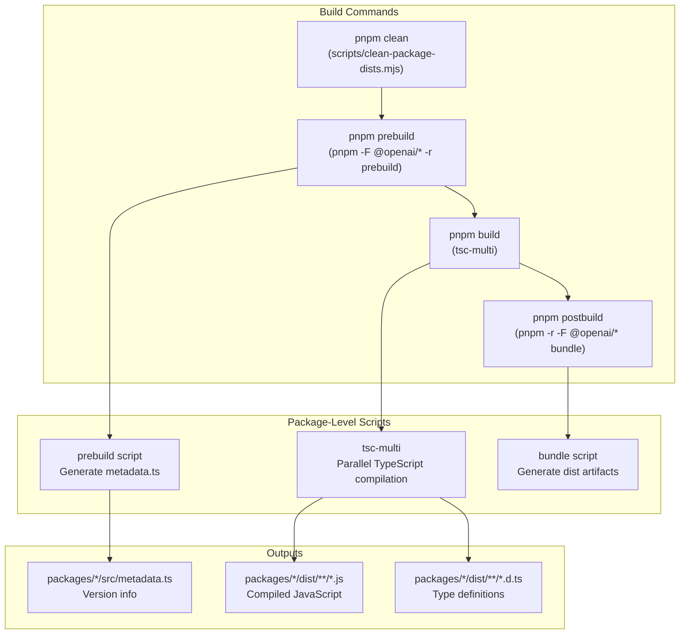
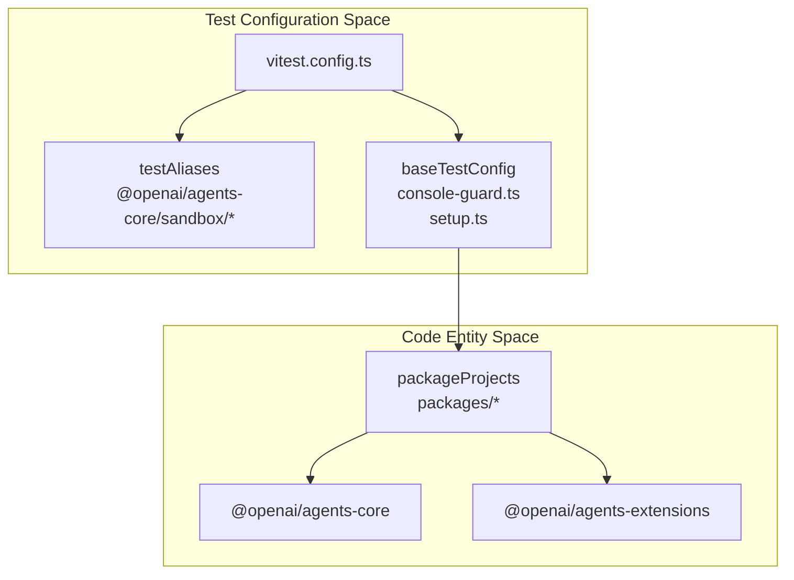
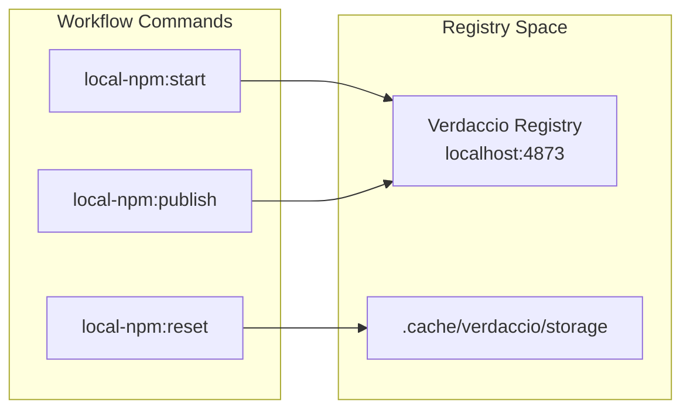
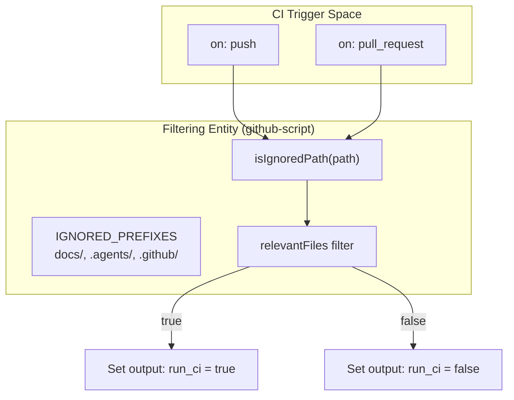

<!-- source: DeepWiki mcp.deepwiki.com · repo openai/openai-agents-js · page 6.3 Building and Testing · fetched 2026-10-26 -->

# Building and Testing

Relevant source files

The following files were used as context for generating this wiki page:

- [.agents/skills/code-change-verification/SKILL.md](.agents/skills/code-change-verification/SKILL.md)
- [.agents/skills/code-change-verification/scripts/run.mjs](.agents/skills/code-change-verification/scripts/run.mjs)
- [.agents/skills/examples-auto-run/scripts/run.sh](.agents/skills/examples-auto-run/scripts/run.sh)
- [.agents/skills/implementation-strategy/SKILL.md](.agents/skills/implementation-strategy/SKILL.md)
- [.agents/skills/pr-draft-summary/SKILL.md](.agents/skills/pr-draft-summary/SKILL.md)
- [.github/dependabot.yml](.github/dependabot.yml)
- [.github/workflows/changeset.yml](.github/workflows/changeset.yml)
- [.github/workflows/docs.yml](.github/workflows/docs.yml)
- [.github/workflows/issues.yml](.github/workflows/issues.yml)
- [.github/workflows/release-tag.yml](.github/workflows/release-tag.yml)
- [.github/workflows/release.yml](.github/workflows/release.yml)
- [.github/workflows/test.yml](.github/workflows/test.yml)
- [.gitignore](.gitignore)
- [AGENTS.md](AGENTS.md)
- [examples/agent-patterns/forcing-tool-use.ts](examples/agent-patterns/forcing-tool-use.ts)
- [integration-tests/README.md](integration-tests/README.md)
- [integration-tests/_helpers/prereqs.ts](integration-tests/_helpers/prereqs.ts)
- [integration-tests/bun.test.ts](integration-tests/bun.test.ts)
- [integration-tests/bun/aisdk.ts](integration-tests/bun/aisdk.ts)
- [integration-tests/bun/package.json](integration-tests/bun/package.json)
- [integration-tests/cloudflare-workers/worker/package.json](integration-tests/cloudflare-workers/worker/package.json)
- [integration-tests/cloudflare-workers/worker/src/index.ts](integration-tests/cloudflare-workers/worker/src/index.ts)
- [integration-tests/cloudflare.test.ts](integration-tests/cloudflare.test.ts)
- [integration-tests/deno.test.ts](integration-tests/deno.test.ts)
- [integration-tests/deno/aisdk.ts](integration-tests/deno/aisdk.ts)
- [integration-tests/deno/package.json](integration-tests/deno/package.json)
- [integration-tests/node-ai-sdk-v4-ts.test.ts](integration-tests/node-ai-sdk-v4-ts.test.ts)
- [integration-tests/node-ai-sdk-v4-ts/.npmrc](integration-tests/node-ai-sdk-v4-ts/.npmrc)
- [integration-tests/node-ai-sdk-v4-ts/package.json](integration-tests/node-ai-sdk-v4-ts/package.json)
- [integration-tests/node-ai-sdk-v4-ts/src/index.ts](integration-tests/node-ai-sdk-v4-ts/src/index.ts)
- [integration-tests/node-ai-sdk-v4-ts/tsconfig.json](integration-tests/node-ai-sdk-v4-ts/tsconfig.json)
- [integration-tests/node-sdk-behavior.test.ts](integration-tests/node-sdk-behavior.test.ts)
- [integration-tests/node-sdk-behavior/.npmrc](integration-tests/node-sdk-behavior/.npmrc)
- [integration-tests/node-sdk-behavior/package.json](integration-tests/node-sdk-behavior/package.json)
- [integration-tests/node-sdk-behavior/test/capabilities/execution-controls.test.mjs](integration-tests/node-sdk-behavior/test/capabilities/execution-controls.test.mjs)
- [integration-tests/node-sdk-behavior/test/capabilities/guardrails.test.mjs](integration-tests/node-sdk-behavior/test/capabilities/guardrails.test.mjs)
- [integration-tests/node-sdk-behavior/test/capabilities/hosted-multi-agent.test.mjs](integration-tests/node-sdk-behavior/test/capabilities/hosted-multi-agent.test.mjs)
- [integration-tests/node-sdk-behavior/test/capabilities/hosted-tools.test.mjs](integration-tests/node-sdk-behavior/test/capabilities/hosted-tools.test.mjs)
- [integration-tests/node-sdk-behavior/test/capabilities/programmatic-tool-calling.test.mjs](integration-tests/node-sdk-behavior/test/capabilities/programmatic-tool-calling.test.mjs)
- [integration-tests/node-sdk-behavior/test/capabilities/provider-parity.test.mjs](integration-tests/node-sdk-behavior/test/capabilities/provider-parity.test.mjs)
- [integration-tests/node-sdk-behavior/test/capabilities/tool-search.test.mjs](integration-tests/node-sdk-behavior/test/capabilities/tool-search.test.mjs)
- [integration-tests/node.test.ts](integration-tests/node.test.ts)
- [integration-tests/node/aisdk.cjs](integration-tests/node/aisdk.cjs)
- [integration-tests/node/codex.mjs](integration-tests/node/codex.mjs)
- [integration-tests/node/package.json](integration-tests/node/package.json)
- [integration-tests/vite-react.test.ts](integration-tests/vite-react.test.ts)
- [package.json](package.json)
- [scripts/prettier-changed.mjs](scripts/prettier-changed.mjs)

This document describes the build system, test infrastructure, linting setup, and continuous integration pipeline for the OpenAI Agents SDK monorepo. It covers the compilation process using `tsc-multi`, test execution with Vitest and Playwright, code quality enforcement, and integration tests across multiple runtimes (Node, Bun, Deno, Cloudflare Workers) using a local Verdaccio registry.

---

## Build System Architecture

The monorepo uses a multi-stage build pipeline that compiles TypeScript packages in parallel, generates metadata, and bundles distribution artifacts.

### Build Pipeline Overview

**Sources:** [package.json:6-10](), [package.json:99]()

### TypeScript Compilation with tsc-multi

The build system uses `tsc-multi` to compile all packages in parallel. The `build:ci` script optimizes this by limiting workers to 1 to prevent memory issues in CI environments.

| Build Command | Purpose | Implementation |
|---------------|---------|----------------|
| `pnpm clean` | Remove compiled outputs | `node scripts/clean-package-dists.mjs && tsc-multi --clean` [package.json:6]() |
| `pnpm build` | Compile all packages | `pnpm clean && tsc-multi` [package.json:8]() |
| `pnpm build:ci` | CI optimized build | `pnpm prebuild && pnpm clean && tsc-multi --maxWorkers 1 && pnpm postbuild` [package.json:9]() |
| `pnpm packages:dev` | Watch mode | `tsc-multi --watch` [package.json:11]() |

**Sources:** [package.json:6-11]()

---

## Test Infrastructure

The test infrastructure uses Vitest as the primary test runner with coverage reporting via `@vitest/coverage-v8`.

### Vitest Workspace Configuration

The monorepo uses Vitest to run tests across multiple packages with shared configuration.

**Sources:** [package.json:105](), [package.json:16-23]()

### Test Commands

The `package.json` defines several test suites for different scopes:

| Command | Implementation | Purpose |
|---------|----------------|---------|
| `pnpm test` | `CI=1 NODE_ENV=test vitest && pnpm test:rclone-pin` | Standard CI test run [package.json:16]() |
| `pnpm test:coverage` | `NODE_ENV=test vitest run --coverage` | Generate coverage report [package.json:17]() |
| `pnpm test:integration` | `NODE_ENV=test vitest run --config=vitest.integration.config.ts` | Run runtime integration tests [package.json:19]() |
| `pnpm test:watch` | `NODE_ENV=test vitest --watch` | Local development watch mode [package.json:23]() |

**Sources:** [package.json:16-23]()

---

## Integration Testing and Local Registry

The SDK is tested against multiple runtimes (Node.js, Bun, Deno, Cloudflare Workers) and environments (Vite/React). To ensure compatibility with published packages, the CI uses a local **Verdaccio** registry.

### Local Registry Workflow

The integration test pipeline utilizes a local registry to simulate a real `npm publish` and `npm install` cycle. This prevents local workspace links from masking dependency issues.

**Sources:** [package.json:80-82](), [package.json:104]()

### Cross-Runtime Integration Tests

Integration tests are located in the `integration-tests/` directory and use `execa` to run commands in isolated environments.

| Runtime / Test | File | Implementation Detail |
|----------------|------|-----------------------|
| **Node.js** | `integration-tests/node.test.ts` | Tests ESM/CJS compatibility and behavior profiles |
| **Deno** | `integration-tests/deno.test.ts` | Validates SDK usage in Deno runtime |
| **Bun** | `integration-tests/bun.test.ts` | Validates SDK usage in Bun runtime using `bun install` [integration-tests/bun.test.ts:29-33]() |
| **Cloudflare** | `integration-tests/cloudflare.test.ts` | Tests deployment to Cloudflare Workers |
| **Vite/React** | `integration-tests/vite-react.test.ts` | Validates browser-side compatibility via Playwright |

**Sources:** [integration-tests/bun.test.ts:9-35](), [package.json:97](), [package.json:95]()

---

## CI/CD Pipeline

The continuous integration pipeline runs on every push to `main` and on pull requests. It includes complex filtering to skip CI for documentation-only changes.

### CI Workflow Filtering Logic

The `changes` job determines if the full suite needs to run based on modified paths.

**Sources:** [.github/workflows/test.yml:23-42](), [.github/workflows/test.yml:82-87]()

### CI Jobs and Matrix

The `test` job runs on a matrix of Node.js versions: `['22', '24.3.x']`.

| Step | Command | Purpose |
|------|---------|---------|
| Build | `pnpm build:ci` | Compile all packages [package.json:9]() |
| Dist Check | `pnpm -r -F "@openai/*" dist:check` | Validate generated `.d.ts` files [.github/workflows/test.yml:127]() |
| Lint | `pnpm lint` | Run ESLint across monorepo [.github/workflows/test.yml:130]() |
| Examples | `pnpm -r build-check` | Type-check all examples [.github/workflows/test.yml:136]() |
| Tests | `pnpm test` | Run unit and package tests [.github/workflows/test.yml:139]() |

**Sources:** [.github/workflows/test.yml:94-98](), [.github/workflows/test.yml:124-139]()

---

## Code Quality and Linting

The project enforces strict linting and formatting rules.

- **ESLint:** Configured in `eslint.config.mjs` (referenced via `pnpm lint` [package.json:29]()).
- **Prettier:** Formats all packages, examples, and integration tests [package.json:25]().
- **Husky:** Manages git hooks to ensure linting passes before commit [package.json:78](), [package.json:96]().

### Changeset Validation

The CI includes an automated changeset validation workflow that verifies that pull requests include appropriate changesets and syncs package labels based on modified files.

**Sources:** [.github/workflows/changeset.yml:63-68](), [.github/workflows/changeset.yml:178-183](), [package.json:73]()

---

## Release and Versioning

The project uses **Changesets** to manage versioning and publishing.

- **Version Bump:** `pnpm bump-version` runs `changeset version` and updates metadata [package.json:77]().
- **Publishing:** The `ci:publish` command handles monorepo-wide publication [package.json:76]().
- **Tags:** The `Create Release Tag` workflow automatically creates git tags (e.g., `v0.0.1`) when a version bump commit is detected on `main` [.github/workflows/release-tag.yml:31-43]().

**Sources:** [.github/workflows/release.yml:52-64](), [.github/workflows/release-tag.yml:1-53]()

---

