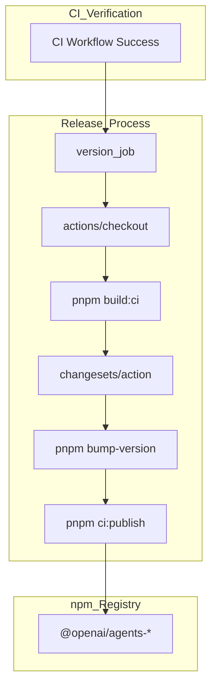
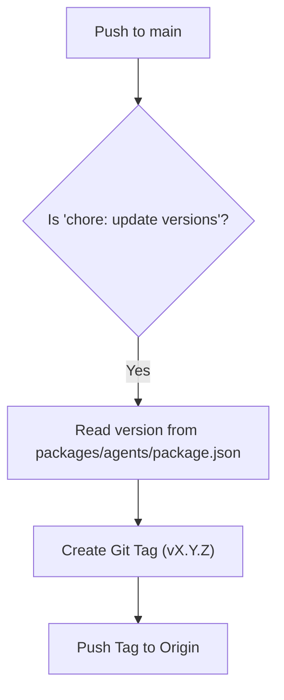

<!-- source: DeepWiki mcp.deepwiki.com · repo openai/openai-agents-js · page 6.4 Release and Versioning · fetched 2026-10-26 -->

# Release and Versioning

Relevant source files

The following files were used as context for generating this wiki page:

- [.agents/skills/changeset-validation/SKILL.md](.agents/skills/changeset-validation/SKILL.md)
- [.agents/skills/changeset-validation/references/validation-prompt.md](.agents/skills/changeset-validation/references/validation-prompt.md)
- [.agents/skills/changeset-validation/scripts/changeset-assign-milestone.mjs](.agents/skills/changeset-validation/scripts/changeset-assign-milestone.mjs)
- [.agents/skills/changeset-validation/scripts/changeset-prompt.mjs](.agents/skills/changeset-validation/scripts/changeset-prompt.mjs)
- [.agents/skills/changeset-validation/scripts/changeset-validation-result.mjs](.agents/skills/changeset-validation/scripts/changeset-validation-result.mjs)
- [.agents/skills/changeset-validation/scripts/run-fixtures.sh](.agents/skills/changeset-validation/scripts/run-fixtures.sh)
- [.agents/skills/code-change-verification/scripts/run.ps1](.agents/skills/code-change-verification/scripts/run.ps1)
- [.agents/skills/code-change-verification/scripts/run.sh](.agents/skills/code-change-verification/scripts/run.sh)
- [.agents/skills/docs-sync/SKILL.md](.agents/skills/docs-sync/SKILL.md)
- [.agents/skills/docs-sync/references/doc-coverage-checklist.md](.agents/skills/docs-sync/references/doc-coverage-checklist.md)
- [.agents/skills/final-release-review/SKILL.md](.agents/skills/final-release-review/SKILL.md)
- [.agents/skills/final-release-review/references/review-checklist.md](.agents/skills/final-release-review/references/review-checklist.md)
- [.github/dependabot.yml](.github/dependabot.yml)
- [.github/workflows/changeset.yml](.github/workflows/changeset.yml)
- [.github/workflows/docs.yml](.github/workflows/docs.yml)
- [.github/workflows/issues.yml](.github/workflows/issues.yml)
- [.github/workflows/release-tag.yml](.github/workflows/release-tag.yml)
- [.github/workflows/release.yml](.github/workflows/release.yml)
- [.github/workflows/test.yml](.github/workflows/test.yml)
- [package.json](package.json)
- [scripts/changeset-validation-lite.mjs](scripts/changeset-validation-lite.mjs)

This document explains the release management process for the OpenAI Agents JS SDK, including the Changesets workflow, version synchronization across packages, automated metadata generation, changelog management, and npm publishing procedures.

The SDK uses a monorepo structure where multiple packages are released in lockstep to ensure compatibility. The release process is managed via `@changesets/cli` and GitHub Actions.

## Versioning Strategy

The SDK follows a "fixed" versioning strategy where all core packages share the same version number. The monorepo identifies five primary packages for release management.

| Package Name | Description |
|--------------|-------------|
| `@openai/agents` | The main aggregator package |
| `@openai/agents-core` | Foundation classes and interfaces |
| `@openai/agents-openai` | OpenAI-specific implementations |
| `@openai/agents-realtime` | Real-time voice and session handling |
| `@openai/agents-extensions` | Third-party adapters and integrations |

Sources: [package.json:3-4](), [package.json:12-17](), [.agents/skills/changeset-validation/scripts/changeset-prompt.mjs:12-18]()

## Release Workflow

The release process follows a structured path from local development to automated publishing, triggered by the completion of CI checks on the `main` branch.

### 1. Creating Changesets
Developers must include a changeset file with any PR that modifies code in the `packages/` directory. 
- A changeset is a small Markdown file in the `.changeset/` directory.
- It specifies which packages are affected and whether the change is a `patch`, `minor`, or `major` bump.
- The `required_bump` is judged against the latest release tag [ .agents/skills/changeset-validation/references/validation-prompt.md:23-23 ]().

### 2. Changeset Validation
Every Pull Request is validated by an automated workflow [ .github/workflows/changeset.yml:1-9 ](). This workflow uses a specialized skill (`$changeset-validation`) to ensure:
- Every changed package is covered by at least one changeset [ .agents/skills/changeset-validation/references/validation-prompt.md:18-18 ]().
- Changeset summaries are descriptive (1-2 lines) [ .agents/skills/changeset-validation/references/validation-prompt.md:21-21 ]().
- The semver bump level matches the actual code changes [ .agents/skills/changeset-validation/references/validation-prompt.md:23-23 ]().
- A lightweight check is performed via `pnpm changeset:validate-lite` [ package.json:73-73 ](), which identifies relevant package directories by excluding release-managed files like `CHANGELOG.md` or `metadata.ts` [ scripts/changeset-validation-lite.mjs:105-111 ]().

### 3. Version Bumping and Metadata Generation
When changes are merged into `main`, the release workflow handles the version updates. The command `pnpm bump-version` [ package.json:77-77 ]() triggers:
1. `changeset version`: Consumes the changeset files and updates `package.json` versions and `CHANGELOG.md` files.
2. `prebuild`: Executes the `prebuild` script for all packages [ package.json:7-7 ](), which generates a `src/metadata.ts` file containing the new version string.

### 4. Publishing to npm
Publishing is handled by the `Changesets Release` GitHub Action [ .github/workflows/release.yml:1-64 ](). This job is triggered only after the `CI` workflow completes successfully [ .github/workflows/release.yml:4-7 ]().

Title: Release Pipeline Data Flow

Sources: [ .github/workflows/release.yml:1-64 ](), [ package.json:76-77 ](), [ .github/workflows/test.yml:1-140 ]()

## Automated Metadata Generation

To ensure that the SDK can report its own version (e.g., for User-Agent headers or telemetry), each package generates a `metadata.ts` file during the build process.

- **Trigger**: The `prebuild` script defined in the root `package.json` [ package.json:7-7 ]().
- **Data Flow**: The script reads the version from the local `package.json` and writes it to `src/metadata.ts`.
- **Validation**: The changeset validator ensures that `metadata.ts` changes are treated as "release-managed" and do not require additional changesets themselves [ .agents/skills/changeset-validation/scripts/changeset-prompt.mjs:187-187 ](), [ scripts/changeset-validation-lite.mjs:109-109 ]().

## Release Tagging

Once a version bump commit is pushed to `main` by the `github-actions[bot]`, a separate workflow creates the corresponding Git tag. The workflow identifies a version bump by checking if the commit message starts with `chore: update versions` and the author is the GitHub Actions bot [ .github/workflows/release-tag.yml:31-31 ]().

Title: Git Tag Creation Logic

Sources: [ .github/workflows/release-tag.yml:1-53 ]()

## Local Publishing for Testing

For local integration testing across runtimes (Node, Bun, Deno), the repository uses **Verdaccio**, a local npm registry. This allows testing the full `npm install` and execution flow without publishing to the public registry.

- **Start Registry**: `pnpm local-npm:start` [ package.json:81-81 ]().
- **Publish Locally**: `pnpm local-npm:publish` [ package.json:82-82 ](). This pushes the packages to `http://localhost:4873` using the `--registry` flag and `--force` to allow overwriting versions during development.
- **Reset Storage**: `pnpm local-npm:reset` [ package.json:80-80 ]().

Sources: [ package.json:80-82 ]()

## Documentation Release

Documentation is released independently of the npm packages but is often triggered by the same push to `main`.

- **Build and Deploy**: The `Deploy Docs to GitHub Pages` workflow [ .github/workflows/docs.yml:1-57 ]() runs `pnpm build:ci` followed by `pnpm docs:build` [ .github/workflows/docs.yml:34-36 ]().
- **Translation**: Documentation can be translated using the `docs:translate` script [ package.json:13-13 ]().
- **Verification**: Documentation scripts are type-checked using a dedicated `tsconfig.scripts.json` via the `docs:scripts:check` command [ package.json:15-15 ]().

Sources: [ .github/workflows/docs.yml:1-57 ](), [ package.json:12-15 ]()

---

