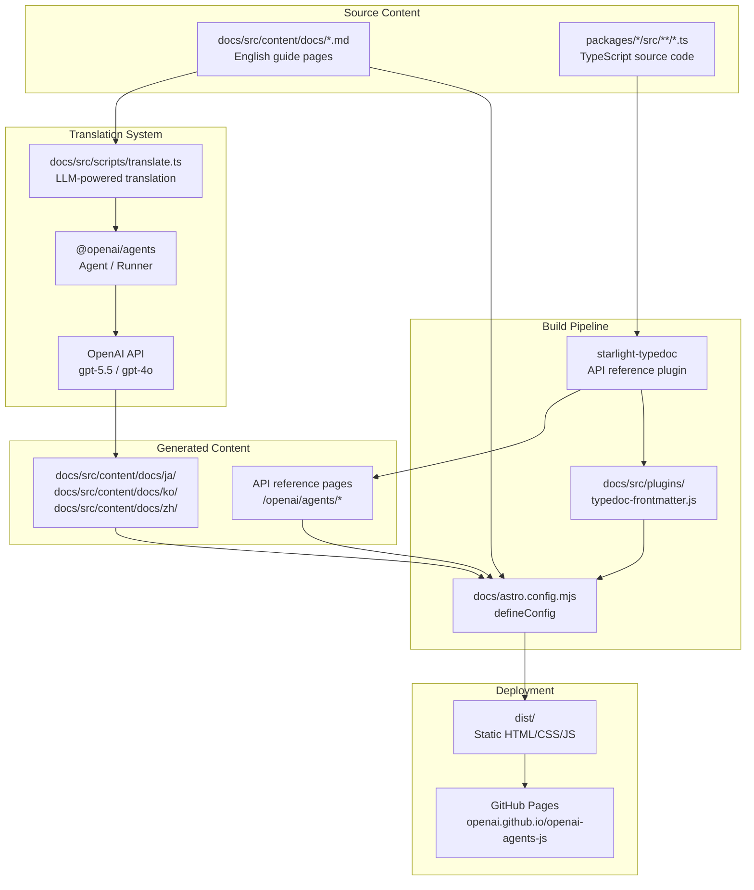
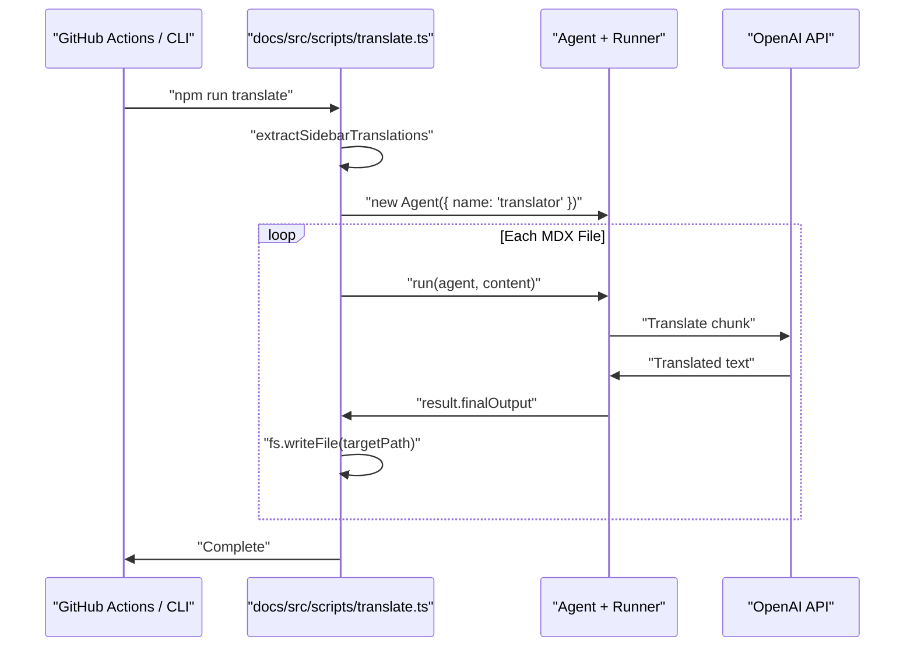

<!-- source: DeepWiki mcp.deepwiki.com · repo openai/openai-agents-js · page 7 Documentation System · fetched 2026-10-26 -->

# Documentation System

<details>
<summary>Relevant source files</summary>

The following files were used as context for generating this wiki page:

- [README.md](README.md)
- [docs/astro.config.mjs](docs/astro.config.mjs)
- [docs/package.json](docs/package.json)
- [docs/src/components/Hero.astro](docs/src/components/Hero.astro)
- [docs/src/content/docs/extensions/twilio.mdx](docs/src/content/docs/extensions/twilio.mdx)
- [docs/src/content/docs/guides/guardrails.mdx](docs/src/content/docs/guides/guardrails.mdx)
- [docs/src/content/docs/guides/human-in-the-loop.mdx](docs/src/content/docs/guides/human-in-the-loop.mdx)
- [docs/src/content/docs/guides/quickstart.mdx](docs/src/content/docs/guides/quickstart.mdx)
- [docs/src/content/docs/guides/tracing.mdx](docs/src/content/docs/guides/tracing.mdx)
- [docs/src/content/docs/guides/voice-agents.mdx](docs/src/content/docs/guides/voice-agents.mdx)
- [docs/src/content/docs/guides/voice-agents/quickstart.mdx](docs/src/content/docs/guides/voice-agents/quickstart.mdx)
- [docs/src/content/docs/index.mdx](docs/src/content/docs/index.mdx)
- [docs/src/styles/global.css](docs/src/styles/global.css)
- [examples/ai-sdk-ui/package.json](examples/ai-sdk-ui/package.json)
- [examples/ai-sdk-v1/package.json](examples/ai-sdk-v1/package.json)
- [examples/ai-sdk/package.json](examples/ai-sdk/package.json)
- [examples/nextjs/package.json](examples/nextjs/package.json)
- [examples/realtime-demo/package.json](examples/realtime-demo/package.json)
- [examples/realtime-next/package.json](examples/realtime-next/package.json)
- [examples/realtime-twilio-sip/package.json](examples/realtime-twilio-sip/package.json)
- [examples/realtime-twilio/package.json](examples/realtime-twilio/package.json)
- [packages/agents/README.md](packages/agents/README.md)
- [pnpm-lock.yaml](pnpm-lock.yaml)

</details>


The OpenAI Agents SDK documentation system is a self-hosting example of the SDK's capabilities. The system uses **Astro** with **Starlight** for static site generation, **TypeDoc** for API reference extraction, and the **Agents SDK itself** to power automated translations through an LLM-based translation agent. This creates a documentation pipeline that is both comprehensive and maintainable.

The documentation system consists of two major subsystems:
1.  **Documentation Architecture** ([Documentation Architecture](#7.1)): The Astro + Starlight setup, content organization, LLM-powered translation pipeline, and deployment workflows.
2.  **API Reference Generation** ([API Reference Generation](#7.2)): TypeDoc configuration, custom plugins, and automated API documentation extraction.

For information about the monorepo structure and development workflows, see [Development Guide](#6).

## System Overview

The documentation system architecture integrates several key technologies to provide a complete documentation solution:



**High-Level Documentation System Architecture**

Sources: [docs/astro.config.mjs:1-93](), [docs/package.json:11-11](), [docs/package.json:14-24]()

### Technology Stack

The documentation system combines several specialized tools to manage a multi-package monorepo:

| Component | Technology | Purpose |
|-----------|-----------|---------|
| Static Site Generator | `astro` | Modern build system with content collections [docs/package.json:19-19]() |
| Documentation Theme | `@astrojs/starlight` | Purpose-built docs theme with i18n support [docs/package.json:15-15]() |
| API Documentation | `typedoc` | Extract API docs from TypeScript [docs/package.json:23-23]() |
| TypeDoc Integration | `starlight-typedoc` | Bridge TypeDoc output to Starlight [docs/package.json:22-22]() |
| Markdown Processing | `typedoc-plugin-markdown` | Convert TypeDoc to Markdown [docs/package.json:24-24]() |
| Translation Engine | `@openai/agents` | SDK-powered LLM translation script [docs/package.json:17-17]() |
| LLM Context Support | `starlight-llms-txt` | Generates `.txt` files for LLM ingestion [docs/astro.config.mjs:77-92]() |

Sources: [docs/astro.config.mjs:2-7](), [docs/package.json:13-31]()

## Multi-Package API Documentation

The SDK consists of multiple packages, each with separate API documentation generated from TypeScript source code. The system creates independent TypeDoc instances for each package to maintain clear boundaries within the `docs/astro.config.mjs` file:

| Package | Entry Point | Output Path |
|---------|-------------|-------------|
| `@openai/agents` (Main) | `../packages/agents/src/index.ts` | `openai/agents` |
| `@openai/agents/realtime` | `../packages/agents/src/realtime/index.ts` | `openai/agents/realtime` |
| `@openai/agents-core` | `../packages/agents-core/src/index.ts` | `openai/agents-core` |
| `@openai/agents-openai` | `../packages/agents-openai/src/index.ts` | `openai/agents-openai` |
| `@openai/agents-realtime` | `../packages/agents-realtime/src/index.ts` | `openai/agents-realtime` |
| `@openai/agents-extensions` | `../packages/agents-extensions/src/index.ts` | `openai/agents-extensions` |

Sources: [docs/astro.config.mjs:34-76]()

## LLM-Powered Translation System

The documentation system includes a translation pipeline that uses the Agents SDK itself to translate documentation. This meta-application demonstrates the SDK's capabilities while maintaining documentation consistency.



**Translation Agent Workflow**

Sources: [docs/package.json:11-11](), [docs/astro.config.mjs:95-264]()

The translation script uses an `Agent` instance with specific instructions and language mappings to ensure technical accuracy. It targets `gpt-5.5` or `gpt-4o` models to process the `sidebar` configuration and markdown files.

### Supported Languages

The system currently supports three target languages defined in the `sidebar` configuration:

*   **Japanese (ja)**: `translations: { ja: '概要' }` [docs/astro.config.mjs:100-100]()
*   **Chinese (zh)**: `translations: { zh: '概述' }` [docs/astro.config.mjs:101-101]()
*   **Korean (ko)**: `translations: { ko: '개요' }` [docs/astro.config.mjs:102-102]()

Sources: [docs/astro.config.mjs:99-103]()

## Automated CI/CD Workflows

The documentation system is maintained through specialized workflows:

*   **Translation Script**: A standalone Node script executed via `tsx` that uses the SDK's `Agent` and `run` primitives to process markdown files [docs/package.json:11-11]().
*   **Sidebar Integration**: The `sidebar` array in `astro.config.mjs` contains explicit translation keys for navigation labels [docs/astro.config.mjs:95-104]().
*   **Content Generation**: TypeDoc plugins like `typedoc-plugin-zod` and `typedoc-plugin-frontmatter` are used to ensure that generated API docs contain the necessary metadata for Starlight [docs/astro.config.mjs:28-30]().

## LLM-Friendly Content (llms.txt)

The documentation system includes `starlight-llms-txt` to generate optimized content for LLMs and AI coding assistants. It defines custom sets for "Guides" and "API Reference" while excluding translated directories to keep the context window focused on the primary English documentation.

```javascript
starlightLlmsTxt({
  projectName: 'OpenAI Agents SDK (TypeScript)',
  customSets: [
    { label: 'Guides', paths: ['guides/**'] },
    { label: 'API Reference', paths: ['api/**'] },
  ],
  exclude: ['ja/**', 'zh/**', 'ko/**'],
})
```

Sources: [docs/astro.config.mjs:77-92]()

---

