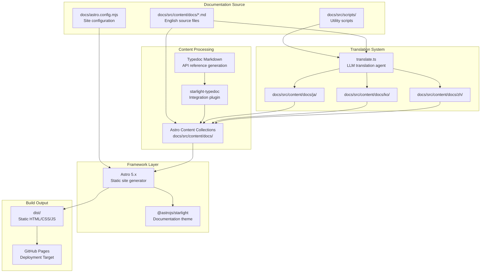
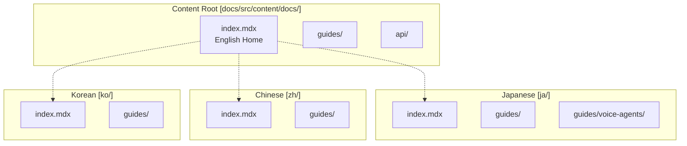
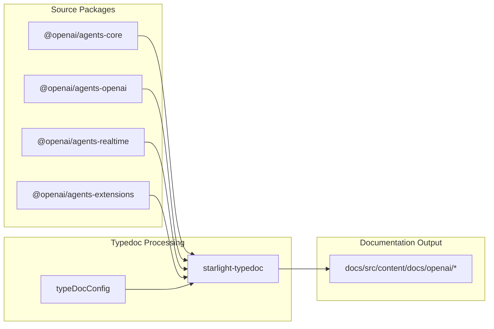

<!-- source: DeepWiki mcp.deepwiki.com · repo openai/openai-agents-js · page 7.1 Documentation Architecture · fetched 2026-10-26 -->

# Documentation Architecture

<details>
<summary>Relevant source files</summary>

The following files were used as context for generating this wiki page:

- [README.md](README.md)
- [docs/astro.config.mjs](docs/astro.config.mjs)
- [docs/src/components/Hero.astro](docs/src/components/Hero.astro)
- [docs/src/content/docs/extensions/twilio.mdx](docs/src/content/docs/extensions/twilio.mdx)
- [docs/src/content/docs/guides/guardrails.mdx](docs/src/content/docs/guides/guardrails.mdx)
- [docs/src/content/docs/guides/human-in-the-loop.mdx](docs/src/content/docs/guides/human-in-the-loop.mdx)
- [docs/src/content/docs/guides/quickstart.mdx](docs/src/content/docs/guides/quickstart.mdx)
- [docs/src/content/docs/guides/tracing.mdx](docs/src/content/docs/guides/tracing.mdx)
- [docs/src/content/docs/guides/voice-agents.mdx](docs/src/content/docs/guides/voice-agents.mdx)
- [docs/src/content/docs/guides/voice-agents/quickstart.mdx](docs/src/content/docs/guides/voice-agents/quickstart.mdx)
- [docs/src/content/docs/index.mdx](docs/src/content/docs/index.mdx)
- [docs/src/content/docs/ja/guides/guardrails.mdx](docs/src/content/docs/ja/guides/guardrails.mdx)
- [docs/src/content/docs/ja/guides/human-in-the-loop.mdx](docs/src/content/docs/ja/guides/human-in-the-loop.mdx)
- [docs/src/content/docs/ja/guides/mcp.mdx](docs/src/content/docs/ja/guides/mcp.mdx)
- [docs/src/content/docs/ja/guides/models.mdx](docs/src/content/docs/ja/guides/models.mdx)
- [docs/src/content/docs/ja/guides/tracing.mdx](docs/src/content/docs/ja/guides/tracing.mdx)
- [docs/src/content/docs/ja/guides/voice-agents/build.mdx](docs/src/content/docs/ja/guides/voice-agents/build.mdx)
- [docs/src/content/docs/ja/guides/voice-agents/transport.mdx](docs/src/content/docs/ja/guides/voice-agents/transport.mdx)
- [docs/src/content/docs/ko/guides/guardrails.mdx](docs/src/content/docs/ko/guides/guardrails.mdx)
- [docs/src/content/docs/ko/guides/human-in-the-loop.mdx](docs/src/content/docs/ko/guides/human-in-the-loop.mdx)
- [docs/src/content/docs/ko/guides/mcp.mdx](docs/src/content/docs/ko/guides/mcp.mdx)
- [docs/src/content/docs/ko/guides/models.mdx](docs/src/content/docs/ko/guides/models.mdx)
- [docs/src/content/docs/ko/guides/tracing.mdx](docs/src/content/docs/ko/guides/tracing.mdx)
- [docs/src/content/docs/ko/guides/voice-agents/build.mdx](docs/src/content/docs/ko/guides/voice-agents/build.mdx)
- [docs/src/content/docs/ko/guides/voice-agents/transport.mdx](docs/src/content/docs/ko/guides/voice-agents/transport.mdx)
- [docs/src/content/docs/zh/guides/human-in-the-loop.mdx](docs/src/content/docs/zh/guides/human-in-the-loop.mdx)
- [docs/src/content/docs/zh/guides/mcp.mdx](docs/src/content/docs/zh/guides/mcp.mdx)
- [docs/src/content/docs/zh/guides/models.mdx](docs/src/content/docs/zh/guides/models.mdx)
- [docs/src/content/docs/zh/guides/tracing.mdx](docs/src/content/docs/zh/guides/tracing.mdx)
- [docs/src/content/docs/zh/guides/voice-agents/build.mdx](docs/src/content/docs/zh/guides/voice-agents/build.mdx)
- [docs/src/content/docs/zh/guides/voice-agents/transport.mdx](docs/src/content/docs/zh/guides/voice-agents/transport.mdx)
- [docs/src/scripts/translate.ts](docs/src/scripts/translate.ts)
- [docs/src/styles/global.css](docs/src/styles/global.css)
- [packages/agents/README.md](packages/agents/README.md)

</details>


This document describes the technical architecture of the OpenAI Agents SDK documentation system, including the static site framework, content organization, automated translation pipeline, and deployment process.

## Documentation Stack Overview

The documentation site uses **Astro** with the **Starlight** theme as its foundation, combining static site generation with content authoring in Markdown. The system supports multiple languages through an LLM-powered translation pipeline that uses the Agents SDK itself to translate documentation.



**Sources:** [docs/astro.config.mjs:1-92](), [README.md:113-114]()

## Package Dependencies and Scripts

The documentation package is managed within the monorepo. Key scripts are exposed to facilitate documentation workflows, specifically for translation and building.

### Available Scripts

| Script | Command | Purpose |
|------------|---------|---------|
| `docs:dev` | `pnpm -F docs dev` | Start Astro development server |
| `docs:translate` | `pnpm -F docs translate` | Run the LLM translation pipeline |
| `docs:build` | `pnpm -F docs build` | Build the static production site |

**Sources:** [docs/src/scripts/translate.ts:11-13](), [docs/astro.config.mjs:2-6]()

## Content Organization Structure

Documentation follows Astro's content collections pattern. The root of the content directory contains the English source, while localized versions reside in language-coded subdirectories.



**Sources:** [docs/src/scripts/translate.ts:132-137](), [docs/astro.config.mjs:94-121](), [docs/src/content/docs/ja/guides/voice-agents/quickstart.mdx:1-15]()

## LLM-Powered Translation Pipeline

The documentation system uses the OpenAI Agents SDK to translate English content into Japanese, Korean, and Chinese. The `translate.ts` script uses an `Agent` and `Runner` to perform the translation task.

### Translation Script Implementation

The script initializes a translation agent using the SDK's core classes. It uses `setDefaultOpenAIKey` to configure the global client used by the translator agent. The default model for translation is `gpt-5.6-sol`.

```typescript
import { Agent, Runner, setDefaultOpenAIKey } from '@openai/agents';

const OPENAI_MODEL = process.env.OPENAI_MODEL || 'gpt-5.6-sol';
setDefaultOpenAIKey(process.env.OPENAI_API_KEY || '');

// Logic inside translate.ts involves creating a Runner and Agent
```

**Sources:** [docs/src/scripts/translate.ts:19-22](), [docs/src/scripts/translate.ts:138-139]()

### Code Block Preservation Strategy

To prevent the LLM from corrupting code samples or imports, the script implements a placeholder system. This is crucial for maintaining the integrity of examples like those found in `guides/voice-agents/quickstart.mdx`.

1.  **Exclusion**: Code snippets and imports are protected via `ENABLE_CODE_SNIPPET_EXCLUSION`.
2.  **Replacement**: Sensitive technical blocks are swapped with placeholders during the translation phase.
3.  **Restoration**: After the `Agent` returns the translated text, placeholders are replaced with the original code.

**Sources:** [docs/src/scripts/translate.ts:140](), [docs/src/content/docs/guides/voice-agents/quickstart.mdx:6-7]()

### Sidebar Synchronization

The function `extractSidebarTranslations` parses `docs/astro.config.mjs` to extract labels and existing translations. This ensures that internal links in translated documents use the correct localized labels defined in the site configuration.

**Sources:** [docs/src/scripts/translate.ts:27-128]()

## Sidebar Configuration

The sidebar is defined in `docs/astro.config.mjs` as a hierarchical array. Each item supports a `translations` object for localized labels.

| Key | Purpose |
|-----|---------|
| `label` | Default English label |
| `link` | Relative path to the document |
| `translations` | Map of `ja`, `zh`, `ko` labels |
| `items` | Nested items for categories |

**Sources:** [docs/astro.config.mjs:94-270]()

## API Reference Generation

The SDK uses `starlight-typedoc` to generate API documentation directly from TypeScript source files across the monorepo packages.

### TypeDoc Plugin Configuration

The configuration uses several plugins to enhance the output:
- `typedoc-plugin-zod`: Handles Zod schema documentation.
- `typedoc-plugin-frontmatter`: Manages Markdown frontmatter for Starlight compatibility.
- `./src/plugins/typedoc-frontmatter.js`: A custom local plugin for specialized frontmatter handling.



**Sources:** [docs/astro.config.mjs:8-31](), [docs/astro.config.mjs:52-75]()

## LLMS.txt Support

The documentation includes support for `llms.txt` via `starlight-llms-txt`. This generates a machine-readable summary of the documentation specifically for LLM consumption, excluding translated versions to keep the context concise.

**Sources:** [docs/astro.config.mjs:76-91]()

---

