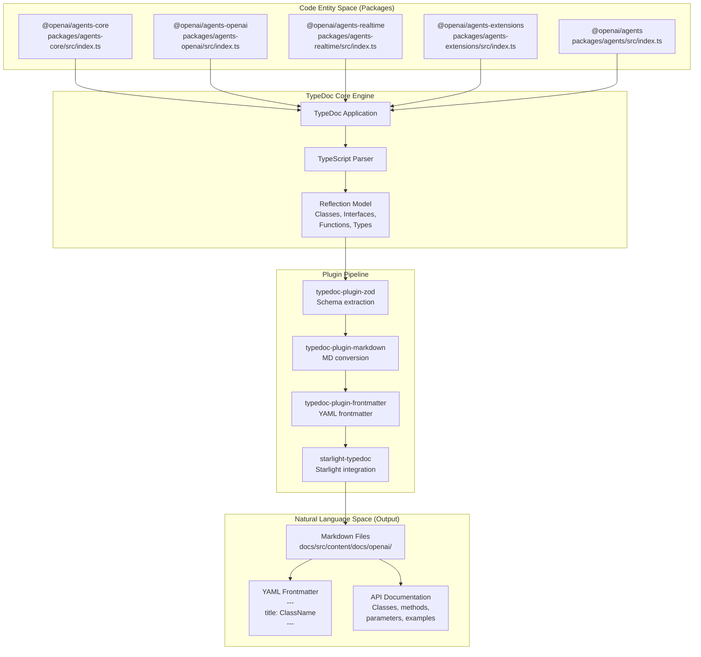
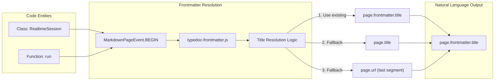

<!-- source: DeepWiki mcp.deepwiki.com · repo openai/openai-agents-js · page 7.2 API Reference Generation · fetched 2026-10-26 -->

# API Reference Generation

<details>
<summary>Relevant source files</summary>

The following files were used as context for generating this wiki page:

- [README.md](README.md)
- [docs/astro.config.mjs](docs/astro.config.mjs)
- [docs/package.json](docs/package.json)
- [docs/src/components/Hero.astro](docs/src/components/Hero.astro)
- [docs/src/content/docs/extensions/twilio.mdx](docs/src/content/docs/extensions/twilio.mdx)
- [docs/src/content/docs/guides/guardrails.mdx](docs/src/content/docs/guides/guardrails.mdx)
- [docs/src/content/docs/guides/human-in-the-loop.mdx](docs/src/content/docs/guides/human-in-the-loop.mdx)
- [docs/src/content/docs/guides/quickstart.mdx](docs/src/content/docs/guides/quickstart.mdx)
- [docs/src/content/docs/guides/tracing.mdx](docs/src/content/docs/guides/tracing.mdx)
- [docs/src/content/docs/guides/voice-agents.mdx](docs/src/content/docs/guides/voice-agents.mdx)
- [docs/src/content/docs/guides/voice-agents/quickstart.mdx](docs/src/content/docs/guides/voice-agents/quickstart.mdx)
- [docs/src/content/docs/index.mdx](docs/src/content/docs/index.mdx)
- [docs/src/styles/global.css](docs/src/styles/global.css)
- [examples/ai-sdk-ui/package.json](examples/ai-sdk-ui/package.json)
- [examples/ai-sdk-v1/package.json](examples/ai-sdk-v1/package.json)
- [examples/ai-sdk/package.json](examples/ai-sdk/package.json)
- [examples/nextjs/package.json](examples/nextjs/package.json)
- [examples/realtime-demo/package.json](examples/realtime-demo/package.json)
- [examples/realtime-next/package.json](examples/realtime-next/package.json)
- [examples/realtime-twilio-sip/package.json](examples/realtime-twilio-sip/package.json)
- [examples/realtime-twilio/package.json](examples/realtime-twilio/package.json)
- [packages/agents/README.md](packages/agents/README.md)
- [pnpm-lock.yaml](pnpm-lock.yaml)

</details>


This document describes the automated API reference generation system used in the OpenAI Agents SDK documentation. The system transforms TypeScript source code from the packages into browsable, searchable API documentation pages using TypeDoc and integrates them into the Starlight documentation site.

## Overview

The API reference generation pipeline processes TypeScript source files from all published packages and generates Markdown documentation pages that are integrated into the Starlight documentation site. The system uses TypeDoc as the core documentation generator, enhanced with several plugins for Markdown output, frontmatter handling, and Zod schema documentation.

**Key Components:**

| Component | Version | Purpose |
|-----------|---------|---------|
| `typedoc` | ^0.28.19 | Core TypeScript documentation generator |
| `typedoc-plugin-markdown` | ^4.12.0 | Converts TypeDoc output to Markdown |
| `starlight-typedoc` | ^0.21.5 | Integrates TypeDoc with Astro/Starlight |
| `typedoc-plugin-frontmatter` | ^1.3.1 | Adds YAML frontmatter to generated pages |
| `typedoc-plugin-zod` | ^1.4.3 | Documents Zod schemas |

Sources: [docs/package.json:23-30](), [pnpm-lock.yaml:104-125]()

## TypeDoc to Starlight Pipeline

The following diagram illustrates how source code entities from the monorepo packages are transformed into the final documentation site.

### Natural Language Space to Code Entity Space: Documentation Flow



Sources: [docs/astro.config.mjs:34-76](), [docs/package.json:13-25]()

## Plugin Architecture

### typedoc-plugin-markdown
The `typedoc-plugin-markdown` plugin converts TypeDoc's internal representation to Markdown format instead of HTML. It handles the transformation of TypeScript constructs (classes, interfaces, functions, types) into readable Markdown documentation.

Sources: [docs/package.json:24](), [pnpm-lock.yaml:110-112]()

### typedoc-plugin-frontmatter & Custom Plugin
The system uses both the standard `typedoc-plugin-frontmatter` and a local custom plugin located at `./src/plugins/typedoc-frontmatter.js`. The custom plugin ensures every generated API page includes proper YAML frontmatter for Starlight compatibility.

### Title Resolution Logic



Sources: [docs/astro.config.mjs:29-30]()

### typedoc-plugin-zod
The `typedoc-plugin-zod` plugin documents Zod schemas used throughout the SDK. This is critical for the `Agent` and `Tool` definitions which rely heavily on Zod for schema validation.

Sources: [docs/package.json:30](), [pnpm-lock.yaml:123-125]()

## TypeDoc Configuration

The TypeDoc configuration is defined within `docs/astro.config.mjs` and applied to multiple documentation targets.

**Common Configuration:**
```javascript
const typeDocConfig = {
  useCodeBlocks: true,
  parametersFormat: 'htmlTable',
  propertyMembersFormat: 'htmlTable',
  disableSources: true,
  plugin: [
    'typedoc-plugin-zod',
    'typedoc-plugin-frontmatter',
    './src/plugins/typedoc-frontmatter.js',
  ],
};
```
Sources: [docs/astro.config.mjs:22-32]()

### Entry Points and Output Targets

| Label | Entry Point | Output Path | tsconfig |
|-------|-------------|-------------|----------|
| Main API | `../packages/agents/src/index.ts` | `openai/agents` | `../packages/agents/tsconfig.json` |
| @openai/agents/realtime | `../packages/agents/src/realtime/index.ts` | `openai/agents/realtime` | `../packages/agents/tsconfig.json` |
| Core | `../packages/agents-core/src/index.ts` | `openai/agents-core` | `../packages/agents-core/tsconfig.json` |
| OpenAI | `../packages/agents-openai/src/index.ts` | `openai/agents-openai` | `../packages/agents-openai/tsconfig.json` |
| Realtime | `../packages/agents-realtime/src/index.ts` | `openai/agents-realtime` | `../packages/agents-realtime/tsconfig.json` |
| Extensions | `../packages/agents-extensions/src/index.ts` | `openai/agents-extensions` | `../packages/agents-extensions/tsconfig.json` |

Sources: [docs/astro.config.mjs:34-76]()

## Build Process

### Starlight Integration
The documentation is built using Astro and Starlight. The `starlight-typedoc` integration is initialized via `createStarlightTypeDocPlugin()`. Each package is processed as a separate plugin instance to maintain logical separation in the sidebar.

Sources: [docs/astro.config.mjs:5-20]()

### Local Build Commands
The `docs` package provides scripts for development and building:
- `npm run dev`: Runs `astro dev` for local preview with HMR.
- `npm run build`: Runs `astro build` which triggers the TypeDoc generation pipeline.
- `npm run translate`: Runs the `translate.ts` script using `tsx` to handle documentation translation via LLM agents.

Sources: [docs/package.json:5-11]()

### LLM-txt Generation
The system also generates an `llms.txt` file via `starlight-llms-txt` to provide a machine-readable version of the API reference for LLM consumption. It specifically targets paths in `api/**` and `guides/**` while excluding specific language subdirectories.

Sources: [docs/astro.config.mjs:77-92]()

## Dependency Management
The system relies on `pnpm` workspaces. The `docs` package depends on `@openai/agents` via the `workspace:*` protocol, ensuring the documentation is always built against the latest local code.

Sources: [docs/package.json:17](), [pnpm-lock.yaml:89-91]()

---

