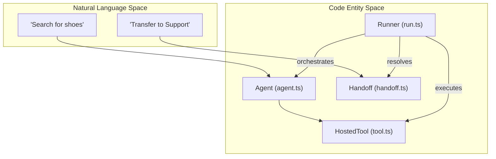
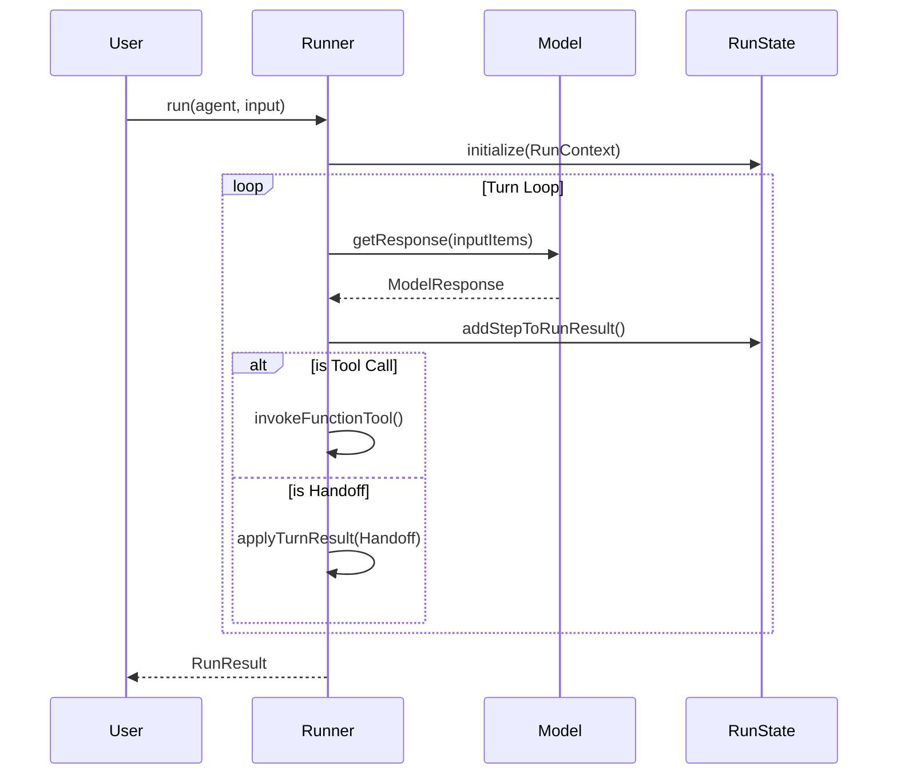

<!-- source: DeepWiki mcp.deepwiki.com · repo openai/openai-agents-js · page 8 Glossary · fetched 2026-10-26 -->

# Glossary

Relevant source files

The following files were used as context for generating this wiki page:

- [.changeset/quiet-expected-test-logs.md](.changeset/quiet-expected-test-logs.md)
- [.changeset/realtime-text-output-guardrails.md](.changeset/realtime-text-output-guardrails.md)
- [examples/docs/tracing/run-with-tracing-api-key.ts](examples/docs/tracing/run-with-tracing-api-key.ts)
- [packages/agents-core/CHANGELOG.md](packages/agents-core/CHANGELOG.md)
- [packages/agents-core/package.json](packages/agents-core/package.json)
- [packages/agents-core/src/index.ts](packages/agents-core/src/index.ts)
- [packages/agents-core/src/mcp.ts](packages/agents-core/src/mcp.ts)
- [packages/agents-core/src/mcpLogging.ts](packages/agents-core/src/mcpLogging.ts)
- [packages/agents-core/src/mcpServers.ts](packages/agents-core/src/mcpServers.ts)
- [packages/agents-core/src/mcpUtil.ts](packages/agents-core/src/mcpUtil.ts)
- [packages/agents-core/src/run.ts](packages/agents-core/src/run.ts)
- [packages/agents-core/src/runState.ts](packages/agents-core/src/runState.ts)
- [packages/agents-core/src/runner/runLoop.ts](packages/agents-core/src/runner/runLoop.ts)
- [packages/agents-core/src/runner/toolExecution.ts](packages/agents-core/src/runner/toolExecution.ts)
- [packages/agents-core/src/runner/turnResolution.ts](packages/agents-core/src/runner/turnResolution.ts)
- [packages/agents-core/src/sandbox/client.ts](packages/agents-core/src/sandbox/client.ts)
- [packages/agents-core/src/sandbox/internal/sessionStateTrust.ts](packages/agents-core/src/sandbox/internal/sessionStateTrust.ts)
- [packages/agents-core/src/sandbox/runtime/livePreservedSessions.ts](packages/agents-core/src/sandbox/runtime/livePreservedSessions.ts)
- [packages/agents-core/src/sandbox/runtime/manager.ts](packages/agents-core/src/sandbox/runtime/manager.ts)
- [packages/agents-core/src/sandbox/runtime/sessionSerialization.ts](packages/agents-core/src/sandbox/runtime/sessionSerialization.ts)
- [packages/agents-core/src/sandbox/runtime/sessionState.ts](packages/agents-core/src/sandbox/runtime/sessionState.ts)
- [packages/agents-core/src/sandbox/sandboxes/docker.ts](packages/agents-core/src/sandbox/sandboxes/docker.ts)
- [packages/agents-core/src/sandbox/sandboxes/shared/manifestPersistence.ts](packages/agents-core/src/sandbox/sandboxes/shared/manifestPersistence.ts)
- [packages/agents-core/src/sandbox/sandboxes/unixLocal.ts](packages/agents-core/src/sandbox/sandboxes/unixLocal.ts)
- [packages/agents-core/src/shims/mcp-server/browser.ts](packages/agents-core/src/shims/mcp-server/browser.ts)
- [packages/agents-core/src/shims/mcp-server/node.ts](packages/agents-core/src/shims/mcp-server/node.ts)
- [packages/agents-core/src/tracing/config.ts](packages/agents-core/src/tracing/config.ts)
- [packages/agents-core/src/tracing/context.ts](packages/agents-core/src/tracing/context.ts)
- [packages/agents-core/src/tracing/createSpans.ts](packages/agents-core/src/tracing/createSpans.ts)
- [packages/agents-core/src/tracing/index.ts](packages/agents-core/src/tracing/index.ts)
- [packages/agents-core/src/tracing/processor.ts](packages/agents-core/src/tracing/processor.ts)
- [packages/agents-core/src/tracing/provider.ts](packages/agents-core/src/tracing/provider.ts)
- [packages/agents-core/src/tracing/spans.ts](packages/agents-core/src/tracing/spans.ts)
- [packages/agents-core/src/tracing/traces.ts](packages/agents-core/src/tracing/traces.ts)
- [packages/agents-core/src/tracing/utils.ts](packages/agents-core/src/tracing/utils.ts)
- [packages/agents-core/test/mcpCache.test.ts](packages/agents-core/test/mcpCache.test.ts)
- [packages/agents-core/test/mcpLogging.test.ts](packages/agents-core/test/mcpLogging.test.ts)
- [packages/agents-core/test/mcpServers.test.ts](packages/agents-core/test/mcpServers.test.ts)
- [packages/agents-core/test/mcpToFunctionTool.test.ts](packages/agents-core/test/mcpToFunctionTool.test.ts)
- [packages/agents-core/test/mcpToolFilter.integration.test.ts](packages/agents-core/test/mcpToolFilter.integration.test.ts)
- [packages/agents-core/test/run.stream.test.ts](packages/agents-core/test/run.stream.test.ts)
- [packages/agents-core/test/run.test.ts](packages/agents-core/test/run.test.ts)
- [packages/agents-core/test/runState.test.ts](packages/agents-core/test/runState.test.ts)
- [packages/agents-core/test/runner/toolExecution.test.ts](packages/agents-core/test/runner/toolExecution.test.ts)
- [packages/agents-core/test/sandboxes/docker.test.ts](packages/agents-core/test/sandboxes/docker.test.ts)
- [packages/agents-core/test/sandboxes/dockerUnit.test.ts](packages/agents-core/test/sandboxes/dockerUnit.test.ts)
- [packages/agents-core/test/sandboxes/unixLocal.test.ts](packages/agents-core/test/sandboxes/unixLocal.test.ts)
- [packages/agents-core/test/shims/mcp-server/browser.test.ts](packages/agents-core/test/shims/mcp-server/browser.test.ts)
- [packages/agents-core/test/shims/mcp-server/node.test.ts](packages/agents-core/test/shims/mcp-server/node.test.ts)
- [packages/agents-core/test/taskTurnTracing.test.ts](packages/agents-core/test/taskTurnTracing.test.ts)
- [packages/agents-core/test/toolCustomData.test.ts](packages/agents-core/test/toolCustomData.test.ts)
- [packages/agents-core/test/tracing.test.ts](packages/agents-core/test/tracing.test.ts)
- [packages/agents-extensions/CHANGELOG.md](packages/agents-extensions/CHANGELOG.md)
- [packages/agents-extensions/package.json](packages/agents-extensions/package.json)
- [packages/agents-extensions/src/metadata.ts](packages/agents-extensions/src/metadata.ts)
- [packages/agents-openai/CHANGELOG.md](packages/agents-openai/CHANGELOG.md)
- [packages/agents-openai/package.json](packages/agents-openai/package.json)
- [packages/agents-openai/src/openaiTracingExporter.ts](packages/agents-openai/src/openaiTracingExporter.ts)
- [packages/agents-openai/test/openaiTracingExporter.test.ts](packages/agents-openai/test/openaiTracingExporter.test.ts)
- [packages/agents-realtime/CHANGELOG.md](packages/agents-realtime/CHANGELOG.md)
- [packages/agents-realtime/package.json](packages/agents-realtime/package.json)
- [packages/agents-realtime/src/clientMessages.ts](packages/agents-realtime/src/clientMessages.ts)
- [packages/agents-realtime/src/index.ts](packages/agents-realtime/src/index.ts)
- [packages/agents-realtime/src/openaiRealtimeBase.ts](packages/agents-realtime/src/openaiRealtimeBase.ts)
- [packages/agents-realtime/src/realtimeSession.ts](packages/agents-realtime/src/realtimeSession.ts)
- [packages/agents-realtime/src/transportLayerEvents.ts](packages/agents-realtime/src/transportLayerEvents.ts)
- [packages/agents-realtime/src/utils.ts](packages/agents-realtime/src/utils.ts)
- [packages/agents-realtime/test/openaiRealtimeBase.test.ts](packages/agents-realtime/test/openaiRealtimeBase.test.ts)
- [packages/agents-realtime/test/realtimeSession.test.ts](packages/agents-realtime/test/realtimeSession.test.ts)
- [packages/agents-realtime/test/realtimeVoiceConfigRegression.test.ts](packages/agents-realtime/test/realtimeVoiceConfigRegression.test.ts)
- [packages/agents-realtime/test/utils.test.ts](packages/agents-realtime/test/utils.test.ts)
- [packages/agents/CHANGELOG.md](packages/agents/CHANGELOG.md)
- [packages/agents/package.json](packages/agents/package.json)

This glossary defines technical terms, jargon, abbreviations, and domain concepts used within the OpenAI Agents SDK. Each term is mapped to its primary implementation in the codebase.

## Core Execution Concepts

### Agent
The fundamental unit of logic and identity. An `Agent` encapsulates instructions, a specific model, a set of tools, and handoff configurations.
*   **Implementation:** `Agent` class in `[packages/agents-core/src/agent.ts:15-16]()`.
*   **Data Flow:** Agents are passed to the `run()` function or `Runner` class to initiate a turn-based execution loop `[packages/agents-core/src/run.ts:212-218]()`.

### Runner
The orchestration engine responsible for the agent execution loop. It manages model calls, tool execution, and state transitions.
*   **Implementation:** `Runner` class in `[packages/agents-core/src/run.ts:114-118]()`.
*   **Logic:** Orchestrates turns via `prepareTurn` `[packages/agents-core/src/runner/turnPreparation.ts:1-10]()` and `resolveTurnAfterModelResponse` `[packages/agents-core/src/runner/turnResolution.ts:1-10]()`.

### RunState
A serializable snapshot of the current state of an agent run. It includes conversation history, the active agent, and schema versioning for persistence.
*   **Implementation:** `RunState` class in `[packages/agents-core/src/runState.ts:69-72]()`.
*   **Version History:** Currently at version `1.12` to support features like sandbox persistence and stable agent identity `[packages/agents-core/src/runState.ts:94-109]()`.

### RunContext
A shared object passed through the execution lifecycle (tools, guardrails, hooks) containing metadata and the current execution state.
*   **Implementation:** `RunContext` class in `[packages/agents-core/src/runContext.ts:15-17]()`.

### Handoff
The mechanism by which one agent transfers control to another.
*   **Implementation:** `Handoff` class in `[packages/agents-core/src/handoff.ts:82-84]()`.
*   **Usage:** Created using the `handoff()` helper `[packages/agents-core/src/handoff.ts:16-18]()`.

### RunResult & StreamedRunResult
The final or incremental output of an agent execution.
*   **Implementation:** `RunResult` and `StreamedRunResult` in `[packages/agents-core/src/result.ts:1-20]()`.
*   **Flow:** The `Runner` streams items to the result via `streamStepItemsToRunResult` `[packages/agents-core/src/runner/streaming.ts:64-67]()`.

---

## Tools & Integrations

### Tool
An abstraction for capabilities provided to an agent.
1.  **FunctionTool:** Local JS functions wrapped for LLM consumption `[packages/agents-core/src/tool.ts:211-213]()`.
2.  **HostedTool:** OpenAI-managed tools (e.g., `web_search`, `code_interpreter`, `programmatic_tool_calling`) `[packages/agents-core/src/tool.ts:201-203]()`.
3.  **MCP Tool:** Tools provided via the Model Context Protocol `[packages/agents-core/src/tool.ts:209-210]()`.
4.  **toolSearchTool:** A specialized tool used by OpenAI `Responses` models to discover other tools `[packages/agents-core/src/runState.ts:54-57]()`.

### MCP (Model Context Protocol)
A protocol for agents to access external tools and resources.
*   **MCPServer:** Interface for connecting to MCP servers via `stdio`, `HTTP`, or `SSE` `[packages/agents-core/src/mcp.ts:117-122]()`.
*   **getAllMcpTools:** Utility to aggregate tools from multiple MCP servers `[packages/agents-core/src/mcp.ts:106-107]()`.
*   **Deferred Loading:** MCP tools can be initialized lazily to improve startup performance.

### HITL (Human-in-the-Loop)
A workflow pattern where execution pauses for manual approval.
*   **Implementation:** Triggered by `needsApproval: true` in `ToolOptions` `[packages/agents-core/src/tool.ts:247-249]()`.
*   **Item:** Represented by `RunToolApprovalItem` `[packages/agents-core/src/items.ts:96-98]()`.

---

## Real-time & Voice

### RealtimeSession
The primary interface for low-latency voice and text interactions.
*   **Implementation:** `RealtimeSession` class in `[packages/agents-realtime/src/realtimeSession.ts:217-219]()`.

### TransportLayer
An abstraction for the communication protocol used by Realtime agents.
*   **WebRTC:** `OpenAIRealtimeWebRTC` `[packages/agents-realtime/src/openaiRealtimeWebRtc.ts:1-10]()`.
*   **WebSocket:** `OpenAIRealtimeWebSocket` `[packages/agents-realtime/src/openaiRealtimeWebsocket.ts:1-10]()`.

### VAD (Voice Activity Detection)
The system detecting speech boundaries. Configured via `turn_detection` in `RealtimeSessionConfig` `[packages/agents-realtime/src/realtimeSession.ts:37-39]()`.

### SDP (Session Description Protocol)
Used in WebRTC transport to negotiate media capabilities between the client and the OpenAI Realtime API `[packages/agents-realtime/CHANGELOG.md:80-82]()`.

### ResponseCreateSequencer
Ensures `response.create` events are sent in order during Realtime sessions, particularly after interruptions or state changes.

---

## Safety & Observability

### Guardrail & Tripwire
Validation layers for safety.
*   **Guardrail:** Logic that inspects inputs/outputs `[packages/agents-core/src/guardrail.ts:1-10]()`.
*   **Tripwire:** A guardrail that throws a `GuardrailTripwireTriggered` error to halt execution `[packages/agents-core/src/errors.ts:28-32]()`.

### Tracing (Span & Trace)
*   **Trace:** A complete execution workflow `[packages/agents-core/src/tracing/traces.ts:46-48]()`.
*   **Span:** A single unit of work (e.g., `Agent`, `Generation`, `Function`, `Guardrail`, `Handoff`) `[packages/agents-core/src/tracing/spans.ts:28-30]()`.
*   **TracingProcessor:** Handles the export of traces (e.g., `BatchTraceProcessor`) `[packages/agents-core/src/tracing/processor.ts:116-121]()`.

---

## Sandbox Agents (Beta)

### SandboxAgent & Manifest
*   **SandboxAgent:** An agent running in an isolated environment `[packages/agents-core/src/run.ts:94-97]()`.
*   **Manifest:** A declarative config defining the sandbox environment (files, environment, root) `[packages/agents-core/src/sandbox/manifest.ts:1-10]()`.
*   **Capability:** Permissions granted to the sandbox (e.g., `filesystem`, `shell`) `[packages/agents-core/src/runState.ts:63-67]()`.
*   **Snapshot:** A point-in-time state of a sandbox that can be used for restoration or reuse `[packages/agents-core/CHANGELOG.md:18-19]()`.

---

## Infrastructure & Tooling

*   **workspace:\*:** Pnpm protocol for local package dependencies within the monorepo `[packages/agents-core/package.json:118-121]()`.
*   **Changeset:** Tool for managing monorepo versions and changelogs `[packages/agents/CHANGELOG.md:1-5]()`.
*   **Verdaccio:** Local npm registry used for integration testing across runtimes (Node, Bun, Deno, etc.).
*   **tsc-multi:** Build utility for generating ESM/CJS outputs `[packages/agents-core/package.json:16-20]()`.
*   **Shims:** Platform-specific polyfills (Node, Browser, Workers) to ensure cross-platform compatibility `[packages/agents-core/package.json:67-86]()`.
*   **Compaction:** Process of pruning or summarizing history to fit context windows, managed via sessions like `OpenAIResponsesCompactionSession` `[packages/agents-core/src/run.ts:70-77]()`.

---

## Architecture Diagrams

### Code Entity Mapping
Title: Natural Language to Code Entity Mapping

Sources: `[packages/agents-core/src/agent.ts:15-16]()`, `[packages/agents-core/src/tool.ts:201-203]()`, `[packages/agents-core/src/handoff.ts:82-84]()`, `[packages/agents-core/src/run.ts:114-118]()`

### Execution Data Flow
Title: Agent Execution Loop (Runner)

Sources: `[packages/agents-core/src/run.ts:178-220]()`, `[packages/agents-core/src/runState.ts:69-72]()`, `[packages/agents-core/src/runner/streaming.ts:64-67]()`, `[packages/agents-core/src/runner/runLoop.ts:79-82]()`