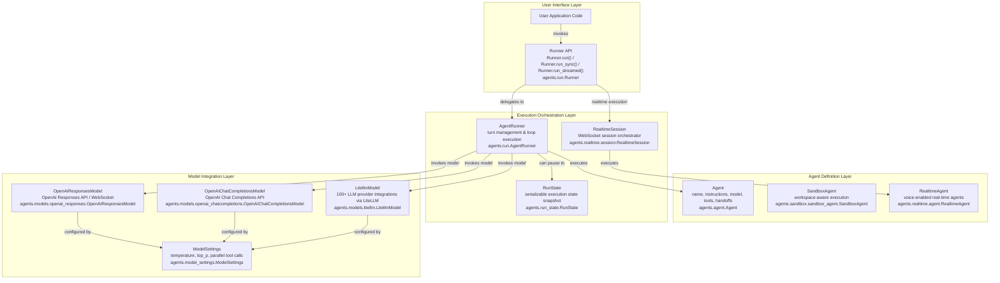
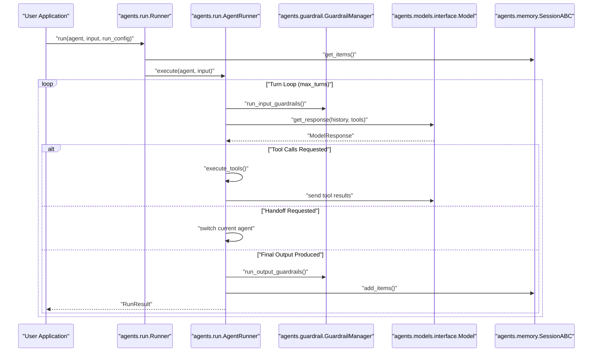

<!-- source: DeepWiki mcp.deepwiki.com · repo openai/openai-agents-python · page 1 Overview · fetched 2026-10-26 -->

# Overview

<details>
<summary>Relevant source files</summary>

The following files were used as context for generating this wiki page:

- [.release-please-manifest.json](.release-please-manifest.json)
- [.vscode/settings.json](.vscode/settings.json)
- [CHANGELOG.md](CHANGELOG.md)
- [README.md](README.md)
- [docs/config.md](docs/config.md)
- [docs/examples.md](docs/examples.md)
- [docs/guardrails.md](docs/guardrails.md)
- [docs/human_in_the_loop.md](docs/human_in_the_loop.md)
- [docs/index.md](docs/index.md)
- [docs/mcp.md](docs/mcp.md)
- [docs/models/index.md](docs/models/index.md)
- [docs/realtime/guide.md](docs/realtime/guide.md)
- [docs/realtime/quickstart.md](docs/realtime/quickstart.md)
- [docs/ref/sandbox/util/blocking_io.md](docs/ref/sandbox/util/blocking_io.md)
- [docs/release.md](docs/release.md)
- [docs/results.md](docs/results.md)
- [docs/running_agents.md](docs/running_agents.md)
- [docs/sessions/index.md](docs/sessions/index.md)
- [docs/streaming.md](docs/streaming.md)
- [docs/tools.md](docs/tools.md)
- [docs/tracing.md](docs/tracing.md)
- [mkdocs.yml](mkdocs.yml)
- [pyproject.toml](pyproject.toml)
- [src/agents/version.py](src/agents/version.py)
- [tests/fixtures/released_api_contract.json](tests/fixtures/released_api_contract.json)
- [uv.lock](uv.lock)

</details>


## Purpose and Scope

The OpenAI Agents SDK (`openai-agents`) is a lightweight, provider-agnostic Python framework designed for building stateful multi-agent workflows with large language models [README.md:1-4](). The scope of this page is to introduce the SDK's core purpose, its high-level architectural layers, execution mechanics, tool systems, multi-agent coordination primitives, session management, and persistence models.

Sources: [README.md:1-4]()

## High-Level Architecture

The SDK is structured into clean modular layers, separating user-facing execution APIs from agent definitions, model adapters, tool integrations, state persistence, and observability telemetry.

### Architectural Layering and Code Entities



Sources: [README.md:10-21](), [docs/running_agents.md:3-8](), [docs/models/index.md:3-7]()

## Agent Execution Model

The execution flow is managed by the `AgentRunner` orchestrator class, which executes a turn-based loop combining input guardrails, model invocations, tool execution, and agent handoffs [docs/running_agents.md:24-43]().

### Turn Loop Execution and Code Entities



Sources: [docs/running_agents.md:24-43](), [docs/guardrails.md:32-38](), [docs/sessions/index.md:54-58]()

## Tool System Overview

The SDK provides a unified abstraction over five primary categories of tools [docs/tools.md:3-9]():
- **Function Tools**: Python functions wrapped via the `@function_tool` decorator with automated Pydantic schema inference [docs/tools.md:7]().
- **Hosted Tools**: OpenAI-managed capabilities such as `WebSearchTool`, `FileSearchTool`, `CodeInterpreterTool`, `ImageGenerationTool`, and `HostedMCPTool` [docs/tools.md:27-34]().
- **Local Runtime Tools**: Tools executing directly in the local environment (`ComputerTool`, `ShellTool`, `ApplyPatchTool`) [docs/tools.md:6]().
- **Model Context Protocol (MCP)**: Integration with local and remote MCP servers via `MCPServer` implementations [docs/mcp.md:10-25]().
- **Agents as Tools**: Exposing an agent as a callable tool via `Agent.as_tool()` [docs/tools.md:8]().

Sources: [docs/tools.md:3-9](), [docs/mcp.md:10-25]()

## Multi-Agent Coordination

Multi-agent workflows are supported through two core design patterns [docs/agents.md:16-19]():
1. **Handoffs**: Peer-to-peer conversation transfer using the `handoff()` function, where control switches entirely to the target agent [docs/handoffs.md:1]() (linked via `Agent.handoffs`).
2. **Manager Pattern**: Hierarchical delegation where a manager agent retains control by calling specialist sub-agents exposed as tools via `Agent.as_tool()` [docs/tools.md:8]().

Sources: [docs/tools.md:8](), [README.md:16]()

## Realtime and Voice Agents

For low-latency multimodal and voice experiences, the SDK provides `RealtimeAgent`, `RealtimeRunner`, and `RealtimeSession`, connecting over WebSockets to support incremental audio processing, tool execution, and interruption handling [docs/realtime/guide.md:9-18](). Additionally, `VoicePipeline` combines speech-to-text, an agent workflow, and text-to-speech [README.md:15]().

Sources: [README.md:14-15](), [docs/realtime/guide.md:9-18]()

## State and Persistence

State management is split across three layers:
- **In-Memory Run State**: Managed during active execution by `AgentRunner` [docs/running_agents.md:24-43]().
- **Serializable Snapshots**: `RunState` captures checkpoints for human-in-the-loop approvals and resume workflows [docs/running_agents.md:32-33]().
- **Persistent Sessions**: Conforming to the `SessionABC` protocol, implementations such as `SQLiteSession`, `RedisSession`, `SQLAlchemySession`, and `MongoDBSession` store conversation history across turns [docs/sessions/index.md:1-8](), [pyproject.toml:51-61]().

Sources: [docs/running_agents.md:32-33](), [docs/sessions/index.md:1-8](), [pyproject.toml:51-61]()

## Installation

Install the core SDK package via pip [README.md:27-35]():

```bash
pip install openai-agents
```

Optional dependency groups are available for specific backends and extensions (e.g., `voice`, `redis`, `sqlalchemy`, `mongodb`, `docker`, `realtime`, `viz`) [pyproject.toml:42-63]().

Sources: [README.md:27-35](), [pyproject.toml:42-63]()

---

