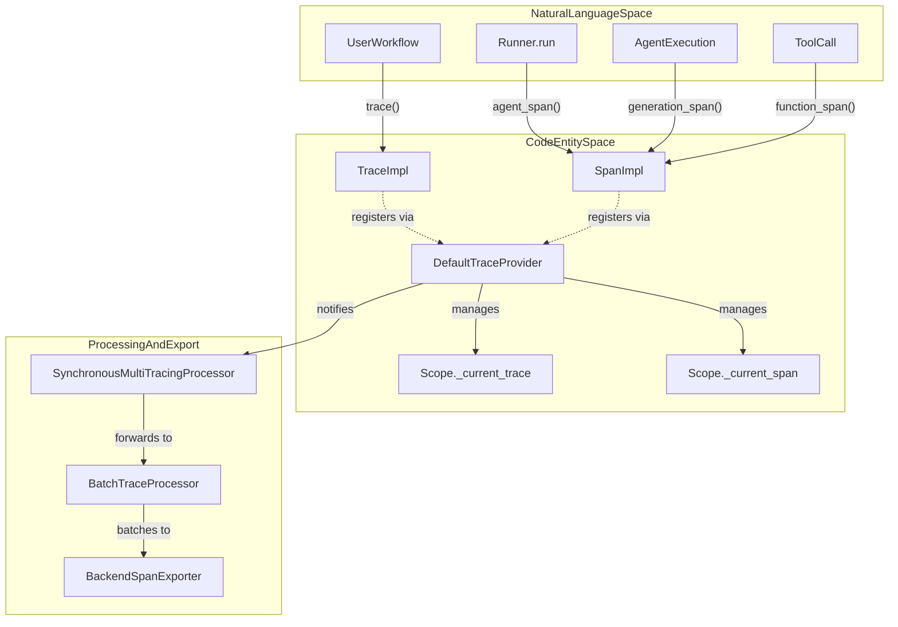
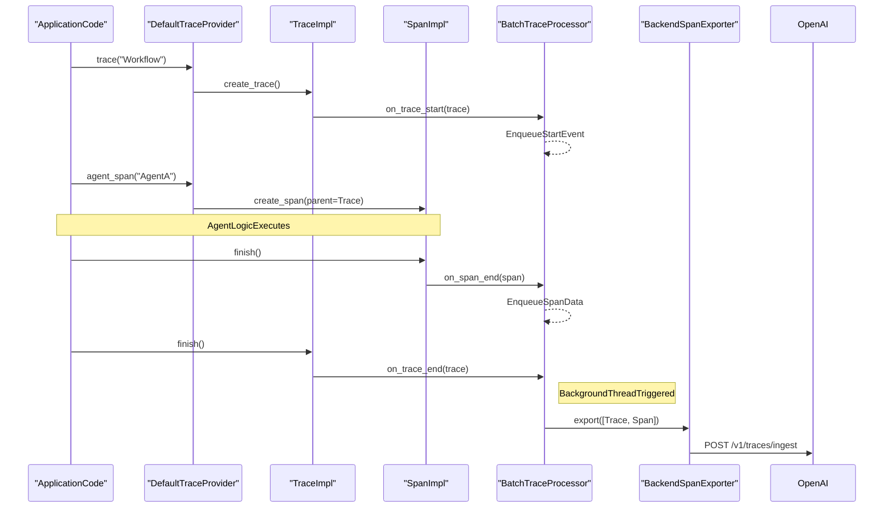

<!-- source: DeepWiki mcp.deepwiki.com · repo openai/openai-agents-python · page 10.1 Tracing Architecture · fetched 2026-10-26 -->

# Tracing Architecture

Relevant source files

The following files were used as context for generating this wiki page:

- [src/agents/sandbox/runtime.py](src/agents/sandbox/runtime.py)
- [src/agents/tracing/__init__.py](src/agents/tracing/__init__.py)
- [src/agents/tracing/context.py](src/agents/tracing/context.py)
- [src/agents/tracing/create.py](src/agents/tracing/create.py)
- [src/agents/tracing/processor_interface.py](src/agents/tracing/processor_interface.py)
- [src/agents/tracing/processors.py](src/agents/tracing/processors.py)
- [src/agents/tracing/provider.py](src/agents/tracing/provider.py)
- [src/agents/tracing/scope.py](src/agents/tracing/scope.py)
- [src/agents/tracing/setup.py](src/agents/tracing/setup.py)
- [src/agents/tracing/spans.py](src/agents/tracing/spans.py)
- [src/agents/tracing/traces.py](src/agents/tracing/traces.py)
- [src/agents/tracing/util.py](src/agents/tracing/util.py)
- [tests/test_asyncio_progress.py](tests/test_asyncio_progress.py)
- [tests/test_disabled_trace_provider_flush.py](tests/test_disabled_trace_provider_flush.py)
- [tests/test_disabled_trace_provider_shutdown.py](tests/test_disabled_trace_provider_shutdown.py)
- [tests/test_runner_tracing_disabled.py](tests/test_runner_tracing_disabled.py)
- [tests/test_trace_processor.py](tests/test_trace_processor.py)
- [tests/tracing/test_import_side_effects.py](tests/tracing/test_import_side_effects.py)
- [tests/tracing/test_processor_api_key.py](tests/tracing/test_processor_api_key.py)
- [tests/tracing/test_reasoning_export.py](tests/tracing/test_reasoning_export.py)
- [tests/tracing/test_set_api_key_fix.py](tests/tracing/test_set_api_key_fix.py)
- [tests/tracing/test_spans_impl.py](tests/tracing/test_spans_impl.py)
- [tests/tracing/test_trace_context.py](tests/tracing/test_trace_context.py)
- [tests/tracing/test_traces_impl.py](tests/tracing/test_traces_impl.py)
- [tests/tracing/test_tracing_env_disable.py](tests/tracing/test_tracing_env_disable.py)

## Purpose and Scope

The tracing system in the OpenAI Agents SDK provides a comprehensive observability framework for monitoring, debugging, and optimizing agent workflows. It captures a hierarchical record of events including LLM generations, tool calls, handoffs, and guardrail executions. This architecture is built on a provider-processor-exporter pattern, utilizing Python `contextvars` for automatic span nesting and background threads for non-blocking data export.

Sources: `[src/agents/tracing/provider.py:17-21]()`, `[src/agents/tracing/spans.py:59-96]()`, `[src/agents/tracing/traces.py:51-81]()`

## Architecture Overview

The architecture consists of three distinct layers: the **Creation Layer** (where spans are initialized), the **Processing Layer** (where data is buffered and batched), and the **Export Layer** (where data is transmitted to a backend).

### Diagram: Tracing System Architecture

Sources: `[src/agents/tracing/provider.py:208-360]()`, `[src/agents/tracing/scope.py:8-12]()`, `[src/agents/tracing/spans.py:4-5]()`

The `DefaultTraceProvider` acts as the central coordinator. It tracks the active trace and span using Python `contextvars` managed in the `Scope` class, allowing nested spans to automatically discover their parents without manual ID passing.

Sources: `[src/agents/tracing/provider.py:208-360]()`, `[src/agents/tracing/scope.py:8-12]()`, `[src/agents/tracing/spans.py:4-5]()`

## Core Components

### TraceProvider
The `TraceProvider` defines the interface for creating traces and spans. The `DefaultTraceProvider` implementation handles ID generation and manages the lifecycle of `TracingProcessor` instances.

*   **State Management**: It maintains a `SynchronousMultiTracingProcessor` which acts as a fan-out proxy for multiple registered processors (`[src/agents/tracing/provider.py:93-101]()`).
*   **Global Control**: Tracing can be globally disabled. When disabled, the provider returns `NoOpTrace` and `NoOpSpan` objects that perform no work and consume minimal resources (`[src/agents/tracing/provider.py:20-21]()`, `[src/agents/tracing/spans.py:216-227]()`, `[src/agents/tracing/traces.py:236-240]()`).

Sources: `[src/agents/tracing/provider.py:208-386]()`, `[src/agents/tracing/processor_interface.py:7-38]()`

### BatchTraceProcessor
To minimize performance impact on agent execution, the `BatchTraceProcessor` offloads export logic to a background worker thread.

| Feature | Implementation Detail |
| :--- | :--- |
| **Buffering** | Uses a `queue.Queue` to hold finished traces and spans (`[src/agents/tracing/processors.py:228]()`). |
| **Worker Thread** | A dedicated thread (`_worker`) loops, waiting for the queue to fill or a timer to expire (`[src/agents/tracing/processors.py:253-264]()`). |
| **Trigger Logic** | Exports occur when `max_batch_size` is reached or after `schedule_delay` seconds (`[src/agents/tracing/processors.py:291-305]()`). |
| **Shutdown** | On process exit, `shutdown()` is called to flush all remaining items in the queue with an optional timeout (`[src/agents/tracing/processors.py:343-352]()`). |

Sources: `[src/agents/tracing/processors.py:204-360]()`, `[tests/test_trace_processor.py:69-143]()`

### BackendSpanExporter
The `BackendSpanExporter` is the default implementation for sending data to OpenAI. It handles HTTP communication, authentication, and data sanitization.

*   **Endpoint**: Defaults to `https://api.openai.com/v1/traces/ingest` (`[src/agents/tracing/processors.py:45]()`).
*   **Authentication**: Uses the OpenAI API key, which can be set via `set_api_key()` or environment variables (`OPENAI_API_KEY`) (`[src/agents/tracing/processors.py:92-108]()`).
*   **Retry Logic**: Implements exponential backoff for transient network failures or 5xx server errors (`[src/agents/tracing/processors.py:158-183]()`).
*   **Sanitization**: Truncates large string fields to stay within backend limits (default 100,000 bytes per field) (`[src/agents/tracing/processors.py:46-47]()`, `[src/agents/tracing/processors.py:408-417]()`).

Sources: `[src/agents/tracing/processors.py:44-190]()`, `[src/agents/tracing/processors.py:388-420]()`

## Trace Lifecycle and Data Flow

The lifecycle of a trace involves entering a context, executing agent logic which spawns children, and finally flushing the data.

### Diagram: Trace and Span Lifecycle Flow

Sources: `[src/agents/tracing/provider.py:117-176]()`, `[src/agents/tracing/processors.py:270-289]()`, `[src/agents/tracing/__init__.py:122-130]()`

1.  **Start**: When a `Trace` or `Span` is started, the `on_trace_start` or `on_span_start` hooks are called (`[src/agents/tracing/provider.py:117-130]()`, `[src/agents/tracing/provider.py:147-160]()`).
2.  **Execution**: The SDK automatically wraps key operations. For example, `Runner.run` initializes an agent workflow trace if one is not already active (`[tests/test_agent_tracing.py:43-70]()`).
3.  **Completion**: When the context manager exits, `on_span_end` or `on_trace_end` is triggered, which enqueues the data for the `BatchTraceProcessor` (`[src/agents/tracing/provider.py:132-145]()`, `[src/agents/tracing/provider.py:162-176]()`).
4.  **Flushing**: The `flush_traces()` function can be used to manually trigger an export of all pending items in the processor queue (`[src/agents/tracing/__init__.py:122-130]()`).

Sources: `[src/agents/tracing/provider.py:117-176]()`, `[src/agents/tracing/processors.py:270-289]()`, `[src/agents/tracing/__init__.py:122-130]()`

## Hierarchical Structure and Context Variables

The SDK uses `contextvars` to maintain a stack of active spans. This ensures that even in highly concurrent async environments, spans are correctly parented.

*   **`Scope._current_trace`**: A `ContextVar` holding the root `Trace` of the current execution flow (`[src/agents/tracing/scope.py:15-17]()`).
*   **`Scope._current_span`**: A `ContextVar` holding the immediate parent `Span` (`[src/agents/tracing/scope.py:11-13]()`).

### Span Hierarchy Types
The system supports specialized data structures for different operations:
*   **`AgentSpanData`**: Tracks agent name, available tools, and handoffs (`[src/agents/tracing/span_data.py:28-61]()`).
*   **`GenerationSpanData`**: Captures LLM inputs, outputs, model name, and token usage (`[src/agents/tracing/span_data.py:169-209]()`).
*   **`FunctionSpanData`**: Records tool name, arguments, and return values (`[src/agents/tracing/span_data.py:135-166]()`).
*   **`TaskSpanData` / `TurnSpanData`**: Used by the runner to group aggregate usage across multiple turns (`[src/agents/tracing/span_data.py:64-132]()`).

Sources: `[src/agents/tracing/span_data.py:11-270]`, `[src/agents/tracing/scope.py:8-44]`, `[tests/test_agent_tracing.py:134-184]()`

## Sensitive Data Handling

The tracing architecture provides mechanisms to redact sensitive information from exported payloads to comply with privacy requirements.

*   **Redaction Policy**: The `ConsoleSpanExporter` and `BackendSpanExporter` check `_debug.DONT_LOG_MODEL_DATA` and `_debug.DONT_LOG_TOOL_DATA` to suppress sensitive fields in logs and exports (`[src/agents/tracing/processors.py:31-42]()`, `[src/agents/tracing/processors.py:187-191]()`).
*   **Run Configuration**: `RunConfig.trace_include_sensitive_data` determines if detailed error messages or PII are stripped during the export phase of an agent run (`[tests/test_tracing_errors_streamed.py:110-128]()`).
*   **Sanitization Logic**: The `BackendSpanExporter` specifically sanitizes usage data to only include allowed keys like `input_tokens` and `output_tokens` when sending to specific tracing APIs (`[src/agents/tracing/processors.py:48-54]()`, `[src/agents/tracing/processors.py:422-440]()`).

Sources: `[src/agents/tracing/processors.py:31-54]()`, `[src/agents/tracing/processors.py:422-440]()`, `[tests/test_tracing_errors_streamed.py:110-128]()`

---

