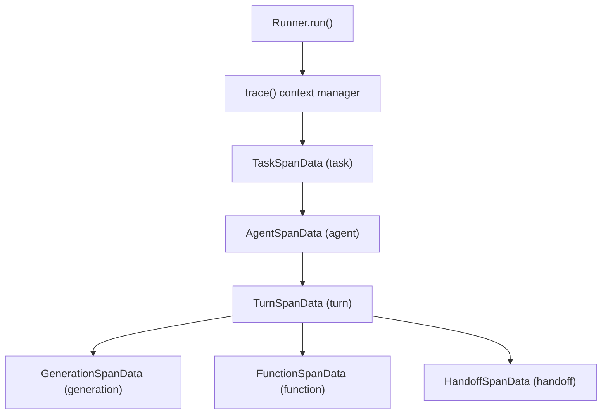

<!-- source: DeepWiki mcp.deepwiki.com · repo openai/openai-agents-python · page 10.2 Span Types and Lifecycle · fetched 2026-10-26 -->

# Span Types and Lifecycle

<details>
<summary>Relevant source files</summary>

The following files were used as context for generating this wiki page:

- [examples/basic/agent_lifecycle_example.py](examples/basic/agent_lifecycle_example.py)
- [examples/basic/lifecycle_example.py](examples/basic/lifecycle_example.py)
- [src/agents/lifecycle.py](src/agents/lifecycle.py)
- [src/agents/models/interface.py](src/agents/models/interface.py)
- [src/agents/sandbox/runtime.py](src/agents/sandbox/runtime.py)
- [src/agents/tracing/config.py](src/agents/tracing/config.py)
- [src/agents/tracing/context.py](src/agents/tracing/context.py)
- [src/agents/tracing/processor_interface.py](src/agents/tracing/processor_interface.py)
- [src/agents/tracing/span_data.py](src/agents/tracing/span_data.py)
- [src/agents/tracing/spans.py](src/agents/tracing/spans.py)
- [src/agents/tracing/traces.py](src/agents/tracing/traces.py)
- [tests/test_agent_hooks.py](tests/test_agent_hooks.py)
- [tests/test_agent_llm_hooks.py](tests/test_agent_llm_hooks.py)
- [tests/test_agent_tracing.py](tests/test_agent_tracing.py)
- [tests/test_global_hooks.py](tests/test_global_hooks.py)
- [tests/test_responses_tracing.py](tests/test_responses_tracing.py)
- [tests/test_run_hooks.py](tests/test_run_hooks.py)
- [tests/test_runner_tracing_disabled.py](tests/test_runner_tracing_disabled.py)
- [tests/test_tracing.py](tests/test_tracing.py)
- [tests/test_tracing_errors.py](tests/test_tracing_errors.py)
- [tests/test_tracing_errors_streamed.py](tests/test_tracing_errors_streamed.py)
- [tests/testing_processor.py](tests/testing_processor.py)
- [tests/tracing/test_span_ordering.py](tests/tracing/test_span_ordering.py)
- [tests/tracing/test_spans_impl.py](tests/tracing/test_spans_impl.py)
- [tests/tracing/test_trace_context.py](tests/tracing/test_trace_context.py)
- [tests/tracing/test_traces_impl.py](tests/tracing/test_traces_impl.py)
- [tests/voice/test_workflow.py](tests/voice/test_workflow.py)

</details>


This page documents the span types in the tracing system, their data structures, creation points in the agent execution flow, and lifecycle management. Spans represent operations with start and end times that form a hierarchical trace of agent workflow execution.

## Span Type Overview

The SDK automatically creates spans at key execution points. Each span type captures domain-specific metadata about a particular operation.

| Span Type | Purpose | Data Class | Implementation |
|-----------|---------|------------|----------------|
| **Task** | Represents one top-level Runner run | `TaskSpanData` | [src/agents/tracing/span_data.py:64-96]() |
| **Agent** | Tracks an agent's context and configuration | `AgentSpanData` | [src/agents/tracing/span_data.py:28-62]() |
| **Turn** | Represents one loop iteration within an agent run | `TurnSpanData` | [src/agents/tracing/span_data.py:98-133]() |
| **Generation** | Captures LLM request/response generation details | `GenerationSpanData` | [src/agents/tracing/span_data.py:169-210]() |
| **Function** | Tracks local or MCP function tool execution | `FunctionSpanData` | [src/agents/tracing/span_data.py:135-167]() |
| **Handoff** | Records transfer of control between agents | `HandoffSpanData` | [src/agents/tracing/span_data.py:245-252]() |
| **Response** | Captures raw response structures and tokens | `ResponseSpanData` | [src/agents/tracing/span_data.py:212-243]() |

Sources: [src/agents/tracing/span_data.py:11-252]()

---

## Detailed Span Data Structures

Every span wraps a specific `SpanData` subclass defining how its payload is structured upon export [src/agents/tracing/span_data.py:11-27]().

### 1. AgentSpanData
Created when an agent begins execution. It records the agent's name, registered handoffs, available tools, and output type [src/agents/tracing/span_data.py:28-62]().
- **Attributes**: `name`, `handoffs`, `tools`, `output_type`, `metadata` [src/agents/tracing/span_data.py:34-48]()
- **Export format**: Returns `type: "agent"`, `name`, `handoffs`, `tools`, and `output_type` [src/agents/tracing/span_data.py:54-61]().

### 2. GenerationSpanData
Encapsulates an interaction with a language model, tracking model identification, configuration parameters, prompt inputs, generated outputs, and token usage [src/agents/tracing/span_data.py:169-210]().
- **Attributes**: `input`, `output`, `model`, `model_config`, `usage` [src/agents/tracing/span_data.py:175-181]()
- **Export format**: Returns `type: "generation"` along with input/output sequences, model name, and usage metrics [src/agents/tracing/span_data.py:201-209]().

### 3. FunctionSpanData
Created during local tool or MCP tool execution [src/agents/tracing/span_data.py:135-167]().
- **Attributes**: `name`, `input`, `output`, `mcp_data` [src/agents/tracing/span_data.py:141-153]()
- **Export format**: Returns `type: "function"`, tool `name`, serialized `input`, stringified `output`, and optional `mcp_data` [src/agents/tracing/span_data.py:159-166]().

### 4. HandoffSpanData
Records a conversation handoff from one agent to another [src/agents/tracing/span_data.py:245-252]().
- **Attributes**: `from_agent`, `to_agent` [src/agents/tracing/span_data.py:251-252]()

Sources: [src/agents/tracing/span_data.py:28-252]()

---

## Span Lifecycle and Context Management

Spans manage their own timing (`started_at`, `ended_at`) and thread-local context propagation via `Span` and `Scope` [src/agents/tracing/spans.py:59-215]().


Sources: [src/agents/tracing/span_data.py:64-252](), [tests/test_agent_tracing.py:45-211]()

---

## Custom Spans and `custom_span()`

Users can create arbitrary custom spans using the `custom_span()` context manager or helper function [tests/test_tracing.py:9-20](). Custom spans allow attaching custom operational boundaries and metadata (such as database queries or custom subroutines) to traces [src/agents/tracing/spans.py:71-89]().

```python
with custom_span("database_query", {"operation": "SELECT"}) as span:
    results = await db.query("SELECT * FROM users")
```
Sources: [src/agents/tracing/spans.py:71-89](), [tests/test_tracing.py:9-20]()

---

## Natural Language to Code Entity Mapping

The following diagram bridges conceptual tracing terms to their exact code entities and modules within the repository.

```mermaid
graph TD
    TraceConcept[""Top-Level Trace Run""] --> RunnerRun[""Runner.run() / Runner.run_streamed()""]
    TaskConcept[""Task Span""] --> TaskData[""TaskSpanData in span_data.py""]
    AgentConcept[""Agent Execution""] --> AgentData[""AgentSpanData in span_data.py""]
    LLMCall[""LLM Generation""] --> GenData[""GenerationSpanData in span_data.py""]
    ToolExec[""Tool Execution""] --> FuncData[""FunctionSpanData in span_data.py""]
    HandoffConcept[""Agent Handoff""] --> HandoffData[""HandoffSpanData in span_data.py""]
    CustomOp[""Custom Operation""] --> CustomSpanFn[""custom_span() in tracing package""]
```
Sources: [src/agents/tracing/span_data.py:28-252](), [tests/test_tracing.py:9-20]()

---

