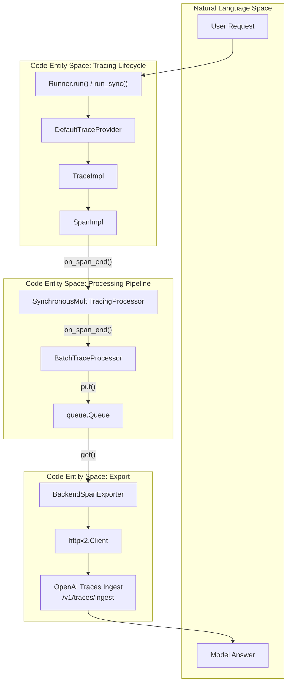
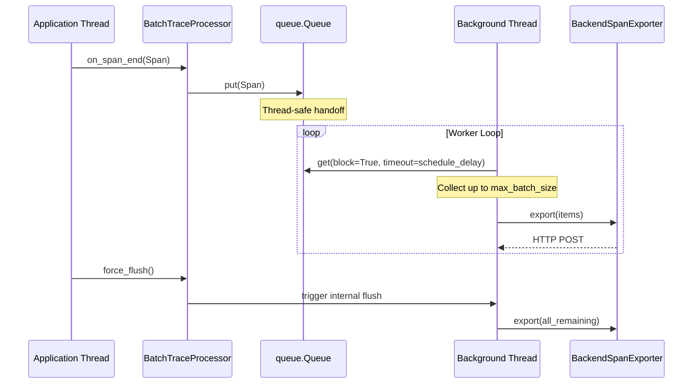

<!-- source: DeepWiki mcp.deepwiki.com · repo openai/openai-agents-python · page 10.3 Trace Processors and Export · fetched 2026-10-26 -->

# Trace Processors and Export

<details>
<summary>Relevant source files</summary>

The following files were used as context for generating this wiki page:

- [src/agents/tracing/__init__.py](src/agents/tracing/__init__.py)
- [src/agents/tracing/create.py](src/agents/tracing/create.py)
- [src/agents/tracing/processors.py](src/agents/tracing/processors.py)
- [src/agents/tracing/provider.py](src/agents/tracing/provider.py)
- [src/agents/tracing/scope.py](src/agents/tracing/scope.py)
- [src/agents/tracing/setup.py](src/agents/tracing/setup.py)
- [src/agents/tracing/util.py](src/agents/tracing/util.py)
- [tests/test_asyncio_progress.py](tests/test_asyncio_progress.py)
- [tests/test_disabled_trace_provider_flush.py](tests/test_disabled_trace_provider_flush.py)
- [tests/test_disabled_trace_provider_shutdown.py](tests/test_disabled_trace_provider_shutdown.py)
- [tests/test_trace_processor.py](tests/test_trace_processor.py)
- [tests/tracing/test_import_side_effects.py](tests/tracing/test_import_side_effects.py)
- [tests/tracing/test_processor_api_key.py](tests/tracing/test_processor_api_key.py)
- [tests/tracing/test_reasoning_export.py](tests/tracing/test_reasoning_export.py)
- [tests/tracing/test_set_api_key_fix.py](tests/tracing/test_set_api_key_fix.py)
- [tests/tracing/test_tracing_env_disable.py](tests/tracing/test_tracing_env_disable.py)

</details>


This page documents the trace processing and export pipeline that delivers span and trace data to observability backends. It covers the default export to OpenAI's Traces API, the batching and async processing system, and how to add custom processors for third-party platforms.

For creating and managing traces and spans, see [Tracing Architecture](#10.1). For span types and lifecycle, see [Span Types and Lifecycle](#10.2).

---

## Processing Architecture

The SDK uses a pipeline architecture to process traces and spans asynchronously without blocking agent execution. The default configuration exports traces to OpenAI's backend, but you can add or replace processors to route data to other systems.

### System Data Flow



Sources: `[src/agents/tracing/provider.py:93-176]()`, `[src/agents/tracing/processors.py:206-258]()`, `[src/agents/tracing/processors.py:44-66]()`

---

## Trace Processor Interface

All trace processors implement the `TracingProcessor` protocol defined in the SDK. The system calls these methods as spans and traces lifecycle events occur.

### Processor Protocol

| Method | Parameters | Purpose |
|--------|-----------|---------|
| `on_trace_start` | `trace: Trace` | Called when a new trace is initialized. `[src/agents/tracing/processor_interface.py:12-12]()` |
| `on_trace_end` | `trace: Trace` | Called when a trace completes. `[src/agents/tracing/processor_interface.py:15-15]()` |
| `on_span_start` | `span: Span` | Called when a span begins. `[src/agents/tracing/processor_interface.py:18-18]()` |
| `on_span_end` | `span: Span` | Called when a span finishes. `[src/agents/tracing/processor_interface.py:21-21]()` |
| `force_flush` | None | Blocks until all buffered data is exported. `[src/agents/tracing/processor_interface.py:27-27]()` |
| `shutdown` | `timeout: float \| None` | Cleanup resources and perform final flush. `[src/agents/tracing/processor_interface.py:24-24]()` |

The `SynchronousMultiTracingProcessor` acts as a fan-out mechanism, forwarding these calls to all registered processors in order `[src/agents/tracing/provider.py:93-102]()`.

Sources: `[src/agents/tracing/processor_interface.py:1-30]()`, `[src/agents/tracing/provider.py:93-176]()`

---

## BatchTraceProcessor

`BatchTraceProcessor` is the default processor that buffers spans and traces to avoid per-span network overhead. It utilizes a background thread to perform exports asynchronously `[src/agents/tracing/processors.py:206-218]()`.

### Background Worker Logic



### Configuration Parameters

| Parameter | Default | Description |
|-----------|---------|-------------|
| `max_batch_size` | 100 | Max items per export call. `[src/agents/tracing/processors.py:213-213]()` |
| `schedule_delay` | 5.0 | Seconds to wait before forcing a batch export. `[src/agents/tracing/processors.py:214-214]()` |
| `max_queue_size` | 2048 | Max pending items before dropping new ones. `[src/agents/tracing/processors.py:215-215]()` |
| `export_trigger_ratio` | 0.5 | Queue fill ratio that triggers immediate export. `[src/agents/tracing/processors.py:216-216]()` |

Sources: `[src/agents/tracing/processors.py:206-258]()`, `[tests/test_trace_processor.py:69-89]()`

---

## BackendSpanExporter

The `BackendSpanExporter` handles the actual transmission of data to the OpenAI Traces API. It includes built-in logic for sanitization, authentication, and exponential backoff `[src/agents/tracing/processors.py:44-86]()`.

### Export Pipeline

1. **Grouping**: Items are grouped by `tracing_api_key` to allow multi-tenant exports in a single batch `[src/agents/tracing/processors.py:125-129]()`.
2. **Sanitization**: If the endpoint is the default OpenAI ingest, it truncates large fields and drops disallowed usage keys to comply with API limits `[src/agents/tracing/processors.py:136-143]()`.
3. **Authentication**: Uses headers for `Authorization`, `OpenAI-Organization`, and `OpenAI-Project` `[src/agents/tracing/processors.py:146-157]()`.
4. **Retries**: Implements exponential backoff with jitter for 5xx errors or network failures `[src/agents/tracing/processors.py:159-190]()`.

### Sensitive Data Redaction
Certain spans capture sensitive data (e.g., `generation_span` and `function_span`). This can be disabled globally via environment variables or per run using `RunConfig.trace_include_sensitive_data` `[docs/ja/tracing.md:142-146]()`. Audio spans can similarly be redacted via `VoicePipelineConfig.trace_include_sensitive_audio_data` `[docs/ja/tracing.md:148-148]()`.

Sources: `[src/agents/tracing/processors.py:44-190]()`, `[docs/ja/tracing.md:142-150]()`

---

## Custom Processors and Integrations

Users can extend the tracing system by adding additional processors or replacing the default stack entirely.

### Registration Methods

* `add_trace_processor(processor)`: Appends a new processor to the existing list. Both the default OpenAI export and the new processor will receive data `[src/agents/tracing/__init__.py:94-98]()`.
* `set_trace_processors([processors])`: Overwrites the entire processor list. This is used to disable OpenAI exports in favor of a custom backend `[src/agents/tracing/__init__.py:101-105]()`.

### Implementation Example

```python
from agents.tracing.processor_interface import TracingProcessor
from agents.tracing import add_trace_processor

class ConsoleProcessor(TracingProcessor):
    def on_span_end(self, span):
        print(f"Span Finished: {span.span_data.name}") 

add_trace_processor(ConsoleProcessor())
```

### Third-Party Integrations
The SDK tracing interface is supported by several community and vendor integrations:
* **Weights & Biases (Weave)** `[docs/zh/tracing.md:210-210]()`
* **Arize-Phoenix** `[docs/zh/tracing.md:211-211]()`
* **MLflow** `[docs/zh/tracing.md:213-213]()`
* **Braintrust** `[docs/zh/tracing.md:215-215]()`
* **Pydantic Logfire** `[docs/zh/tracing.md:216-216]()`

Sources: `[src/agents/tracing/provider.py:93-116]()`, `[docs/ja/tracing.md:152-162]()`, `[docs/zh/tracing.md:208-216]()`

---

## Immediate Exports (Flushing)

In short-lived environments (like Lambda functions) or specific job workers (Celery/FastAPI background tasks), traces might be lost if the process terminates before the `BatchTraceProcessor` background thread runs.

Call `flush_traces()` to block the current thread until all buffered spans are successfully exported `[src/agents/tracing/__init__.py:122-130]()`.

```python
from agents import Runner, flush_traces, trace

@celery_app.task
def run_agent_task(prompt: str):
    try:
        with trace("celery_task"):
            result = Runner.run_sync(agent, prompt)
        return result.final_output
    finally:
        flush_traces() # Blocks until export completes
```

Sources: `[docs/ja/tracing.md:65-83]()`, `[src/agents/tracing/provider.py:236-242]()`

---

