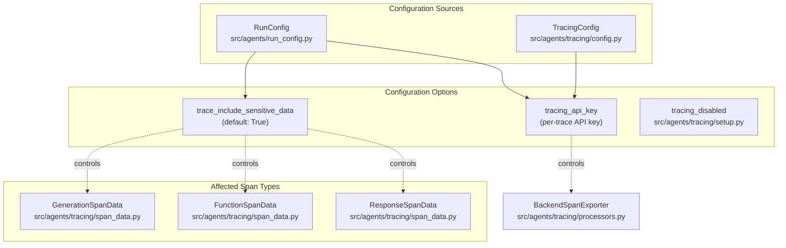
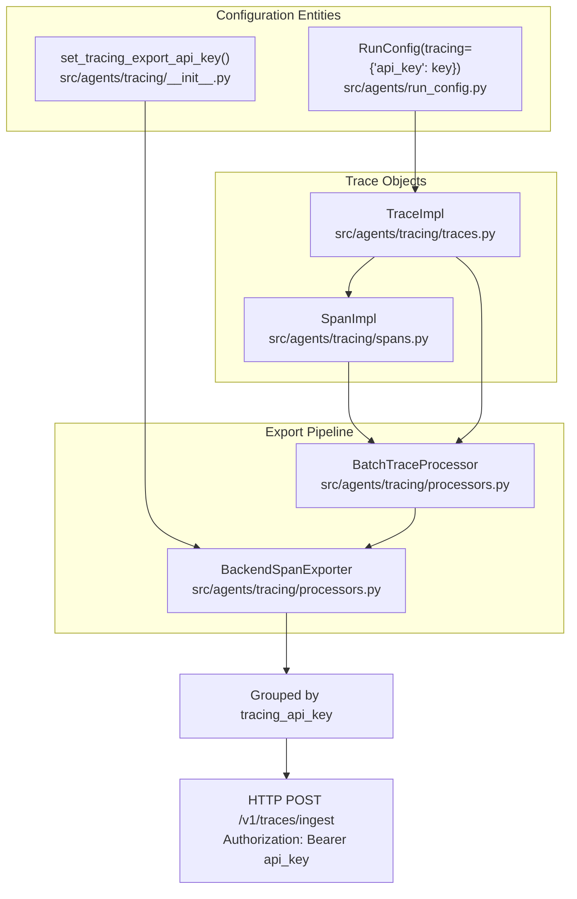

<!-- source: DeepWiki mcp.deepwiki.com · repo openai/openai-agents-python · page 10.4 Sensitive Data Handling · fetched 2026-10-26 -->

# Sensitive Data Handling

<details>
<summary>Relevant source files</summary>

The following files were used as context for generating this wiki page:

- [src/agents/exceptions.py](src/agents/exceptions.py)
- [src/agents/result.py](src/agents/result.py)
- [src/agents/run.py](src/agents/run.py)
- [src/agents/run_internal/agent_runner_helpers.py](src/agents/run_internal/agent_runner_helpers.py)
- [src/agents/run_internal/run_loop.py](src/agents/run_internal/run_loop.py)
- [src/agents/run_internal/run_steps.py](src/agents/run_internal/run_steps.py)
- [src/agents/run_internal/session_persistence.py](src/agents/run_internal/session_persistence.py)
- [src/agents/run_internal/turn_resolution.py](src/agents/run_internal/turn_resolution.py)
- [src/agents/run_state.py](src/agents/run_state.py)
- [src/agents/tracing/__init__.py](src/agents/tracing/__init__.py)
- [src/agents/tracing/create.py](src/agents/tracing/create.py)
- [src/agents/tracing/processors.py](src/agents/tracing/processors.py)
- [src/agents/tracing/provider.py](src/agents/tracing/provider.py)
- [src/agents/tracing/scope.py](src/agents/tracing/scope.py)
- [src/agents/tracing/setup.py](src/agents/tracing/setup.py)
- [src/agents/tracing/util.py](src/agents/tracing/util.py)
- [tests/test_agent_runner.py](tests/test_agent_runner.py)
- [tests/test_agent_runner_streamed.py](tests/test_agent_runner_streamed.py)
- [tests/test_asyncio_progress.py](tests/test_asyncio_progress.py)
- [tests/test_disabled_trace_provider_flush.py](tests/test_disabled_trace_provider_flush.py)
- [tests/test_disabled_trace_provider_shutdown.py](tests/test_disabled_trace_provider_shutdown.py)
- [tests/test_error_logging_redaction.py](tests/test_error_logging_redaction.py)
- [tests/test_run_impl_resume_paths.py](tests/test_run_impl_resume_paths.py)
- [tests/test_run_state.py](tests/test_run_state.py)
- [tests/test_trace_processor.py](tests/test_trace_processor.py)
- [tests/tracing/test_import_side_effects.py](tests/tracing/test_import_side_effects.py)
- [tests/tracing/test_processor_api_key.py](tests/tracing/test_processor_api_key.py)
- [tests/tracing/test_reasoning_export.py](tests/tracing/test_reasoning_export.py)
- [tests/tracing/test_set_api_key_fix.py](tests/tracing/test_set_api_key_fix.py)
- [tests/tracing/test_tracing_env_disable.py](tests/tracing/test_tracing_env_disable.py)

</details>


## Purpose and Scope

This page details how the OpenAI Agents SDK handles sensitive data, PII redaction, trace inclusion toggles, and API key scoping for telemetry exports. The tracing system captures execution details including LLM inputs/outputs, tool call arguments/results, and audio data. The SDK provides fine-grained controls via `trace_include_sensitive_data`, PII redaction debug flags, `tracing_disabled`, and `set_tracing_export_api_key()` to ensure compliance with data governance and Zero Data Retention (ZDR) requirements.

For general tracing architecture, see [Tracing Architecture (10.1)](). For model integration details, see [Model Integration (7)]().

---

## Overview of Trace Data Controls

The SDK provides configuration options at multiple layers to govern what data is exported when spans are emitted to backends via `BackendSpanExporter` [src/agents/tracing/processors.py:45-148]().

Title: Trace Data Configuration and Flow

Sources: [src/agents/tracing/processors.py:30-148](), [src/agents/tracing/span_data.py:1-50]()

---

## trace_include_sensitive_data

The `trace_include_sensitive_data` configuration option determines whether LLM generation inputs/outputs and tool execution arguments/results are populated within exported trace spans.

### Configuration

Set this option via `RunConfig` when executing an agent runner:

```python
from agents import Agent, Runner, RunConfig

# Include sensitive data (default behavior)
await Runner.run(
    agent,
    "user input",
    run_config=RunConfig(trace_include_sensitive_data=True)
)

# Exclude sensitive data (metadata/metrics only)
await Runner.run(
    agent,
    "user input", 
    run_config=RunConfig(trace_include_sensitive_data=False)
)
```
Sources: [tests/test_agent_runner.py:79-80]()

### Span Fields and Filtering

| Span Type | Data Included When `True` | Data Omitted When `False` |
|-----------|---------------------------|---------------------------|
| `GenerationSpanData` | LLM input messages, output messages | Input and output messages omitted |
| `FunctionSpanData` | Tool input arguments, output results | Input and output omitted |
| `ResponseSpanData` | Response API input items, response object | Input and response omitted |

**Always Included Regardless of Setting:**
- Timestamps (`started_at`, `ended_at`)
- Model name and identifiers
- Token counts and usage statistics
- Span hierarchy (parent/child relationships)

Sources: [src/agents/tracing/span_data.py:1-100]()

---

## PII Redaction and Console Exporter Policies

When exporting traces locally or debugging via `ConsoleSpanExporter`, the SDK inspects debug flags [src/agents/_debug.py]() to ensure that sensitive payloads are not written to stdout or logs.

### Console Exporter Redaction

The `ConsoleSpanExporter` checks `_debug.DONT_LOG_MODEL_DATA` and `_debug.DONT_LOG_TOOL_DATA`. If either flag is set, trace and span exports are emitted with redacted notices rather than plaintext payloads [src/agents/tracing/processors.py:32-38]():

```python
class ConsoleSpanExporter(TracingExporter):
    def export(self, items: list[Trace | Span[Any]]) -> None:
        for item in items:
            if _debug.DONT_LOG_MODEL_DATA or _debug.DONT_LOG_TOOL_DATA:
                if isinstance(item, Trace):
                    print("[Exporter] Export trace. Trace data is redacted.")
                else:
                    print("[Exporter] Export span. Span data is redacted.")
                continue
            ...
```

Sources: [src/agents/tracing/processors.py:28-43](), [tests/test_trace_processor.py:56-68]()

---

## tracing_disabled and Zero Data Retention (ZDR)

For environments operating under strict Zero Data Retention (ZDR) policies or when telemetry must be entirely suppressed, tracing can be disabled globally or per-run.

### Disabling Methods

1. **Environment Variable**: Set `OPENAI_AGENTS_DISABLE_TRACING=1`.
2. **Global Code Configuration**: Invoke `set_tracing_disabled(True)` during application initialization.
3. **Per-Run Configuration**: Set `RunConfig.tracing_disabled = True`.

When tracing is disabled, trace providers return null/no-op trace contexts, preventing span collection and network export.

Sources: [src/agents/tracing/setup.py:1-50](), [tests/tracing/test_tracing_env_disable.py:1-30]()

---

## set_tracing_export_api_key() and API Key Propagation

The SDK supports using distinct OpenAI API keys for model inference versus trace exporting. This allows applications using third-party model providers (via `AnyLLMModel` or `LitellmModel`) to export operational telemetry back to OpenAI infrastructure securely.

### Configuration Hierarchy

| Configuration Level | Scope | Mechanism |
|---------------------|-------|-----------|
| Global Default | All exported traces | `set_tracing_export_api_key(api_key)` |
| Per-Run | Single agent execution | `RunConfig(tracing={"api_key": "..."})` |
| Per-Trace | Manual trace creation | `trace(tracing={"api_key": "..."})` |

### Global Configuration Example

```python
from agents.tracing import set_tracing_export_api_key

# Set a dedicated API key for trace exporting
set_tracing_export_api_key("sk-tracing-key-xyz")
```

### Implementation: API Key Propagation Flow

Title: Tracing API Key Propagation and Export Flow

Sources: [src/agents/tracing/processors.py:96-147](), [src/agents/tracing/traces.py:19-55](), [src/agents/tracing/spans.py:20-42]()

**Key Implementation Details:**
1. **`Trace` and `Span`** instances store their own `tracing_api_key` attribute, resolved from run configuration or global defaults [src/agents/tracing/traces.py:44-44](), [src/agents/tracing/spans.py:32-32]().
2. **`BackendSpanExporter`** inspects items during `export()` and groups them by `tracing_api_key` [src/agents/tracing/processors.py:138-144]().
3. Each distinct credential group transmits a separate HTTP payload to the ingest endpoint using its designated `Authorization` bearer token [src/agents/tracing/processors.py:144-150]().

Sources: [src/agents/tracing/processors.py:96-150](), [tests/tracing/test_processor_api_key.py:1-40]()

---

