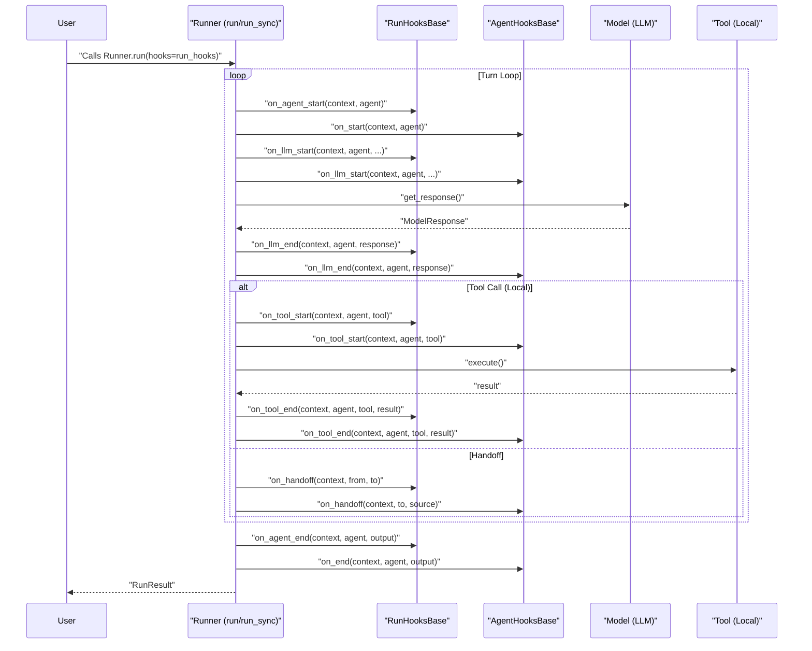
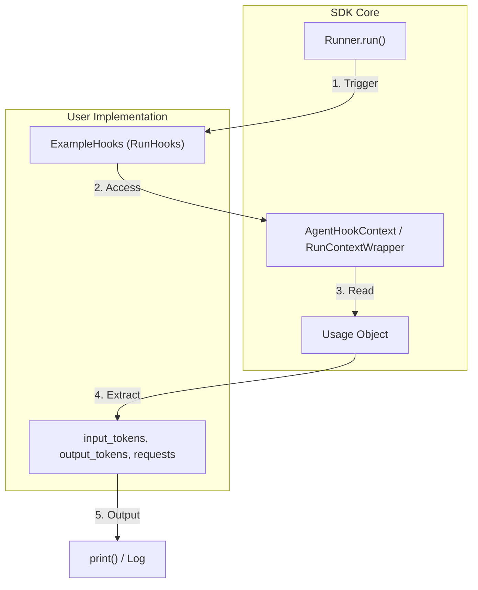

<!-- source: DeepWiki mcp.deepwiki.com · repo openai/openai-agents-python · page 10.5 Hooks and Lifecycle Events · fetched 2026-10-26 -->

# Hooks and Lifecycle Events

<details>
<summary>Relevant source files</summary>

The following files were used as context for generating this wiki page:

- [examples/basic/agent_lifecycle_example.py](examples/basic/agent_lifecycle_example.py)
- [examples/basic/lifecycle_example.py](examples/basic/lifecycle_example.py)
- [src/agents/lifecycle.py](src/agents/lifecycle.py)
- [src/agents/tracing/span_data.py](src/agents/tracing/span_data.py)
- [tests/test_agent_hooks.py](tests/test_agent_hooks.py)
- [tests/test_agent_llm_hooks.py](tests/test_agent_llm_hooks.py)
- [tests/test_global_hooks.py](tests/test_global_hooks.py)
- [tests/test_run_hooks.py](tests/test_run_hooks.py)

</details>


Hooks provide callback mechanisms to observe and respond to events during agent execution. They enable logging, monitoring, custom analytics, side effects, and integration with external systems without modifying the core execution flow.

This page documents the hook system for standard agent workflows. For tracing and observability features, see [Tracing Architecture](10.1) and [Span Types and Lifecycle](10.2).

---

## Hook Categories

The SDK provides two primary hook interfaces defined in `src/agents/lifecycle.py`. These interfaces allow you to hook into the lifecycle of a complete run or a specific agent.

| Hook Type | Scope | Lifecycle Events | Configured On |
|-----------|-------|------------------|---------------|
| `RunHooks` | Entire workflow execution | `on_llm_start`, `on_llm_end`, `on_agent_start`, `on_agent_end`, `on_tool_start`, `on_tool_end`, `on_handoff` | `Runner.run()` / `run_sync()` / `run_streamed()` |
| `AgentHooks` | Individual agent execution | `on_start`, `on_end`, `on_llm_start`, `on_llm_end`, `on_tool_start`, `on_tool_end`, `on_handoff` | `Agent(hooks=...)` property |

Sources: [src/agents/lifecycle.py:13-118](), [src/agents/lifecycle.py:119-194](), [src/agents/agent.py:1-200]()

---

## Hooks and Execution Flow

The following diagram maps Natural Language lifecycle events to the specific code entities and methods that handle them during a run.

**Lifecycle Event Mapping**


Sources: [src/agents/lifecycle.py:13-194](), [examples/basic/lifecycle_example.py:41-108](), [examples/basic/agent_lifecycle_example.py:19-60]()

---

## RunHooks Interface

`RunHooks` (aliased from `RunHooksBase` at [src/agents/lifecycle.py:13-118]()) receives callbacks for all events occurring within a single `Runner.run` call, regardless of which agent is currently active.

### Hook Methods

| Method | Signature | When Called |
|--------|-----------|-------------|
| `on_agent_start` | `(context, agent) -> None` | Before an agent is invoked; fires on every agent switch. [src/agents/lifecycle.py:37-57]() |
| `on_agent_end` | `(context, agent, output) -> None` | When an agent produces a final result. [src/agents/lifecycle.py:59-72]() |
| `on_llm_start` | `(context, agent, system_prompt, input_items) -> None` | Just before the model provider is called. [src/agents/lifecycle.py:18-26]() |
| `on_llm_end` | `(context, agent, response) -> None` | Immediately after the model returns a response. [src/agents/lifecycle.py:28-35]() |
| `on_tool_start` | `(context, agent, tool) -> None` | Before a **local** tool (`FunctionTool`) is executed. [src/agents/lifecycle.py:83-96]() |
| `on_tool_end` | `(context, agent, tool, result) -> None` | After a local tool returns its result. [src/agents/lifecycle.py:98-116]() |
| `on_handoff` | `(context, from_agent, to_agent) -> None` | When a conversation transfers between agents. [src/agents/lifecycle.py:74-81]() |

Sources: [src/agents/lifecycle.py:13-118]()

---

## AgentHooks Interface

`AgentHooks` (aliased from `AgentHooksBase` at [src/agents/lifecycle.py:119-194]()) is scoped to a specific `Agent` instance. It is useful for agent-specific logic, such as an agent that logs its own tool usage differently than others.

### Hook Methods

| Method | Signature | Description |
|--------|-----------|-------------|
| `on_start` | `(context, agent) -> None` | Called when the run switches to *this* agent. [src/agents/lifecycle.py:126-147]() |
| `on_end` | `(context, agent, output) -> None` | Called when *this* agent produces final output. [src/agents/lifecycle.py:149-162]() |
| `on_handoff` | `(context, agent, source) -> None` | Called when *this* agent is the **target** of a handoff. [src/agents/lifecycle.py:164-172]() |
| `on_tool_start` | `(context, agent, tool) -> None` | Called before a tool is run by *this* agent. [src/agents/lifecycle.py:174-179]() |

Sources: [src/agents/lifecycle.py:119-194]()

---

## Context and Data Flow

Hooks receive a `RunContextWrapper` (or `AgentHookContext`), which provides access to the shared state and telemetry of the run.

### Telemetry and Usage
Hooks are the primary way to observe real-time token usage. The `context.usage` property (of type `Usage`) is updated before `on_llm_end` and `on_agent_end` are called.

```python
async def on_agent_end(self, context: RunContextWrapper, agent: Agent, output: Any) -> None:
    # Access accumulated usage for the run so far
    u = context.usage
    print(f"Total tokens: {u.total_tokens} (In: {u.input_tokens}, Out: {u.output_tokens})")
```
Sources: [examples/basic/lifecycle_example.py:45-46](), [src/agents/run_context.py:1-100]()

### Tool Metadata
For local function tools, the `context` passed to `on_tool_start` and `on_tool_end` is typically a `ToolContext` [src/agents/tool_context.py:1-100](). This allows hooks to inspect the exact arguments generated by the model.

| Property | Description |
|----------|-------------|
| `tool_name` | The name of the tool as called by the LLM. [src/agents/tool_context.py:1-100]() |
| `tool_call_id` | Unique ID for the specific call. [src/agents/tool_context.py:1-100]() |
| `tool_arguments` | Raw JSON string of arguments. [src/agents/tool_context.py:1-100]() |

Sources: [src/agents/lifecycle.py:83-116](), [examples/basic/lifecycle_example.py:85-88]()

---

## Implementation Example: Logging and Metrics

This diagram illustrates how a custom `RunHooks` implementation interacts with the SDK classes to extract metrics.

**Code Entity Space: Metrics Collection**


Sources: [examples/basic/lifecycle_example.py:41-75](), [src/agents/lifecycle.py:13-68]()

---

## Important Technical Constraints

1. **Local Tools Only**: `on_tool_start` and `on_tool_end` do **not** trigger for hosted OpenAI tools like `WebSearchTool`, `FileSearchTool`, or `CodeInterpreterTool`. These tools run server-side and their internal execution lifecycle is not visible to the local Python SDK hooks.
   * Sources: [examples/basic/lifecycle_example.py:77-80](), [examples/basic/agent_lifecycle_example.py:43-46]()
2. **Error Handling**: If an LLM call fails (e.g., network error), `on_llm_start` will fire. In non-streaming runs, `on_llm_end` and `on_agent_end` will be skipped if an exception is raised.
   * Sources: [src/agents/lifecycle.py:13-118](), [tests/test_run_hooks.py:182-201]()
3. **Type Safety**: When implementing hooks, use the generic `TContext` to maintain type hints for your custom context object across all lifecycle events.
   * Sources: [src/agents/lifecycle.py:13-16](), [src/agents/lifecycle.py:102-105]()
4. **Handoff Logic**: In `AgentHooks`, `on_handoff` is called on the **target** agent, and the `source` agent is passed as an argument. In `RunHooks`, both agents are provided to the single `on_handoff` method.
   * Sources: [src/agents/lifecycle.py:74-81](), [src/agents/lifecycle.py:164-172]()
5. **Streaming Hooks**: In `Runner.run_streamed()`, hooks like `on_llm_end` fire when the model response is fully processed, even if the user has not finished consuming all stream events.
   * Sources: [tests/test_run_hooks.py:125-156]()

---

