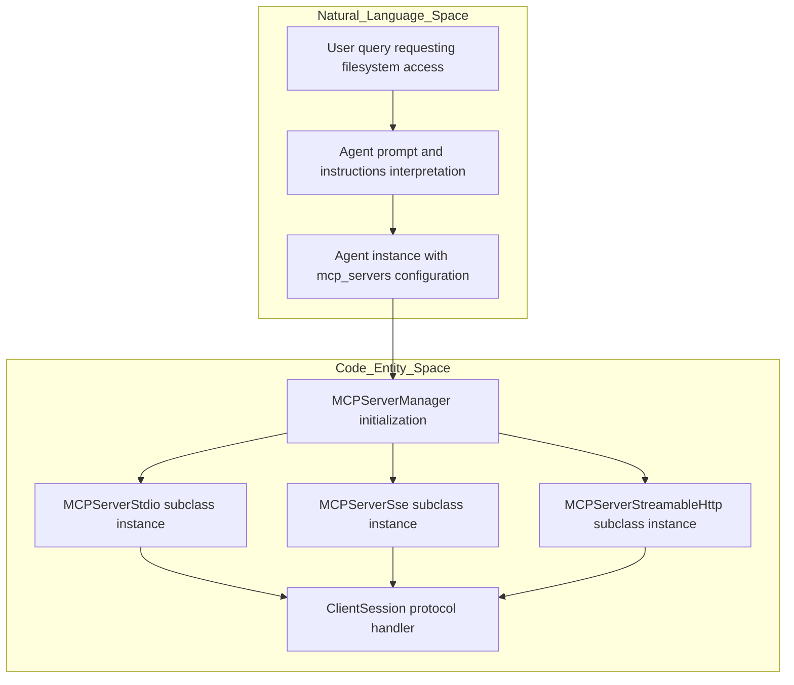
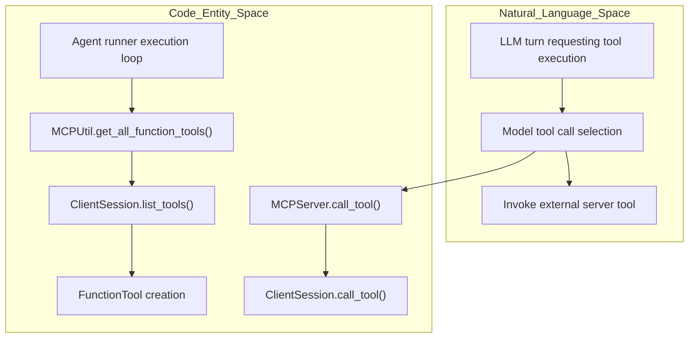
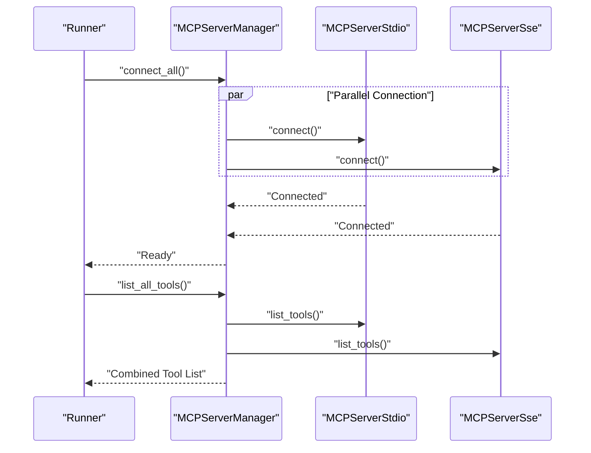

<!-- source: DeepWiki mcp.deepwiki.com · repo openai/openai-agents-python · page 11 Model Context Protocol (MCP) · fetched 2026-10-26 -->

# Model Context Protocol (MCP)

Relevant source files

The following files were used as context for generating this wiki page:

- [src/agents/mcp/__init__.py](src/agents/mcp/__init__.py)
- [src/agents/mcp/manager.py](src/agents/mcp/manager.py)
- [src/agents/mcp/server.py](src/agents/mcp/server.py)
- [src/agents/mcp/util.py](src/agents/mcp/util.py)
- [tests/mcp/__init__.py](tests/mcp/__init__.py)
- [tests/mcp/helpers.py](tests/mcp/helpers.py)
- [tests/mcp/servers/paginated.py](tests/mcp/servers/paginated.py)
- [tests/mcp/test_caching.py](tests/mcp/test_caching.py)
- [tests/mcp/test_client_session_retries.py](tests/mcp/test_client_session_retries.py)
- [tests/mcp/test_connect_disconnect.py](tests/mcp/test_connect_disconnect.py)
- [tests/mcp/test_list_page_limits.py](tests/mcp/test_list_page_limits.py)
- [tests/mcp/test_mcp_approval.py](tests/mcp/test_mcp_approval.py)
- [tests/mcp/test_mcp_imports.py](tests/mcp/test_mcp_imports.py)
- [tests/mcp/test_mcp_pagination_integration.py](tests/mcp/test_mcp_pagination_integration.py)
- [tests/mcp/test_mcp_resources.py](tests/mcp/test_mcp_resources.py)
- [tests/mcp/test_mcp_server_manager.py](tests/mcp/test_mcp_server_manager.py)
- [tests/mcp/test_mcp_server_manager_cleanup_state.py](tests/mcp/test_mcp_server_manager_cleanup_state.py)
- [tests/mcp/test_mcp_tracing.py](tests/mcp/test_mcp_tracing.py)
- [tests/mcp/test_mcp_util.py](tests/mcp/test_mcp_util.py)
- [tests/mcp/test_prompt_server.py](tests/mcp/test_prompt_server.py)
- [tests/mcp/test_runner_calls_mcp.py](tests/mcp/test_runner_calls_mcp.py)
- [tests/mcp/test_server_errors.py](tests/mcp/test_server_errors.py)
- [tests/test_tool_origin.py](tests/test_tool_origin.py)

The Model Context Protocol (MCP) is an open standard that enables agents to access tools, prompts, and resources from external servers. The OpenAI Agents SDK provides first-class support for MCP, allowing agents to dynamically discover and execute tools hosted on remote or local MCP servers.

This integration supports multiple transport layers, including **Stdio**, **SSE (HTTP)**, and **Streamable HTTP**, as well as **Hosted MCP** for OpenAI-managed infrastructure.

### MCP Integration Architecture

The following diagram illustrates how natural language user intent bridges to the underlying SDK and MCP protocol code entities.

**MCP System Context Diagram**

**Sources:** [src/agents/mcp/server.py:220-250](), [src/agents/mcp/util.py:94-105](), [src/agents/manager.py:1-50]()

---

## MCP Overview and Architecture

The MCP integration allows an `Agent` to communicate with one or more `MCPServer` instances. When an agent runs, it gathers tool definitions from its configured servers. These are converted into executable tools that the LLM can invoke.

- **MCPServer**: The base abstract class for all MCP transports [src/agents/mcp/server.py:224-225]().
- **Tool Discovery**: Tools are fetched via the MCP `list_tools` capability and wrapped into the SDK's tool system using `MCPUtil.get_all_function_tools` [src/agents/mcp/util.py:63-93]().
- **Prompt Discovery**: Servers can also expose prompts that can be retrieved via `list_prompts` and `get_prompt` [src/agents/mcp/server.py:343-380]().
- **Hosted MCP**: A specialized tool type, `HostedMCPTool`, that offloads execution to OpenAI-managed infrastructure [docs/mcp.md:70-75]().

For details, see [MCP Overview and Architecture](#11.1).

**Sources:** [src/agents/mcp/server.py:224-250](), [src/agents/mcp/util.py:63-93](), [docs/mcp.md:70-75]()

---

## MCP Server Implementations

The SDK provides several concrete implementations of the `MCPServer` class to handle different communication protocols:

| Class | Transport | Use Case |
|-------|-----------|----------|
| `MCPServerStdio` | Standard I/O | Local subprocesses (e.g., a Python or Node.js script) [src/agents/mcp/server.py:615-616]() |
| `MCPServerSse` | Server-Sent Events | HTTP-based servers with streaming updates [src/agents/mcp/server.py:850-851]() |
| `MCPServerStreamableHttp` | Custom HTTP | High-performance bidirectional HTTP transport using `StreamableHTTPTransport` [src/agents/mcp/server.py:934-935]() |

These classes manage the connection lifecycle, including automatic retries and transport-specific error handling like `is_http_connect_error` [src/agents/mcp/server.py:50-68]().

For details, see [MCP Server Implementations](#11.2).

**Sources:** [src/agents/mcp/server.py:530-1050](), [docs/mcp.md:18-27]()

---

## MCP Tool Discovery and Filtering

Not all tools on an MCP server may be appropriate for every agent. The SDK provides a `ToolFilter` mechanism to include or exclude specific tools.

- **Static Filtering**: Use `ToolFilterStatic` to provide `allowed_tool_names` or `blocked_tool_names` [src/agents/mcp/util.py:122-132]().
- **Dynamic Filtering**: A `ToolFilterCallable` can decide availability based on the `ToolFilterContext`, which includes the current `RunContextWrapper` and agent [src/agents/mcp/util.py:94-110]().
- **Caching**: The `cache_tools_list` parameter in `MCPServer` prevents redundant network calls to the MCP server during a single run [src/agents/mcp/server.py:534]().
- **Naming Strategy**: `include_server_in_tool_names` can be used in `mcp_config` to prefix tool names with their server name (e.g., `mcp_docs__search`), avoiding collisions [docs/mcp.md:57-57]().

**MCP Tool Discovery and Execution Flow**

For details, see [MCP Tool Discovery and Filtering](#11.3).

**Sources:** [src/agents/mcp/util.py:90-138](), [src/agents/mcp/server.py:534-540](), [docs/mcp.md:55-58]()

---

## MCP Server Manager

When an agent is configured with multiple MCP servers, the `MCPServerManager` coordinates their lifecycle. It ensures that all servers are connected before tool execution begins and handles cleanup when the session ends.

**Server Management Flow**

The manager supports a `strict` mode where failure to connect to any single server causes the entire operation to fail [src/agents/mcp/manager.py:60-75](). It also tracks `active_servers` and `failed_servers` for observability [src/agents/mcp/manager.py:44-45]().

For details, see [MCP Server Manager](#11.4).

**Sources:** [src/agents/mcp/manager.py:22-150]()

---

## MCP Error Handling and Approval

Executing tools on external servers introduces risks. The SDK provides safety gates and error translation:

- **Require Approval**: The `RequireApprovalSetting` can force a human-in-the-loop check before an MCP tool is executed, configurable via policies ("always", "never") or custom callables [src/agents/mcp/server.py:85-121]().
- **Error Wrapping**: MCP-specific errors (like `MCPError`) are caught and can be formatted for the LLM using a `failure_error_function` or `default_tool_error_function` [src/agents/mcp/server.py:231-235](), [src/agents/mcp/util.py:23-34]().
- **Meta Resolver**: The `MCPToolMetaResolver` allows attaching custom metadata (like authentication tokens or trace IDs) to every MCP request via the `_meta` field [src/agents/mcp/util.py:191-209]().
- **Schema Strictness**: `convert_schemas_to_strict` in `mcp_config` attempts to convert MCP tool schemas to strict JSON schemas using `ensure_strict_json_schema` for better model compatibility [docs/mcp.md:39-45](), [src/agents/mcp/util.py:22]().

For details, see [MCP Error Handling and Approval](#11.5).

**Sources:** [src/agents/mcp/server.py:85-121](), [src/agents/mcp/util.py:187-210](), [src/agents/mcp/server.py:231-235](), [docs/mcp.md:37-45]()

---

