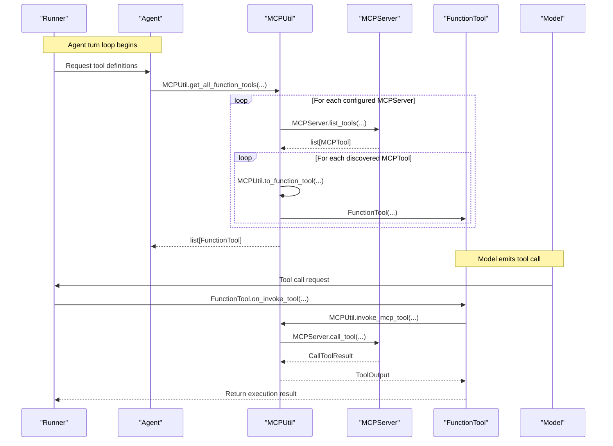

<!-- source: DeepWiki mcp.deepwiki.com · repo openai/openai-agents-python · page 11.1 MCP Overview and Architecture · fetched 2026-10-26 -->

# MCP Overview and Architecture

<details>
<summary>Relevant source files</summary>

The following files were used as context for generating this wiki page:

- [examples/mcp/filesystem_example/README.md](examples/mcp/filesystem_example/README.md)
- [examples/mcp/filesystem_example/sample_files/favorite_books.txt](examples/mcp/filesystem_example/sample_files/favorite_books.txt)
- [examples/mcp/filesystem_example/sample_files/favorite_cities.txt](examples/mcp/filesystem_example/sample_files/favorite_cities.txt)
- [examples/mcp/filesystem_example/sample_files/favorite_songs.txt](examples/mcp/filesystem_example/sample_files/favorite_songs.txt)
- [examples/mcp/get_all_mcp_tools_example/main.py](examples/mcp/get_all_mcp_tools_example/main.py)
- [examples/mcp/git_example/README.md](examples/mcp/git_example/README.md)
- [examples/mcp/git_example/main.py](examples/mcp/git_example/main.py)
- [examples/mcp/sse_example/README.md](examples/mcp/sse_example/README.md)
- [examples/mcp/sse_example/main.py](examples/mcp/sse_example/main.py)
- [examples/mcp/sse_example/server.py](examples/mcp/sse_example/server.py)
- [examples/mcp/tool_filter_example/main.py](examples/mcp/tool_filter_example/main.py)
- [src/agents/mcp/__init__.py](src/agents/mcp/__init__.py)
- [src/agents/mcp/manager.py](src/agents/mcp/manager.py)
- [src/agents/mcp/util.py](src/agents/mcp/util.py)
- [tests/mcp/helpers.py](tests/mcp/helpers.py)
- [tests/mcp/test_mcp_approval.py](tests/mcp/test_mcp_approval.py)
- [tests/mcp/test_mcp_imports.py](tests/mcp/test_mcp_imports.py)
- [tests/mcp/test_mcp_resources.py](tests/mcp/test_mcp_resources.py)
- [tests/mcp/test_mcp_server_manager.py](tests/mcp/test_mcp_server_manager.py)
- [tests/mcp/test_mcp_server_manager_cleanup_state.py](tests/mcp/test_mcp_server_manager_cleanup_state.py)
- [tests/mcp/test_mcp_tracing.py](tests/mcp/test_mcp_tracing.py)
- [tests/mcp/test_mcp_util.py](tests/mcp/test_mcp_util.py)
- [tests/mcp/test_prompt_server.py](tests/mcp/test_prompt_server.py)
- [tests/mcp/test_runner_calls_mcp.py](tests/mcp/test_runner_calls_mcp.py)
- [tests/test_tool_origin.py](tests/test_tool_origin.py)

</details>


## Purpose and Scope

This page introduces the Model Context Protocol (MCP) integration within the OpenAI Agents SDK (`agents.mcp`). It details the protocol's purpose, architectural approach, core component classes (`MCPServer`, `_MCPServerWithClientSession`, `MCPUtil`), transport mechanisms (`MCPServerStdio`, `MCPServerSse`, `MCPServerStreamableHttp`), tool discovery and conversion pipelines, and metadata resolution. For concrete server implementation details, see [MCP Server Implementations](11.2). For tool filtering and selection rules, see [MCP Tool Discovery and Filtering](11.3). For server supervisor management, see [MCP Server Manager](11.4). For error handling and human-in-the-loop approvals, see [MCP Error Handling and Approval](11.5).

Sources: [src/agents/mcp/util.py:1-440](), [src/agents/mcp/__init__.py:1-64]()

## Protocol Overview

The Model Context Protocol (MCP) standardizes how external servers provide tools, prompts, and context resources to language models. The OpenAI Agents SDK bridges MCP servers into standard SDK `FunctionTool` representations so that any `Agent` can seamlessly invoke remote or local MCP capabilities during execution loops.

When an agent configured with `mcp_servers` executes:
1. The SDK connects to each server using the configured transport protocol [src/agents/mcp/server.py:231-233]().
2. Available tools are queried via `list_tools()` [src/agents/mcp/util.py:209-228]().
3. Tool schemas are converted to SDK `FunctionTool` instances via `MCPUtil.to_function_tool()` [src/agents/mcp/util.py:230-311]().
4. Tool invocations dispatched by the model are routed through `MCPUtil.invoke_mcp_tool()` to the underlying server [src/agents/mcp/util.py:355-440]().
5. Responses (Text/Image contents) are normalized into SDK tool outputs [src/agents/mcp/util.py:404-426]().

Sources: [src/agents/mcp/util.py:180-440](), [src/agents/mcp/server.py:223-263]()

## Architecture Overview

The following architecture diagram bridges natural language concepts to the concrete code entities (`Agent`, `MCPServer`, `MCPUtil`, `FunctionTool`, `Runner`) implemented across the SDK codebase.

Title: MCP Integration Architecture (Code Entity Mapping)
```mermaid
graph TB
    subgraph "NaturalLanguageSpace"
        AgentConcept[""Agent Configuration with External Tools""]
        ServerConcept[""External Tool Server (stdio/HTTP)""]
    end

    subgraph "CodeEntitySpace"
        Agent["Agent<br/>src/agents/agent.py"]
        AgentMCPServers["Agent.mcp_servers<br/>list[MCPServer]"]
        MCPServer["MCPServer<br/>src/agents/mcp/server.py"]
        MCPUtil["MCPUtil<br/>src/agents/mcp/util.py"]
        FunctionTool["FunctionTool<br/>src/agents/tool.py"]
        Runner["Runner<br/>src/agents/runner.py"]
    end

    AgentConcept -->|"configured with"| Agent
    ServerConcept -->|"wrapped by"| MCPServer

    Agent -->|"has"| AgentMCPServers
    AgentMCPServers -->|"contains"| MCPServer
    
    Runner -->|"invokes tool resolution"| Agent
    Agent -->|"calls MCPUtil.get_all_function_tools()"| MCPUtil
    MCPList["MCPUtil.get_all_function_tools()"] -->|"calls list_tools()"| MCPServer
    MCPList -->|"creates"| FunctionTool
    
    FunctionTool -->|"registered on"| Agent
    Runner -->|"executes"| FunctionTool
    FunctionTool -->|"calls MCPUtil.invoke_mcp_tool()"| MCPUtil
    MCPUtil -->|"calls call_tool()"| MCPServer
```

**Key architectural principles:**
- **Abstraction via `MCPServer`**: All transport implementations inherit from `MCPServer`, providing uniform `connect()`, `cleanup()`, `list_tools()`, and `call_tool()` interfaces [src/agents/mcp/server.py:224-263]().
- **Tool Conversion Boundary**: `MCPUtil` maps raw `MCPTool` schemas into SDK `FunctionTool` instances, allowing agents to process them identically to native Python functions [src/agents/mcp/util.py:230-311]().
- **Lazy Connection Management**: MCP connections initialize lazily when tools are first requested or listed [src/agents/mcp/server.py:552-578]().

Sources: [src/agents/mcp/server.py:224-263](), [src/agents/mcp/util.py:180-311](), [src/agents/mcp/server.py:552-578]()

## Core Components

### `MCPServer` Abstract Base Class

The `MCPServer` base class defines the protocol interface for all MCP servers:

| Method / Property | Signature / Type | Purpose |
|-------------------|------------------|---------|
| `connect()` | `async def connect() -> None` | Establish connection to server [src/agents/mcp/server.py:231]() |
| `cleanup()` | `async def cleanup() -> None` | Release underlying transport resources [src/agents/mcp/server.py:235]() |
| `list_tools()` | `async def list_tools(...) -> list[MCPTool]` | Retrieve exposed server tools [src/agents/mcp/server.py:239]() |
| `call_tool()` | `async def call_tool(...) -> CallToolResult` | Execute a specific tool invocation [src/agents/mcp/server.py:243]() |
| `name` | `property -> str` | Readable identifier for logging and tracing [src/agents/mcp/server.py:255]() |

Sources: [src/agents/mcp/server.py:224-263]()

### `_MCPServerWithClientSession` Base Class

The internal `_MCPServerWithClientSession` class manages `mcp.ClientSession` lifecycles, retries, and tool caching:
- **Tool Caching**: When `cache_tools_list=True`, tool definitions are cached locally until explicitly invalidated [src/agents/mcp/server.py:552-578]().
- **Tool Filtering**: Applies `ToolFilter` (allowlists/blocklists or dynamic callable filters) before returning tools to the agent [src/agents/mcp/util.py:94-138]().

Sources: [src/agents/mcp/server.py:265-748](), [src/agents/mcp/util.py:94-138]()

### `MCPUtil` Utility Class

`MCPUtil` provides static methods for aggregating, converting, and invoking MCP tools [src/agents/mcp/util.py:180-440]().

Sources: [src/agents/mcp/util.py:180-440]()

## Transport Mechanisms

The SDK supports three transport implementations:
- **`MCPServerStdio`**: Communicates with local subprocess tools over standard input/output pipes [src/agents/mcp/server.py:779]() (e.g., `uvx mcp-server-git`).
- **`MCPServerSse`**: Connects to remote servers using HTTP combined with Server-Sent Events [src/agents/mcp/server.py:1026]().
- **`MCPServerStreamableHttp`**: Connects via bidirectional streamable HTTP endpoints [src/agents/mcp/server.py:1261]().

Sources: [src/agents/mcp/server.py:779-1703]()

## Tool Conversion and Execution Flow

The sequence diagram below details the tool discovery and execution pipeline mapping `Runner`, `Agent`, `MCPUtil`, `MCPServer`, and `FunctionTool`.

Title: MCP Tool Lifecycle and Execution Sequence


Sources: [src/agents/mcp/util.py:180-440](), [src/agents/mcp/server.py:224-263]()

## Tracing Integration

MCP operations emit instrumentation spans:
- **`mcp_tools` span**: Recorded during `list_tools()` tool discovery phases, containing the server name and returned tool list [src/agents/mcp/util.py:216]().
- **`function` span with `mcp_data`**: Recorded when executing an MCP tool call, capturing invocation context and server metadata [src/agents/mcp/util.py:428-438]().

Sources: [src/agents/mcp/util.py:216](), [src/agents/mcp/util.py:428-438]()

## Metadata Resolution

Dynamic metadata (such as per-request authentication headers or request IDs) can be injected into MCP calls via `tool_meta_resolver` [src/agents/mcp/util.py:191-209]():
- `MCPToolMetaContext` provides access to the current run context, server name, tool name, and parsed arguments [src/agents/mcp/util.py:142-157]().
- The resolver returns a dictionary merged into the MCP `_meta` request payload [src/agents/mcp/util.py:313-353]().

Sources: [src/agents/mcp/util.py:138-157](), [src/agents/mcp/util.py:313-353]()

---

