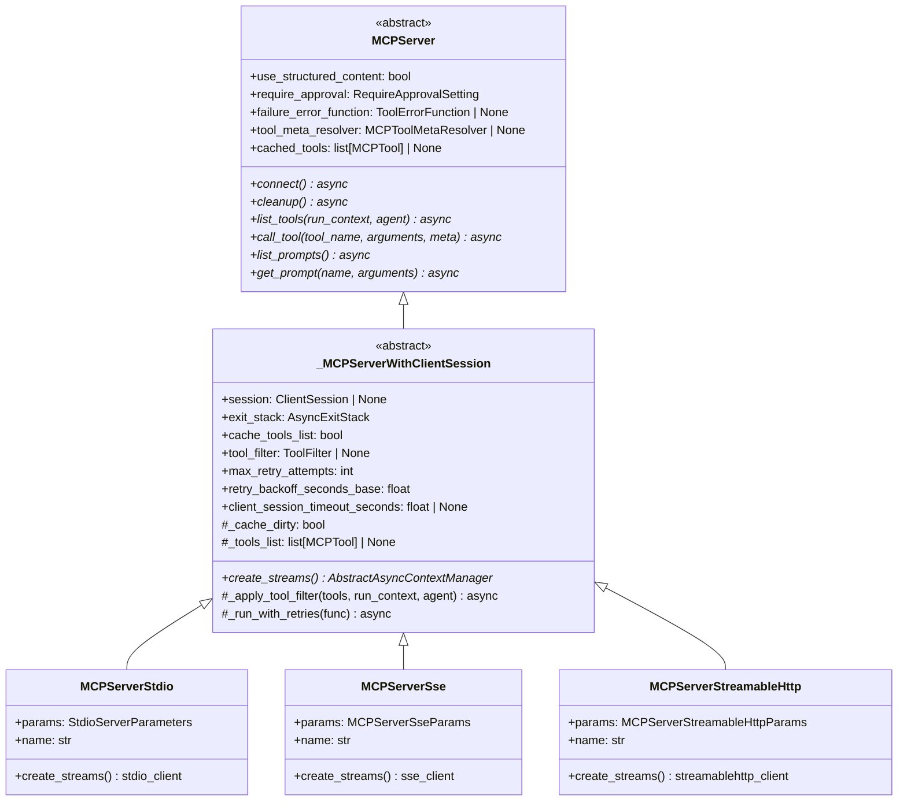
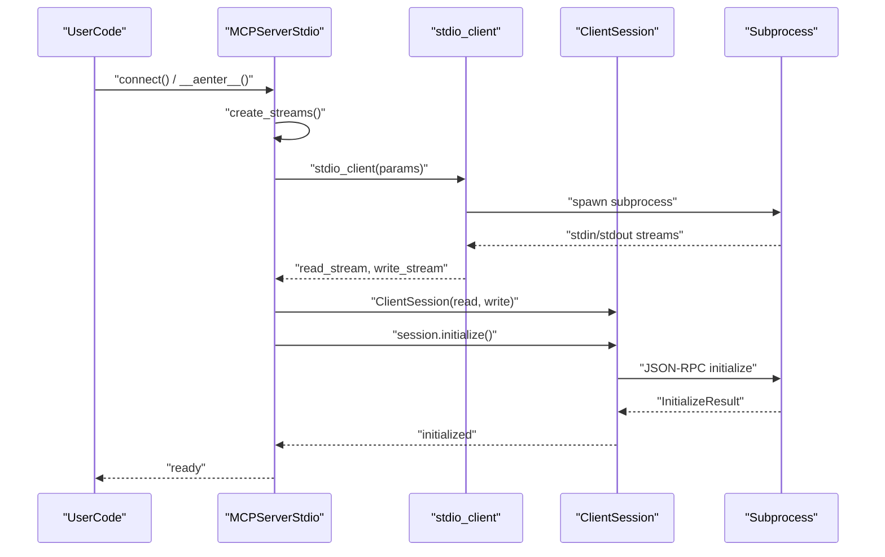
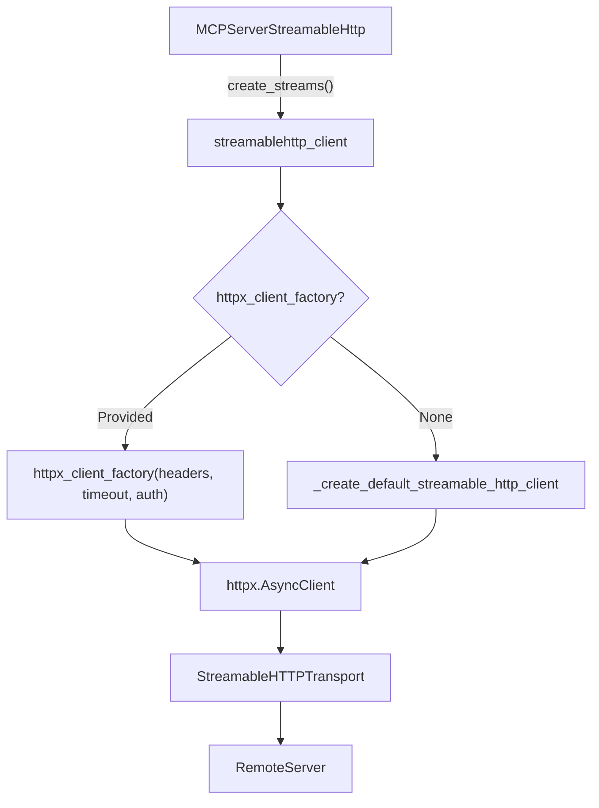
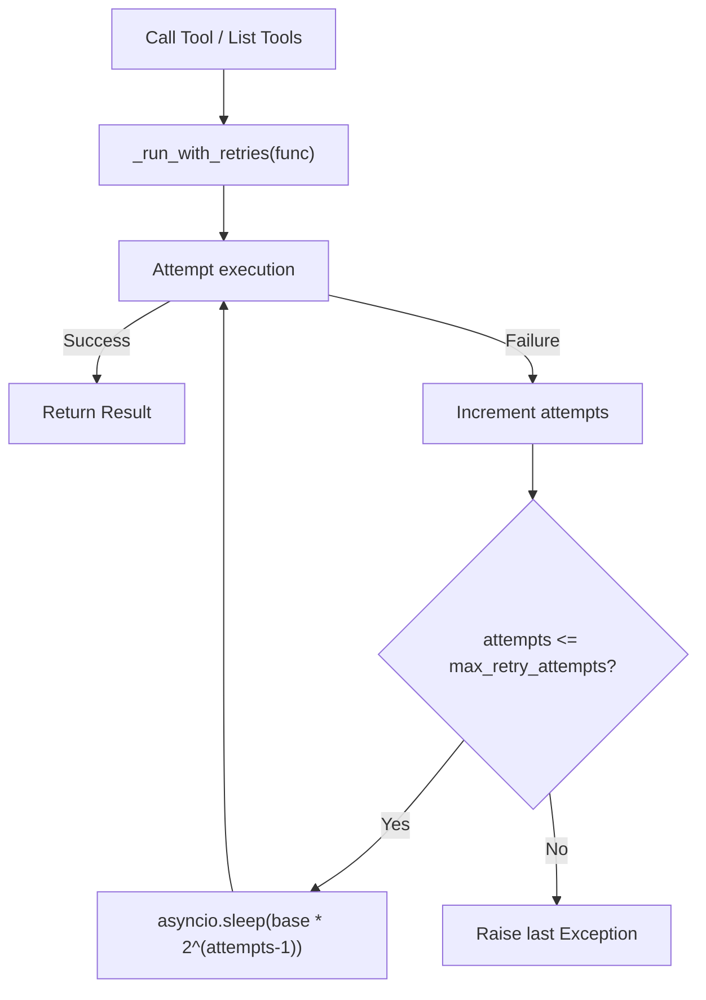

<!-- source: DeepWiki mcp.deepwiki.com · repo openai/openai-agents-python · page 11.2 MCP Server Implementations · fetched 2026-10-26 -->

# MCP Server Implementations

Relevant source files

The following files were used as context for generating this wiki page:

- [src/agents/mcp/server.py](src/agents/mcp/server.py)
- [tests/mcp/__init__.py](tests/mcp/__init__.py)
- [tests/mcp/servers/paginated.py](tests/mcp/servers/paginated.py)
- [tests/mcp/test_caching.py](tests/mcp/test_caching.py)
- [tests/mcp/test_client_session_retries.py](tests/mcp/test_client_session_retries.py)
- [tests/mcp/test_connect_disconnect.py](tests/mcp/test_connect_disconnect.py)
- [tests/mcp/test_list_page_limits.py](tests/mcp/test_list_page_limits.py)
- [tests/mcp/test_mcp_pagination_integration.py](tests/mcp/test_mcp_pagination_integration.py)
- [tests/mcp/test_server_errors.py](tests/mcp/test_server_errors.py)

This document describes the concrete MCP server implementations provided by the SDK for connecting to Model Context Protocol servers. These implementations handle transport-specific communication details, tool discovery, automatic pagination, caching, and retry logic.

For an overview of MCP integration patterns and when to use each server type, see [11.1 MCP Overview and Architecture](). For tool discovery and filtering mechanisms, see [11.3 MCP Tool Discovery and Filtering]().

---

## Server Architecture

The SDK provides three self-managed MCP server implementations, each suited to different transport mechanisms. All implementations inherit from `_MCPServerWithClientSession` [src/agents/mcp/server.py:266-266](), which extends the abstract `MCPServer` base class [src/agents/mcp/server.py:224-224]().

| Implementation | Transport | Use Case | Context Manager |
|---------------|-----------|----------|-----------------|
| `MCPServerStdio` | stdio | Local subprocess execution | Yes |
| `MCPServerSse` | HTTP with Server-Sent Events | Remote servers with SSE support | Yes |
| `MCPServerStreamableHttp` | Streamable HTTP | Remote servers with HTTP streaming | Yes |

### Class Hierarchy

The following diagram maps the code entities to the system architecture, bridging system concepts to concrete classes in `src/agents/mcp/server.py`:

**MCP Server Implementation Hierarchy**

Sources: [src/agents/mcp/server.py:224-264](), [src/agents/mcp/server.py:266-749](), [src/agents/mcp/server.py:780-878](), [src/agents/mcp/server.py:880-978](), [src/agents/mcp/server.py:980-1078]()

---

## MCPServerStdio

`MCPServerStdio` spawns a local subprocess and communicates over stdin/stdout. This is ideal for prototyping or when the MCP server is distributed as a command-line tool.

### Configuration

Parameters are defined via `StdioServerParameters` [src/agents/mcp/server.py:782-782]():

| Parameter | Type | Description |
|-----------|------|-------------|
| `command` | `str` | Executable to run (e.g., `"python"`, `"node"`) |
| `args` | `list[str]` | Command-line arguments |
| `env` | `dict[str, str]` | Environment variables |
| `cwd` | `str | Path` | Working directory for the subprocess |

### Initialization Sequence

The following diagram illustrates the initialization flow bridging client session execution to `stdio_client` and subprocess spawning in `src/agents/mcp/server.py`:

**MCPServerStdio Connection Sequence**

Sources: [src/agents/mcp/server.py:780-878](), [src/agents/mcp/server.py:862-873](), [src/agents/mcp/server.py:486-552]()

---

## MCPServerSse

`MCPServerSse` uses the Server-Sent Events (SSE) transport. This is suitable for remote servers that push updates to the client.

### Configuration

Parameters are defined via `MCPServerSseParams` [src/agents/mcp/server.py:882-894]():

| Parameter | Type | Description |
|-----------|------|-------------|
| `url` | `str` | Server URL endpoint for SSE. |
| `headers` | `dict[str, str]` | HTTP headers for authentication. |
| `timeout` | `float | timedelta` | HTTP request timeout for the initial connection. |
| `sse_read_timeout` | `float | timedelta` | Timeout for reading SSE events. |
| `httpx_client_factory` | `HttpClientFactory` | Custom `httpx.AsyncClient` factory. |

### Initialization Sequence

**MCPServerSse Connection Sequence**

Sources: [src/agents/mcp/server.py:880-978](), [src/agents/mcp/server.py:962-973](), [src/agents/mcp/server.py:486-552]()

---

## MCPServerStreamableHttp

`MCPServerStreamableHttp` uses the Streamable HTTP transport, providing bidirectional streaming over HTTP. This is the recommended transport for remote production servers.

### Configuration

Parameters are defined via `MCPServerStreamableHttpParams` [src/agents/mcp/server.py:982-996]():

| Parameter | Type | Description |
|-----------|------|-------------|
| `url` | `str` | Server URL endpoint |
| `headers` | `dict[str, str]` | HTTP headers for authentication |
| `timeout` | `float | timedelta` | HTTP request timeout |
| `sse_read_timeout` | `float | timedelta` | Timeout for reading SSE events. |
| `terminate_on_close` | `bool` | Whether to send a terminate signal to the server on close. |
| `httpx_client_factory` | `HttpClientFactory` | Custom `httpx.AsyncClient` factory |
| `transport_factory` | `Callable[[str], StreamableHTTPTransport]` | Custom `StreamableHTTPTransport` factory. |

### Custom Client Factory

The `httpx_client_factory` parameter allows users to inject custom `httpx` configurations, such as custom SSL contexts or proxy settings. It must match the `HttpClientFactory` protocol [src/agents/mcp/util.py:77-90]().

**MCPServerStreamableHttp HTTP Client Configuration**

Sources: [src/agents/mcp/server.py:980-1078](), [src/agents/mcp/util.py:77-90](), [src/agents/mcp/server.py:1095-1110]()

---

## Connection Lifecycle and Retry Logic

### Connection Management

All servers implement `connect()` and `cleanup()`. The `connect()` method establishes the underlying transport, creates the `mcp.ClientSession`, and performs the protocol handshake [src/agents/mcp/server.py:486-552](). If connection fails, `cleanup()` is automatically called to close streams and release resources [src/agents/mcp/server.py:549-552]().

### Retry Mechanism

The `_run_with_retries` method provides exponential backoff for protocol-level requests like `list_tools` and `call_tool` [src/agents/mcp/server.py:554-621](). This mechanism handles transient network issues or temporary server unavailability.

| Setting | Type | Description |
|-----------|------|-------------|
| `max_retry_attempts` | `int` | Max retries before failing (`-1` for unlimited) |
| `retry_backoff_seconds_base` | `float` | Base for exponential backoff (e.g., `1.0`) |
| `retry_backoff_seconds_max` | `float | None` | Maximum cap on retry backoff delay |

**Retry Flow with Exponential Backoff**

The `_run_with_retries` method also manages retry budgets across paginated requests and session isolation scenarios [src/agents/mcp/server.py:591-621](), [tests/mcp/test_client_session_retries.py:131-158]().

Sources: [src/agents/mcp/server.py:554-621](), [src/agents/mcp/server.py:279-282](), [tests/mcp/test_client_session_retries.py:67-73]()

---

## Pagination and Caching

### Pagination Support

MCP listing methods (`list_tools`, `list_prompts`, etc.) support automatic pagination using cursor parameters (`PaginatedRequestParams`) [src/agents/mcp/server.py:32-34](). Servers can be configured with `max_list_pages` to bound resource enumeration and prevent runaway pagination loops [tests/mcp/test_list_page_limits.py:40-69](). If `max_list_pages` is exceeded without reaching a termination cursor, a `UserError` is raised [tests/mcp/test_list_page_limits.py:65-67]().

### Tool List Caching

If `cache_tools_list` is `True`, the server stores the result of the first `list_tools()` call in `_tools_list` and sets `_cache_dirty = False` [src/agents/mcp/server.py:327-337](). Subsequent calls return the cached list unless `invalidate_tools_cache()` is called [src/agents/mcp/server.py:441-443](). Concurrency safety ensures that background refreshes or parallel listing requests do not overwrite newer cache states [tests/mcp/test_caching.py:74-158]().

Sources: [src/agents/mcp/server.py:327-337](), [src/agents/mcp/server.py:441-443](), [tests/mcp/test_caching.py:74-158](), [tests/mcp/test_list_page_limits.py:40-69]()

---

## Parameter Validation and Execution

### Parameter Validation

Before making a remote `call_tool` request, the server performs local validation of required parameters if the tool schema is available in the cache [src/agents/mcp/server.py:623-655]().

**Validation Logic:**
1. Check if `arguments` is a dictionary (JSON object) [src/agents/mcp/server.py:649-652]().
2. Compare provided keys against the `required` list in the tool's `inputSchema` [src/agents/mcp/server.py:637-647]().
3. Raise `UserError` if required parameters are missing [src/agents/mcp/server.py:646-647]().

Sources: [src/agents/mcp/server.py:623-655]()

---

## Prompt and Resource Support

MCP servers also support listing and retrieving prompts and resources:

*   **Prompts:** `list_prompts()` returns available templates [src/agents/mcp/server.py:656-663](). `get_prompt(name, arguments)` retrieves the formatted prompt content [src/agents/mcp/server.py:665-673]().
*   **Resources:** `list_resources()` and `list_resource_templates()` allow discovery of data sources [src/agents/mcp/server.py:674-689](). `read_resource(uri)` fetches the actual data [src/agents/mcp/server.py:691-699]().

Sources: [src/agents/mcp/server.py:656-699]()

---

