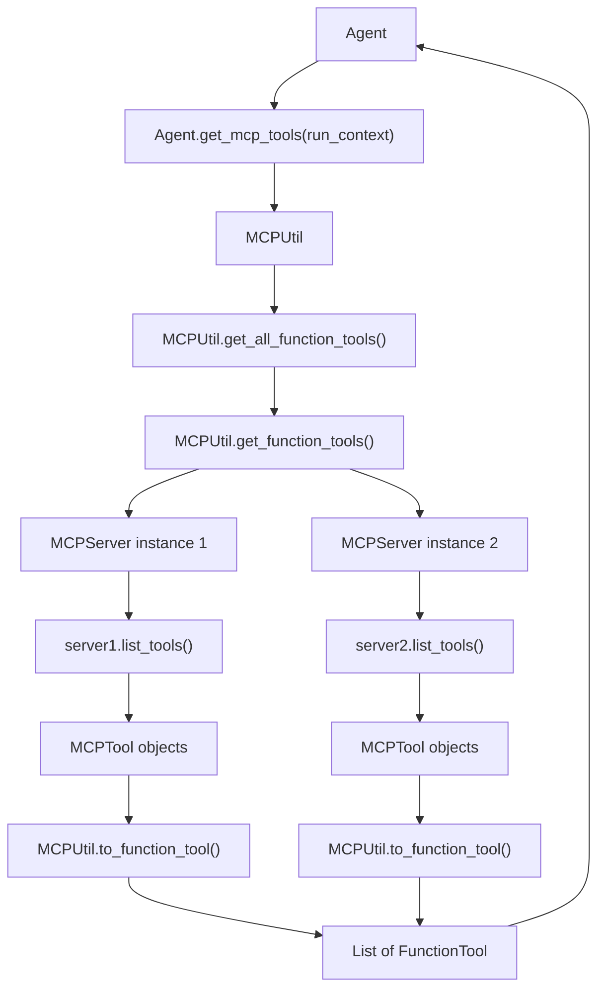
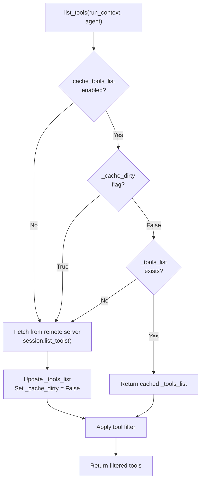

<!-- source: DeepWiki mcp.deepwiki.com · repo openai/openai-agents-python · page 11.3 MCP Tool Discovery and Filtering · fetched 2026-10-26 -->

# MCP Tool Discovery and Filtering

<details>
<summary>Relevant source files</summary>

The following files were used as context for generating this wiki page:

- [src/agents/mcp/__init__.py](src/agents/mcp/__init__.py)
- [src/agents/mcp/manager.py](src/agents/mcp/manager.py)
- [src/agents/mcp/util.py](src/agents/mcp/util.py)
- [tests/mcp/helpers.py](tests/mcp/helpers.py)
- [tests/mcp/test_mcp_approval.py](tests/mcp/test_mcp_approval.py)
- [tests/mcp/test_mcp_imports.py](tests/mcp/test_mcp_imports.py)
- [tests/mcp/test_mcp_resources.py](tests/mcp/test_mcp_resources.py)
- [tests/mcp/test_mcp_server_manager.py](tests/mcp/test_mcp_server_manager.py)
- [tests/mcp/test_mcp_server_manager_cleanup_state.py](tests/mcp/test_mcp_server_manager_cleanup_state.py)
- [tests/mcp/test_mcp_tracing.py](tests/mcp/test_mcp_tracing.py)
- [tests/mcp/test_mcp_util.py](tests/mcp/test_mcp_util.py)
- [tests/mcp/test_prompt_server.py](tests/mcp/test_prompt_server.py)
- [tests/mcp/test_runner_calls_mcp.py](tests/mcp/test_runner_calls_mcp.py)
- [tests/test_tool_origin.py](tests/test_tool_origin.py)

</details>


This page details the Model Context Protocol (MCP) tool discovery and filtering mechanisms within the OpenAI Agents SDK. It covers how tools are fetched via `list_tools()`, cached using `cache_tools_list`, filtered via static or dynamic policies using `ToolFilterContext`, and how name collisions are managed across multiple servers.

For server connection management and implementations, see page 11.2. For error handling and tool approvals, see page 11.5.

---

## 1. Tool Discovery Process (`list_tools()`)

The SDK discovers MCP tools by invoking `list_tools()` on `MCPServer` instances. This process queries connected MCP servers for their available tool definitions, normalizes schemas, converts them into Agents SDK `FunctionTool` objects, and handles potential name collisions.

### Discovery Flow Architecture

Title: MCP Tool Discovery Flow


**Key Execution Steps:**
1. **Agent Level**: The agent requests its available tools through `get_mcp_tools(run_context)`.
2. **Aggregation**: `MCPUtil.get_all_function_tools()` coordinates querying multiple servers and aggregates the resulting tool objects [src/agents/mcp/util.py:644-672]().
3. **Server Query**: `MCPServer.list_tools()` fetches raw tool lists from the underlying MCP client session.
4. **Tool Conversion**: Each retrieved `MCPTool` is transformed into an SDK `FunctionTool` via `MCPUtil.to_function_tool()` [src/agents/mcp/util.py:236-288]().

Sources: [src/agents/mcp/util.py:236-288](), [src/agents/mcp/util.py:644-672]()

---

## 2. Tool Caching (`cache_tools_list`)

To minimize network latency and overhead from repeated server discovery requests, the SDK supports optional tool list caching per server via the `cache_tools_list` configuration parameter.

Title: MCP Tool Caching Logic


### Caching Behaviors
- **Disabled (`cache_tools_list=False`)**: Tools are fetched from the remote server on every invocation.
- **Enabled (`cache_tools_list=True`)**: Subsequent tool discovery calls return cached tool lists unless `invalidate_tools_cache()` is called, which sets `_cache_dirty = True`.

Sources: [src/agents/mcp/util.py:44-57](), [tests/mcp/helpers.py:54-54]()

---

## 3. Tool Filtering (`tool_filter`)

The SDK provides robust static and dynamic filtering capabilities to control which tools exposed by an MCP server are made available to an agent.

### Filter Types and Structures

| Filter Type | Python Type | Description |
|-------------|-------------|-------------|
| **Static Filter** | `ToolFilterStatic` (TypedDict) | Uses explicit allowlists (`allowed_tool_names`) and/or blocklists (`blocked_tool_names`) [src/agents/mcp/util.py:122-133](). |
| **Callable Filter** | `ToolFilterCallable` | A synchronous or asynchronous callable taking `(ToolFilterContext, MCPTool)` returning a boolean [src/agents/mcp/util.py:107-119](). |
| **None** | `None` | No filtering; all discovered tools are exposed [src/agents/mcp/util.py:135-138](). |

Sources: [src/agents/mcp/util.py:107-138](), [src/agents/mcp/util.py:213-233]()

---

### `ToolFilterContext`

When using dynamic filter callables, the SDK constructs and passes a `ToolFilterContext` instance containing execution and scoping metadata [src/agents/mcp/util.py:94-105]():

```python
@dataclass
class ToolFilterContext:
    run_context: RunContextWrapper[Any]
    agent: AgentBase
    server_name: str
```

- `run_context`: Wraps the active run context [src/agents/mcp/util.py:97-98]().
- `agent`: The specific agent requesting the tools [src/agents/mcp/util.py:100-101]().
- `server_name`: The identifier of the MCP server providing the tools [src/agents/mcp/util.py:103-104]().

Sources: [src/agents/mcp/util.py:94-105]()

---

## 4. Name Collision Handling

When multiple MCP servers or local tools share identical names, collisions can occur. The SDK resolves name collisions during aggregation:

- **Strict Validation**: Duplicate tool names across servers trigger a `UserError` by default [src/agents/mcp/util.py:644-672]().
- **Server Prefixes**: If name collision handling or server namespace inclusion is configured, tool names are automatically prefixed (e.g., `mcp_{server_name}__{tool_name}`) to guarantee uniqueness across agent toolsets [src/agents/mcp/util.py:63-75]().

Sources: [src/agents/mcp/util.py:19-20](), [src/agents/mcp/util.py:63-75](), [src/agents/mcp/util.py:644-672]()

---

