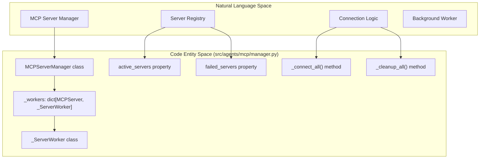
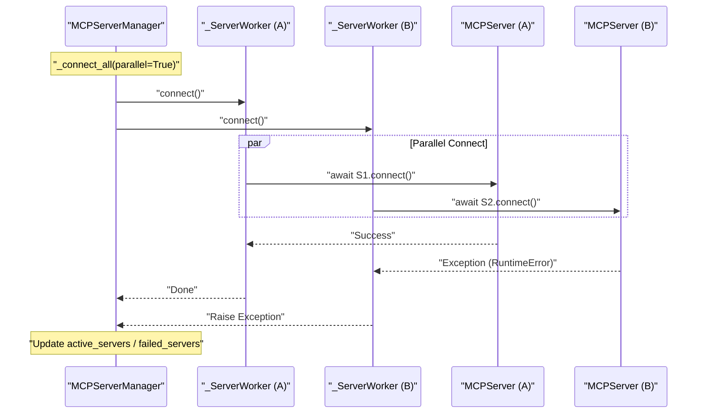

<!-- source: DeepWiki mcp.deepwiki.com · repo openai/openai-agents-python · page 11.4 MCP Server Manager · fetched 2026-10-26 -->

# MCP Server Manager

<details>
<summary>Relevant source files</summary>

The following files were used as context for generating this wiki page:

- [src/agents/mcp/__init__.py](src/agents/mcp/__init__.py)
- [src/agents/mcp/manager.py](src/agents/mcp/manager.py)
- [src/agents/mcp/util.py](src/agents/mcp/util.py)
- [tests/mcp/helpers.py](tests/mcp/helpers.py)
- [tests/mcp/test_mcp_approval.py](tests/mcp/test_mcp_approval.py)
- [tests/mcp/test_mcp_imports.py](tests/mcp/test_mcp_imports.py)
- [tests/mcp/test_mcp_resources.py](tests/mcp/test_mcp_resources.py)
- [tests/mcp/test_mcp_server_manager.py](tests/mcp/test_mcp_server_manager.py)
- [tests/mcp/test_mcp_server_manager_cleanup_state.py](tests/mcp/test_mcp_server_manager_cleanup_state.py)
- [tests/mcp/test_mcp_tracing.py](tests/mcp/test_mcp_tracing.py)
- [tests/mcp/test_mcp_util.py](tests/mcp/test_mcp_util.py)
- [tests/mcp/test_prompt_server.py](tests/mcp/test_prompt_server.py)
- [tests/mcp/test_runner_calls_mcp.py](tests/mcp/test_runner_calls_mcp.py)
- [tests/test_tool_origin.py](tests/test_tool_origin.py)

</details>


The `MCPServerManager` class orchestrates the lifecycle of multiple MCP servers, managing their connection, reconnection, and cleanup. It provides centralized control over server availability and failure recovery for agents that depend on MCP tools.

For information about individual MCP server implementations, see [11.2 MCP Server Implementations](). For details on tool discovery and filtering from MCP servers, see [11.3 MCP Tool Discovery and Filtering]().

## Purpose and Scope

`MCPServerManager` solves the operational challenge of connecting to multiple MCP servers reliably. When an agent uses tools from several external servers (e.g., database access, web search, file operations), each server may fail independently. The manager:

- Connects multiple servers concurrently or sequentially [src/agents/mcp/manager.py:153-154]().
- Tracks which servers succeeded (`active_servers`) and which failed (`failed_servers`) [src/agents/mcp/manager.py:181-186]().
- Retries failed connections without affecting working servers via `reconnect()` [src/agents/mcp/manager.py:284-306]().
- Ensures cleanup happens in the correct async task context using internal `_ServerWorker` tasks [src/agents/mcp/manager.py:37-80]().
- Provides strict mode for all-or-nothing connection requirements [src/agents/mcp/manager.py:167]().

This abstraction allows agents to focus on tool usage rather than connection management complexity.

Sources: [src/agents/mcp/manager.py:37-80](), [src/agents/mcp/manager.py:153-186](), [src/agents/mcp/manager.py:284-306]()

## Manager Architecture

The following diagram maps the high-level management concepts to the specific code entities in the SDK.

### Manager Code Entity Mapping

Sources: [src/agents/mcp/manager.py:37-41](), [src/agents/mcp/manager.py:119-186]()

The manager maintains state via:
- **`active_servers`**: Successfully connected servers ready for tool invocation [src/agents/mcp/manager.py:207-213]().
- **`failed_servers`**: Servers that failed connection attempts [src/agents/mcp/manager.py:181]().
- **`errors`**: A mapping of servers to the specific exceptions encountered during connection [src/agents/mcp/manager.py:184]().

Internal state includes:
- **`_workers`**: A dictionary mapping each `MCPServer` to a `_ServerWorker` that manages its specific lifecycle task [src/agents/mcp/manager.py:179]().

Sources: [src/agents/mcp/manager.py:179](), [src/agents/mcp/manager.py:181](), [src/agents/mcp/manager.py:184](), [src/agents/mcp/manager.py:207-213]()

## Connection Modes

### Sequential Connection
By default, `MCPServerManager` connects servers one at a time if `connect_in_parallel` is `False`. However, even in sequential mode, it uses the worker architecture to ensure that each server's `connect()` and `cleanup()` execute in the same task, which is required by many MCP transports [src/agents/mcp/manager.py:153-154]().

### Parallel Connection
When `connect_in_parallel=True`, the manager triggers the connection logic across all worker tasks concurrently using `asyncio.gather` [src/agents/mcp/manager.py:262-273]().

### Parallel Execution Flow

Sources: [src/agents/mcp/manager.py:47-48](), [src/agents/mcp/manager.py:61-79](), [src/agents/mcp/manager.py:262-273]()

## Task Context Preservation
The manager ensures `connect()` and `cleanup()` execute in the same task via the `_ServerWorker`. This is critical because many MCP transports (like `stdio`) rely on task-local state or `anyio` cancellation scopes [src/agents/mcp/manager.py:81-86]().

The utility function `_run_with_timeout_in_task` is used to apply timeouts while preserving the task identity, avoiding the creation of new tasks that `asyncio.wait_for` might trigger on older Python versions [src/agents/mcp/manager.py:81-117]().

Sources: [src/agents/mcp/manager.py:81-117]()

## Server State Tracking

The manager provides properties for inspecting server state:

| Property | Type | Description |
|----------|------|-------------|
| `active_servers` | `list[MCPServer]` | Servers that connected successfully. [src/agents/mcp/manager.py:207-213]() |
| `failed_servers` | `list[MCPServer]` | Servers that failed connection attempts. [src/agents/mcp/manager.py:181]() |
| `errors` | `dict[MCPServer, Exception]` | Mapping of servers to their connection errors. [src/agents/mcp/manager.py:184]() |

State transitions occur during:
- **`__aenter__`**: Automatically calls `connect_all()` [src/agents/mcp/manager.py:192-194]().
- **`reconnect(failed_only=True)`**: Retries only servers currently in the `failed_servers` list [src/agents/mcp/manager.py:291-294]().
- **`reconnect(failed_only=False)`**: Cleans up and reconnects every server in the manager [src/agents/mcp/manager.py:296-302]().

Sources: [src/agents/mcp/manager.py:181](), [src/agents/mcp/manager.py:184](), [src/agents/mcp/manager.py:192-194](), [src/agents/mcp/manager.py:207-213](), [src/agents/mcp/manager.py:291-302]()

## Connection Strategies

### Standard Mode (Non-Strict)
In standard mode (`strict=False`), individual server failures are logged and recorded in `failed_servers`, but the manager allows the application to proceed with the subset of servers that succeeded [src/agents/mcp/manager.py:167]().

### Strict Mode
When `strict=True`, the first connection failure encountered during `connect_all()` or `reconnect()` will be raised immediately to the caller, effectively treating the entire group of servers as a single unit of failure [src/agents/mcp/manager.py:277-282]().

### Reconnection
The `reconnect()` method allows refreshing server connections at runtime. If a server was previously failed, a successful reconnection will move it from `failed_servers` to `active_servers` [src/agents/mcp/manager.py:284-332]().

Sources: [src/agents/mcp/manager.py:167](), [src/agents/mcp/manager.py:277-332]()

## Error Handling and Cancellation

The manager handles different failure scenarios during the connection phase:

| Scenario | Logic | Result |
|----------|-------|--------|
| **Connection Timeout** | `connect_timeout_seconds` | The connection attempt is cancelled and recorded as a failure [src/agents/mcp/manager.py:164](). |
| **CancelledError** | `suppress_cancelled_error` | If `True`, connection cancellations are treated as managed failures rather than crashing the manager [src/agents/mcp/manager.py:168](). |
| **Cleanup Failure** | `cleanup_timeout_seconds` | Cleanup attempts are also wrapped in timeouts to prevent hanging during shutdown [src/agents/mcp/manager.py:165](). |

Sources: [src/agents/mcp/manager.py:160-178](), [src/agents/mcp/manager.py:334-362]()

## Implementation Example

```python
from agents.mcp import MCPServerManager, MCPServerStdio

# Initialize servers
server1 = MCPServerStdio(params={"command": "uvx", "args": ["mcp-server-git"]})
server2 = MCPServerStdio(params={"command": "npx", "args": ["@modelcontextprotocol/server-filesystem", "."]})

# Use manager to orchestrate connections
async with MCPServerManager(
    [server1, server2], 
    connect_in_parallel=True,
    strict=False
) as manager:
    # active_servers only contains servers that connected successfully
    agent = Agent(
        name="Assistant",
        mcp_servers=manager.active_servers
    )
    
    # If a server was down, we can try again later
    if manager.failed_servers:
        await manager.reconnect(failed_only=True)
```
Sources: [src/agents/mcp/manager.py:127-142](), [src/agents/mcp/manager.py:284-294]()

Sources:
- [src/agents/mcp/manager.py:1-362]()
- [src/agents/mcp/server.py:1-126]()
- [tests/mcp/test_mcp_server_manager.py:1-245]()

---

