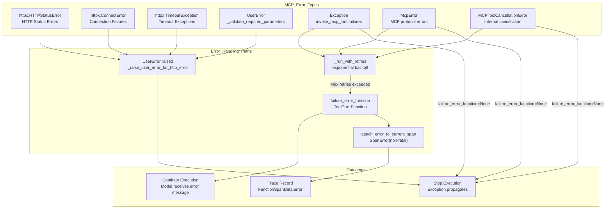
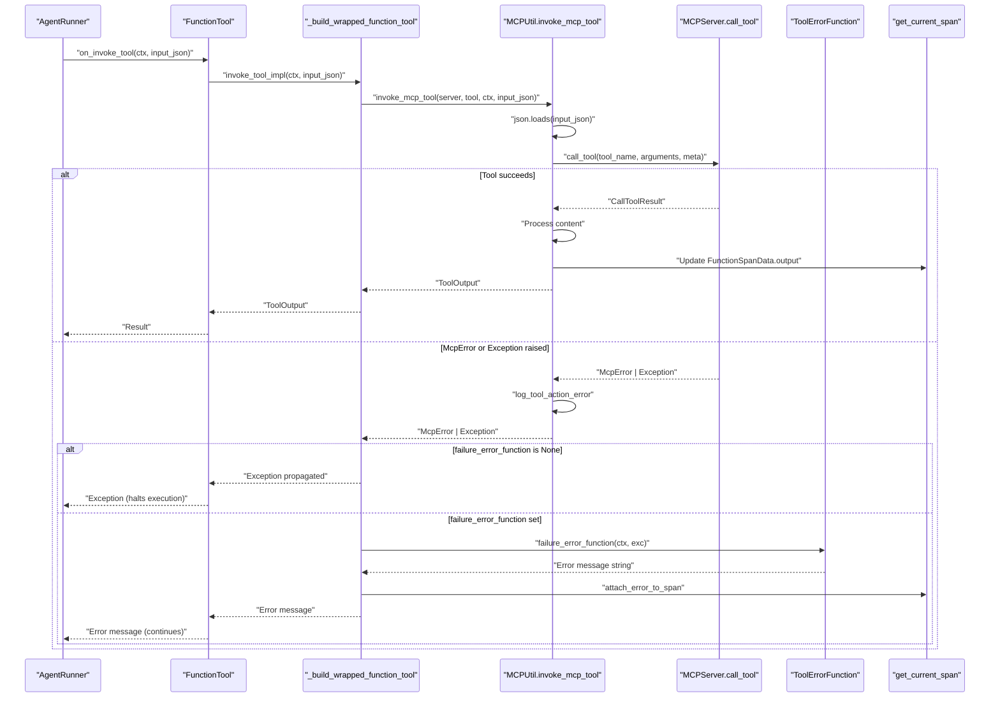
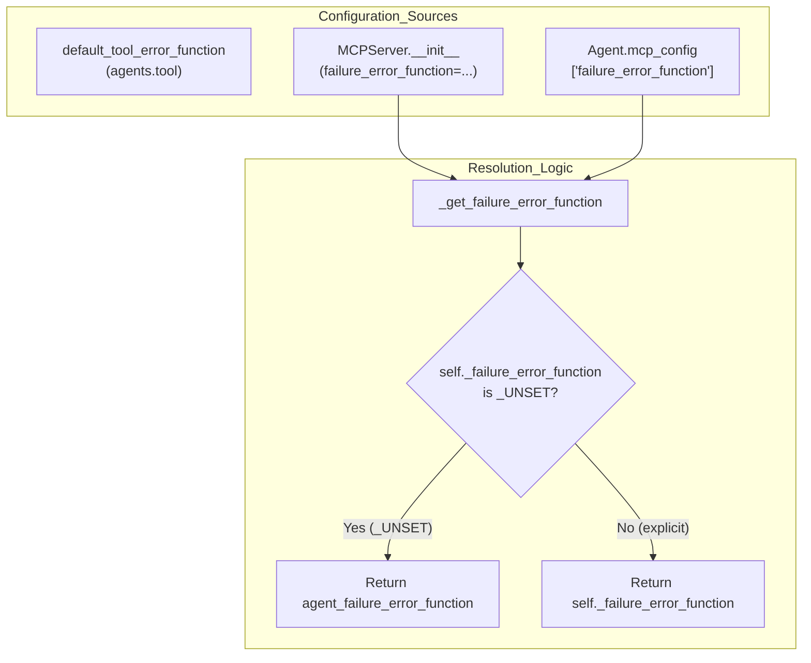
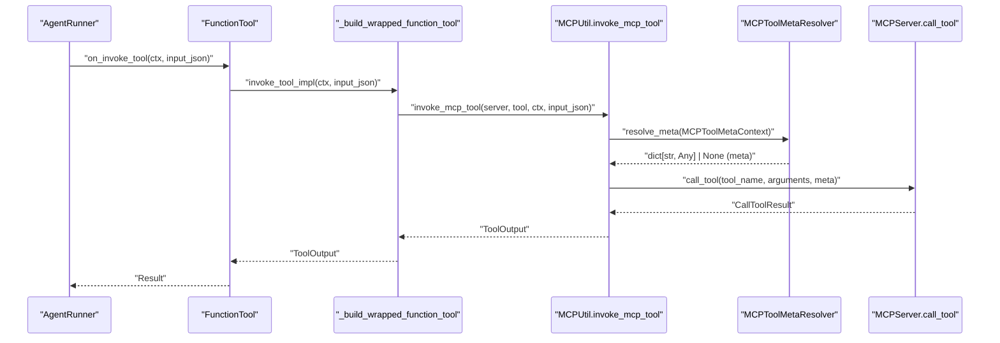

<!-- source: DeepWiki mcp.deepwiki.com · repo openai/openai-agents-python · page 11.5 MCP Error Handling and Approval · fetched 2026-10-26 -->

# MCP Error Handling and Approval

<details>
<summary>Relevant source files</summary>

The following files were used as context for generating this wiki page:

- [src/agents/mcp/__init__.py](src/agents/mcp/__init__.py)
- [src/agents/mcp/manager.py](src/agents/mcp/manager.py)
- [src/agents/mcp/server.py](src/agents/mcp/server.py)
- [src/agents/mcp/util.py](src/agents/mcp/util.py)
- [tests/mcp/__init__.py](tests/mcp/__init__.py)
- [tests/mcp/helpers.py](tests/mcp/helpers.py)
- [tests/mcp/servers/paginated.py](tests/mcp/servers/paginated.py)
- [tests/mcp/test_caching.py](tests/mcp/test_caching.py)
- [tests/mcp/test_client_session_retries.py](tests/mcp/test_client_session_retries.py)
- [tests/mcp/test_connect_disconnect.py](tests/mcp/test_connect_disconnect.py)
- [tests/mcp/test_list_page_limits.py](tests/mcp/test_list_page_limits.py)
- [tests/mcp/test_mcp_approval.py](tests/mcp/test_mcp_approval.py)
- [tests/mcp/test_mcp_imports.py](tests/mcp/test_mcp_imports.py)
- [tests/mcp/test_mcp_pagination_integration.py](tests/mcp/test_mcp_pagination_integration.py)
- [tests/mcp/test_mcp_resources.py](tests/mcp/test_mcp_resources.py)
- [tests/mcp/test_mcp_server_manager.py](tests/mcp/test_mcp_server_manager.py)
- [tests/mcp/test_mcp_server_manager_cleanup_state.py](tests/mcp/test_mcp_server_manager_cleanup_state.py)
- [tests/mcp/test_mcp_tracing.py](tests/mcp/test_mcp_tracing.py)
- [tests/mcp/test_mcp_util.py](tests/mcp/test_mcp_util.py)
- [tests/mcp/test_prompt_server.py](tests/mcp/test_prompt_server.py)
- [tests/mcp/test_runner_calls_mcp.py](tests/mcp/test_runner_calls_mcp.py)
- [tests/mcp/test_server_errors.py](tests/mcp/test_server_errors.py)
- [tests/test_tool_origin.py](tests/test_tool_origin.py)

</details>


This page documents error handling mechanisms and approval flows for Model Context Protocol (MCP) tools within the OpenAI Agents SDK. It covers how MCP tool failures are handled gracefully, how errors are converted to model-visible messages, retry strategies, parameter validation, human-in-the-loop approval policies, and custom metadata injection. For general MCP integration, see [11.1 MCP Overview and Architecture](). For MCP server lifecycle management, see [11.4 MCP Server Manager](). For general tool approval mechanisms, see [4.7 Tool Approval and Human-in-the-Loop]().

## Error Handling Architecture

MCP servers handle multiple error categories during connection, tool listing, and tool invocation. The SDK provides layered error handling to ensure graceful degradation rather than complete workflow failure.

### Error Type Hierarchy

MCP error handling distinguishes between infrastructure failures (which halt execution) and tool invocation failures (which can be converted to error messages). `UserError` is raised for client-side configuration, parameter validation failures, or transport connection failures [src/agents/exceptions.py](), whereas `McpError` represents protocol-level errors originating from MCP servers or underlying client sessions [src/agents/mcp/_compat.py:53]().

**MCP Error Types and Flow**



Sources: [src/agents/mcp/server.py:680-711](), [src/agents/mcp/server.py:559-595](), [src/agents/mcp/util.py:332-430](), [src/agents/mcp/util.py:19-27]()

### HTTP and Connection Errors

MCP servers using HTTP-based transports (`MCPServerSse`, `MCPServerStreamableHttp`) handle connection failures by converting them to `UserError` exceptions via `_raise_user_error_for_http_error()` [src/agents/mcp/server.py:466-478](). These errors indicate configuration problems or infrastructure failures that require user intervention.

| Error Type | Detection Method | User Error Message |
|------------|------------------|-------------------|
| `httpx.HTTPStatusError` | `is_http_status_error(exc)` | `"Failed to connect to MCP server '{name}': HTTP error {code} ({reason})"` |
| `httpx.ConnectError` | `is_http_connect_error(exc)` | `"Failed to connect to MCP server '{name}': Could not reach the server."` |
| `httpx.TimeoutException` | `is_http_timeout_error(exc)` | `"Failed to connect to MCP server '{name}': Connection timeout."` |

The `connect()` and `cleanup()` methods use this error handling to provide clear feedback during server lifecycle operations. The SDK includes specialized logic to sanitize URLs in error messages, ensuring credentials like API keys or user passwords are not leaked in logs or tracebacks [src/agents/mcp/server.py:164-219]().

Sources: [src/agents/mcp/server.py:680-711](), [src/agents/mcp/server.py:466-478](), [src/agents/mcp/server.py:492-557](), [src/agents/mcp/server.py:720-754](), [src/agents/mcp/server.py:164-219](), [tests/mcp/test_server_errors.py:32-60]()

### Tool Invocation Error Flow

When MCP tools are invoked, errors flow through `MCPUtil.invoke_mcp_tool()` which is wrapped by `_build_wrapped_function_tool()` to enable graceful degradation [src/agents/mcp/util.py:332-430]().

**MCP Tool Invocation Sequence**



Sources: [src/agents/mcp/util.py:332-430](), [src/agents/mcp/util.py:279-283](), [src/agents/mcp/util.py:20-21](), [tests/mcp/test_mcp_util.py:209-247]()

### Parameter Validation

`_MCPServerWithClientSession.call_tool()` validates required parameters via `_validate_required_parameters()` before remote invocation [src/agents/mcp/server.py:597-627](). Validation occurs if the tool's `inputSchema` has a `required` array [src/agents/mcp/server.py:628-660]().

```python
# Implementation in _validate_required_parameters
required_names = [name for name in raw_required if isinstance(name, str)]
missing = [name for name in required_names if name not in arguments_to_validate]
if missing:
    raise UserError(f"missing required parameters: {', '.join(sorted(missing))}")
```

Sources: [src/agents/mcp/server.py:597-627](), [src/agents/mcp/server.py:628-660](), [tests/mcp/test_client_session_retries.py:79-162]()

### Retry Mechanism

`_MCPServerWithClientSession` supports automatic retries via `_run_with_retries()` for transient failures like `McpError` or `ClosedResourceError` [src/agents/mcp/server.py:286-344]().

| Parameter | Type | Default | Description |
|-----------|------|---------|-------------|
| `max_retry_attempts` | `int` | `0` | Number of retries (`-1` for unlimited) |
| `retry_backoff_seconds_base` | `float` | `1.0` | Base delay for exponential backoff |

Retries share a single budget across paginated operations, such as listing large sets of tools or prompts [tests/mcp/test_client_session_retries.py:117-144]().

Sources: [src/agents/mcp/server.py:286-344](), [src/agents/mcp/server.py:480-490](), [src/agents/mcp/server.py:559-595](), [tests/mcp/test_client_session_retries.py:60-77](), [tests/mcp/test_client_session_retries.py:117-144]()

## Failure Error Function System

The `failure_error_function` (type: `ToolErrorFunction`) converts MCP tool failures into model-visible error messages [src/agents/mcp/server.py:47]().

### Configuration Hierarchy

**Failure Error Function Resolution**



Sources: [src/agents/mcp/server.py:226-232](), [src/agents/mcp/server.py:269-275](), [src/agents/mcp/util.py:210-256](), [tests/mcp/test_mcp_util.py:405-495]()

### Default Error Handler Behavior

The `default_tool_error_function` produces a generic message: `"An error occurred while running the tool. Please try again or modify your approach."` [src/agents/tool.py:33](). This prevents exposing internal implementation details to the model while signaling failure.

Sources: [src/agents/mcp/util.py:33](), [tests/mcp/test_mcp_util.py:283-292]()

## Approval Flow

MCP tools support human-in-the-loop approval using the `require_approval` parameter on MCP servers [src/agents/mcp/server.py:85-121]().

### Approval Policy Types

MCP servers normalize `require_approval` inputs via `_normalize_needs_approval()` [src/agents/mcp/server.py:346-403]().

| Input Type | Example | Behavior |
|------------|---------|----------|
| Global boolean | `require_approval=True` | All tools require approval |
| Global string | `require_approval="always"` | All tools require approval |
| Tool name mapping | `{"tool_a": "always", "tool_b": "never"}` | Specific tools require approval |
| Tool list object | `{"always": {"tool_names": ["tool_a"]}}` | Listed tools require approval |
| Callable | `LocalMCPApprovalCallable` | Policy evaluated per-call |

Sources: [src/agents/mcp/server.py:85-121](), [src/agents/mcp/server.py:346-403](), [tests/mcp/test_mcp_approval.py:44-70]()

### Dynamic Approval Policies

Callable approval policies enable context-aware decisions based on run state and tool properties [src/agents/mcp/server.py:97-102]().

```python
def dynamic_approval_policy(
    run_context: RunContextWrapper[Any],
    agent: Agent, 
    tool: MCPTool
) -> bool:
    # Logic to decide if tool requires approval
    return "delete" in tool.name.lower()
```

The `_get_needs_approval_for_tool()` method wraps this into an async callable compatible with the SDK's internal tool approval gates [src/agents/mcp/server.py:405-433]().

Sources: [src/agents/mcp/server.py:405-433](), [src/agents/mcp/server.py:97-102](), [tests/mcp/test_mcp_approval.py:153-196]()

## MCP Tool Meta Resolver

The `MCPToolMetaResolver` is a callable that allows injecting custom metadata into MCP tool calls [src/agents/mcp/util.py:191-194](). This metadata is sent to the MCP server along with the tool call arguments as the `_meta` payload.

```python
if TYPE_CHECKING:
    MCPToolMetaResolver = Callable[
        [MCPToolMetaContext],
        MaybeAwaitable[dict[str, Any] | None],
    ]
```

The `MCPToolMetaContext` provides information about the current run context, server name, tool name, and parsed arguments [src/agents/mcp/util.py:142-157]().

**MCP Tool Meta Resolver Flow**



Sources: [src/agents/mcp/util.py:142-157](), [src/agents/mcp/util.py:191-194](), [src/agents/mcp/util.py:332-430](), [src/agents/mcp/server.py:233-234](), [tests/mcp/test_mcp_util.py:168-220]()

## Error Recovery and Tracing

MCP error handling integrates with the SDK's tracing system via `mcp_tools_span` [src/agents/mcp/util.py:36]().

### Span Error Attachment

When a tool fails and a `failure_error_function` is present, the error is recorded in the tracing span as a non-fatal error using `attach_error_to_span` to allow the model to attempt recovery [src/agents/mcp/util.py:418-428](). If sensitive data tracing is disabled, error details are redacted in the span [src/agents/run_internal/error_handlers.py:94-98]().

### Logging and Redaction

Logging verbosity is controlled by internal debug flags like `DONT_LOG_TOOL_DATA` [src/agents/_debug.py](). The `log_tool_action_error` function ensures that tool execution failures are logged without leaking sensitive payloads when redaction is enabled [src/agents/mcp/util.py:20](), [tests/test_error_logging_redaction.py:1-7]().

| Stage | Log Level | Message Format |
|-------|-----------|----------------|
| **MCP error** | WARNING | `"MCP tool {name} on server '{server}' returned an error: {error}"` |
| **General error** | ERROR | `"Error invoking MCP tool {name} on server '{server}': {exc}"` |
| **HTTP failure** | WARNING | `"Ignoring initialized notification HTTP failure"` |

Sources: [src/agents/mcp/util.py:344-357](), [src/agents/mcp/util.py:369-391](), [src/agents/mcp/server.py:756-765](), [src/agents/run_internal/error_handlers.py:94-98](), [tests/test_error_logging_redaction.py:1-7]()

---

