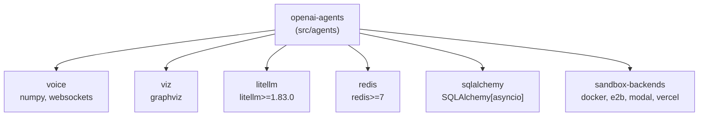
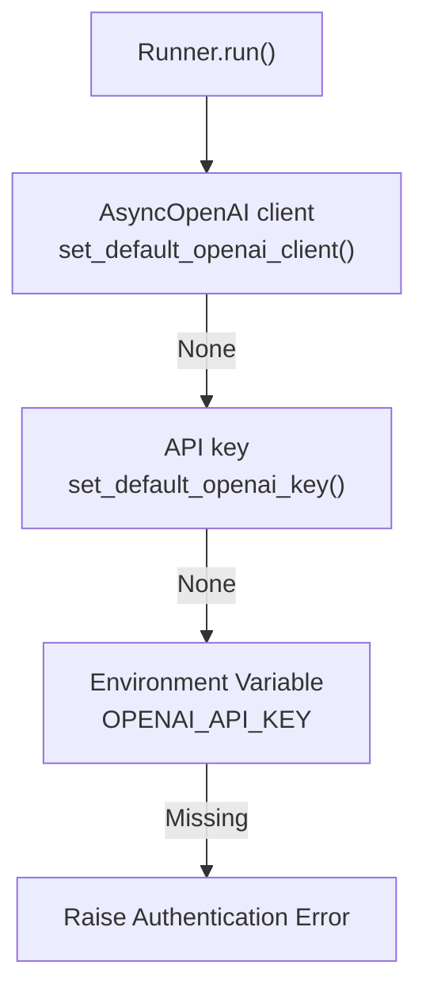
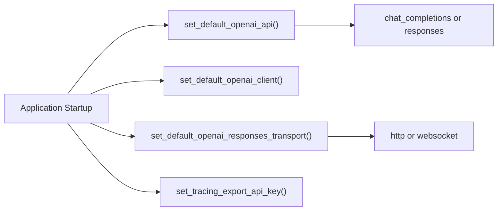

<!-- source: DeepWiki mcp.deepwiki.com · repo openai/openai-agents-python · page 12 Configuration and Setup · fetched 2026-10-26 -->

# Configuration and Setup

<details>
<summary>Relevant source files</summary>

The following files were used as context for generating this wiki page:

- [.release-please-manifest.json](.release-please-manifest.json)
- [.vscode/settings.json](.vscode/settings.json)
- [CHANGELOG.md](CHANGELOG.md)
- [docs/ko/config.md](docs/ko/config.md)
- [docs/zh/config.md](docs/zh/config.md)
- [pyproject.toml](pyproject.toml)
- [src/agents/version.py](src/agents/version.py)
- [tests/fixtures/released_api_contract.json](tests/fixtures/released_api_contract.json)
- [uv.lock](uv.lock)

</details>


This page covers SDK installation, dependency management, API key configuration, and runtime settings. As a parent page, it provides a high-level overview of initialization and configuration workflows. For detailed deep dives, refer to the child pages:
- [Installation and Dependencies](#12.1) — pip install, optional dependencies (`[voice]`, `[redis]`, `[litellm]`, sandbox providers), and `pyproject.toml` structure.
- [API Keys and Authentication](#12.2) — `OPENAI_API_KEY`, `set_default_openai_key()`, custom API keys, and authentication for different providers.
- [Global SDK Configuration](#12.3) — `set_default_openai_client()`, `set_default_openai_api()`, `set_default_openai_responses_transport()`, and environment variables.

---

## Installation and Dependencies

The SDK requires Python 3.10 or higher [pyproject.toml:6](). The core library can be installed via pip or uv using the standard package name:

```bash
pip install openai-agents
```

The core installation includes essential runtime dependencies such as `openai`, `pydantic`, `griffelib`, and `websockets` [pyproject.toml:10-15]().

### Optional Dependencies

For specialized features like alternative model providers, persistent storage, voice pipelines, or isolated execution sandboxes, optional dependency groups can be specified via bracket notation [pyproject.toml:42-92]().

**Title: SDK Dependency Ecosystem Mapping**

Sources: [pyproject.toml:42-92](), [src/agents/version.py:1-7]()

For details, see [Installation and Dependencies](#12.1).

---

## API Keys and Authentication

The SDK resolves API keys and model clients through a fallback hierarchy. If no explicit client instance is supplied to a provider or runner, the SDK checks global overrides and standard environment variables [docs/ko/config.md:38-48]().

### Authentication Flow and Resolution

**Title: Authentication Resolution Flow**

Sources: [docs/ko/config.md:38-48](), [docs/zh/config.md:38-48]()

You can programmatically configure authentication using helper functions like `set_default_openai_key()` or `set_default_openai_client()` [docs/ko/config.md:40-56]().

For details, see [API Keys and Authentication](#12.2).

---

## Global SDK Configuration

SDK-wide defaults control protocol transports, API wrappers, and tracing behaviors across all agent executions [docs/ko/config.md:5-10]().

### Global Configuration Methods

**Title: Global Configuration Entity Mapping**

Sources: [docs/ko/config.md:64-111](), [docs/zh/config.md:95-111]()

For details, see [Global SDK Configuration](#12.3).

---

