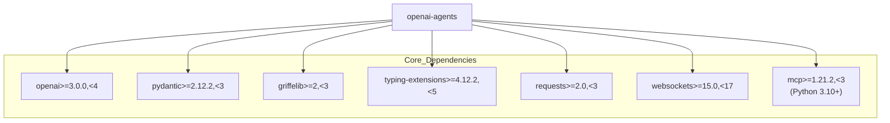
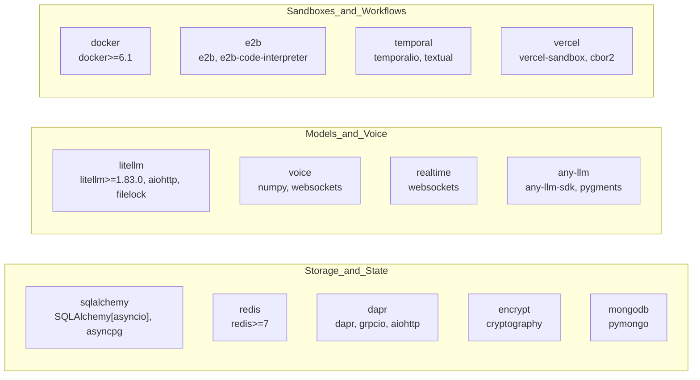
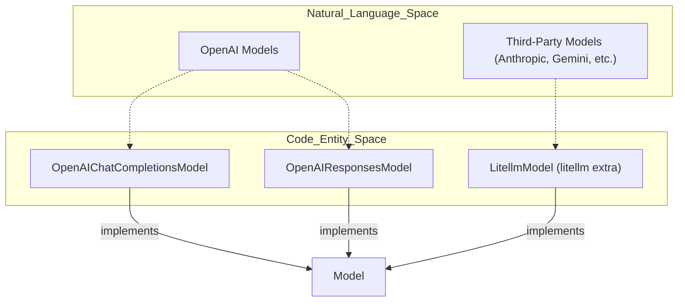

<!-- source: DeepWiki mcp.deepwiki.com · repo openai/openai-agents-python · page 12.1 Installation and Dependencies · fetched 2026-10-26 -->

# Installation and Dependencies

<details>
<summary>Relevant source files</summary>

The following files were used as context for generating this wiki page:

- [.release-please-manifest.json](.release-please-manifest.json)
- [.vscode/settings.json](.vscode/settings.json)
- [CHANGELOG.md](CHANGELOG.md)
- [pyproject.toml](pyproject.toml)
- [src/agents/version.py](src/agents/version.py)
- [tests/fixtures/released_api_contract.json](tests/fixtures/released_api_contract.json)
- [uv.lock](uv.lock)

</details>


This document describes how to install the OpenAI Agents SDK and details its dependency structure. It covers installation methods, core dependencies, optional feature groups, Python version requirements, and the build system configuration.

For information about configuring API keys and authentication after installation, see [API Keys and Authentication](#12.2). For global SDK configuration options, see [Global SDK Configuration](#12.3).

---

## Purpose and Scope

The OpenAI Agents SDK is distributed as a Python package named `openai-agents` with a modular dependency structure. Core functionality requires only essential dependencies, while advanced features (voice processing, visualization, multi-provider support, sandboxes, etc.) are available through optional dependency groups. This design minimizes installation overhead for basic use cases while enabling rich functionality when needed.

**Sources:** [pyproject.toml:1-35]()

---

## Installation Methods

### Basic Installation

Install the SDK using pip:

```bash
pip install openai-agents
```

Or using `uv` (recommended for faster installation and better dependency resolution):

```bash
uv pip install openai-agents
```

### Installing with Optional Features

Install the SDK with one or more optional feature groups using the extras syntax:

```bash
# Single feature
pip install openai-agents[litellm]

# Multiple features
pip install openai-agents[voice,redis,litellm]

# All features
pip install openai-agents[voice,viz,litellm,realtime,sqlalchemy,encrypt,redis,dapr,docker,e2b,temporal]
```

### Development Installation

For contributors or those modifying the SDK, the repository uses `uv` workspaces and standard sync workflows:

```bash
# Clone the repository
git clone https://github.com/openai/openai-agents-python
cd openai-agents-python

# Sync all dependencies including dev group and all extras
uv sync --all-extras --all-packages --group dev
```

**Sources:** [pyproject.toml:36-93](), [uv.lock:1-17]()

---

## Python Version Requirements

The SDK requires **Python 3.10 or higher** [pyproject.toml:6](). It is tested against Python versions 3.10 through 3.14 [pyproject.toml:27-32]().

```toml
requires-python = ">=3.10"
```

Some features have additional constraints:
- **MCP (Model Context Protocol)**: Requires Python 3.10+ due to the `mcp` library dependency [pyproject.toml:16]().
- **Voice features**: Require Python 3.10+ for `numpy>=2.2.0` compatibility [pyproject.toml:44]().
- **Any-LLM**: Requires Python 3.11+ [pyproject.toml:47-49]().

**Sources:** [pyproject.toml:6](), [pyproject.toml:16-16](), [pyproject.toml:27-32](), [pyproject.toml:44](), [pyproject.toml:47-49]()

---

## Core Dependencies

The SDK's core dependencies provide essential functionality for agent orchestration, API communication, and type safety.

### Dependency Structure



**Sources:** [pyproject.toml:9-23]()

### Core Dependency Purposes

| Dependency | Version Constraint | Purpose |
|------------|-------------------|---------|
| `openai` | `>=3.0.0, <4` | OpenAI API client for Responses, Chat Completions, and Realtime APIs [pyproject.toml:10](). |
| `pydantic` | `>=2.12.2, <3` | Data validation, schema generation, and structured outputs [pyproject.toml:11](). |
| `griffelib` | `>=2, <3` | Python code inspection for automatic tool schema generation [pyproject.toml:12](). |
| `typing-extensions` | `>=4.12.2, <5` | Backports of typing features for older Python versions [pyproject.toml:13](). |
| `requests` | `>=2.0, <3` | Synchronous HTTP client for various integrations [pyproject.toml:14](). |
| `websockets` | `>=15.0, <17` | WebSocket transport for Realtime and Voice capabilities [pyproject.toml:15](). |
| `mcp` | `>=1.21.2, <3` | Model Context Protocol client for external tool integration [pyproject.toml:16](). |

**Sources:** [pyproject.toml:9-23]()

---

## Optional Feature Groups

The SDK provides extensive optional feature groups that can be installed independently. These are defined in the `[project.optional-dependencies]` section of `pyproject.toml` [pyproject.toml:42-92]().

### Feature Group Overview



**Sources:** [pyproject.toml:42-92]()

### Feature Group Details

| Feature | Dependencies | Purpose |
|---------|-------------|---------|
| `voice` | `numpy>=2.2.0`, `websockets` | Audio processing for voice pipelines [pyproject.toml:44](). |
| `litellm` | `litellm>=1.83.0`, `aiohttp`, `filelock` | Multi-provider support via `LitellmModel` [pyproject.toml:46](). |
| `redis` | `redis>=7` | Redis-backed session storage [pyproject.toml:54](). |
| `encrypt` | `cryptography>=45.0,<51` | Transparent encryption for session storage [pyproject.toml:53](). |
| `sqlalchemy`| `SQLAlchemy[asyncio]>=2.0`, `asyncpg>=0.29.0` | Database-backed session storage [pyproject.toml:52](). |
| `dapr` | `dapr>=1.16.0`, `grpcio>=1.60.0`, `aiohttp`, `protobuf` | Dapr integration for distributed state [pyproject.toml:55-60](). |
| `e2b` | `e2b==2.31.0`, `e2b-code-interpreter==2.8.1`, `h2`, `protobuf`, `pygments` | Remote code execution sandboxes [pyproject.toml:70-76](). |
| `temporal` | `temporalio==1.34.0`, `textual`, `protobuf`, `pygments` | Durable workflow orchestration [pyproject.toml:87-92](). |
| `mongodb` | `pymongo>=4.14` | MongoDB-backed session storage [pyproject.toml:61](). |

**Sources:** [pyproject.toml:42-92]()

---

## Implementation: Model Provider Extensions

The SDK uses optional dependencies to provide concrete implementations of the `Model` interface.

### Natural Language Space to Code Entity Space: Models



**Sources:** [pyproject.toml:46]()

### Multi-Provider Support with LiteLLM
The `LitellmModel` class (available via the `[litellm]` extra) allows the SDK to communicate with over 100 LLM providers by wrapping the `litellm` library. This integration is mapped via the optional dependency `litellm>=1.83.0` [pyproject.toml:46]().

**Sources:** [pyproject.toml:46]()

---

## Build System and Packaging

The SDK uses `hatchling` as its build backend [pyproject.toml:139-141]().

### Build Configuration
```toml
[build-system]
requires = ["hatchling"]
build-backend = "hatchling.build"

[tool.hatch.build.targets.wheel]
packages = ["src/agents"]
```
The source code is located in `src/agents/` and packaged as the `agents` module [pyproject.toml:152-153]().

### Metadata
- **Name:** `openai-agents` [pyproject.toml:2]()
- **Version:** `0.24.0` [src/agents/version.py:7](), [pyproject.toml:3]()
- **License:** MIT [pyproject.toml:7]()
- **Repository:** https://github.com/openai/openai-agents-python [pyproject.toml:40]()

**Sources:** [pyproject.toml:1-153](), [src/agents/version.py:1-7]()

---

## Dependency Management with uv

The project uses `uv` for dependency management, with locked versions stored in `uv.lock` [uv.lock:1-9]().

### Workspace Configuration
```toml
[tool.uv.workspace]
members = ["agents"]

[tool.uv.sources]
agents = { workspace = true }
```
**Sources:** [pyproject.toml:133-138]()

### Locked Dependencies
Key locked versions in `uv.lock` include runtime dependencies such as `aiohttp`, `aiofiles`, and `websockets` managed across target platforms and python versions [uv.lock:1-66]().

**Sources:** [uv.lock:1-66](), [pyproject.toml:9-23]()

---

## Development and Quality Tools

Development dependencies are managed in the `dev` group in `pyproject.toml` [pyproject.toml:94-131]().

| Category | Tools |
|----------|-------|
| **Linting** | `ruff==0.16.8` [pyproject.toml:97]() |
| **Type Checking** | `mypy`, `pyright==1.1.408` [pyproject.toml:96, 128]() |
| **Testing** | `pytest>=9.0.3`, `pytest-asyncio`, `pytest-mock>=3.14.0`, `pytest-xdist` [pyproject.toml:98-101]() |
| **Docs** | `mkdocs>=1.6.0`, `mkdocs-material>=9.7.7`, `mkdocstrings[python]>=0.28.0` [pyproject.toml:103-107]() |

### Code Quality Configuration
- **Ruff**: Line length 100, target Python 3.10 [pyproject.toml:156-158]().
- **MyPy**: Strict mode enabled [pyproject.toml:192-193]().

**Sources:** [pyproject.toml:94-232]()

---

