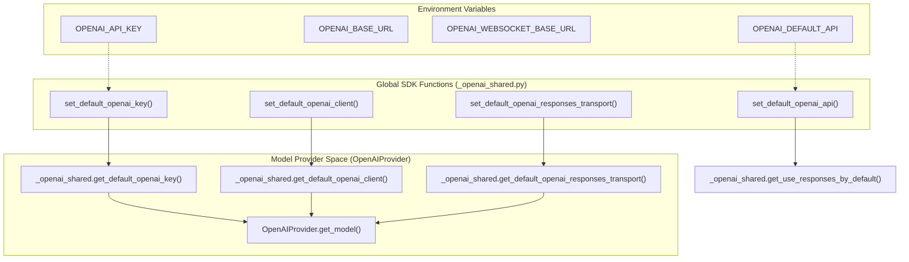
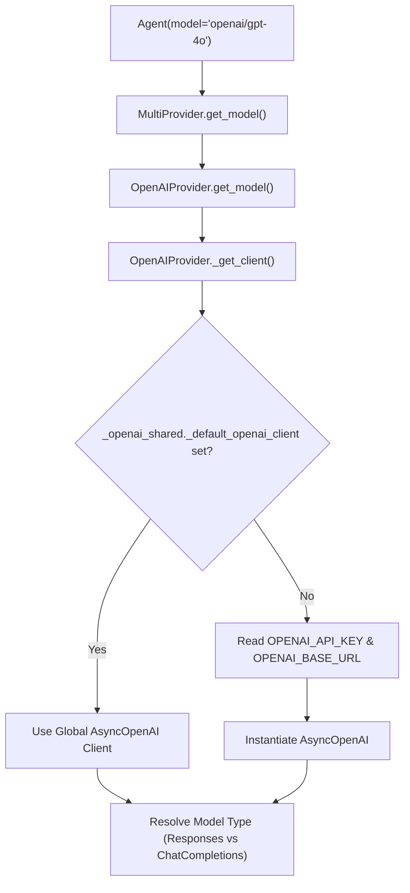

<!-- source: DeepWiki mcp.deepwiki.com · repo openai/openai-agents-python · page 12.3 Global SDK Configuration · fetched 2026-10-26 -->

# Global SDK Configuration

Relevant source files

The following files were used as context for generating this wiki page:

- [docs/ref/tool_context.md](docs/ref/tool_context.md)
- [examples/basic/stream_ws.py](examples/basic/stream_ws.py)
- [examples/basic/tools.py](examples/basic/tools.py)
- [src/agents/__init__.py](src/agents/__init__.py)
- [src/agents/_config.py](src/agents/_config.py)
- [src/agents/function_schema.py](src/agents/function_schema.py)
- [src/agents/models/_openai_shared.py](src/agents/models/_openai_shared.py)
- [src/agents/models/multi_provider.py](src/agents/models/multi_provider.py)
- [src/agents/models/openai_provider.py](src/agents/models/openai_provider.py)
- [src/agents/responses_websocket_session.py](src/agents/responses_websocket_session.py)
- [src/agents/tool.py](src/agents/tool.py)
- [src/agents/voice/models/openai_model_provider.py](src/agents/voice/models/openai_model_provider.py)
- [tests/models/test_map.py](tests/models/test_map.py)
- [tests/sandbox/test_session_utils.py](tests/sandbox/test_session_utils.py)
- [tests/test_config.py](tests/test_config.py)
- [tests/test_function_schema.py](tests/test_function_schema.py)
- [tests/test_function_schema_logger_restore.py](tests/test_function_schema_logger_restore.py)
- [tests/test_function_tool.py](tests/test_function_tool.py)
- [tests/test_function_tool_decorator.py](tests/test_function_tool_decorator.py)
- [tests/test_openai_provider_client_options.py](tests/test_openai_provider_client_options.py)
- [tests/voice/test_openai_model_provider.py](tests/voice/test_openai_model_provider.py)

## Purpose and Scope
This page details the global SDK configuration mechanisms for the OpenAI Agents Python package. It covers global client management functions (`set_default_openai_client()`, `set_default_openai_key()`, `set_default_openai_api()`, and `set_default_openai_responses_transport()`), environment variable integration, and how model providers (`OpenAIProvider`, `MultiProvider`) consume these settings during model resolution.

Sources: [src/agents/models/_openai_shared.py:1-68](), [tests/test_config.py:1-24]()

---

## Configuration Architecture and Precedence
The SDK uses a hierarchical configuration approach where per-run configurations override global SDK settings, which in turn override environment variables. Global state is centrally managed within internal shared modules.

Title: "Global SDK Configuration Precedence and Resolution"

Sources: [src/agents/models/_openai_shared.py:1-68](), [src/agents/models/openai_provider.py:138-151]()

---

## Global Configuration Functions
The SDK exposes module-level helper functions to customize the underlying OpenAI client, API choice, and transport protocols across all agents without requiring explicit parameters on every agent instantiation or `RunConfig`.

### `set_default_openai_key()`
Sets the default API key used when instantiating default `AsyncOpenAI` clients across providers.
- **Implementation:** Stored in module-level state inside `_openai_shared.py`.
- **Usage:** Invoking `set_default_openai_key("sk-...")` ensures subsequent agent executions without an explicit client instance will utilize this API key.

Sources: [src/agents/models/_openai_shared.py:11-20](), [tests/test_config.py:31-35]()

### `set_default_openai_client()`
Configures a shared, custom `AsyncOpenAI` client instance globally.
- **Parameters:**
  - `client`: An instance of `AsyncOpenAI`.
  - `use_for_tracing`: Optional boolean indicating whether to sync the tracing API key with the client's key.
- **Implementation:** Updates the internal `_default_openai_client` reference. When `OpenAIProvider._get_client()` runs, it checks for this cached client before falling back to constructing a new `AsyncOpenAI` instance.

Sources: [src/agents/models/_openai_shared.py:21-35](), [tests/test_config.py:37-43]()

### `set_default_openai_api()`
Selects the default OpenAI API backend for model resolution.
- **Supported Values:**
  - `"responses"` (Default): Uses the OpenAI Responses API (`OpenAIResponsesModel`).
  - `"chat_completions"`: Uses the OpenAI Chat Completions API (`OpenAIChatCompletionsModel`).
- **Implementation:** Modifies the flag returned by `_openai_shared.get_use_responses_by_default()`, dictating whether `OpenAIProvider` instantiates `OpenAIResponsesModel` or `OpenAIChatCompletionsModel`.

Sources: [src/agents/models/_openai_shared.py:32-45](), [tests/test_config.py:79-93]()

### `set_default_openai_responses_transport()`
Configures the transport mechanism for the Responses API globally.
- **Supported Values:**
  - `"http"`: Standard HTTP transport (`OpenAIResponsesModel`).
  - `"websocket"`: WebSocket-based transport (`OpenAIResponsesWSModel`).
- **Implementation:** Updates the default responses transport flag inspected by `OpenAIProvider` during model construction. Passing invalid values raises a `ValueError`.

Sources: [src/agents/models/_openai_shared.py:46-68](), [tests/test_config.py:95-116]()

---

## Environment Variables Reference
The SDK inspects standard environment variables during client and model initialization when explicit parameters or global setters are not invoked.

| Environment Variable | Description | Associated Code Entity / Getter |
| :--- | :--- | :--- |
| `OPENAI_API_KEY` | Primary API key for OpenAI requests. | `_openai_shared.get_default_openai_key()` [src/agents/models/_openai_shared.py:11-20]() |
| `OPENAI_BASE_URL` | Base URL for OpenAI HTTP requests. | `OpenAIProvider._get_client()` [src/agents/models/openai_provider.py:138-151]() |
| `OPENAI_WEBSOCKET_BASE_URL` | WebSocket base URL for Responses API transport. | `OpenAIProvider` init [src/agents/models/openai_provider.py:69-70]() |
| `OPENAI_AGENTS_TRACE_INCLUDE_SENSITIVE_DATA` | Flag controlling whether sensitive data is included in traces. | Tracing configuration |

Sources: [src/agents/models/_openai_shared.py:1-68](), [src/agents/models/openai_provider.py:65-112]()

---

## Multi-Provider Routing Integration
When working with multiple backends via `MultiProvider`, global configurations are delegated to the underlying `OpenAIProvider` instance. 

Title: "Multi-Provider Client and Model Resolution"

Sources: [src/agents/models/multi_provider.py:62-139](), [src/agents/models/openai_provider.py:138-151]()

---

---

