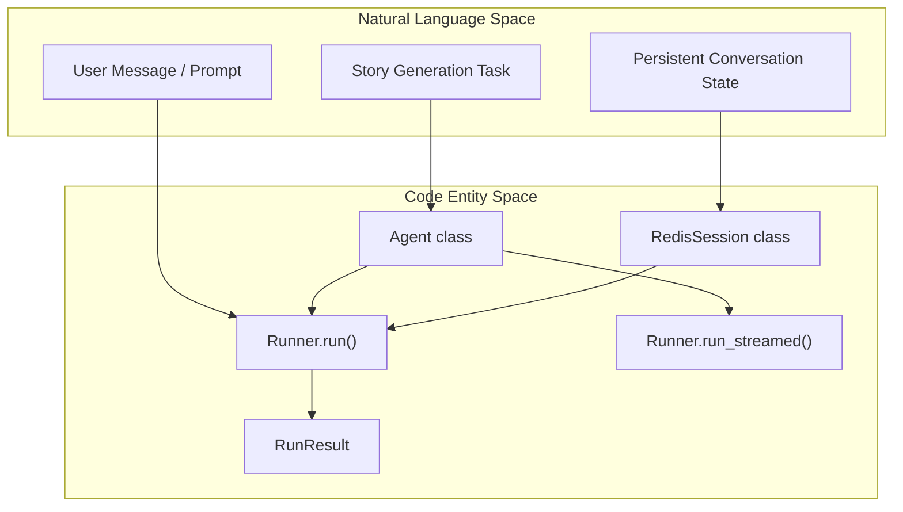
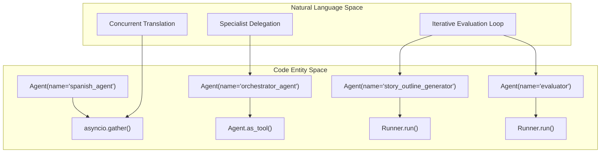

<!-- source: DeepWiki mcp.deepwiki.com · repo openai/openai-agents-python · page 13 Usage Patterns and Examples · fetched 2026-10-26 -->

# Usage Patterns and Examples

Relevant source files

The following files were used as context for generating this wiki page:

- [examples/agent_patterns/agents_as_tools.py](examples/agent_patterns/agents_as_tools.py)
- [examples/agent_patterns/deterministic.py](examples/agent_patterns/deterministic.py)
- [examples/agent_patterns/input_guardrails.py](examples/agent_patterns/input_guardrails.py)
- [examples/agent_patterns/llm_as_a_judge.py](examples/agent_patterns/llm_as_a_judge.py)
- [examples/agent_patterns/parallelization.py](examples/agent_patterns/parallelization.py)
- [examples/agent_patterns/routing.py](examples/agent_patterns/routing.py)
- [examples/auto_mode.py](examples/auto_mode.py)
- [examples/basic/previous_response_id.py](examples/basic/previous_response_id.py)
- [examples/memory/redis_session_example.py](examples/memory/redis_session_example.py)
- [examples/run_examples.py](examples/run_examples.py)
- [examples/sandbox/extensions/temporal/local_hello_workflow.py](examples/sandbox/extensions/temporal/local_hello_workflow.py)
- [tests/test_redis_session_example.py](tests/test_redis_session_example.py)
- [tests/test_run_examples_script.py](tests/test_run_examples_script.py)

This page demonstrates practical patterns for building agent applications using the OpenAI Agents SDK. It serves as a high-level guide to common workflows, from single-agent task execution to complex multi-agent orchestration, streaming, tool integration, and state persistence.

For deep dives into specific implementations, see the following child pages:
- [Basic Agent Workflows](#13.1) — Simple agent examples, single-turn and multi-turn conversations, basic tool usage, and the examples runner script (`[examples/run_examples.py:1-9]()`).
- [Multi-Agent Orchestration Examples](#13.2) — Manager pattern examples, handoff patterns, triage agents, and advanced pattern scripts like LLM-as-a-judge (`[examples/agent_patterns/llm_as_a_judge.py:11-14]()`), parallelization (`[examples/agent_patterns/parallelization.py:6-9]()`), and deterministic routing (`[examples/agent_patterns/deterministic.py:8-16]()`).
- [Streaming Patterns](#13.3) — Using `Runner.run_streamed()`, consuming stream events, handling `previous_response_id` (`[examples/basic/previous_response_id.py:6-15]()`), and real-time updates.
- [Tool Integration Examples](#13.4) — Examples of integrating different tool types, MCP servers, custom function tools, and agents as tools (`[examples/agent_patterns/agents_as_tools.py:6-10]()`).

## Core Execution and Workflow Patterns

The SDK provides multiple execution primitives to handle synchronous scripts, asynchronous pipelines, and automated test runners. Workflows can combine standard agent invocations with guardrails (`[examples/agent_patterns/input_guardrails.py:18-29]()`) and state persistence mechanisms like Redis sessions (`[examples/memory/redis_session_example.py:1-9]()`).

### Diagram: Execution Flow to Code Entities
The following diagram bridges natural language execution intents to the specific code entities involved in the execution lifecycle.

Sources: [examples/agent_patterns/llm_as_a_judge.py:57-60](), [examples/memory/redis_session_example.py:36-40](), [examples/basic/previous_response_id.py:25-29]()

## Multi-Agent Orchestration Patterns

Complex tasks often benefit from dividing responsibilities across multiple specialized agents. Patterns implemented in the SDK include:
- **LLM-as-a-Judge**: Looping between a generator agent and an evaluating agent until a desired quality score or pass condition is met (`[examples/agent_patterns/llm_as_a_judge.py:11-14]()`).
- **Parallelization**: Running identical or complementary agent tasks concurrently using `asyncio.gather()` and synthesizing results (`[examples/agent_patterns/parallelization.py:30-43]()`).
- **Deterministic Workflows**: Chaining agents sequentially with programmatic validation gates (`[examples/agent_patterns/deterministic.py:8-16]()`).
- **Agents-as-Tools**: Exposing specialist agents as callable tools to a front-line orchestrator agent (`[examples/agent_patterns/agents_as_tools.py:6-10]()`).

### Diagram: Orchestration Topology to Code Entities
This diagram maps orchestration topologies to their corresponding code components.

Sources: [examples/agent_patterns/llm_as_a_judge.py:16-39](), [examples/agent_patterns/parallelization.py:11-20](), [examples/agent_patterns/agents_as_tools.py:30-51]()

## Summary of Child Pages

For comprehensive guidance and detailed reference implementations, consult the child sections:
- For basic execution setups, see [Basic Agent Workflows](#13.1).
- For orchestration scripts and multi-agent topologies, see [Multi-Agent Orchestration Examples](#13.2).
- For event streaming and response continuation (`previous_response_id`), see [Streaming Patterns](#13.3).
- For custom tools, MCP integrations, and agent tool encapsulation, see [Tool Integration Examples](#13.4).

Sources: [examples/agent_patterns/llm_as_a_judge.py:1-89](), [examples/agent_patterns/input_guardrails.py:1-122](), [examples/memory/redis_session_example.py:1-147](), [examples/basic/previous_response_id.py:1-74]()

---

