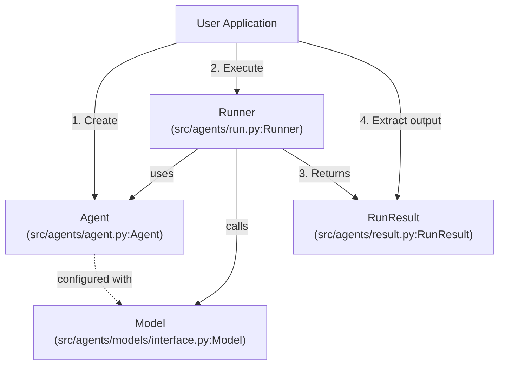
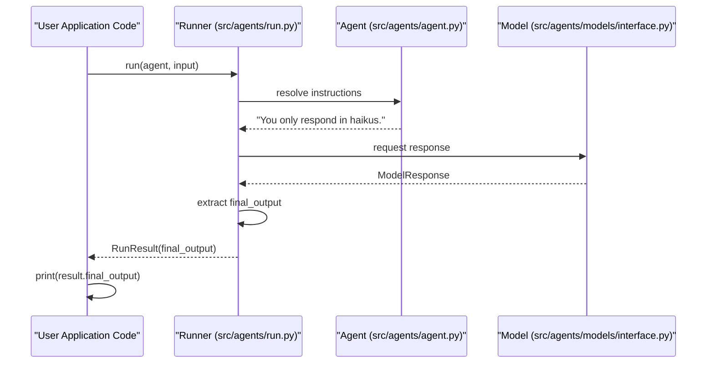
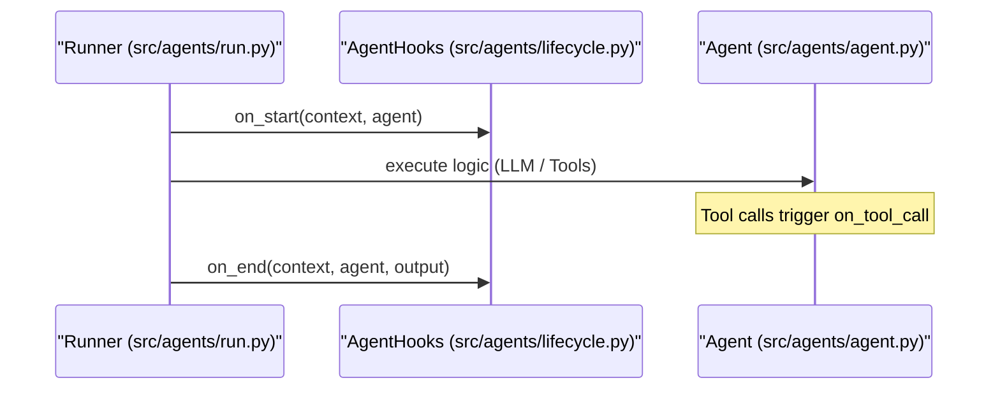

<!-- source: DeepWiki mcp.deepwiki.com · repo openai/openai-agents-python · page 13.1 Basic Agent Workflows · fetched 2026-10-26 -->

# Basic Agent Workflows

<details>
<summary>Relevant source files</summary>

The following files were used as context for generating this wiki page:

- [examples/agent_patterns/forcing_tool_use.py](examples/agent_patterns/forcing_tool_use.py)
- [examples/agent_patterns/human_in_the_loop_custom_rejection.py](examples/agent_patterns/human_in_the_loop_custom_rejection.py)
- [examples/basic/prompt_template.py](examples/basic/prompt_template.py)
- [examples/mcp/streamable_http_remote_example/main.py](examples/mcp/streamable_http_remote_example/main.py)
- [examples/memory/redis_session_example.py](examples/memory/redis_session_example.py)
- [examples/reasoning_content/main.py](examples/reasoning_content/main.py)
- [examples/reasoning_content/runner_example.py](examples/reasoning_content/runner_example.py)
- [examples/research_bot/agents/planner_agent.py](examples/research_bot/agents/planner_agent.py)
- [examples/run_examples.py](examples/run_examples.py)
- [examples/sandbox/extensions/temporal/local_hello_workflow.py](examples/sandbox/extensions/temporal/local_hello_workflow.py)
- [examples/tools/file_search.py](examples/tools/file_search.py)
- [src/agents/models/default_models.py](src/agents/models/default_models.py)
- [tests/models/test_default_models.py](tests/models/test_default_models.py)
- [tests/test_redis_session_example.py](tests/test_redis_session_example.py)
- [tests/test_run_examples_script.py](tests/test_run_examples_script.py)

</details>


This page covers fundamental agent usage patterns: simple agent examples, single-turn and multi-turn conversations, basic tool usage, lifecycle hooks, context management, dynamic instructions, and the examples runner script. These patterns form the foundation for building robust agent applications with the SDK.

---

## Core Components

The fundamental building blocks for any agent workflow are the core classes that manage configuration, execution orchestration, and output retrieval:

| Component | Purpose | Key Methods/Properties |
|-----------|---------|------------------------|
| `Agent` | LLM configuration with instructions, tools, and behavior | `name`, `instructions`, `tools`, `model`, `output_type` [src/agents/agent.py:44-93]() |
| `Runner` | Execution orchestration | `run()`, `run_sync()`, `run_streamed()` [src/agents/run.py:34-118]() |
| `RunResult` | Execution outcome | `final_output`, `new_items`, `to_input_list()`, `last_agent` [src/agents/result.py:27-106]() |

**Component Relationship Diagram**



Sources: [src/agents/agent.py:44-93](), [src/agents/run.py:34-49](), [src/agents/result.py:27-35](), [src/agents/models/interface.py:73-82]()

---

## Single-Turn Conversations

Single-turn workflows involve one user input and one agent response, with no conversation history. This represents the simplest pattern for interacting with an LLM via an agent.

### Basic Hello World

The minimal agent workflow requires instantiating an `Agent` and invoking `Runner.run()` [src/agents/run.py:34-49]():

```python
from agents import Agent, Runner

agent = Agent(
    name="Assistant",
    instructions="You only respond in haikus.",
)

result = await Runner.run(agent, "Tell me about recursion in programming.")
print(result.final_output)
```

**Single-Turn Execution Flow**



Sources: [src/agents/run.py:34-49](), [src/agents/agent.py:44-55](), [src/agents/result.py:27-35]()

### Structured Output

Use `output_type` to enforce typed responses instead of plain text. The SDK utilizes Pydantic models for validation, triggering structured outputs on supported models [src/agents/agent.py:83-84]().

```python
from pydantic import BaseModel
from agents import Agent, Runner

class FinalResult(BaseModel):
    number: int

agent = Agent(
    name="Calculator Agent",
    instructions="Return the number as a structured result.",
    output_type=FinalResult
)

result = await Runner.run(agent, "The answer is 42")
print(result.final_output.number) # 42
```

Sources: [src/agents/agent.py:83-84](), [examples/basic/tools.py:13-16]()

---

## Multi-Turn Conversations

Multi-turn workflows maintain conversation context across multiple user inputs.

### Manual History with `to_input_list()`

The application carries the full conversation transcript between turns by converting the previous `RunResult` into a list of input items using `to_input_list()` [src/agents/result.py:76-88](). This list is passed back into subsequent `Runner.run()` calls [src/agents/run.py:34-49]().

```python
from agents import Agent, Runner

agent = Agent(name="Assistant", instructions="Help the user.")

# Turn 1
result = await Runner.run(agent, "My name is Alice.")
print(result.final_output)

# Turn 2 - include previous history
input_data = result.to_input_list()
input_data.append({"role": "user", "content": "What is my name?"})

result = await Runner.run(agent, input_data)
print(result.final_output) # "Your name is Alice."
```

Sources: [src/agents/result.py:76-88](), [src/agents/run.py:34-49]()

---

## Basic Tool Usage

Tools enable agents to perform actions such as executing calculations, searching data, or interacting with external systems.

### Function Tools

The `@tool` (or `@function_tool`) decorator registers Python functions as callable tools [src/agents/decorators.py:19](). The SDK automatically generates JSON schemas by inspecting function signatures and docstrings via `FuncSchema` [src/agents/function_schema.py:23-45]().

```python
import random
from agents import Agent, Runner, tool

@tool
def random_number(max: int) -> int:
    """Generate a random number from 0 to max (inclusive)."""
    return random.randint(0, max)

agent = Agent(
    name="Start Agent",
    instructions="Generate a random number.",
    tools=[random_number]
)

result = await Runner.run(agent, "Give me a number between 0 and 100.")
```

Sources: [src/agents/decorators.py:19](), [src/agents/function_schema.py:23-45]()

---

## Examples Runner Script

To facilitate testing and running samples across the repository, the SDK provides an automated runner script located at `examples/run_examples.py` [examples/run_examples.py:1-9](). 

Key features of the examples runner script include:
- Discovering `__main__`-guarded example files under the `examples/` directory [examples/run_examples.py:1-7]().
- Automatically skipping interactive, server, audio, or external examples unless explicitly included [examples/run_examples.py:5-8]().
- Supporting an auto mode (`EXAMPLES_INTERACTIVE_MODE=auto`) that applies deterministic inputs and auto-approvals for non-interactive test execution [examples/run_examples.py:6-9]().
- Writing per-example execution logs to designated temporary directories (`.tmp/examples-start-logs`) [examples/run_examples.py:8-38]().

Sources: [examples/run_examples.py:1-55]()

---

## Lifecycle Hooks

The SDK provides a hook system (`AgentHooks` and `RunHooks`) to observe and react to agent lifecycle events such as starting, ending, and tool invocation [src/agents/lifecycle.py:21-105]().

### Monitoring Agent Execution

`RunHooks` apply to the entire execution span, while `AgentHooks` are scoped to specific agents [src/agents/lifecycle.py:53-105]().

```python
from agents import Agent, AgentHooks, AgentHookContext, RunContextWrapper

class LoggingHooks(AgentHooks):
    async def on_start(self, context: AgentHookContext, agent: Agent) -> None:
        print(f"Agent {agent.name} starting")

    async def on_end(self, context: RunContextWrapper, agent: Agent, output: Any) -> None:
        print(f"Agent {agent.name} finished")

agent = Agent(name="Logged Agent", hooks=LoggingHooks())
```

**Agent Lifecycle Hook Flow**



Sources: [src/agents/lifecycle.py:53-105](), [src/agents/agent.py:88-89]()

---

## Context Management

Context is a dependency-injection mechanism used to share state or helper utilities with tools and hooks via `RunContextWrapper` [src/agents/run_context.py:17-38]().

```python
from dataclasses import dataclass
from agents import Agent, RunContextWrapper, Runner, tool

@dataclass
class UserContext:
    name: str

@tool
async def greet_user(wrapper: RunContextWrapper[UserContext]) -> str:
    return f"Hello, {wrapper.context.name}!"

agent = Agent[UserContext](name="Assistant", tools=[greet_user])

await Runner.run(agent, "Greet me", context=UserContext(name="John"))
```

Sources: [src/agents/run_context.py:17-38](), [src/agents/function_schema.py:38-39]()

---

## Dynamic Instructions

Instructions can be defined as a callable accepting `GenerateDynamicPromptData`, enabling dynamic, context-aware system prompts [src/agents/agent.py:31-39]().

```python
from agents import Agent, GenerateDynamicPromptData, Runner

async def build_prompt(data: GenerateDynamicPromptData):
    user_name = data.context.context.name
    return f"You are assisting {user_name}."

agent = Agent(name="Dynamic Agent", instructions=build_prompt)

await Runner.run(agent, "Hello", context=UserContext(name="Alice"))
```

Sources: [src/agents/agent.py:31-39](), [src/agents/agent.py:51-52]()

---

