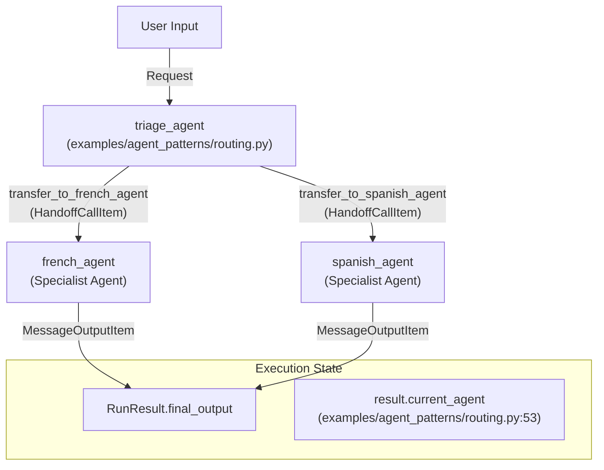
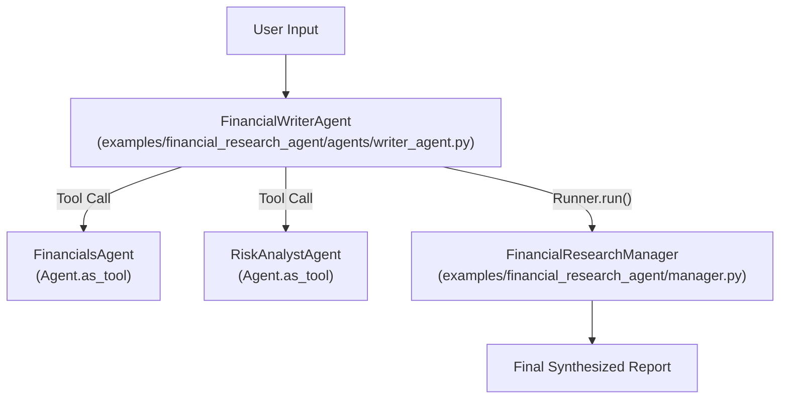
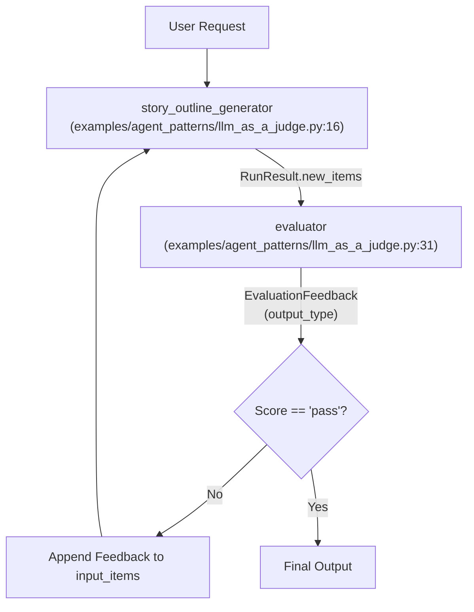
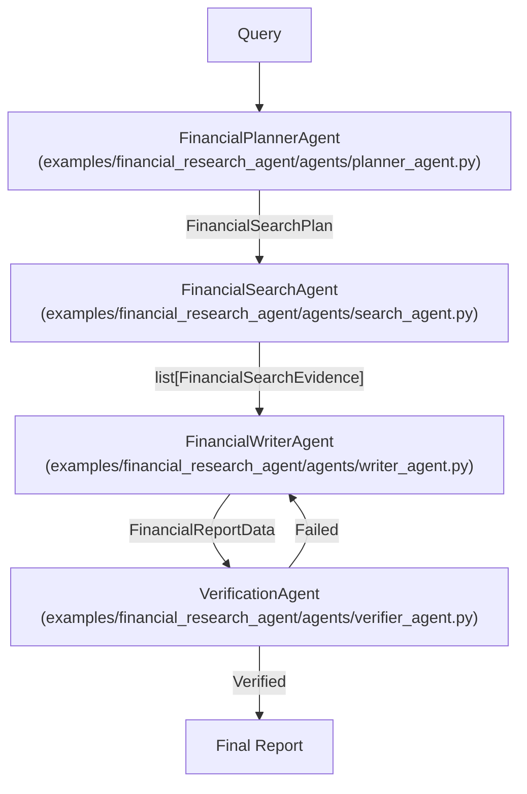

<!-- source: DeepWiki mcp.deepwiki.com · repo openai/openai-agents-python · page 13.2 Multi-Agent Orchestration Examples · fetched 2026-10-26 -->

# Multi-Agent Orchestration Examples

<details>
<summary>Relevant source files</summary>

The following files were used as context for generating this wiki page:

- [examples/agent_patterns/agents_as_tools.py](examples/agent_patterns/agents_as_tools.py)
- [examples/agent_patterns/deterministic.py](examples/agent_patterns/deterministic.py)
- [examples/agent_patterns/input_guardrails.py](examples/agent_patterns/input_guardrails.py)
- [examples/agent_patterns/llm_as_a_judge.py](examples/agent_patterns/llm_as_a_judge.py)
- [examples/agent_patterns/parallelization.py](examples/agent_patterns/parallelization.py)
- [examples/agent_patterns/routing.py](examples/agent_patterns/routing.py)
- [examples/auto_mode.py](examples/auto_mode.py)
- [examples/basic/previous_response_id.py](examples/basic/previous_response_id.py)
- [examples/financial_research_agent/README.md](examples/financial_research_agent/README.md)
- [examples/financial_research_agent/__init__.py](examples/financial_research_agent/__init__.py)
- [examples/financial_research_agent/agents/__init__.py](examples/financial_research_agent/agents/__init__.py)
- [examples/financial_research_agent/agents/financials_agent.py](examples/financial_research_agent/agents/financials_agent.py)
- [examples/financial_research_agent/agents/planner_agent.py](examples/financial_research_agent/agents/planner_agent.py)
- [examples/financial_research_agent/agents/risk_agent.py](examples/financial_research_agent/agents/risk_agent.py)
- [examples/financial_research_agent/agents/search_agent.py](examples/financial_research_agent/agents/search_agent.py)
- [examples/financial_research_agent/agents/verifier_agent.py](examples/financial_research_agent/agents/verifier_agent.py)
- [examples/financial_research_agent/agents/writer_agent.py](examples/financial_research_agent/agents/writer_agent.py)
- [examples/financial_research_agent/manager.py](examples/financial_research_agent/manager.py)
- [examples/financial_research_agent/printer.py](examples/financial_research_agent/printer.py)
- [examples/research_bot/agents/search_agent.py](examples/research_bot/agents/search_agent.py)
- [tests/test_financial_research_budget.py](tests/test_financial_research_budget.py)

</details>


This page provides concrete implementation examples of multi-agent orchestration patterns using the OpenAI Agents SDK. These examples demonstrate how to coordinate multiple specialized agents to solve complex tasks through delegation, handoffs, and tool-based invocation.

---

## Pattern Comparison

The SDK supports several orchestration styles, each suited to different control flow requirements:

| Pattern | Control Flow | Final Output From | Best For | Code Entity |
|---------|--------------|-------------------|----------|-------------|
| **Handoffs** | Peer delegation | Last specialist | Routing, specialized domains | `Agent.handoffs` [src/agents/agent.py:108-110](), `handoff()` [src/agents/handoffs/__init__.py:183-185]() |
| **Agents-as-Tools** | Central orchestration | Manager agent | Structured composition, manager keeps context | `Agent.as_tool()` [src/agents/agent.py:465-467]() |
| **LLM-as-a-Judge** | Iterative refinement | Generator agent | Quality-critical outputs, automated evaluation | `Runner.run()` loop [examples/agent_patterns/llm_as_a_judge.py:56-83]() |
| **Deterministic** | Code-driven flow | Last agent in sequence | Fixed workflows, gating logic | Sequential `Runner.run()` [examples/agent_patterns/deterministic.py:51-80]() |

Sources: [examples/agent_patterns/llm_as_a_judge.py:10-14](), [examples/agent_patterns/deterministic.py:8-16]()

---

## Pattern 1: Triage and Handoffs

The triage pattern uses handoffs to route requests to specialist agents. Control transfers completely to the specialist, which becomes the `current_agent` for the remainder of the turn.

**Triage and Specialist Coordination (Natural Language to Code Entity Space)**


**Implementation:**

In `examples/agent_patterns/routing.py`, a `triage_agent` routes based on language. The execution loop updates the `agent` variable to `result.current_agent` to preserve state across handoffs.

```python
triage_agent = Agent(
    name="triage_agent",
    instructions="Handoff to the appropriate agent based on the language of the request.",
    handoffs=[french_agent, spanish_agent, english_agent],
)

# In execution loop:
result = await Runner.run(agent, input_data)
agent = result.current_agent # Update to the agent that now has control
```
[examples/agent_patterns/routing.py:30-73]()

Sources: [examples/agent_patterns/routing.py:15-73]()

---

## Pattern 2: Manager and Agents-as-Tools

In this pattern, a manager agent maintains control of the conversation and calls specialized agents as if they were tools. This is often used when a final synthesis step or centralized aggregator is required.

**Manager Orchestration with Synthesis**


### Dynamic Tool Control

The manager can extract specific parts of a sub-agent's output using a `custom_output_extractor` in `as_tool()`. This is useful when the manager only needs a summary rather than the full `RunResult`.

**Implementation:**

In `examples/financial_research_agent/manager.py`, the manager uses a custom extractor to pull just the summary text from specialized analysis agents.

```python
async def _summary_extractor(run_result: RunResult | RunResultStreaming) -> str:
    # The financial/risk analyst agents emit an AnalysisSummary with a `summary` field.
    return str(run_result.final_output.summary)

# Attaching tools to the writer_agent
writer_agent.tools = [
    financials_agent.as_tool(
        tool_name="fundamentals_analysis",
        custom_output_extractor=_summary_extractor
    ),
    risk_agent.as_tool(
        tool_name="risk_analysis",
        custom_output_extractor=_summary_extractor
    ),
]
```
[examples/financial_research_agent/manager.py:61-66](), [examples/financial_research_agent/agents/writer_agent.py:39-44]()

Sources: [examples/financial_research_agent/manager.py:61-66](), [examples/financial_research_agent/agents/writer_agent.py:39-44](), [src/agents/agent.py:465-515]()

---

## Pattern 3: LLM-as-a-Judge (Iterative Refinement)

This pattern uses two agents in a loop: a **Generator** and an **Evaluator**. The loop continues until the Evaluator provides a "pass" score or a maximum round limit is reached.

**Refinement Loop Flow**


**Implementation:**

The evaluator uses a structured `output_type` to provide a machine-readable score.

```python
@dataclass
class EvaluationFeedback:
    feedback: str
    score: Literal["pass", "needs_improvement", "fail"]

evaluator = Agent[None](
    name="evaluator",
    output_type=EvaluationFeedback,
)

# Loop logic
while True:
    story_result = await Runner.run(story_outline_generator, input_items)
    evaluator_result = await Runner.run(evaluator, story_result.to_input_list())
    result: EvaluationFeedback = evaluator_result.final_output

    if result.score == "pass":
        break
    
    input_items.append({"content": f"Feedback: {result.feedback}", "role": "user"})
```
[examples/agent_patterns/llm_as_a_judge.py:25-83]()

Sources: [examples/agent_patterns/llm_as_a_judge.py:16-85]()

---

## Pattern 4: Deterministic Code Orchestration

Code-driven orchestration is used when the flow between agents is fixed or depends on deterministic logic rather than LLM reasoning. This is common in complex pipelines like financial research.

**Financial Research Manager Flow (Natural Language to Code Entity Space)**


**Implementation:**

In `examples/financial_research_agent/manager.py`, the `FinancialResearchManager` orchestrates a multi-step pipeline including planning, parallel searching, and a verification/revision loop.

```python
async def _produce_verified_report(
    self,
    query: str,
    search_results: Sequence[FinancialSearchEvidence],
) -> tuple[FinancialReportData, VerificationResult]:
    report = await self._write_report(query, search_results)
    verification = await self._verify_report(query, report, search_results)
    if verification.verified:
        return report, verification

    report = await self._revise_report(query, report, search_results, verification)
    verification = await self._verify_report(query, report, search_results)
    if not verification.verified:
        raise RuntimeError("Financial report failed evidence verification")
    return report, verification
```
[examples/financial_research_agent/manager.py:106-123]()

Sources: [examples/financial_research_agent/manager.py:106-123]()

---

## Pattern 5: Parallel Execution

When multiple independent tasks can be performed simultaneously, use Python's `asyncio.create_task` and `asyncio.as_completed` to run multiple `Runner.run` calls in parallel.

**Implementation:**

In `examples/financial_research_agent/manager.py`, the search phase executes multiple queries concurrently using `asyncio.as_completed`.

```python
async def _perform_searches(
    self, search_plan: FinancialSearchPlan
) -> Sequence[FinancialSearchEvidence]:
    with custom_span("Search the web"):
        tasks = [
            asyncio.create_task(self._search(item))
            for item in search_plan.searches[:MAX_SEARCHES]
        ]
        results: list[FinancialSearchEvidence] = []
        for task in asyncio.as_completed(tasks):
            result = await task
            if result is not None:
                results.append(result)
        return results
```
[examples/financial_research_agent/manager.py:135-168]()

Sources: [examples/financial_research_agent/manager.py:135-168]()

---

