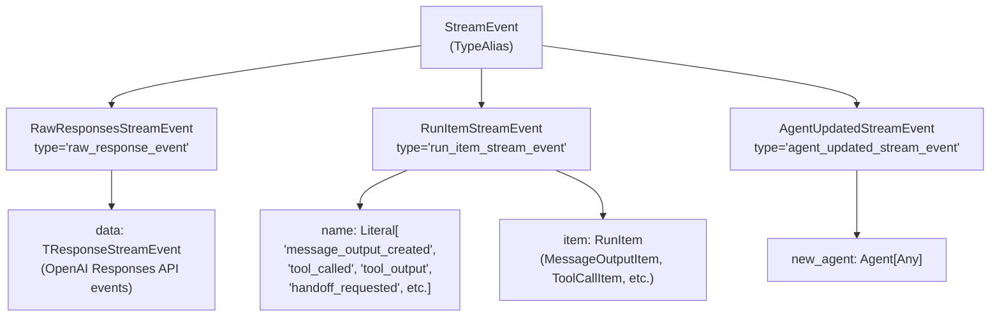
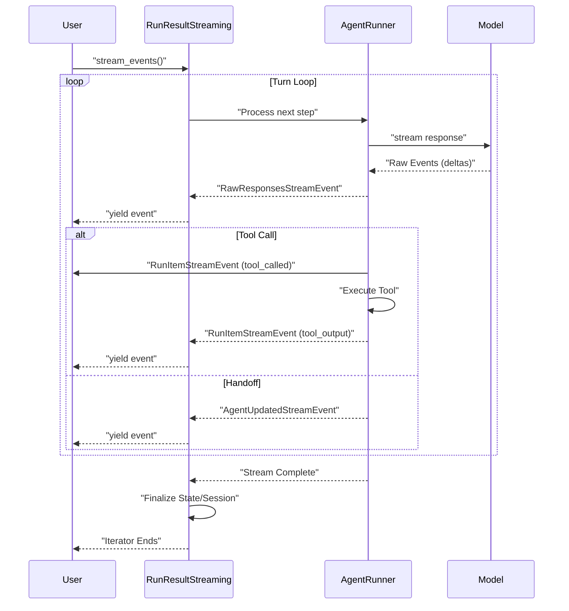

<!-- source: DeepWiki mcp.deepwiki.com · repo openai/openai-agents-python · page 13.3 Streaming Patterns · fetched 2026-10-26 -->

# Streaming Patterns

<details>
<summary>Relevant source files</summary>

The following files were used as context for generating this wiki page:

- [examples/memory/compaction_session_example.py](examples/memory/compaction_session_example.py)
- [examples/memory/compaction_session_stateless_example.py](examples/memory/compaction_session_stateless_example.py)
- [src/agents/memory/__init__.py](src/agents/memory/__init__.py)
- [src/agents/memory/util.py](src/agents/memory/util.py)
- [src/agents/run_internal/model_provider_lifecycle.py](src/agents/run_internal/model_provider_lifecycle.py)
- [src/agents/run_internal/streaming.py](src/agents/run_internal/streaming.py)
- [tests/test_agent_tool_state.py](tests/test_agent_tool_state.py)
- [tests/test_cancel_streaming.py](tests/test_cancel_streaming.py)
- [tests/test_runner_model_provider_lifecycle.py](tests/test_runner_model_provider_lifecycle.py)
- [tests/test_soft_cancel.py](tests/test_soft_cancel.py)
- [tests/test_stream_events.py](tests/test_stream_events.py)
- [tests/tracing/test_setup.py](tests/tracing/test_setup.py)

</details>


This page covers how to stream agent execution updates in real time using `Runner.run_streamed()`. Streaming enables incremental response delivery, progress indicators, and real-time UI updates without waiting for the entire agent run to complete.

For basic execution patterns, see [3.2. Runner and Execution Flow](). For result inspection after a completed run, see [3.3. RunResult and Output Management]().

---

## Overview

[`Runner.run_streamed()`][agents.run.Runner.run_streamed]() executes an agent and returns a [`RunResultStreaming`][agents.result.RunResultStreaming]() object that produces a stream of [`StreamEvent`][agents.stream_events.StreamEvent]() objects as the run progresses. This allows you to:

- Display partial text output token-by-token as the model generates it [docs/ko/streaming.md:19-36]().
- Show progress indicators when tools execute or handoffs occur [docs/ko/streaming.md:72-74]().
- Update UI state incrementally instead of waiting for final completion [docs/ko/streaming.md:7-8]().
- Cancel long-running operations gracefully [docs/ko/streaming.md:62-64]().

The streaming API is compatible with all agent features including tools, handoffs, guardrails, and human-in-the-loop approvals [docs/ko/streaming.md:42-44]().

**Sources:** [docs/ko/streaming.md:1-11](), [src/agents/stream_events.py:61-62]()

---

## Basic Streaming Pattern

### Initiating a Streamed Run

Call `Runner.run_streamed()` with the same parameters as `Runner.run()`. The method returns a `RunResultStreaming` object immediately [docs/ko/streaming.md:9-10]().

```python
from agents import Agent, Runner

agent = Agent(
    name="Assistant",
    instructions="Be helpful and concise.",
)

result = Runner.run_streamed(agent, "Explain quantum computing")
```

### Consuming Stream Events

Iterate over `result.stream_events()` to receive updates as they occur. The stream must be fully consumed before the run is considered complete [docs/ko/streaming.md:11-12]().

```python
async for event in result.stream_events():
    if event.type == "raw_response_event":
        # Process raw model events (e.g. text deltas)
        print(event.data)
    elif event.type == "run_item_stream_event":
        # Process completed items (messages, tool calls, etc.)
        print(f"Item: {event.name}")
    elif event.type == "agent_updated_stream_event":
        # Agent changed (handoff occurred)
        print(f"Now running: {event.new_agent.name}")

# After iteration completes, result contains final state
assert result.is_complete
```

**Critical:** Session persistence, approval bookkeeping, and history compaction finish after the last event is yielded [docs/ko/streaming.md:11-12](). Always consume the entire stream before inspecting the final `RunResult` properties like `final_output` or `interruptions` [docs/ko/streaming.md:11-12]().

**Sources:** [docs/ko/streaming.md:3-40](), [docs/zh/streaming.md:9-12]()

---

## Stream Event Types

The SDK emits three categories of streaming events, each serving different use cases [src/agents/stream_events.py:61-62]().

### Event Type Hierarchy

| Natural Language Space | Code Entity Space | File Reference |
| :--- | :--- | :--- |
| **Raw Model Stream** | `RawResponsesStreamEvent` | [src/agents/stream_events.py:12-21]() |
| **High-level Run Items** | `RunItemStreamEvent` | [src/agents/stream_events.py:25-50]() |
| **Agent Handoff Event** | `AgentUpdatedStreamEvent` | [src/agents/stream_events.py:53-60]() |

**Stream Event Object Model**

*Sources: [src/agents/stream_events.py:1-62]()*, [src/agents/run_internal/streaming.py:28-66]()

### RawResponsesStreamEvent

Raw events from the OpenAI Responses API, passed through unchanged [src/agents/stream_events.py:12-14](). Use these for token-by-token text streaming or low-level protocol inspection.

**Common raw event types (from `openai.types.responses`):**
- `ResponseTextDeltaEvent`: Incremental text token [docs/ko/streaming.md:34-35]().
- `ResponseFunctionCallArgumentsDeltaEvent`: Incremental tool arguments [tests/test_stream_events.py:13-14]().

**Computer tool events:** Preview models emit `computer_call` with a single `action`, while GA models can emit batched `actions[]`. Both shapes appear in raw events [docs/ko/streaming.md:17-18]().

**Sources:** [src/agents/stream_events.py:11-21](), [docs/ko/streaming.md:13-40]()

### RunItemStreamEvent

Higher-level events emitted when complete items are produced [src/agents/stream_events.py:25-26](). Use these for semantic progress updates.

**Event names (`RunItemStreamEvent.name`):**
| Name | When Emitted | Item Type |
|------|-------------|-----------|
| `message_output_created` | Assistant message finalized | `MessageOutputItem` |
| `tool_called` | Tool invocation started | `ToolCallItem` |
| `tool_output` | Tool execution completed | `ToolCallOutputItem` |
| `tool_search_called` | Hosted tool search initiated | `ToolSearchCallItem` |
| `tool_search_output_created` | Tool search results loaded | `ToolSearchOutputItem` |
| `handoff_requested` | Handoff call initiated | `HandoffCallItem` |
| `handoff_occured` | Handoff completed (intentional typo) | `HandoffOutputItem` |
| `reasoning_item_created` | Reasoning step finished | `ReasoningItem` |
| `mcp_approval_requested` | MCP tool approval needed | `MCPApprovalRequestItem` |
| `mcp_list_tools` | MCP tool discovery result | `MCPListToolsItem` |

**Sources:** [src/agents/run_internal/streaming.py:33-65](), [docs/ko/streaming.md:76-92]()

### AgentUpdatedStreamEvent

Emitted when the current agent changes, typically due to a handoff [src/agents/stream_events.py:53-54](). Use this to update UI state showing which agent is active.

```python
async for event in result.stream_events():
    if event.type == "agent_updated_stream_event":
        print(f"Switched to agent: {event.new_agent.name}")
```

**Sources:** [src/agents/stream_events.py:52-59]()

---

## Streaming Execution Flow

### Turn Loop and Event Consumption

`RunResultStreaming` manages the lifecycle of a streamed run, providing access to `stream_events()` which yields events generated by the internal turn loop [docs/ko/streaming.md:9-11]().

**Internal Streaming Sequence**

*Sources: [docs/ko/streaming.md:9-12]*, [src/agents/run_internal/streaming.py:68-73](), [tests/test_stream_events.py:90-130]()

---

## Streaming with Interruptions

### Approval Flow

When a tool requires approval, the stream ends naturally and pending approvals appear in `result.interruptions` [docs/ko/streaming.md:43-44](). You must fully consume the stream before `interruptions` is populated.

```python
# First segment: run until approval needed
result = Runner.run_streamed(agent, "Delete temporary files")
async for event in result.stream_events():
    pass

# Check for interruptions
if result.interruptions:
    state = result.to_state()
    for interruption in result.interruptions:
        state.approve(interruption)
    
    # Resume and stream continuation
    result = Runner.run_streamed(agent, state)
    async for event in result.stream_events():
        pass
```

**Sources:** [docs/ko/streaming.md:42-60]()

---

## Cancellation Patterns

### Immediate vs. After-Turn Cancellation

`RunResultStreaming.cancel()` supports two modes [docs/ko/streaming.md:64-66](), [tests/test_cancel_streaming.py:163-177](), [tests/test_soft_cancel.py:24-41]():

- `mode="immediate"`: Stops execution immediately. This is the default behavior [tests/test_cancel_streaming.py:163-177]().
- `mode="after_turn"`: Completes the current turn (e.g., finishing an LLM response or tool execution) before stopping [docs/ko/streaming.md:64](), [tests/test_soft_cancel.py:24-41]().

```python
result = Runner.run_streamed(agent, "Generate a 1000-word story")

# ... some time later ...
result.cancel(mode="after_turn")

async for event in result.stream_events():
    # Will continue yielding until the current turn is finished
    print(event)
```

If `cancel(mode="after_turn")` is used, the turn completes, ensuring session items are saved and usage is tracked [docs/ko/streaming.md:68](), [tests/test_soft_cancel.py:110-150]().

**Sources:** [docs/ko/streaming.md:62-71](), [tests/test_cancel_streaming.py:39-178](), [tests/test_soft_cancel.py:24-187]()

---

## Summary of Run Item Event Names

The following semantic names are used in `RunItemStreamEvent.name` to categorize the `item` payload, as implemented in `stream_step_items_to_queue` [src/agents/run_internal/streaming.py:28-66]().

| Event Name | Item Class | Description |
| :--- | :--- | :--- |
| `message_output_created` | `MessageOutputItem` | Final text message from assistant [src/agents/run_internal/streaming.py:34-35]() |
| `handoff_requested` | `HandoffCallItem` | Model requested a handoff [src/agents/run_internal/streaming.py:36-37]() |
| `handoff_occured` | `HandoffOutputItem` | Handoff execution finished (intentional typo) [src/agents/run_internal/streaming.py:38-39]() |
| `tool_called` | `ToolCallItem` | Tool execution started [src/agents/run_internal/streaming.py:40-41]() |
| `tool_output` | `ToolCallOutputItem` | Tool execution finished [src/agents/run_internal/streaming.py:46-47]() |
| `tool_search_called` | `ToolSearchCallItem` | Hosted tool search initiated [src/agents/run_internal/streaming.py:42-43]() |
| `tool_search_output_created` | `ToolSearchOutputItem` | Hosted tool search results returned [src/agents/run_internal/streaming.py:44-45]() |
| `reasoning_item_created` | `ReasoningItem` | Reasoning step completed [src/agents/run_internal/streaming.py:48-49]() |
| `mcp_approval_requested` | `MCPApprovalRequestItem` | MCP server requires approval [src/agents/run_internal/streaming.py:50-51]() |
| `mcp_list_tools` | `MCPListToolsItem` | List of tools from MCP server [src/agents/run_internal/streaming.py:54-55]() |

**Sources:** [src/agents/run_internal/streaming.py:28-66](), [docs/ko/streaming.md:76-92]()

---

