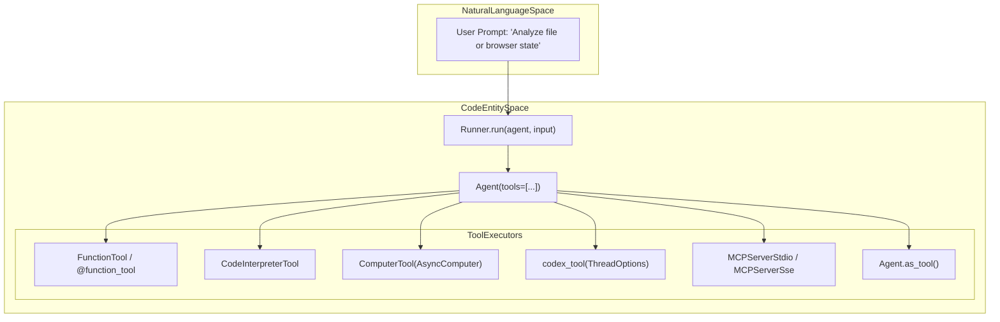
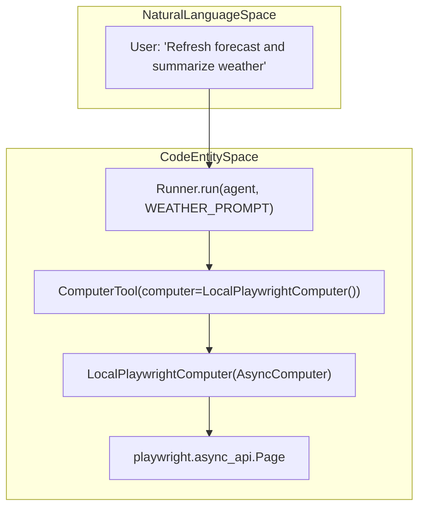
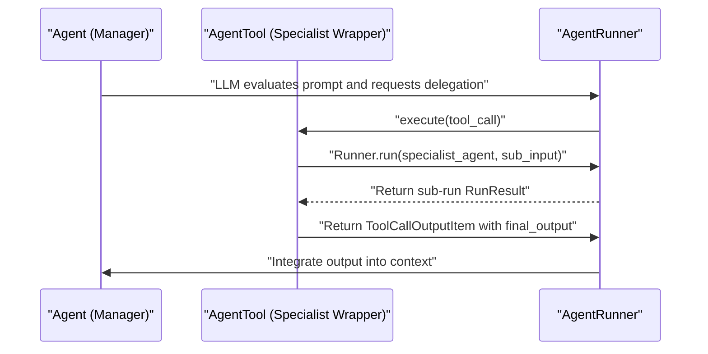

<!-- source: DeepWiki mcp.deepwiki.com · repo openai/openai-agents-python · page 13.4 Tool Integration Examples · fetched 2026-10-26 -->

# Tool Integration Examples

<details>
<summary>Relevant source files</summary>

The following files were used as context for generating this wiki page:

- [examples/mcp/filesystem_example/README.md](examples/mcp/filesystem_example/README.md)
- [examples/mcp/filesystem_example/main.py](examples/mcp/filesystem_example/main.py)
- [examples/mcp/filesystem_example/sample_files/favorite_books.txt](examples/mcp/filesystem_example/sample_files/favorite_books.txt)
- [examples/mcp/filesystem_example/sample_files/favorite_cities.txt](examples/mcp/filesystem_example/sample_files/favorite_cities.txt)
- [examples/mcp/filesystem_example/sample_files/favorite_songs.txt](examples/mcp/filesystem_example/sample_files/favorite_songs.txt)
- [examples/mcp/get_all_mcp_tools_example/main.py](examples/mcp/get_all_mcp_tools_example/main.py)
- [examples/mcp/git_example/README.md](examples/mcp/git_example/README.md)
- [examples/mcp/git_example/main.py](examples/mcp/git_example/main.py)
- [examples/mcp/sse_example/README.md](examples/mcp/sse_example/README.md)
- [examples/mcp/sse_example/main.py](examples/mcp/sse_example/main.py)
- [examples/mcp/sse_example/server.py](examples/mcp/sse_example/server.py)
- [examples/mcp/tool_filter_example/main.py](examples/mcp/tool_filter_example/main.py)
- [examples/research_bot/manager.py](examples/research_bot/manager.py)
- [examples/research_bot/sample_outputs/product_recs.txt](examples/research_bot/sample_outputs/product_recs.txt)
- [examples/research_bot/sample_outputs/vacation.txt](examples/research_bot/sample_outputs/vacation.txt)
- [examples/sandbox/docs/coding_task.py](examples/sandbox/docs/coding_task.py)
- [examples/sandbox/extensions/modal_runner.py](examples/sandbox/extensions/modal_runner.py)
- [examples/sandbox/healthcare_support/skills/prior-auth-packet-builder/SKILL.md](examples/sandbox/healthcare_support/skills/prior-auth-packet-builder/SKILL.md)
- [examples/sandbox/healthcare_support/support_agents.py](examples/sandbox/healthcare_support/support_agents.py)
- [examples/sandbox/healthcare_support/tools.py](examples/sandbox/healthcare_support/tools.py)
- [examples/sandbox/healthcare_support/workflow.py](examples/sandbox/healthcare_support/workflow.py)
- [examples/sandbox/memory.py](examples/sandbox/memory.py)
- [examples/sandbox/memory_multi_agent_multiturn.py](examples/sandbox/memory_multi_agent_multiturn.py)
- [examples/sandbox/sandbox_agent_capabilities.py](examples/sandbox/sandbox_agent_capabilities.py)
- [examples/tools/code_interpreter.py](examples/tools/code_interpreter.py)
- [examples/tools/codex.py](examples/tools/codex.py)
- [examples/tools/codex_same_thread.py](examples/tools/codex_same_thread.py)
- [examples/tools/computer_use.py](examples/tools/computer_use.py)
- [examples/tools/image_generator.py](examples/tools/image_generator.py)
- [src/agents/computer.py](src/agents/computer.py)
- [tests/test_computer_action.py](tests/test_computer_action.py)
- [tests/test_tool_metadata.py](tests/test_tool_metadata.py)

</details>


This page provides practical examples, code patterns, and architectural workflows for integrating different tool types into agents within the OpenAI Agents SDK. It covers custom function tools, hosted OpenAI capabilities, external Model Context Protocol (MCP) servers, local environment runtimes (`ComputerTool` and `codex_tool`), and agent-as-tool delegations.

For foundational architecture, see [Tool System Overview](4.1). For protocol-level details on MCP servers, see [Model Context Protocol (MCP)](11). For multi-agent patterns, see [Multi-Agent Orchestration Examples](13.2).

---

## Tool Type Taxonomy and Code Entity Mapping

The SDK classifies tools into local runtime executables, hosted OpenAI backend capabilities, external protocol servers (MCP), local python function wrappers, and agent-based sub-delegators. 


Sources: [src/agents/tool.py:1-50](), [examples/tools/computer_use.py:15-25](), [examples/tools/codex.py:7-27]()

---

## Function Tool Integration

Function tools expose custom Python logic to the model. Using the `@function_tool` decorator (or its alias `@tool`), the SDK automatically infers JSON schemas from type annotations and docstrings.

### Basic Function Tool Implementation
```python
from typing import Annotated
from agents import Agent, Runner, function_tool

@function_tool
async def get_stock_price(
    symbol: Annotated[str, "Stock ticker symbol (e.g., AAPL)"],
    currency: str = "USD"
) -> str:
    """Fetch the current stock price for a given symbol."""
    return f"{symbol}: $150.25 {currency}"

agent = Agent(
    name="Stock Assistant",
    instructions="Help users check stock prices.",
    tools=[get_stock_price],
)
```
Sources: [src/agents/tool.py:1-50]()

---

## Hosted OpenAI Tools

Hosted tools execute on managed OpenAI infrastructure, providing robust data processing and generation capabilities without local resource overhead.

### Code Interpreter and Image Generation
`CodeInterpreterTool` allows the model to write and execute Python code in an isolated container for math or data analysis. `ImageGenerationTool` creates visual assets from textual prompts [examples/tools/code_interpreter.py:25-28](), [examples/tools/image_generator.py:32-40]().

```python
from agents import Agent, CodeInterpreterTool, ImageGenerationTool, Runner

agent = Agent(
    name="Multi-capable Assistant",
    instructions="Solve math problems using code interpreter or generate images when asked.",
    tools=[
        CodeInterpreterTool(
            tool_config={"type": "code_interpreter", "container": {"type": "auto"}}
        ),
        ImageGenerationTool(
            tool_config={
                "type": "image_generation",
                "model": "gpt-image-2.5-flare",
                "action": "generate",
                "size": "1536x864",
                "quality": "low",
            }
        )
    ],
)
```
Sources: [examples/tools/code_interpreter.py:14-29](), [examples/tools/image_generator.py:31-48]()

When consuming streamed responses from code interpreter or image generation tools, stream events (`RunItemStreamEvent`) expose raw items such as `code_interpreter_call` or `image_generation_call` [examples/tools/code_interpreter.py:41-53](), [examples/tools/image_generator.py:57-64]().

---

## Local Runtime and GUI Tools

The SDK supports specialized local runtime capabilities for GUI interaction (`ComputerTool`) and workspace navigation (`codex_tool`).

### Computer Use with Playwright
The `ComputerTool` wraps an `AsyncComputer` or `Computer` implementation to handle mouse, keyboard, and screen capture events during agent execution [examples/tools/computer_use.py:119-187]().


Sources: [examples/tools/computer_use.py:84-187](), [examples/tools/computer_use.py:205-216]()

### Experimental Codex Tool
The `codex_tool` invokes the local Codex CLI as a subprocess to perform workspace inspections, run tests, or modify files. It supports event streaming (`on_stream`) to monitor thread progression and item lifecycle updates [examples/tools/codex.py:34-93]().

```python
from agents.extensions.experimental.codex import codex_tool, ThreadOptions, TurnOptions

agent = Agent(
    name="Codex Agent",
    tools=[
        codex_tool(
            sandbox_mode="read-only",
            default_thread_options=ThreadOptions(
                model="gpt-5.5",
                network_access_enabled=True,
            ),
            default_turn_options=TurnOptions(
                idle_timeout_seconds=60,
            ),
            on_stream=my_codex_stream_handler,
        )
    ],
)
```
Sources: [examples/tools/codex.py:107-136](), [examples/tools/codex_same_thread.py:63-88]()

Codex sessions can also persist thread identifiers across separate runs by enabling `use_run_context_thread_id=True`, aligning thread persistence with the active execution context dictionary or Pydantic model [examples/tools/codex_same_thread.py:70-85]().

Sources: [examples/tools/computer_use.py:1-216](), [tests/test_computer_action.py:1-194](), [examples/tools/codex.py:7-136](), [examples/tools/codex_same_thread.py:63-88]()

---

## Model Context Protocol (MCP) Server Integration

The Model Context Protocol allows agents to discover and execute tools exposed by external servers over standard input/output (`MCPServerStdio`) or Server-Sent Events (`MCPServerSse`) [examples/mcp/git_example/main.py:36-39](), [examples/mcp/sse_example/main.py:59-64]().

### Stdio and SSE Transport Configuration
```python
from agents import Agent, Runner
from agents.mcp import MCPServerStdio, MCPServerSse

# Stdio Transport (e.g., git or filesystem servers)
async with MCPServerStdio(
    cache_tools_list=True,
    params={"command": "uvx", "args": ["mcp-server-git"]},
) as git_server:
    git_agent = Agent(name="Git Assistant", mcp_servers=[git_server])

# SSE Transport (e.g., remote or HTTP-bridged servers)
async with MCPServerSse(
    name="Remote SSE Server",
    params={"url": "http://127.0.0.1:8000/sse"},
) as sse_server:
    sse_agent = Agent(name="SSE Assistant", mcp_servers=[sse_server])
```
Sources: [examples/mcp/git_example/main.py:36-41](), [examples/mcp/sse_example/main.py:59-64](), [examples/mcp/sse_example/server.py:10-42]()

Servers define tools using standard MCP decorators (`@mcp.tool()`), which are automatically fetched via `server.list_tools()` and executed via `server.run_tool()` during agent turns [examples/mcp/filesystem_example/README.md:21-26](), [examples/mcp/sse_example/server.py:13-17]().

Sources: [examples/mcp/git_example/main.py:1-48](), [examples/mcp/sse_example/main.py:1-109](), [examples/mcp/sse_example/server.py:1-42](), [examples/mcp/filesystem_example/README.md:1-26]()

---

## Agent-as-Tool Integration

Agents can be wrapped into callable tools via `Agent.as_tool()`. This allows a manager agent to delegate scoped sub-tasks to specialist agents while retaining control over overall execution.

### Data Flow for Agent Delegation

Sources: [src/agents/items.py:46-46](), [src/agents/run_internal/run_loop.py:47-48]()

Sources: [src/agents/items.py:1-60](), [src/agents/run_internal/run_loop.py:1-100]()

---

