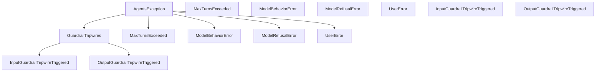
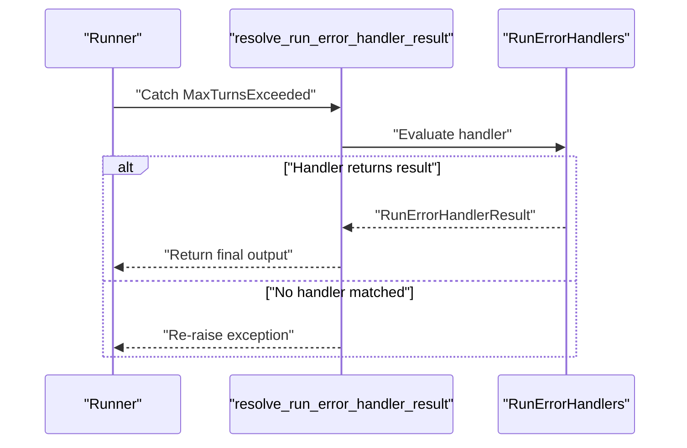
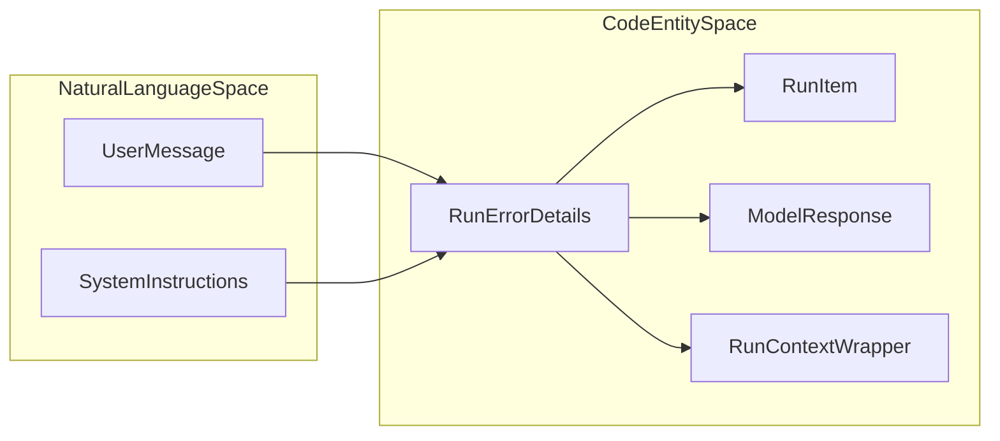

<!-- source: DeepWiki mcp.deepwiki.com · repo openai/openai-agents-python · page 14 Error Handling and Troubleshooting · fetched 2026-10-26 -->

# Error Handling and Troubleshooting

Relevant source files

The following files were used as context for generating this wiki page:

- [.github/scripts/check_optional_truthiness.py](.github/scripts/check_optional_truthiness.py)
- [examples/agent_patterns/agents_as_tools_structured.py](examples/agent_patterns/agents_as_tools_structured.py)
- [src/agents/agent_tool_input.py](src/agents/agent_tool_input.py)
- [src/agents/exceptions.py](src/agents/exceptions.py)
- [src/agents/result.py](src/agents/result.py)
- [src/agents/run.py](src/agents/run.py)
- [src/agents/run_error_handlers.py](src/agents/run_error_handlers.py)
- [src/agents/run_internal/agent_runner_helpers.py](src/agents/run_internal/agent_runner_helpers.py)
- [src/agents/run_internal/error_handlers.py](src/agents/run_internal/error_handlers.py)
- [src/agents/run_internal/run_loop.py](src/agents/run_internal/run_loop.py)
- [src/agents/run_internal/run_steps.py](src/agents/run_internal/run_steps.py)
- [src/agents/run_internal/session_persistence.py](src/agents/run_internal/session_persistence.py)
- [src/agents/run_internal/turn_resolution.py](src/agents/run_internal/turn_resolution.py)
- [src/agents/run_state.py](src/agents/run_state.py)
- [tests/test_agent_runner.py](tests/test_agent_runner.py)
- [tests/test_agent_runner_streamed.py](tests/test_agent_runner_streamed.py)
- [tests/test_agent_tool_input.py](tests/test_agent_tool_input.py)
- [tests/test_error_logging_redaction.py](tests/test_error_logging_redaction.py)
- [tests/test_invalid_final_output_handler.py](tests/test_invalid_final_output_handler.py)
- [tests/test_max_turns.py](tests/test_max_turns.py)
- [tests/test_run_impl_resume_paths.py](tests/test_run_impl_resume_paths.py)
- [tests/test_run_internal_error_handlers.py](tests/test_run_internal_error_handlers.py)
- [tests/test_run_state.py](tests/test_run_state.py)
- [tests/test_tool_use_tracker.py](tests/test_tool_use_tracker.py)

This page covers the SDK's error handling mechanisms, exception types, recovery patterns, and debugging techniques. It provides high-level guidance on preventing, catching, and recovering from errors during agent execution.

For information about observability and monitoring during successful runs, see [Tracing and Observability](#10). For configuration of guardrails that prevent unwanted behavior, see [Safety and Validation](#6).

---

## Exception Hierarchy

The SDK defines a structured exception hierarchy rooted at `AgentsException`. All SDK-raised exceptions inherit from this base class, and many include a `run_data` attribute to provide context about the state of the agent when the failure occurred [src/agents/exceptions.py:14-29]().

### Exception Type Overview

**Sources:** [src/agents/exceptions.py:14-29](), [src/agents/run.py:14-29]()

### Core Exception Types

| Exception | Trigger Condition | Recovery Strategy |
|-----------|------------------|-------------------|
| `AgentsException` | Base class for all SDK exceptions [src/agents/exceptions.py:15]() | Generic catch-all |
| `MaxTurnsExceeded` | Agent loop exceeds `max_turns` limit [src/agents/run.py:17]() | Use error handlers or increase limit |
| `ModelBehaviorError` | Model produces invalid/unexpected output (e.g., malformed structure) [src/agents/exceptions.py:18]() | Retry with different model settings |
| `ModelRefusalError` | Model explicitly refuses to fulfill a request [src/agents/run_internal/turn_resolution.py:70]() | Adjust instructions or configure error handlers |
| `UserError` | Invalid SDK usage or configuration [src/agents/exceptions.py:21]() | Fix implementation code |
| `InputGuardrailTripwireTriggered` | An input guardrail with tripwire configuration triggered [src/agents/exceptions.py:16]() | Review user input safety policies |

For a detailed breakdown of all exception classes and their fields, see [Exception Types](#14.1).

Sources: [src/agents/exceptions.py:14-29](), [src/agents/run.py:14-29](), [src/agents/run_internal/turn_resolution.py:67-71]()

---

## Error Recovery Patterns

The SDK provides mechanisms to recover from errors gracefully, including specialized error handlers for loop-level failures and retry policies for model-level failures.

### Error Handlers

Error handlers intercept specific terminal conditions (such as `max_turns` and `model_refusal`) and provide custom recovery logic, such as returning a fallback final output or cleaning up state [src/agents/run_error_handlers.py:1-40]().

**Sources:** [src/agents/run.py:62](), [src/agents/run_internal/run_loop.py:128-135]()

For implementation details and example code, see [Error Recovery Patterns](#14.2).

---

## Debugging Techniques

Debugging agent workflows often requires inspecting the sequence of events and turns that led to a specific failure or unexpected state.

### Run Data and Context Mapping

When an exception occurs, the SDK can capture snapshots of execution states, bridging high-level natural language interactions with internal code entities.

**Sources:** [src/agents/exceptions.py:20](), [src/agents/run.py:20]()

### Inspecting Run Results

The `RunResult` and `RunResultStreaming` objects provide access to `new_items`, containing every `RunItem` (messages, tool calls, and tool outputs) generated during execution [src/agents/result.py:44]().

- **History Inspection:** Review items added to the session or input lists via `RunResult.to_input_list()` [src/agents/result.py:84-108]().
- **Raw Responses:** Access `raw_responses` to inspect raw provider payloads prior to SDK processing [src/agents/result.py:138]().
- **Tracing:** Tracing captures spans for turns, tasks, generations, and tool executions [src/agents/tracing/__init__.py]() (see [Tracing and Observability](#10)).

For a guide on using these tools to troubleshoot common issues, see [Debugging Techniques](#14.3).

Sources: [src/agents/result.py:1-172](), [src/agents/run.py:44]()

---

## Summary of Troubleshooting Scenarios

| Issue | Code Entity to Check | File Reference |
|-------|----------------------|----------------|
| **Infinite Loops** | `max_turns`, `MaxTurnsExceeded` | [src/agents/run.py:17](), [src/agents/run_config.py:46]() |
| **Model Hallucinations / Parse Errors** | `ModelBehaviorError`, `Agent.output_type` | [src/agents/exceptions.py:18]() |
| **Transient API Errors** | `ModelRetrySettings`, retry policies | [src/agents/run_internal/run_loop.py:155-159]() |
| **Guardrail Rejections** | `InputGuardrailResult`, `OutputGuardrailResult` | [src/agents/guardrail.py:31-33]() |

**Sources:** [src/agents/exceptions.py](), [src/agents/run.py](), [src/agents/run_config.py]()

---

