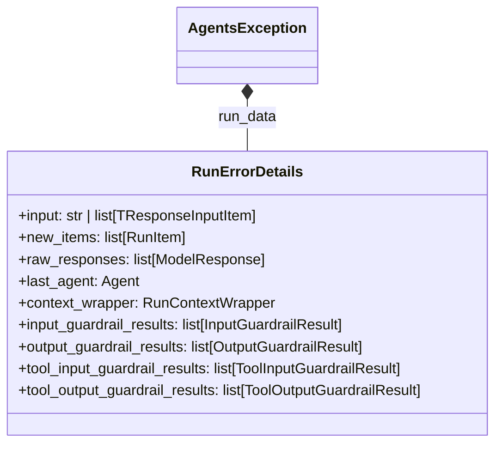
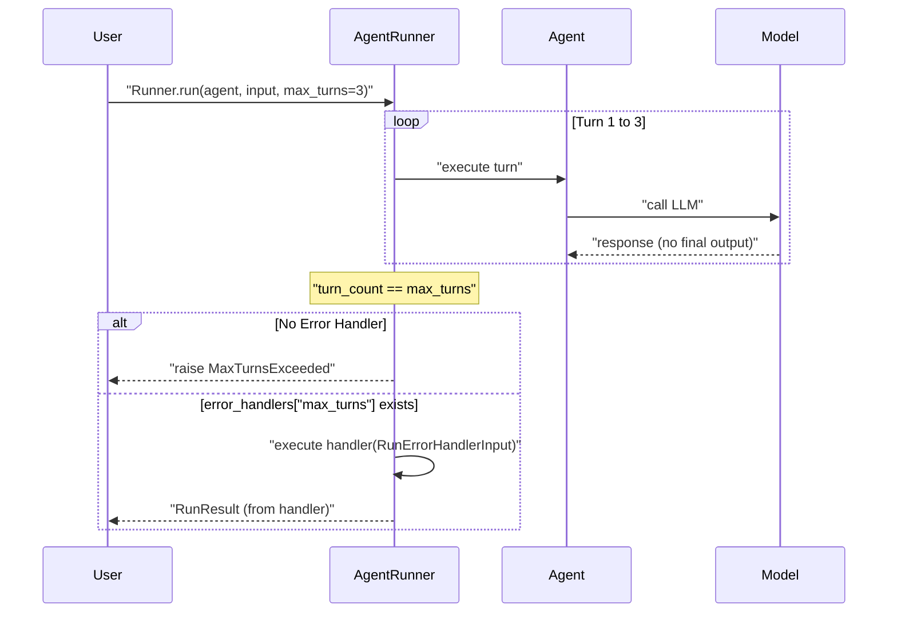
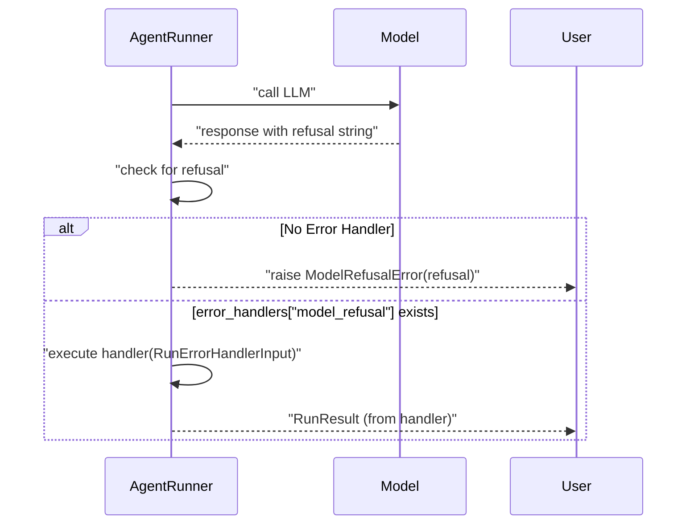
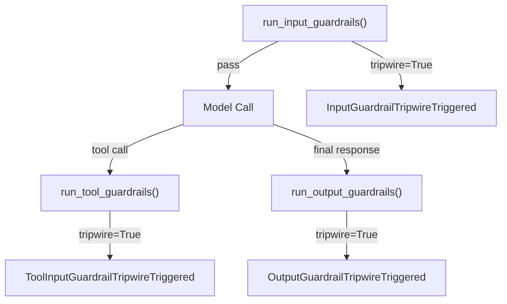

<!-- source: DeepWiki mcp.deepwiki.com · repo openai/openai-agents-python · page 14.1 Exception Types · fetched 2026-10-26 -->

# Exception Types

Relevant source files

The following files were used as context for generating this wiki page:

- [src/agents/exceptions.py](src/agents/exceptions.py)
- [src/agents/result.py](src/agents/result.py)
- [src/agents/run.py](src/agents/run.py)
- [src/agents/run_internal/agent_runner_helpers.py](src/agents/run_internal/agent_runner_helpers.py)
- [src/agents/run_internal/run_loop.py](src/agents/run_internal/run_loop.py)
- [src/agents/run_internal/run_steps.py](src/agents/run_internal/run_steps.py)
- [src/agents/run_internal/session_persistence.py](src/agents/run_internal/session_persistence.py)
- [src/agents/run_internal/turn_resolution.py](src/agents/run_internal/turn_resolution.py)
- [src/agents/run_state.py](src/agents/run_state.py)
- [tests/test_agent_runner.py](tests/test_agent_runner.py)
- [tests/test_agent_runner_streamed.py](tests/test_agent_runner_streamed.py)
- [tests/test_error_logging_redaction.py](tests/test_error_logging_redaction.py)
- [tests/test_run_impl_resume_paths.py](tests/test_run_impl_resume_paths.py)
- [tests/test_run_state.py](tests/test_run_state.py)

This page documents the exception hierarchy in the OpenAI Agents SDK, including when each exception is raised, what data they contain, and patterns for handling them. For information about error recovery strategies, see [Error Recovery Patterns](14.2).

---

## Exception Hierarchy

The SDK defines a hierarchy of exceptions to represent different failure modes during agent execution. All SDK exceptions inherit from `AgentsException`, which serves as the base type for catching any SDK-related error [src/agents/exceptions.py:81-82]().

### Core Exception Tree

```mermaid
graph TB
    AgentsException["AgentsException<br/>(Base class)"]
    MaxTurnsExceeded["MaxTurnsExceeded<br/>(Turn limit exceeded)"]
    ModelBehaviorError["ModelBehaviorError<br/>(LLM produced invalid output)"]
    ModelRefusalError["ModelRefusalError<br/>(Model refused output)"]
    UserError["UserError<br/>(SDK misuse)"]
    ToolTimeoutError["ToolTimeoutError<br/>(Function tool timeout)"]
    
    subgraph "Guardrail Exceptions"
        InputGuardrailTripwire["InputGuardrailTripwireTriggered"]
        OutputGuardrailTripwire["OutputGuardrailTripwireTriggered"]
        ToolInputTripwire["ToolInputGuardrailTripwireTriggered"]
        ToolOutputTripwire["ToolOutputGuardrailTripwireTriggered"]
    end

    subgraph "MCP Exceptions"
        MCPToolCancellation["MCPToolCancellationError"]
    end
    
    AgentsException --> MaxTurnsExceeded
    AgentsException --> ModelBehaviorError
    AgentsException --> ModelRefusalError
    AgentsException --> UserError
    AgentsException --> ToolTimeoutError
    AgentsException --> InputGuardrailTripwire
    AgentsException --> OutputGuardrailTripwire
    AgentsException --> ToolInputTripwire
    AgentsException --> ToolOutputTripwire
    AgentsException --> MCPToolCancellation
```

Sources: [src/agents/exceptions.py:81-209]()

---

## AgentsException

`AgentsException` is the base class for all exceptions raised by the SDK. It provides a common interface for error handling and includes optional `run_data` for debugging [src/agents/exceptions.py:81-89]().

### Key Properties

| Property | Type | Description |
|----------|------|-------------|
| `run_data` | `RunErrorDetails \| None` | Contains execution context when exception occurred (input, items, agent state) [src/agents/exceptions.py:84-88](). |

### RunErrorDetails Structure

When an exception occurs during a run, the SDK captures the state of the run in `RunErrorDetails` [src/agents/exceptions.py:61-79](). This allows developers to inspect exactly what happened before the failure, including which agent was active and what the model's raw responses were.

Sources: [src/agents/exceptions.py:61-79](), [src/agents/run_internal/error_handlers.py:113-136]()

---

## MaxTurnsExceeded

`MaxTurnsExceeded` is raised when an agent execution exceeds the `max_turns` limit specified in the run configuration [src/agents/exceptions.py:91-99](). This is used by the `AgentRunner` to prevent infinite loops in multi-turn conversations.

### Exception Flow

Sources: [src/agents/exceptions.py:91-99](), [src/agents/run_internal/error_handlers.py:41-60](), [src/agents/run_error_handlers.py:50-53]()

---

## ModelBehaviorError

`ModelBehaviorError` is raised when the underlying LLM produces output that violates SDK expectations, protocol requirements, or tool schemas [src/agents/exceptions.py:101-111]().

### Common Scenarios

| Scenario | Description |
|----------|-------------|
| **Malformed Tool Calls** | Model produces a tool call with invalid JSON arguments that cannot be parsed. |
| **Schema Violation** | Model returns content that fails to validate against the agent's `output_type` [tests/test_invalid_final_output_handler.py:64-70](). |
| **Empty Output** | Model returns no final output when a structured output type was expected [tests/test_invalid_final_output_handler.py:177-182](). |

Sources: [src/agents/exceptions.py:101-111](), [tests/test_invalid_final_output_handler.py:64-70](), [src/agents/run_internal/error_handlers.py:47-60]()

---

## ModelRefusalError

`ModelRefusalError` is raised when the model explicitly refuses to produce the requested output, often indicated by a `refusal` field in the model's response [src/agents/exceptions.py:113-122]().

### Exception Flow

Sources: [src/agents/exceptions.py:113-122](), [src/agents/run_internal/error_handlers.py:41-60](), [src/agents/run_error_handlers.py:54-54]()

---

## UserError

`UserError` is raised when the SDK detects developer configuration errors or invalid usage of the API [src/agents/exceptions.py:124-132]().

### Examples in SDK Logic
- **Invalid Error Handler Output**: Raised if a run error handler returns an invalid `final_output` that cannot be serialized or validated against the agent's structured output schema [src/agents/run_internal/error_handlers.py:198-201]().
- **Handler Result Shape**: Raised if an error handler returns a dictionary with unexpected keys [tests/test_run_internal_error_handlers.py:114-123]().

Sources: [src/agents/exceptions.py:124-132](), [src/agents/run_internal/error_handlers.py:198-201](), [tests/test_run_internal_error_handlers.py:114-123]()

---

## Guardrail Exceptions

Guardrail exceptions enforce safety and compliance policies by halting execution immediately when a "tripwire" is triggered.

### Tripwire Types

| Exception | Trigger Point |
|-----------|---------------|
| `InputGuardrailTripwireTriggered` | Triggered by `@input_guardrail` before model execution [src/agents/exceptions.py:156-167](). |
| `OutputGuardrailTripwireTriggered` | Triggered by `@output_guardrail` after the model provides a response [src/agents/exceptions.py:169-180](). |
| `ToolInputGuardrailTripwireTriggered` | Triggered by `@tool_input_guardrail` before tool execution [src/agents/exceptions.py:182-195](). |
| `ToolOutputGuardrailTripwireTriggered` | Triggered by `@tool_output_guardrail` after tool returns a result [src/agents/exceptions.py:197-210](). |

### Guardrail Execution Logic

Sources: [src/agents/exceptions.py:156-210](), [src/agents/run_internal/error_handlers.py:47-60]()

---

## MCP and Tool Exceptions

### MCPToolCancellationError
Raised when an MCP (Model Context Protocol) tool call is internally cancelled [src/agents/exceptions.py:134-142]().

### ToolTimeoutError
Raised when a function tool invocation exceeds its configured `timeout_seconds` duration [src/agents/exceptions.py:144-154]().

Sources: [src/agents/exceptions.py:134-154]()

---

## Redaction and Tracing

The SDK includes mechanisms to prevent sensitive data from leaking into logs or traces when data logging is disabled [tests/test_error_logging_redaction.py:1-7]().

- **`_mark_error_data_redacted`**: Marks an exception so that its details are hidden from logs [src/agents/exceptions.py:35-36]().
- **`_detach_data_redacted_error_traceback`**: Clears the traceback and cause of an exception to ensure no payload data remains in the error object [src/agents/exceptions.py:48-53]().
- **`attach_generic_agent_error`**: Used to attach a generic error message to tracing spans when sensitive data is redacted [src/agents/run_internal/error_handlers.py:75-87]().

Sources: [src/agents/exceptions.py:22-58](), [src/agents/run_internal/error_handlers.py:75-111](), [tests/test_error_logging_redaction.py:189-218]()

---

