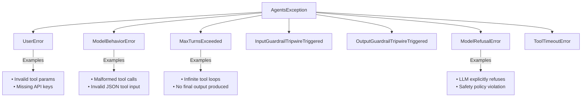
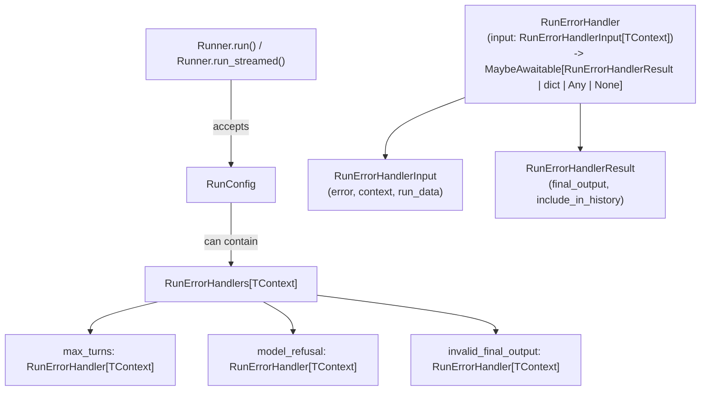
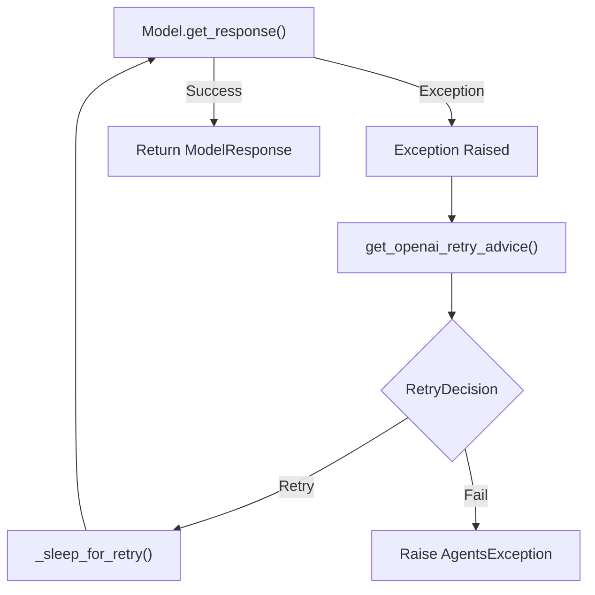
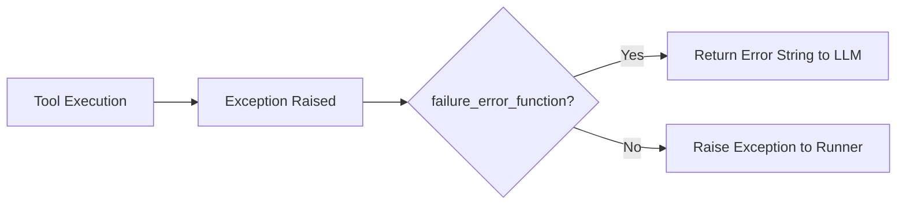

<!-- source: DeepWiki mcp.deepwiki.com · repo openai/openai-agents-python · page 14.2 Error Recovery Patterns · fetched 2026-10-26 -->

# Error Recovery Patterns

Relevant source files

The following files were used as context for generating this wiki page:

- [.github/scripts/check_optional_truthiness.py](.github/scripts/check_optional_truthiness.py)
- [examples/agent_patterns/agents_as_tools_structured.py](examples/agent_patterns/agents_as_tools_structured.py)
- [examples/basic/retry.py](examples/basic/retry.py)
- [examples/basic/retry_litellm.py](examples/basic/retry_litellm.py)
- [integration_tests/openai/test_retry.py](integration_tests/openai/test_retry.py)
- [integration_tests/packaging/test_mcp_compat.py](integration_tests/packaging/test_mcp_compat.py)
- [src/agents/_httpx_compat.py](src/agents/_httpx_compat.py)
- [src/agents/agent_tool_input.py](src/agents/agent_tool_input.py)
- [src/agents/mcp/_compat.py](src/agents/mcp/_compat.py)
- [src/agents/models/_openai_retry.py](src/agents/models/_openai_retry.py)
- [src/agents/models/_retry_runtime.py](src/agents/models/_retry_runtime.py)
- [src/agents/run_error_handlers.py](src/agents/run_error_handlers.py)
- [src/agents/run_internal/error_handlers.py](src/agents/run_internal/error_handlers.py)
- [src/agents/run_internal/model_retry.py](src/agents/run_internal/model_retry.py)
- [tests/models/test_model_retry.py](tests/models/test_model_retry.py)
- [tests/models/test_openai_retry_helpers.py](tests/models/test_openai_retry_helpers.py)
- [tests/test_agent_tool_input.py](tests/test_agent_tool_input.py)
- [tests/test_invalid_final_output_handler.py](tests/test_invalid_final_output_handler.py)
- [tests/test_max_turns.py](tests/test_max_turns.py)
- [tests/test_run_internal_error_handlers.py](tests/test_run_internal_error_handlers.py)
- [tests/test_tool_use_tracker.py](tests/test_tool_use_tracker.py)

This page documents error recovery mechanisms in the OpenAI Agents SDK, including exception handling, structured error handlers (`RunErrorHandlers`), model retry policies, tool-level failure management (`failure_error_function`), and graceful degradation strategies. These mechanisms enable agents to maintain execution despite tool failures, model behavior issues, or loop limits.

---

## Exception Hierarchy and Error Types

The SDK uses a structured exception hierarchy to categorize failures, allowing for specific recovery strategies based on the error type.

### Core Exception Types

**Purpose**: Each exception type signals a different failure category. For instance, `ModelBehaviorError` is raised when the LLM produces malformed tool arguments or invalid JSON for structured output [tests/test_invalid_final_output_handler.py:68-69](). `UserError` signals developer-side configuration issues, such as returning invalid data from an error handler [src/agents/run_internal/error_handlers.py:170-201](). `ModelRefusalError` is raised when the model explicitly refuses to respond to a prompt [tests/test_max_turns.py:170-173](). `MaxTurnsExceeded` prevents infinite loops by capping the turn count [tests/test_max_turns.py:58-59]().

Sources: [src/agents/run_internal/error_handlers.py:170-201](), [tests/test_invalid_final_output_handler.py:68-69](), [tests/test_max_turns.py:58-59](), [tests/test_max_turns.py:170-173]()

### RunErrorData and Context Snapshots

When a run fails or triggers an error handler, the SDK provides structured execution data via `RunErrorData` [src/agents/run_error_handlers.py:17-26]() (passed to handlers) containing input history, newly generated items, raw responses, and the active agent.

| Field | Type | Description |
|-------|------|-------------|
| `input` | `str \| list[TResponseInputItem]` | Original input that triggered the run. |
| `new_items` | `list[RunItem]` | Items generated before the error occurred. |
| `history` | `list[TResponseInputItem]` | Full conversation history up to the point of error. |
| `output` | `list[TResponseInputItem]` | Output items collected in the current run phase. |
| `raw_responses` | `list[ModelResponse]` | Model responses received before the error. |
| `last_agent` | `Agent[Any]` | The agent that was active when the error occurred. |

Sources: [src/agents/run_error_handlers.py:17-26](), [src/agents/run_internal/error_handlers.py:113-137]()

---

## Error Handler Pattern (`RunErrorHandlers`)

The `error_handlers` configuration dictionary allows applications to intercept specific errors (`max_turns`, `model_refusal`, `invalid_final_output`) and return a recovery result instead of crashing.

### Handler Configuration and Data Flow

**Handler Input**: The `RunErrorHandlerInput` [src/agents/run_error_handlers.py:29-33]() dataclass provides the `error`, the `RunContextWrapper`, and `RunErrorData` [src/agents/run_error_handlers.py:17-26]() containing the execution state.

**Handler Output**: A handler can return a `RunErrorHandlerResult` [src/agents/run_error_handlers.py:36-41()], a dictionary containing a `final_output` key, or a direct final output value. If a handler returns `None`, the SDK declines recovery and re-raises the original exception [tests/test_invalid_final_output_handler.py:135-145]().

**Implementation**: The internal module `src/agents/run_internal/error_handlers.py` handles resolution and validation (`validate_handler_final_output` [src/agents/run_internal/error_handlers.py:170-201](), `format_final_output_text` [src/agents/run_internal/error_handlers.py:139-168]()).

Sources: [src/agents/run_error_handlers.py:17-64](), [src/agents/run_internal/error_handlers.py:113-201](), [tests/test_invalid_final_output_handler.py:135-145]()

---

## Model Retry Policies

The SDK provides automated retry management for model requests through `ModelRetrySettings` and provider-specific advice.

### Implementation and Data Flow

**Retry Logic & Normalization**:
*   **Network & Timeout Errors**: Connection errors, read errors, protocol errors, and timeouts (via `_is_network_like_error` [src/agents/run_internal/model_retry.py:90-114]()) automatically trigger retries.
*   **Provider Advice**: `get_openai_retry_advice` [src/agents/models/_openai_retry.py:41-112]() inspects response headers (`retry-after`, `retry-after-ms`, `x-should-retry`) and HTTP status codes (such as `408`, `409`, `429`, or `>=500`) to formulate a retry recommendation.
*   **Replay Safety**: Requests flagged as `unsafe_to_replay` or certain stateful websocket preconditions bypass automated retry logic [src/agents/models/_openai_retry.py:43-59]().
*   **Backoff and Jitter**: Delays are computed using exponential backoff with configurable jitter via `_default_retry_delay` [src/agents/run_internal/model_retry.py:175-201]().

Sources: [src/agents/run_internal/model_retry.py:90-201](), [src/agents/models/_openai_retry.py:41-112](), [src/agents/models/_retry_runtime.py:88-97]()

---

## Tool Error Recovery (`failure_error_function`)

When executing function tools or integrations, exceptions raised within tool callables can be intercepted and handled.

**Graceful Tool Degradation**: If a tool defines or is configured with a `failure_error_function`, exceptions are caught and transformed into text payloads returned to the language model, allowing the conversation to proceed instead of failing the entire turn.

Sources: [src/agents/run_internal/tool_execution.py:64-65]()

---

## Graceful Degradation and Tracing

### Invalid Final Output Recovery
When structured output validation fails (e.g., malformed JSON or mismatch against a Pydantic model), the `invalid_final_output` error handler can supply a validated fallback instance [tests/test_invalid_final_output_handler.py:77-81]().

### Telemetry Error Attachment
To ensure that error recovery telemetry does not crash runs, `attach_generic_agent_error` [src/agents/run_internal/error_handlers.py:75-110]() records failure details on trace spans conditionally based on sensitive data configuration without altering the underlying exception semantics [src/agents/run_internal/error_handlers.py:94-98]().

Sources: [src/agents/run_internal/error_handlers.py:75-110](), [tests/test_invalid_final_output_handler.py:73-96]()

---

