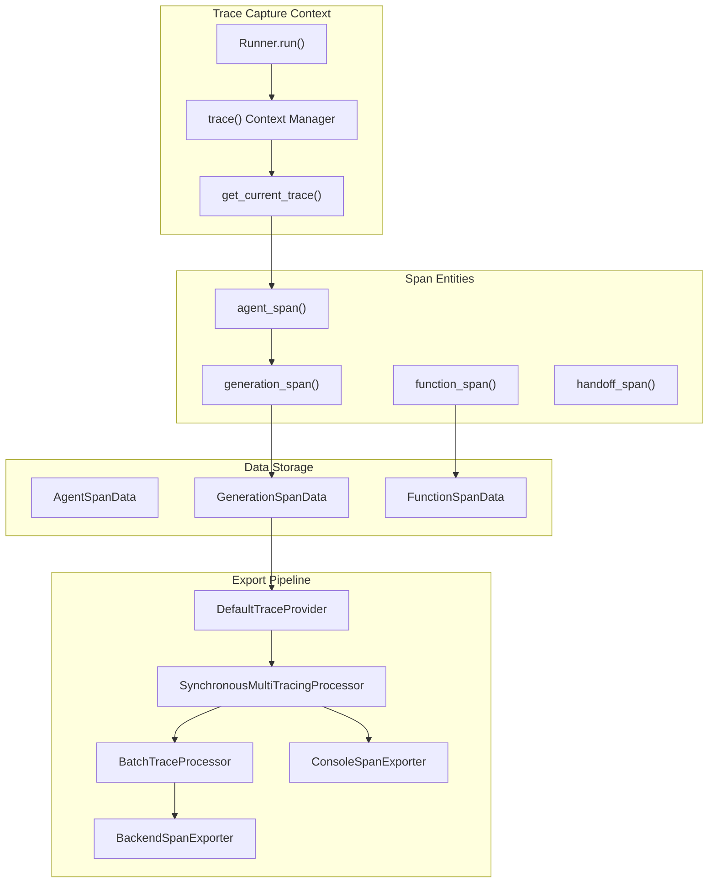
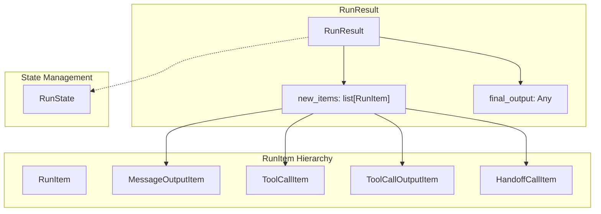

<!-- source: DeepWiki mcp.deepwiki.com · repo openai/openai-agents-python · page 14.3 Debugging Techniques · fetched 2026-10-26 -->

# Debugging Techniques

<details>
<summary>Relevant source files</summary>

The following files were used as context for generating this wiki page:

- [docs/ref/repl.md](docs/ref/repl.md)
- [docs/repl.md](docs/repl.md)
- [src/agents/_debug.py](src/agents/_debug.py)
- [src/agents/repl.py](src/agents/repl.py)
- [src/agents/run_internal/guardrails.py](src/agents/run_internal/guardrails.py)
- [src/agents/strict_schema.py](src/agents/strict_schema.py)
- [src/agents/util/_pretty_print.py](src/agents/util/_pretty_print.py)
- [tests/test_debug.py](tests/test_debug.py)
- [tests/test_guardrails.py](tests/test_guardrails.py)
- [tests/test_pretty_print.py](tests/test_pretty_print.py)
- [tests/test_repl.py](tests/test_repl.py)
- [tests/test_strict_schema.py](tests/test_strict_schema.py)
- [tests/test_strict_schema_oneof.py](tests/test_strict_schema_oneof.py)
- [tests/test_tool_guardrails.py](tests/test_tool_guardrails.py)
- [tests/utils/test_pretty_print_and_items.py](tests/utils/test_pretty_print_and_items.py)

</details>


This page covers practical debugging techniques for the OpenAI Agents SDK, including tracing, logging, result inspection, pretty printing, interactive REPL tools, and common troubleshooting scenarios. For information about exception types and their hierarchies, see [14.1 Exception Types](). For error recovery strategies and handlers, see [14.2 Error Recovery Patterns]().

---

## Tracing for Debugging

The SDK includes a built-in tracing system that captures comprehensive execution data across agent runs. Tracing provides the most powerful debugging tool in the SDK, capturing the hierarchy of agent turns, tool calls, and model generations.

### Trace Architecture Overview

The tracing system is built around a `TraceProvider` that manages the lifecycle of `Trace` and `Span` objects [src/agents/tracing/provider.py:21-21](). The `DefaultTraceProvider` uses a `SynchronousMultiTracingProcessor` to forward events to registered processors [src/agents/tracing/provider.py:93-101]().

Title: Tracing Execution Flow

Sources: [src/agents/tracing/provider.py:21-116](), [src/agents/tracing/processors.py:27-66](), [src/agents/tracing/span_data.py:28-210](), [src/agents/tracing/spans.py:59-96]()

### Exporting Traces

All traces are automatically exported to the OpenAI Traces dashboard via the `BackendSpanExporter` [src/agents/tracing/processors.py:44-66](). By default, traces are sent to the OpenAI ingest endpoint `https://api.openai.com/v1/traces/ingest` [src/agents/tracing/processors.py:45-45]().

For local debugging, the `ConsoleSpanExporter` prints trace and span data directly to the console [src/agents/tracing/processors.py:27-41]().

Sources: [src/agents/tracing/processors.py:27-66]()

### Controlling Sensitive Data and Sanitization

The `BackendSpanExporter` performs sanitization for fields known to be rejected or sensitive. It truncates long strings and drops non-standard usage keys, only allowing `input_tokens` and `output_tokens` [src/agents/tracing/processors.py:46-54](). 

The SDK also respects privacy flags `DONT_LOG_MODEL_DATA` and `DONT_LOG_TOOL_DATA` defined in `src/agents/_debug.py` [src/agents/_debug.py:20-28](). By default, model inputs/outputs and tool call arguments/outputs are excluded from logs to prevent exposing sensitive information [src/agents/_debug.py:20-28](). Setting the environment variables `OPENAI_AGENTS_DONT_LOG_MODEL_DATA` or `OPENAI_AGENTS_DONT_LOG_TOOL_DATA` to `0` or `false` enables logging them [src/agents/_debug.py:4-28]().

Sources: [src/agents/_debug.py:4-28](), [src/agents/tracing/processors.py:32-54]()

### Disabling Tracing

Tracing can be disabled globally or per-run. When disabled, the system uses `NoOpTrace` and `NoOpSpan` which perform no operations and record no data [src/agents/tracing/spans.py:216-228](), [src/agents/tracing/traces.py:215-225]().

Sources: [src/agents/tracing/spans.py:216-228](), [src/agents/tracing/traces.py:215-225]()

---

## Verbose Logging and Debug Flags

The SDK provides internal debug configuration flags via `src/agents/_debug.py` to control logging verbosity and data retention [src/agents/_debug.py:1-28]().

### Debug Flags Summary

| Flag / Environment Variable | Default | Description |
|-----------------------------|---------|-------------|
| `DONT_LOG_MODEL_DATA` (`OPENAI_AGENTS_DONT_LOG_MODEL_DATA`) | `True` | Redacts model prompt and response text from span logs. Set to `0` or `false` to log model data. |
| `DONT_LOG_TOOL_DATA` (`OPENAI_AGENTS_DONT_LOG_TOOL_DATA`) | `True` | Redacts tool inputs and outputs from span logs. Set to `0` or `false` to log tool data. |

Additionally, the SDK includes a `_safe_debug` helper in the tracing provider [src/agents/tracing/provider.py:24-46]() that checks whether logging handler streams are closed before emitting diagnostics, avoiding "IO on closed file" errors during application shutdown [src/agents/tracing/provider.py:27-46]().

Sources: [src/agents/_debug.py:1-28](), [src/agents/tracing/provider.py:24-46]()

---

## Inspecting Run Results and `new_items`

The `RunResult` object is the primary artifact for post-run inspection.

### RunResult Component Map

Title: RunResult Component Map

Sources: [src/agents/result.py:1-100](), [src/agents/items.py:1-100]()

### Debugging with `new_items`

The `new_items` list contains all `RunItem` instances generated during a single execution. This is critical for diagnosing what happened inside a multi-turn agent run [tests/test_tracing_errors.py:165-168]().

| Item Type | What It Reveals | Key Properties |
|-----------|----------------|----------------|
| `MessageOutputItem` | LLM text responses | `content`, `agent_name` |
| `ToolCallItem` | Tool invocations | `call_id`, `name`, `arguments` |
| `ToolCallOutputItem` | Tool results or errors | `call_id`, `output` |
| `HandoffCallItem` | Agent transitions | `agent_name`, `target_agent` |

Sources: [tests/test_tracing_errors.py:165-168](), [src/agents/tracing/span_data.py:135-167]()

---

## Pretty Printing and REPL Debugging

To assist developers in inspecting results and errors during execution, the SDK provides dedicated formatting utilities under `src/agents/util/_pretty_print.py` and interactive diagnostics via `src/agents/repl.py`.

### Pretty Print Helpers

- `pretty_print_result(result: RunResult) -> str`: Formats a summary of a completed run, displaying the last agent name, final output type and content, number of new items, raw responses, and guardrail results [src/agents/util/_pretty_print.py:34-48]().
- `pretty_print_run_error_details(result: RunErrorDetails) -> str`: Formats error diagnostics including counts for input/output and tool guardrail results [src/agents/util/_pretty_print.py:50-62]().
- `pretty_print_run_result_streaming(result: RunResultStreaming) -> str`: Formats streaming run status, current turn, max turns, and final output [src/agents/util/_pretty_print.py:64-79]().

All pretty-printing functions automatically escape terminal control characters (C0, DEL, C1) to ensure safe console output [src/agents/util/_pretty_print.py:11-47]().

### Interactive REPL Testing with `run_demo_loop`

For quick manual testing and debugging from the command line, the SDK provides `run_demo_loop` in `src/agents/repl.py` [src/agents/repl.py:15-22]() (also documented in `docs/repl.md` [docs/repl.md:1-3]()). It runs an asynchronous terminal loop that preserves conversation state across turns, streams token deltas, logs tool calls, and handles agent updates [src/agents/repl.py:35-77]().

```python
import asyncio
from agents import Agent, run_demo_loop

async def main() -> None:
    agent = Agent(name="Assistant", instructions="You are a helpful assistant.")
    await run_demo_loop(agent)

if __name__ == "__main__":
    asyncio.run(main())
```

Sources: [src/agents/repl.py:15-77](), [src/agents/util/_pretty_print.py:11-79](), [docs/repl.md:1-22]()

---

## Common Troubleshooting Scenarios

### Scenario 1: Tool Call Failures

When a tool call fails (e.g., due to invalid JSON arguments from the model), the error is captured in a `ToolCallOutputItem`. In the tracing system, these appear within a `FunctionSpanData` with an error message [tests/test_tracing_errors.py:187-203]().

Sources: [tests/test_tracing_errors.py:187-203](), [src/agents/tracing/span_data.py:135-167]()

### Scenario 2: Trace Export Latency

The `BatchTraceProcessor` exports traces in the background to avoid blocking the main execution thread [src/agents/tracing/processors.py:256-270](). It uses a background worker and a queue [src/agents/tracing/processors.py:276-285]().

**Solution:** Call `flush_traces()` (or `processor.force_flush()`) before the process exits to ensure all queued items are sent to the exporter [src/agents/tracing/processors.py:353-376]().

Sources: [src/agents/tracing/processors.py:256-376]()

### Scenario 3: Max Turns Exceeded

If an agent enters an infinite loop, the runner raises `MaxTurnsExceeded`. Tracing will show a sequence of `turn` spans, allowing you to identify the repetitive behavior [tests/test_agent_tracing.py:163-164]().

Sources: [tests/test_agent_tracing.py:163-164](), [src/agents/tracing/span_data.py:98-133]()

### Scenario 4: Model Refusals

Model refusals are captured as specific error events in the trace. You can inspect the `GenerationSpanData` to see the model's refusal content [src/agents/tracing/span_data.py:169-210]().

Sources: [src/agents/tracing/span_data.py:169-210]()

---

## Programmatic Trace Inspection

For automated testing or custom monitoring, you can implement the `TracingProcessor` interface to intercept events as they happen [src/agents/tracing/processor_interface.py:17-47]().

```python
from agents.tracing import TracingProcessor

class MyDebugProcessor(TracingProcessor):
    def on_span_end(self, span):
        # Log or inspect span.span_data
        pass

# Registration happens via the TraceProvider
```

Sources: [src/agents/tracing/processor_interface.py:17-47](), [src/agents/tracing/provider.py:93-108]()

---

