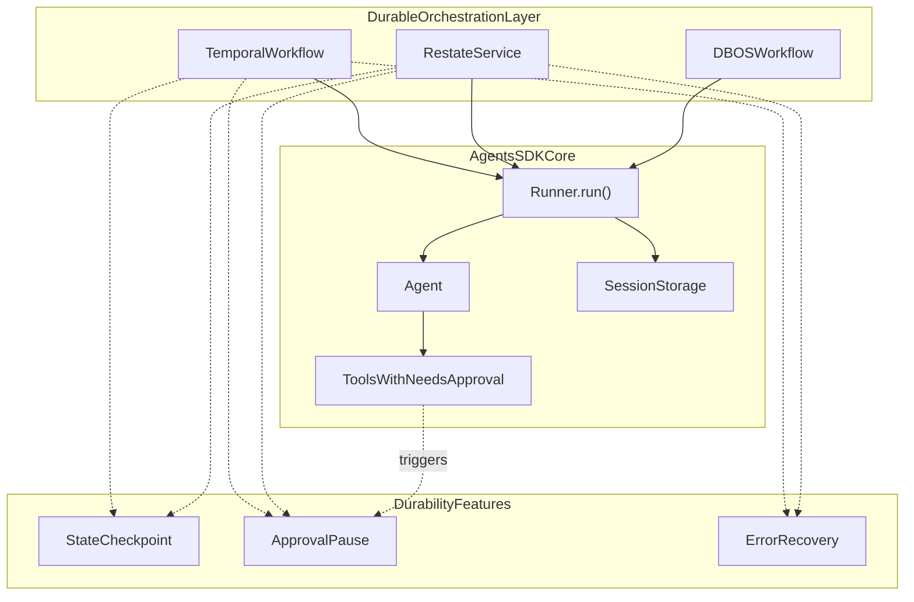
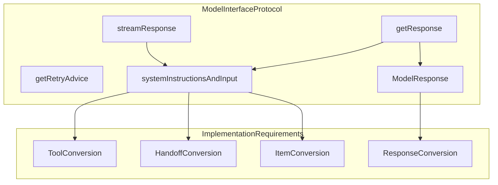

<!-- source: DeepWiki mcp.deepwiki.com · repo openai/openai-agents-python · page 15 Advanced Topics · fetched 2026-10-26 -->

# Advanced Topics

<details>
<summary>Relevant source files</summary>

The following files were used as context for generating this wiki page:

- [src/agents/extensions/experimental/codex/__init__.py](src/agents/extensions/experimental/codex/__init__.py)
- [src/agents/extensions/experimental/codex/codex.py](src/agents/extensions/experimental/codex/codex.py)
- [src/agents/extensions/experimental/codex/codex_options.py](src/agents/extensions/experimental/codex/codex_options.py)
- [src/agents/extensions/experimental/codex/codex_tool.py](src/agents/extensions/experimental/codex/codex_tool.py)
- [src/agents/extensions/experimental/codex/events.py](src/agents/extensions/experimental/codex/events.py)
- [src/agents/extensions/experimental/codex/exec.py](src/agents/extensions/experimental/codex/exec.py)
- [src/agents/extensions/experimental/codex/items.py](src/agents/extensions/experimental/codex/items.py)
- [src/agents/extensions/experimental/codex/output_schema_file.py](src/agents/extensions/experimental/codex/output_schema_file.py)
- [src/agents/extensions/experimental/codex/payloads.py](src/agents/extensions/experimental/codex/payloads.py)
- [src/agents/extensions/experimental/codex/thread.py](src/agents/extensions/experimental/codex/thread.py)
- [src/agents/items.py](src/agents/items.py)
- [src/agents/retry.py](src/agents/retry.py)
- [src/agents/run_internal/items.py](src/agents/run_internal/items.py)
- [src/agents/sandbox/memory/manager.py](src/agents/sandbox/memory/manager.py)
- [src/agents/util/_tool_errors.py](src/agents/util/_tool_errors.py)
- [tests/extensions/experiemental/codex/test_codex_exec_thread.py](tests/extensions/experiemental/codex/test_codex_exec_thread.py)
- [tests/extensions/experiemental/codex/test_codex_tool.py](tests/extensions/experiemental/codex/test_codex_tool.py)
- [tests/test_call_model_input_filter.py](tests/test_call_model_input_filter.py)
- [tests/test_call_model_input_filter_unit.py](tests/test_call_model_input_filter_unit.py)
- [tests/test_items_helpers.py](tests/test_items_helpers.py)
- [tests/test_run_internal_items.py](tests/test_run_internal_items.py)
- [tests/test_run_step_processing.py](tests/test_run_step_processing.py)

</details>


## Overview and Scope

This page covers advanced SDK features and integration patterns for specialized use cases. Topics include durable workflow orchestration for long-running agents, custom model implementations, visualization extensions, and experimental tools like Codex. 

For basic agent orchestration patterns, see [Multi-Agent Orchestration Patterns](#5.5). For standard session management, see [Session and Memory Management](#8).

---

## Long-Running Agents and Durable Workflows

Agent workflows often require durability guarantees: preserving state across process restarts, resuming after human approval steps, or recovering from infrastructure failures. The SDK integrates with external orchestration platforms that provide these capabilities while maintaining the core agent execution model.

### Orchestration Architecture



**Architecture Overview**: Orchestration platforms wrap `Runner.run()` calls to provide durability. The agent execution model remains unchanged—tools, handoffs, and sessions work identically. The platform intercepts tool approval points (via `needs_approval`), persists conversation state, and handles process failures transparently.

For details, see [Long-Running Agents and Durable Workflows](#15.1).

Sources: `src/agents/items.py:98-154`

---

## Custom Model Implementations

The SDK's `Model` interface enables integration with any LLM provider. Built-in implementations include `OpenAIResponsesModel`, `OpenAIChatCompletionsModel`, `LitellmModel`, and `OpenAIRealtimeWebSocketModel`. Custom implementations follow the same contract to provide provider-specific logic for tool conversion, message formatting, and usage tracking.

### Model Interface Contract



**Interface Requirements**: The `Model` interface defines `get_response()` for non-streaming and `stream_response()` for streaming. Implementations must handle the conversion of `TResponseInputItem` to provider-specific message formats and extract `Usage` data from the raw response.

For details, see [Custom Model Implementations](#15.2).

Sources: `src/agents/retry.py:92-114`

---

## RunItem System and Item Helpers

The `RunItem` system is the backbone of agent communication. Every interaction—text, tool calls, tool results, and handoffs—is encapsulated in a `RunItem` or its specialized subtypes (`RunItemBase`, `InputItem`, `MessageOutputItem`) [src/agents/items.py:98-176]().

### Item Type Hierarchy

| Type | Code Entity | Description |
|------|-------------|-------------|
| **Text** | `ResponseOutputText` | Standard text message from agent or user [src/agents/items.py:25](). |
| **Tool Call** | `ResponseFunctionToolCall` | Request to execute a specific tool [src/agents/items.py:19](). |
| **Tool Result** | `ResponseFunctionCallOutputItemParam` | The output/return value of a tool execution [src/agents/items.py:35](). |
| **Handoff** | `HandoffItem` | Record of an agent handing off to another. |

The SDK provides item helpers (`run_item_to_input_item`) to manage these conversions, normalizing various input formats into structures that the model can process [src/agents/run_internal/items.py:179-186]().

For details, see [RunItem System and Item Helpers](#15.3).

Sources: `src/agents/items.py:98-176`, `src/agents/run_internal/items.py:179-186`

---

## Codex Experimental Tool

The SDK includes experimental support for **Codex**, a specialized tool for complex task execution involving sandboxed environments and structured inputs [src/agents/extensions/experimental/codex/codex_tool.py:107-124](). It bridges the agent execution loop with the Codex system.

### Codex Integration Architecture (Code Entity Bridge)

```mermaid
graph TD
    subgraph "NaturalLanguageSpace"
        TaskInput[""NaturalLanguageTaskInput""]
        AgentLoop[""AgentExecutionLoop""]
    end

    subgraph "CodeEntitySpace"
        CodexTool[""agents.extensions.experimental.codex.codex_tool:codex_tool()""]
        CodexClass[""agents.extensions.experimental.codex.codex:Codex""]
        CodexExecClass[""agents.extensions.experimental.codex.exec:CodexExec""]
    end

    TaskInput --> AgentLoop
    AgentLoop --> CodexTool
    CodexTool --> CodexClass
    CodexClass --> CodexExecClass
```

**Functionality**:
- **`codex_tool`**: A high-level wrapper that allows agents to interact with Codex threads by exposing them as standard tools [src/agents/extensions/experimental/codex/codex_tool.py:203-217]().
- **`Codex`**: The core client for managing `Thread` objects and executing commands [src/agents/extensions/experimental/codex/thread.py:72-85]().
- **`CodexExec`**: Manages subprocess execution of the Codex CLI with JSON streaming (`--experimental-json`) [src/agents/extensions/experimental/codex/exec.py:47-60]().

For details, see [Codex Experimental Tool](#15.4).

Sources: `src/agents/extensions/experimental/codex/codex_tool.py:203-217`, `src/agents/extensions/experimental/codex/exec.py:47-60`, `src/agents/extensions/experimental/codex/thread.py:72-85`

---

## Agent Visualization

The SDK includes a visualization extension that uses **Graphviz** to generate structured graphical representations of agents, tools, and their handoff relationships.

### Visualization Mapping (Code Entity Bridge)

```mermaid
graph LR
    subgraph "NaturalLanguageSpace"
        VB[""YellowBoxNode""]
        VE[""GreenEllipseNode""]
        VS[""SolidHandoffArrow""]
        VM[""GreyBoxMCP""]
    end

    subgraph "CodeEntitySpace"
        AgentClass[""agents.agent:Agent""]
        ToolClass[""agents.tool:FunctionTool""]
        HandoffClass[""agents.handoff:Handoff""]
        DrawGraph[""agents.extensions.visualization:draw_graph()""]
    end

    AgentClass --> VB
    ToolClass --> VE
    HandoffClass --> VS
    DrawGraph --> VM
```

**Functionality**:
- **`draw_graph(agent)`**: Generates a directed graph showing the entry point (`__start__`), agent connections, and termination point (`__end__`).
- **Styles**: Agents are rectangles with yellow fill, tools are ellipses with green fill, and MCP servers are grey boxes.

For details, see [Agent Visualization](#15.5).

Sources: `tests/test_run_step_processing.py:17-33`

---

## REPL and Interactive Testing

The SDK provides utilities for interactive testing and debugging of agents via a command-line interface.

**Functionality**:
- **`run_demo_loop`**: Starts an interactive REPL session where users can chat with an agent. It supports both streaming and non-streaming modes and preserves conversation state across turns.
- **Context Handling**: Automatically wraps inputs into the required `RunItem` formats and handles agent handoffs within the loop.

For details, see [REPL and Interactive Testing](#15.6).

Sources: `tests/test_call_model_input_filter.py:18-35`

---

## Prompt Templates

The SDK supports dynamic prompt generation through a structured template system, allowing for versioning and variable substitution.

**Functionality**:
- **`Prompt`**: A `TypedDict` for defining structured prompts with IDs and versions.
- **`DynamicPromptFunction`**: Allows for prompts that are generated at runtime based on the `RunContext`.
- **`PromptUtil.to_model_input`**: Helper for converting templates and variables into the final string sent to the model.

For details, see [Prompt Templates](#15.7).

Sources: `tests/test_call_model_input_filter.py:50-67`

---

