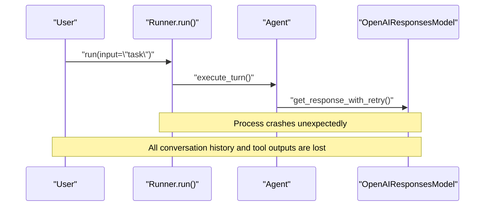
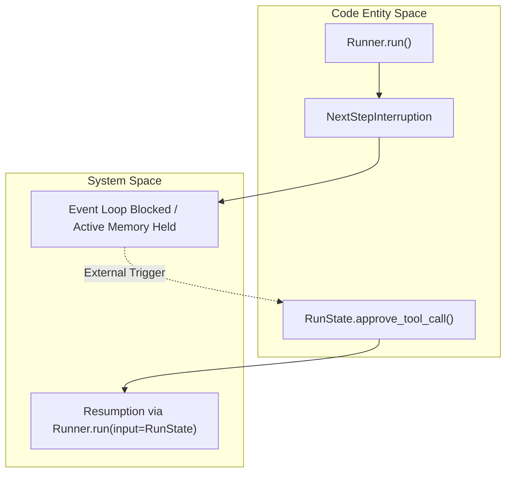
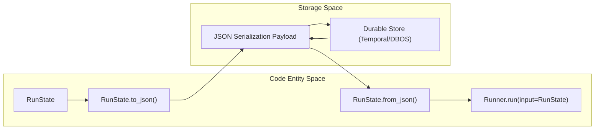
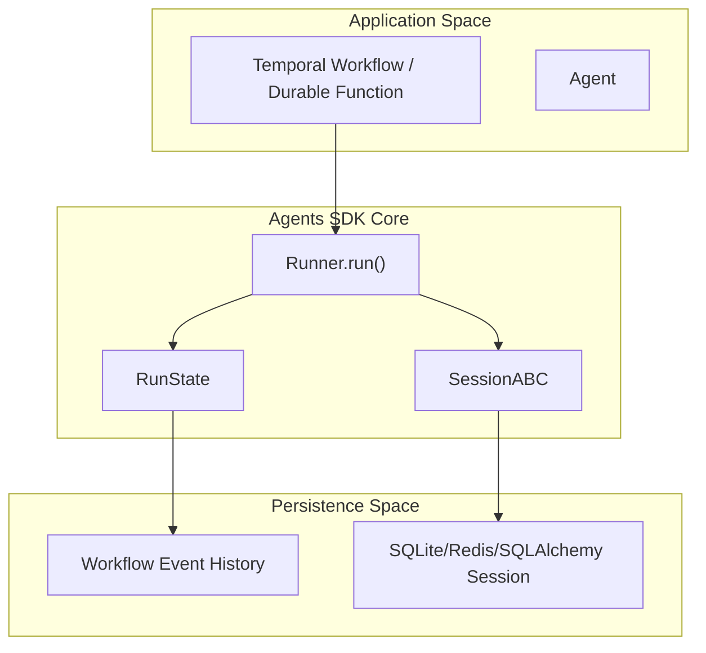
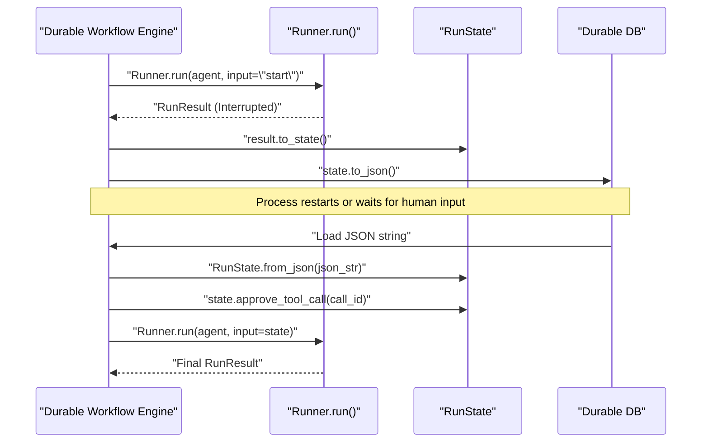

<!-- source: DeepWiki mcp.deepwiki.com · repo openai/openai-agents-python · page 15.1 Long-Running Agents and Durable Workflows · fetched 2026-10-26 -->

# Long-Running Agents and Durable Workflows

Relevant source files

The following files were used as context for generating this wiki page:

- [examples/memory/redis_session_example.py](examples/memory/redis_session_example.py)
- [examples/run_examples.py](examples/run_examples.py)
- [examples/sandbox/extensions/temporal/local_hello_workflow.py](examples/sandbox/extensions/temporal/local_hello_workflow.py)
- [src/agents/exceptions.py](src/agents/exceptions.py)
- [src/agents/result.py](src/agents/result.py)
- [src/agents/run.py](src/agents/run.py)
- [src/agents/run_internal/agent_runner_helpers.py](src/agents/run_internal/agent_runner_helpers.py)
- [src/agents/run_internal/run_loop.py](src/agents/run_internal/run_loop.py)
- [src/agents/run_internal/run_steps.py](src/agents/run_internal/run_steps.py)
- [src/agents/run_internal/session_persistence.py](src/agents/run_internal/session_persistence.py)
- [src/agents/run_internal/turn_resolution.py](src/agents/run_internal/turn_resolution.py)
- [src/agents/run_state.py](src/agents/run_state.py)
- [tests/test_agent_runner.py](tests/test_agent_runner.py)
- [tests/test_agent_runner_streamed.py](tests/test_agent_runner_streamed.py)
- [tests/test_error_logging_redaction.py](tests/test_error_logging_redaction.py)
- [tests/test_redis_session_example.py](tests/test_redis_session_example.py)
- [tests/test_run_examples_script.py](tests/test_run_examples_script.py)
- [tests/test_run_impl_resume_paths.py](tests/test_run_impl_resume_paths.py)
- [tests/test_run_state.py](tests/test_run_state.py)

This page details the integration patterns for building durable, resumable agent workflows that survive process restarts, handle human-in-the-loop approvals via `RunState`, and execute reliably over extended periods [src/agents/run_state.py:1-2](). For general execution flows, see [Runner and Execution Flow](#3.2). For tool approval internals, see [Tool Approval and Human-in-the-Loop](#4.7).

---

## 1. Overview

The OpenAI Agents SDK provides a stateless execution model where `Runner.run()` orchestrates agent interactions, tool calls, and handoffs within a single Python process. While suitable for short-lived interactions, production use cases often demand:
- **Durability**: Surviving process crashes, infrastructure migrations, and container rollouts.
- **Long-Running Operations**: Executing tasks spanning hours, days, or weeks.
- **Human-in-the-Loop Interruption**: Pausing execution for manual review or tool call authorization using `RunState` [src/agents/run_state.py:1-2]().
- **Workflow Replay**: Integrating with orchestration engines like Temporal, Restate, or DBOS [src/agents/run_internal/agent_runner_helpers.py:172-188]().

Sources: [src/agents/run_state.py:1-2](), [src/agents/run_internal/agent_runner_helpers.py:172-188]()

---

## 2. The Durability Challenge

Standard Python async/await tasks are ephemeral. When a process terminates, memory state is lost, causing two major problems in agent pipelines:

### Problem 1: Ephemeral Process Memory Loss

Title: "ProcessCrashExecutionLoss"

Sources: [src/agents/run.py:1-10](), [src/agents/run_internal/run_loop.py:1-15]()

### Problem 2: Resource Blocking During Human Approvals

When a tool requires approval (`needs_approval=True`), execution pauses. In a standard process, keeping threads or async tasks suspended consumes event loop resources.

Title: "ResourceBlockingDuringApproval"

Sources: [src/agents/run_state.py:465-480](), [src/agents/run_internal/run_steps.py:135-140]()

---

## 3. RunState: The Durability Boundary

The `RunState` class serves as the serializable snapshot object for pausing, persisting, and resuming agent execution [src/agents/run_state.py:1-2](). It encapsulates session items, active step data, and trace states.

### Key RunState Components
- `_generated_items`: Accumulates generated `RunItem` instances [src/agents/run_state.py:236-240]().
- `_current_step`: Tracks active interruptions (`NextStepInterruption`) [src/agents/run_state.py:245-250]().
- `_trace_state`: Preserves tracing context across serialization boundaries [src/agents/run_state.py:265-270]().

### RunState Serialization Flow

Title: "RunStateSerializationLifecycle"

Sources: [src/agents/run_state.py:159-186](), [src/agents/run_state.py:530-550](), [src/agents/run_state.py:650-670]()

---

## 4. Framework Integration Architecture

Durable frameworks (such as Temporal) integrate with the SDK by serializing `RunState` into workflow histories. During workflow replay, the SDK checks workflow execution state via helpers like `should_cancel_parallel_model_task_on_input_guardrail_trip()` [src/agents/run_internal/agent_runner_helpers.py:172-188]().

Title: "DurableFrameworkIntegrationArchitecture"

Sources: [src/agents/run_internal/agent_runner_helpers.py:172-188](), [src/agents/run_state.py:1-9](), [src/agents/memory/session.py:1-20]()

---

## 5. Human-in-the-Loop & State Resumption

When an execution pauses due to a tool approval request, developers extract the state using `RunResult.to_state()` or capture it from a `NextStepInterruption` [src/agents/result.py:111-172]().

### Resumption Lifecycle
1. Execute until interruption: `result = Runner.run(...)` [src/agents/run.py:1-50]().
2. Export state: `state = result.to_state()` [src/agents/result.py:111-172]().
3. Persist state JSON: `json_data = state.to_json()` [src/agents/run_state.py:530-550]().
4. Apply approval: `state.approve_tool_call(call_id)` [src/agents/run_state.py:465-480]().
5. Resume execution: `resumed_result = Runner.run(agent, input=state)` [src/agents/run.py:1-50]().

Title: "ResumptionWorkflowSequence"

Sources: [src/agents/run_state.py:465-480](), [src/agents/run_state.py:530-550](), [src/agents/result.py:111-172]()

---

## 6. Context Propagation in Durable Workflows

Custom context objects wrapped by `RunContextWrapper` must be serializable across durable boundaries [src/agents/run_context.py:1-30](). 
- **Dictionary Contexts**: Automatically handled and serialized to JSON [src/agents/run_state.py:318-340]().
- **Custom Objects**: Require explicit `context_serializer` and `context_deserializer` callbacks supplied during `to_json()` and `from_json()` invocations [src/agents/run_state.py:532-535]().

Sources: [src/agents/run_context.py:1-30](), [src/agents/run_state.py:318-340](), [src/agents/run_state.py:532-535]()

---

## 7. Best Practices for Durable Agents

| Practice | Implementation Detail | Source |
| :--- | :--- | :--- |
| **State Persistence** | Save `RunState.to_json()` snapshots to durable external storage upon interruption. | [src/agents/run_state.py:530-550]() |
| **Idempotent Tools** | Ensure external tool side effects use `call_id` as an idempotency key. | [src/agents/run_internal/tool_execution.py:129-150]() |
| **Schema Compatibility** | Monitor schema versions (`CURRENT_SCHEMA_VERSION`) during SDK upgrades. | [src/agents/run_state.py:159-165]() |
| **Unlimited Turns** | Set `max_turns=None` for long-running autonomous background workflows. | [src/agents/run_config.py:46-55]() |

Sources: [src/agents/run_state.py:530-550](), [src/agents/run_internal/tool_execution.py:129-150](), [src/agents/run_state.py:159-165](), [src/agents/run_config.py:46-55]()

---

