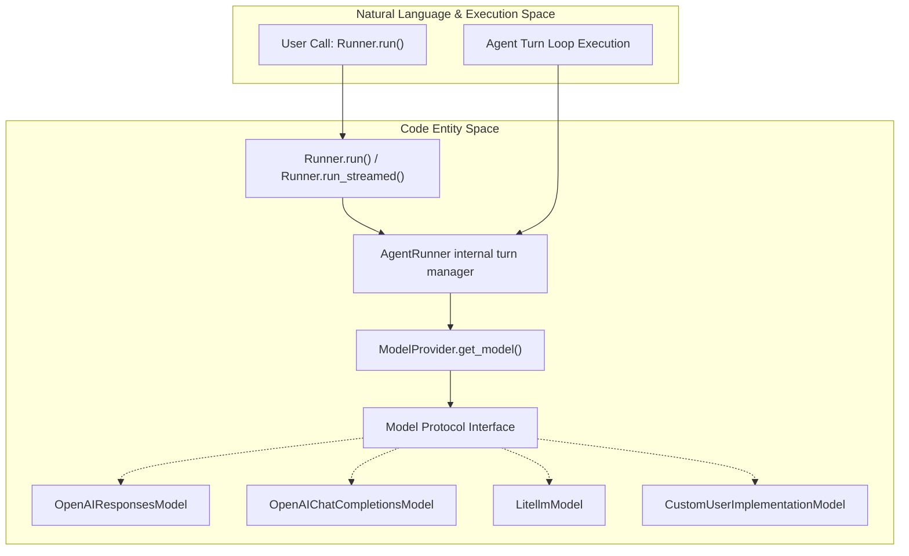
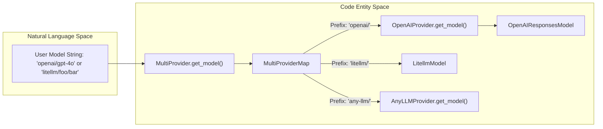

<!-- source: DeepWiki mcp.deepwiki.com · repo openai/openai-agents-python · page 15.2 Custom Model Implementations · fetched 2026-10-26 -->

# Custom Model Implementations

Relevant source files

The following files were used as context for generating this wiki page:

- [examples/basic/stream_ws.py](examples/basic/stream_ws.py)
- [src/agents/_config.py](src/agents/_config.py)
- [src/agents/models/_openai_shared.py](src/agents/models/_openai_shared.py)
- [src/agents/models/interface.py](src/agents/models/interface.py)
- [src/agents/models/multi_provider.py](src/agents/models/multi_provider.py)
- [src/agents/models/openai_provider.py](src/agents/models/openai_provider.py)
- [src/agents/responses_websocket_session.py](src/agents/responses_websocket_session.py)
- [src/agents/tracing/config.py](src/agents/tracing/config.py)
- [src/agents/voice/models/openai_model_provider.py](src/agents/voice/models/openai_model_provider.py)
- [tests/models/test_map.py](tests/models/test_map.py)
- [tests/test_agent_tracing.py](tests/test_agent_tracing.py)
- [tests/test_config.py](tests/test_config.py)
- [tests/test_openai_provider_client_options.py](tests/test_openai_provider_client_options.py)
- [tests/test_responses_tracing.py](tests/test_responses_tracing.py)
- [tests/test_tracing.py](tests/test_tracing.py)
- [tests/test_tracing_errors.py](tests/test_tracing_errors.py)
- [tests/test_tracing_errors_streamed.py](tests/test_tracing_errors_streamed.py)
- [tests/testing_processor.py](tests/testing_processor.py)
- [tests/tracing/test_span_ordering.py](tests/tracing/test_span_ordering.py)
- [tests/voice/test_openai_model_provider.py](tests/voice/test_openai_model_provider.py)
- [tests/voice/test_workflow.py](tests/voice/test_workflow.py)

This page details how to implement the `Model` interface (`[src/agents/models/interface.py:40-108]()`), create custom `ModelProvider` factories (`[src/agents/models/interface.py:111-122]()`), and integrate proprietary, experimental, or custom LLM backends into the Agents SDK using routing mechanisms (`[src/agents/models/multi_provider.py:61-73]()`).

## Overview and Model Abstraction Architecture

The SDK provides model abstraction through the `Model` protocol (`[src/agents/models/interface.py:40-108]()`). All underlying model backends—including OpenAI Responses API, Chat Completions API, and LiteLLM—conform to this interface. Implementing a custom model allows integration of proprietary models, specialized endpoint transformations, or custom mocking layers for testing.

The diagram below maps user-facing execution flows (Natural Language Space) to concrete SDK classes and methods (Code Entity Space):

**Title:** Model Abstraction and Execution Flow

Sources: [src/agents/models/interface.py:40-122](), [src/agents/models/multi_provider.py:61-93]()

## The Model Protocol Interface

To build a custom model implementation, your class must satisfy the `Model` protocol defined in `src/agents/models/interface.py`. 

### Key Methods and Signatures

| Method | Purpose | Arguments |
|--------|---------|-----------|
| `get_response` | Executes non-streaming text/tool generation turns. | `system_instructions`, `input`, `model_settings`, `tools`, `output_schema`, `handoffs`, `previous_response_id`, `conversation_id`, `stream`, `prompt` (`[src/agents/models/interface.py:42-66]()`). |
| `stream_response` | Executes streaming inference, yielding incremental stream events. | Accepts identical parameters to `get_response` and yields `TResponseStreamEvent` items (`[src/agents/models/interface.py:68-102]()`). |
| `get_retry_advice` | Evaluates whether a given exception qualifies for automatic retry. | `exception`, `attempt` (`[src/agents/models/interface.py:104-108]()`). |

Sources: [src/agents/models/interface.py:40-108]()

## Custom ModelProviders and Multi-Provider Routing

A `ModelProvider` (`[src/agents/models/interface.py:111-122]()`) acts as a factory responsible for instantiating and returning a `Model` instance given a model string identifier. The `MultiProvider` class (`[src/agents/models/multi_provider.py:61-73]`) orchestrates routing across multiple sub-providers using prefix matching.

The following diagram demonstrates how model name strings are resolved to specific provider and model code entities:

**Title:** Multi-Provider Prefix Routing Architecture

Sources: [src/agents/models/multi_provider.py:17-126](), [tests/models/test_map.py:31-34]()

### Prefix Modes and Configuration
* **Prefix Handling**: By default, `openai/` routes to `OpenAIProvider`, `litellm/` routes to `LitellmModel`, and `any-llm/` routes to `AnyLLMProvider` (`[src/agents/models/multi_provider.py:64-66]()`).
* **Prefix Modes (`openai_prefix_mode`)**: Can be set to `"alias"` (strips the prefix before forwarding to the provider) or `"model_id"` (preserves the full namespaced string for OpenAI-compatible gateways) (`[src/agents/models/multi_provider.py:88-88]()`).
* **Unknown Prefixes (`unknown_prefix_mode`)**: Determines whether unrecognized prefixes raise a `UserError` or pass through as literal model IDs (`[src/agents/models/multi_provider.py:89-89]()`, `[src/agents/models/multi_provider.py:121-126]()`).

Sources: [src/agents/models/multi_provider.py:61-134]()

## Integrating Proprietary Backends

You can integrate proprietary or custom model backends into the Agents SDK through three distinct integration levels:

1. **Global Client Override**: Use `set_default_openai_client()` to inject a custom-configured `AsyncOpenAI` client instance globally across all agents (`[src/agents/_config.py:20-21]()`).
2. **Per-Agent Model Instance**: Pass an instantiated custom `Model` object directly to the `Agent` constructor (`[src/agents/agent.py:110-110]()`).
3. **RunConfig Provider**: Supply a custom `ModelProvider` implementation via `RunConfig` when invoking `Runner.run()` (`[src/agents/run_config.py:36-36]()`).

Sources: [src/agents/agent.py:110-110](), [src/agents/run_config.py:36-36](), [src/agents/_config.py:20-39]()

## Advanced Response Handling and Streaming

Custom models interacting with non-standard APIs often require special stream management and session pooling.

### Stream Buffering
For OpenAI-compatible providers with unreliable incremental tool-call chunk semantics, enabling `openai_buffer_streamed_tool_calls` buffers streaming tool call deltas and emits the parsed tool call object only after the upstream stream completes (`[src/agents/models/multi_provider.py:92-92]()`, `[src/agents/models/openai_chatcompletions.py:117-117]()`).

### WebSocket Sessions
The `ResponsesWebSocketSession` utility pins multi-turn conversations and nested agent workflows to a persistent WebSocket connection, reducing latency across turns (`[src/agents/responses_websocket_session.py:24-28]()`, `[src/agents/responses_websocket_session.py:101-107]()`).

Sources: [src/agents/models/multi_provider.py:92-92](), [src/agents/responses_websocket_session.py:24-107](), [examples/basic/stream_ws.py:204-204]()

---

