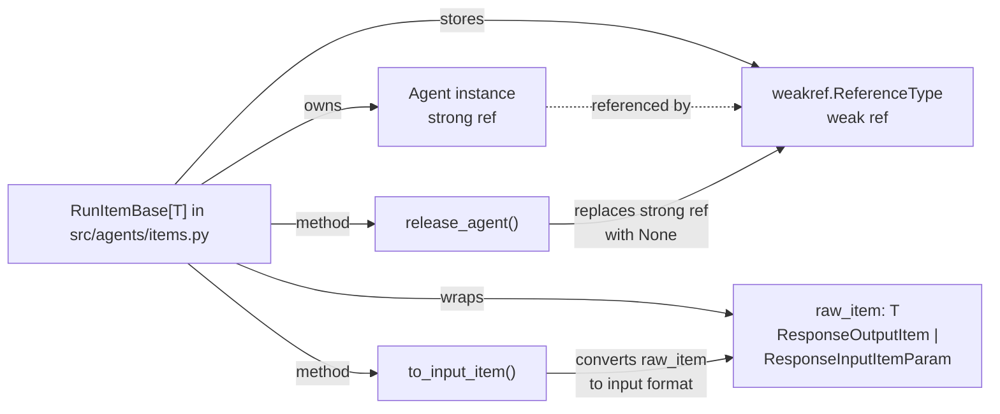
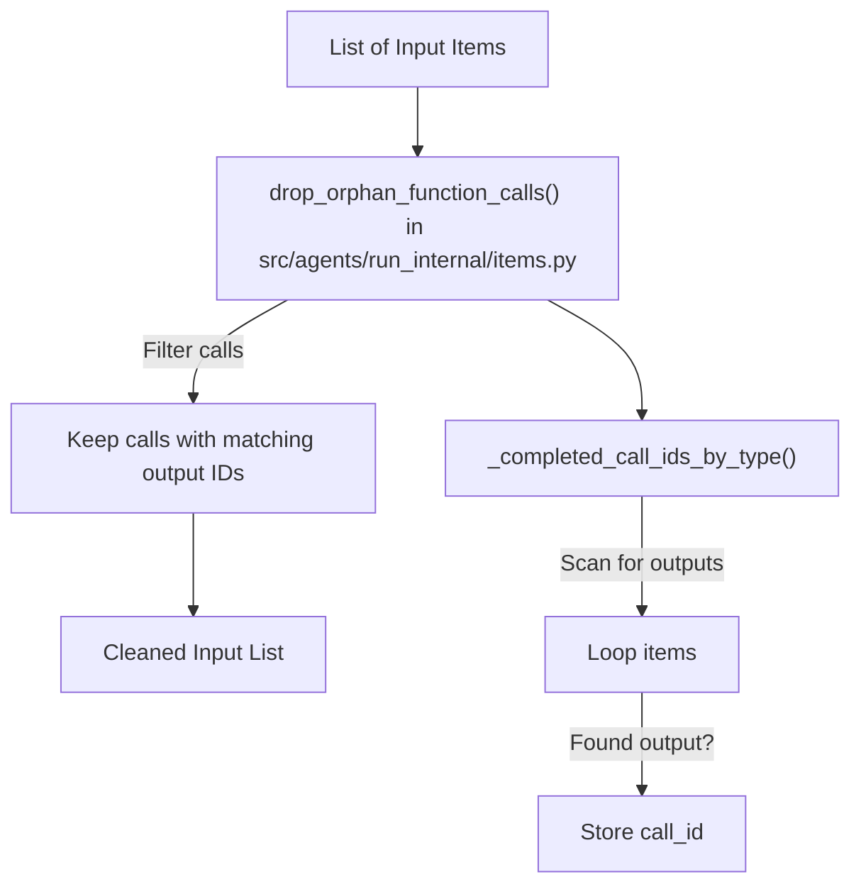
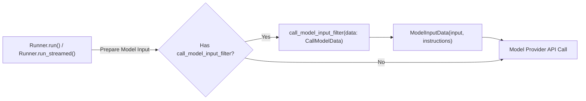

<!-- source: DeepWiki mcp.deepwiki.com · repo openai/openai-agents-python · page 15.3 RunItem System and Item Helpers · fetched 2026-10-26 -->

# RunItem System and Item Helpers

<details>
<summary>Relevant source files</summary>

The following files were used as context for generating this wiki page:

- [src/agents/items.py](src/agents/items.py)
- [src/agents/run_internal/items.py](src/agents/run_internal/items.py)
- [src/agents/util/_tool_errors.py](src/agents/util/_tool_errors.py)
- [tests/test_call_model_input_filter.py](tests/test_call_model_input_filter.py)
- [tests/test_call_model_input_filter_unit.py](tests/test_call_model_input_filter_unit.py)
- [tests/test_items_helpers.py](tests/test_items_helpers.py)
- [tests/test_run_internal_items.py](tests/test_run_internal_items.py)
- [tests/test_run_step_processing.py](tests/test_run_step_processing.py)

</details>


This page documents the `RunItem` type hierarchy and the `ItemHelpers` utility class, which together provide the core data structures for representing agent execution history. Every event during an agent run—messages, tool calls, handoffs, approvals—is captured as a `RunItem` subclass. The `ItemHelpers` class provides static methods for extracting data from items and converting between input/output formats. Additionally, this page covers item memory management via `release_agent()`, input conversion via `to_input_item()`, and the interception pipeline provided by `call_model_input_filter`.

Sources: [src/agents/items.py:94-158](), [tests/test_call_model_input_filter.py:25-34]()

---

## RunItem Type Hierarchy

The SDK defines a comprehensive type hierarchy rooted in `RunItemBase[T]`, where `T` is the underlying Responses API type. Each concrete subclass wraps a specific output or input item from the OpenAI Responses API and tracks the agent that generated it.

Title: RunItem Type Hierarchy to Code Entities

```mermaid
graph TB
    RunItemBase["RunItemBase[T]<br/>Base class with agent tracking in src/agents/items.py"]
    
    MessageOutputItem["MessageOutputItem<br/>ResponseOutputMessage"]
    ToolCallItem["ToolCallItem<br/>ResponseFunctionToolCall + variants"]
    ToolCallOutputItem["ToolCallOutputItem<br/>FunctionCallOutput + variants"]
    
    HandoffCallItem["HandoffCallItem<br/>ResponseFunctionToolCall"]
    HandoffOutputItem["HandoffOutputItem<br/>TResponseInputItem<br/>source_agent, target_agent"]
    
    ToolApprovalItem["ToolApprovalItem<br/>Tool approval request<br/>needs_approval=True"]
    
    ReasoningItem["ReasoningItem<br/>ResponseReasoningItem"]
    CompactionItem["CompactionItem<br/>ResponseCompactionItem"]
    
    ToolSearchCallItem["ToolSearchCallItem<br/>ResponseToolSearchCall"]
    ToolSearchOutputItem["ToolSearchOutputItem<br/>ResponseToolSearchOutputItem"]
    
    MCPApprovalRequestItem["MCPApprovalRequestItem<br/>McpApprovalRequest"]
    MCPApprovalResponseItem["MCPApprovalResponseItem<br/>McpApprovalResponse"]
    
    RunItemBase --> MessageOutputItem
    RunItemBase --> ToolCallItem
    RunItemBase --> ToolCallOutputItem
    RunItemBase --> HandoffCallItem
    RunItemBase --> HandoffOutputItem
    RunItemBase --> ToolApprovalItem
    RunItemBase --> ReasoningItem
    RunItemBase --> CompactionItem
    RunItemBase --> ToolSearchCallItem
    RunItemBase --> ToolSearchOutputItem
    RunItemBase --> MCPApprovalRequestItem
    RunItemBase --> MCPApprovalResponseItem
```


Sources: [src/agents/items.py:94-611]()

---

## RunItemBase: Core Structure and Reference Management

All `RunItem` types inherit from `RunItemBase[T]`, defined in [src/agents/items.py:94-158](), which provides the mechanism for associating execution events with specific agents and handling lifecycle reference pruning.

| Field | Type | Description |
|-------|------|-------------|
| `agent` | `Agent[Any]` | The agent that generated this item [src/agents/items.py:96-97]() |
| `raw_item` | `T` | The underlying Responses API object (output or input param) [src/agents/items.py:99-103]() |
| `_agent_ref` | `weakref.ReferenceType` | Weak reference used for lazy resolution [src/agents/items.py:105-109]() |

### Reference Management and Conversion
The base class provides critical methods for memory management and API compatibility:

1. **`release_agent()`**: Drops the strong reference to the `Agent` while keeping a `weakref`. This is vital for long-running processes to prevent the `RunItem` (which might be stored in a long-lived session) from pinning a complex `Agent` object in memory [src/agents/items.py:120-130]().
2. **`to_input_item()`**: Converts the item into a `TResponseInputItem` (OpenAI SDK `ResponseInputItemParam`). If the `raw_item` is a Pydantic model (output item), it performs a `model_dump(exclude_unset=True)` to create a valid input dictionary [src/agents/items.py:148-158]().

Title: RunItem Memory and Conversion Flow


Sources: [src/agents/items.py:94-158]()

---

## Core Item Types

### MessageOutputItem
Represents a text or refusal message from the LLM. It wraps `ResponseOutputMessage` [src/agents/items.py:161-168]().

### ToolCall and ToolCallOutput
*   **`ToolCallItem`**: Represents a request emitted by the model to invoke a tool [src/agents/items.py:492-509](). It includes `tool_origin` metadata (e.g., `function`, `mcp`, or `agent_as_tool`) to trace the runtime source of the tool [src/agents/items.py:497-498]().
*   **`ToolCallOutputItem`**: Represents the result of a tool execution [src/agents/items.py:512-538](). It contains the tool's output payload, which can be text, images, or file content [src/agents/items.py:532-533]().

### Handoff Items
*   **`HandoffCallItem`**: The specific `ResponseFunctionToolCall` that triggered an agent switch [src/agents/items.py:266-284]().
*   **`HandoffOutputItem`**: A synthetic item that records the transfer between agents. It stores the `source_agent`, `target_agent`, and the original `handoff_call_id` [src/agents/items.py:287-324]().

### ToolApprovalItem
A specialized item representing a tool call that is paused awaiting human intervention [src/agents/items.py:540-549](). These are filtered out of model inputs and primarily used to populate `RunResult.interruptions` [src/agents/run_internal/items.py:144-145]().

Sources: [src/agents/items.py:161-549](), [src/agents/run_internal/items.py:139-155]()

---

## Item Normalization and Conversion

The SDK must frequently convert between high-level `RunItem` objects and the low-level dictionary formats required by the OpenAI Responses API.

### Conversion Logic (`run_item_to_input_item`)
The internal helper `run_item_to_input_item` handles the mapping logic [src/agents/run_internal/items.py:139-155]():
1.  **Exclusion**: Skips `ToolApprovalItem` as they are internal control structures [src/agents/run_internal/items.py:144-145]().
2.  **Conversion**: Calls the item's `to_input_item()` method [src/agents/run_internal/items.py:146]().
3.  **Policy Enforcement**: If the `ReasoningItemIdPolicy` is set to `"omit"`, it strips IDs from reasoning items to minimize token usage or maintain privacy [src/agents/run_internal/items.py:150-154]().

### Orphan Tool Call Pruning
`drop_orphan_function_calls()` is a safety utility used during retries and resumptions. It scans history and removes any tool call items that do not have a matching tool output item [src/agents/run_internal/items.py:171-218](). This prevents the model from receiving "dangling" tool calls that it might try to resolve again incorrectly.

Title: Internal Input Item Normalization Pipeline


Sources: [src/agents/run_internal/items.py:139-218]()

---

## ItemHelpers Utility Class

`ItemHelpers` provides static methods for extracting and normalizing data across different item types [src/agents/items.py:614-723]().

| Method | Purpose |
|--------|---------|
| `extract_last_content()` | Returns the text of the last segment in a message or the refusal string [src/agents/items.py:626-647](). |
| `extract_text()` | Concatenates all text segments from a message while ignoring refusals [src/agents/items.py:666-687](). |
| `input_to_new_input_list()` | Coerces various types (strings, dicts, `RunItem` lists) into a standard `list[TResponseInputItem]` [src/agents/items.py:691-723](). |

### Robust Text Extraction
The `extract_text` method is designed to be resilient to partial or malformed responses where `content_item.text` might be `None` (e.g., in streaming scenarios or certain provider gateways) [src/agents/items.py:676-677]().

```python
# Example of resilient concatenation in ItemHelpers.extract_text
for content_item in item.content:
    if isinstance(content_item, ResponseOutputText):
        # The 'or ""' guard prevents TypeError on None values
        text_content += content_item.text or ""
```

Sources: [src/agents/items.py:614-723](), [tests/test_items_helpers.py:137-156]()

---

## Call Model Input Filter (`call_model_input_filter`)

The `call_model_input_filter` setting in `RunConfig` allows developers to intercept and modify model input items and system instructions dynamically right before every call to the model [tests/test_call_model_input_filter.py:25-34]().

### Data Structures
*   **`CallModelData`**: Wraps the current execution context and model data payload (`model_data`) passed into the filter function [tests/test_call_model_input_filter.py:25]().
*   **`ModelInputData`**: Represents the filtered output containing modified `input` list and/or updated system `instructions` [tests/test_call_model_input_filter.py:28]().

### Execution and Error Handling
The filter can be synchronous or asynchronous [tests/test_call_model_input_filter.py:25-54](). If the filter returns an invalid type or fails validation, a `UserError` is raised [tests/test_call_model_input_filter.py:70-82](). Any exceptions thrown inside the filter are captured and logged to trace spans, respecting `trace_include_sensitive_data` settings [tests/test_call_model_input_filter.py:93-115]().

Title: Call Model Input Filter Data Flow


Sources: [tests/test_call_model_input_filter.py:18-67](), [tests/test_call_model_input_filter_unit.py:16-52]()

---

## Advanced and Synthetic Items

### Tool Search Items
The SDK supports the Responses API `tool_search` capability via `ToolSearchCallItem` and `ToolSearchOutputItem` [src/agents/items.py:171-215](). These items allow the model to dynamically discover tools. The conversion logic for `ToolSearchCallItem` ensures that internal fields like `created_by` are stripped before being replayed to the API, as they are output-only [src/agents/items.py:252-261]().

### MCP (Model Context Protocol) Items
For agents using hosted MCP tools, the system generates specialized approval items:
*   **`MCPApprovalRequestItem`**: Wraps an `McpApprovalRequest` from the API [src/agents/items.py:581-589]().
*   **`MCPApprovalResponseItem`**: Wraps the user's response (`McpApprovalResponse`) [src/agents/items.py:592-600]().

Sources: [src/agents/items.py:171-261](), [src/agents/items.py:581-600]()

---

