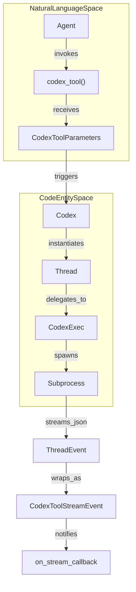
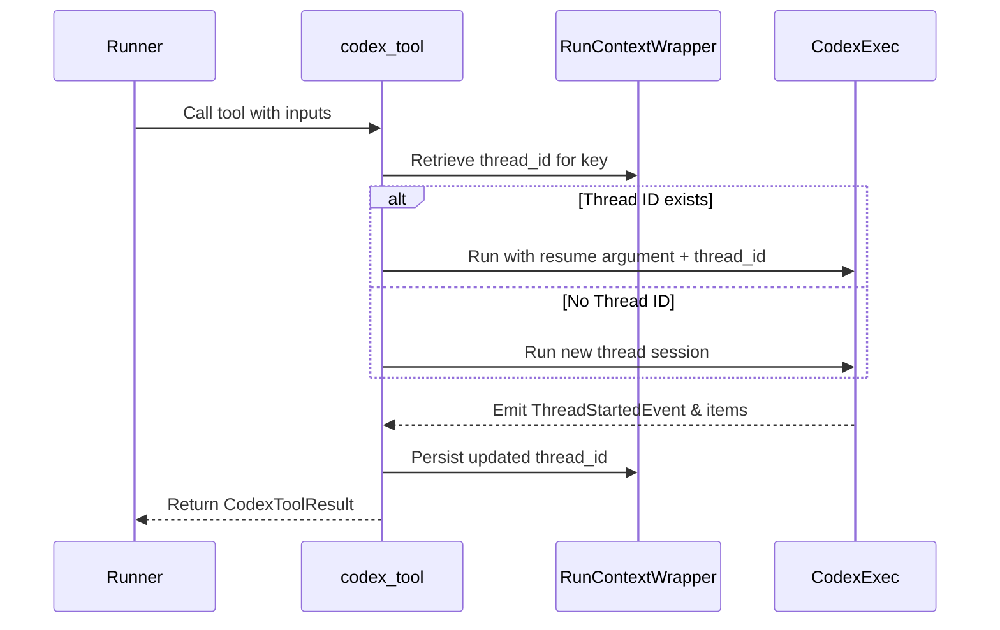

<!-- source: DeepWiki mcp.deepwiki.com · repo openai/openai-agents-python · page 15.4 Codex Experimental Tool · fetched 2026-10-26 -->

# Codex Experimental Tool

Relevant source files

The following files were used as context for generating this wiki page:

- [examples/mcp/filesystem_example/main.py](examples/mcp/filesystem_example/main.py)
- [examples/research_bot/manager.py](examples/research_bot/manager.py)
- [examples/research_bot/sample_outputs/product_recs.txt](examples/research_bot/sample_outputs/product_recs.txt)
- [examples/research_bot/sample_outputs/vacation.txt](examples/research_bot/sample_outputs/vacation.txt)
- [examples/sandbox/extensions/modal_runner.py](examples/sandbox/extensions/modal_runner.py)
- [examples/sandbox/memory.py](examples/sandbox/memory.py)
- [examples/sandbox/memory_multi_agent_multiturn.py](examples/sandbox/memory_multi_agent_multiturn.py)
- [examples/tools/code_interpreter.py](examples/tools/code_interpreter.py)
- [examples/tools/codex.py](examples/tools/codex.py)
- [examples/tools/codex_same_thread.py](examples/tools/codex_same_thread.py)
- [examples/tools/image_generator.py](examples/tools/image_generator.py)
- [src/agents/extensions/experimental/codex/__init__.py](src/agents/extensions/experimental/codex/__init__.py)
- [src/agents/extensions/experimental/codex/codex.py](src/agents/extensions/experimental/codex/codex.py)
- [src/agents/extensions/experimental/codex/codex_options.py](src/agents/extensions/experimental/codex/codex_options.py)
- [src/agents/extensions/experimental/codex/codex_tool.py](src/agents/extensions/experimental/codex/codex_tool.py)
- [src/agents/extensions/experimental/codex/events.py](src/agents/extensions/experimental/codex/events.py)
- [src/agents/extensions/experimental/codex/exec.py](src/agents/extensions/experimental/codex/exec.py)
- [src/agents/extensions/experimental/codex/items.py](src/agents/extensions/experimental/codex/items.py)
- [src/agents/extensions/experimental/codex/output_schema_file.py](src/agents/extensions/experimental/codex/output_schema_file.py)
- [src/agents/extensions/experimental/codex/payloads.py](src/agents/extensions/experimental/codex/payloads.py)
- [src/agents/extensions/experimental/codex/thread.py](src/agents/extensions/experimental/codex/thread.py)
- [src/agents/retry.py](src/agents/retry.py)
- [src/agents/sandbox/memory/manager.py](src/agents/sandbox/memory/manager.py)
- [tests/extensions/experiemental/codex/test_codex_exec_thread.py](tests/extensions/experiemental/codex/test_codex_exec_thread.py)
- [tests/extensions/experiemental/codex/test_codex_tool.py](tests/extensions/experiemental/codex/test_codex_tool.py)

The Codex Experimental Tool provides an interface for agents to interact with a local workspace using the OpenAI Codex CLI [src/agents/extensions/experimental/codex/codex_tool.py:72-74](). It enables agents to perform complex coding tasks, execute shell commands, search the web, and manage a local codebase within a sandboxed environment [src/agents/extensions/experimental/codex/codex_tool.py:72-74](), `[examples/tools/codex.py:30-33]()`.

---

## 1. Overview and Integration

The primary entry point for using this capability is the `codex_tool()` function [src/agents/extensions/experimental/codex/codex_tool.py:274-325](). When attached to an `Agent`, it exposes a tool (typically named `codex` or customized via options) that the model can call to initiate coding tasks [src/agents/extensions/experimental/codex/codex_tool.py:72-74](), `[examples/tools/codex_same_thread.py:70-74]()`. Unlike standard function tools, `codex_tool` manages a persistent subprocess via `CodexExec` and handles streaming updates from the Codex CLI [src/agents/extensions/experimental/codex/exec.py:47-60]().

### Core Architectural Concepts

*   **Codex CLI**: The underlying binary engine that executes coding tasks, invoked via `CodexExec` [src/agents/extensions/experimental/codex/exec.py:47-60]().
*   **Thread**: Represents a persistent session of coding activity managed by the `Thread` class [src/agents/extensions/experimental/codex/thread.py:72-85]().
*   **Turn**: A single execution cycle within a thread where input is processed and a `Turn` (or `RunResult`) containing items, final response, and usage is returned [src/agents/extensions/experimental/codex/thread.py:54-61]().
*   **Sandbox Modes**: Controls the isolation level of Codex access to the local environment, such as `read-only` or `read-write` [src/agents/extensions/experimental/codex/thread_options.py:16]().

### Codex Architecture: Natural Language Space to Code Entity Space

Sources: [src/agents/extensions/experimental/codex/codex_tool.py:107-136](), [src/agents/extensions/experimental/codex/codex.py:21-68](), [src/agents/extensions/experimental/codex/thread.py:90-95](), [src/agents/extensions/experimental/codex/exec.py:61-132]()

---

## 2. Configuration Options

The tool relies on structured configuration objects to control binary execution, thread parameters, and turn properties [src/agents/extensions/experimental/codex/codex_tool.py:203-217]().

### CodexOptions
Defines environment variables, executable path overrides, and API configurations for the CLI [src/agents/extensions/experimental/codex/codex_options.py:11-21]().

| Field | Type | Description |
| :--- | :--- | :--- |
| `codex_path_override` | `str \| None` | Custom path to the `codex` CLI binary [src/agents/extensions/experimental/codex/codex_options.py:13]() |
| `base_url` | `str \| None` | OpenAI base URL configuration for the CLI [src/agents/extensions/experimental/codex/codex_options.py:15]() |
| `api_key` | `str \| None` | API key passed to the CLI [src/agents/extensions/experimental/codex/codex_options.py:17]() |
| `env` | `Mapping[str, str] \| None` | Environment variables injected into the subprocess [src/agents/extensions/experimental/codex/codex_options.py:19]() |

### ThreadOptions
Configures session-level parameters for Codex threads [src/agents/extensions/experimental/codex/thread_options.py:13-33]().

| Field | Type | Description |
| :--- | :--- | :--- |
| `model` | `str \| None` | The model identifier used by Codex [src/agents/extensions/experimental/codex/thread_options.py:14]() |
| `sandbox_mode` | `SandboxMode \| None` | Environment access mode (`read-only`, `read-write`, etc.) [src/agents/extensions/experimental/codex/thread_options.py:16]() |
| `working_directory` | `str \| None` | Working directory for command execution [src/agents/extensions/experimental/codex/thread_options.py:18]() |
| `network_access_enabled` | `bool \| None` | Whether network calls are permitted [src/agents/extensions/experimental/codex/thread_options.py:24]() |
| `web_search_enabled` | `bool \| None` | Enables or disables web search capabilities [src/agents/extensions/experimental/codex/thread_options.py:26]() |
| `approval_policy` | `ApprovalMode \| None` | Policy for human-in-the-loop tool approvals [src/agents/extensions/experimental/codex/thread_options.py:28]() |

### TurnOptions and CodexToolOptions
`TurnOptions` configures single-turn execution details like `idle_timeout_seconds`, `output_schema`, and cancellation signals [src/agents/extensions/experimental/codex/turn_options.py:10-14](). `CodexToolOptions` aggregates these alongside tool naming, parameters, and run-context persistence settings [src/agents/extensions/experimental/codex/codex_tool.py:203-217]().

Sources: [src/agents/extensions/experimental/codex/codex_options.py:11-21](), [src/agents/extensions/experimental/codex/thread_options.py:13-33](), [src/agents/extensions/experimental/codex/turn_options.py:10-14](), [src/agents/extensions/experimental/codex/codex_tool.py:203-217]()

---

## 3. Thread and Turn Model

The Codex tool maintains state across interactions using a persistent thread model [src/agents/extensions/experimental/codex/thread.py:72-85]().

### Thread Persistence and Run Context
When `use_run_context_thread_id` is enabled, `codex_tool` automatically inspects and updates the `thread_id` within the `RunContextWrapper` [src/agents/extensions/experimental/codex/codex_tool.py:534-550](). This allows agents to maintain continuity across multiple `Runner.run()` invocations by referencing a key defined by `run_context_thread_id_key` (defaulting to `codex_thread_id`) [src/agents/extensions/experimental/codex/codex_tool.py:73](), `[examples/tools/codex_same_thread.py:84-93]()`.

### Thread Persistence Flow

Sources: [src/agents/extensions/experimental/codex/codex_tool.py:534-550](), [src/agents/extensions/experimental/codex/exec.py:107-116](), [src/agents/extensions/experimental/codex/thread.py:155-157]()

---

## 4. Streaming and Event Handling

During execution, the Codex CLI emits JSON events line-by-line over stdout [src/agents/extensions/experimental/codex/exec.py:128](). These events are parsed into typed structures and exposed via the `on_stream` callback wrapped in `CodexToolStreamEvent` [src/agents/extensions/experimental/codex/codex_tool.py:196-200](), `[src/agents/extensions/experimental/codex/thread.py:152-158]()`.

### Event Types and Thread Items
*   **Lifecycle Events**: `ThreadStartedEvent`, `TurnStartedEvent`, `TurnCompletedEvent`, `TurnFailedEvent`, and `ThreadErrorEvent` [src/agents/extensions/experimental/codex/events.py:14-48]()
*   **Item Events**: `ItemStartedEvent`, `ItemUpdatedEvent`, and `ItemCompletedEvent` enclosing specific `ThreadItem` instances [src/agents/extensions/experimental/codex/events.py:40-63]()
*   **Thread Items**: Represent distinct execution artifacts such as `ReasoningItem`, `CommandExecutionItem`, `FileChangeItem`, `McpToolCallItem`, `WebSearchItem`, and `ErrorItem` [src/agents/extensions/experimental/codex/items.py:100-175]()

Sources: [src/agents/extensions/experimental/codex/codex_tool.py:196-200](), [src/agents/extensions/experimental/codex/events.py:14-63](), [src/agents/extensions/experimental/codex/items.py:100-175](), [src/agents/extensions/experimental/codex/thread.py:152-158]()

---

## 5. Sandbox Modes and CLI Execution

The `CodexExec` class manages the lifecycle of the subprocess, configuring arguments such as `--sandbox`, `--cd`, `--model`, `--output-schema`, and approval policies [src/agents/extensions/experimental/codex/exec.py:61-106]().

### Sandbox Modes and Security
Codex supports isolation configurations including `read-only` and `read-write` sandbox modes, along with optional network access toggles and approval policies (`never`, `on-failure`, `always`) [src/agents/extensions/experimental/codex/exec.py:68-105](), `[src/agents/extensions/experimental/codex/thread_options.py:16-28]()`. When idle timeouts or signals trigger, `CodexExec` ensures the subprocess is terminated cleanly and releases resources [src/agents/extensions/experimental/codex/exec.py:161-188]().

Sources: [src/agents/extensions/experimental/codex/exec.py:61-188](), [src/agents/extensions/experimental/codex/thread_options.py:16-28]()

---

