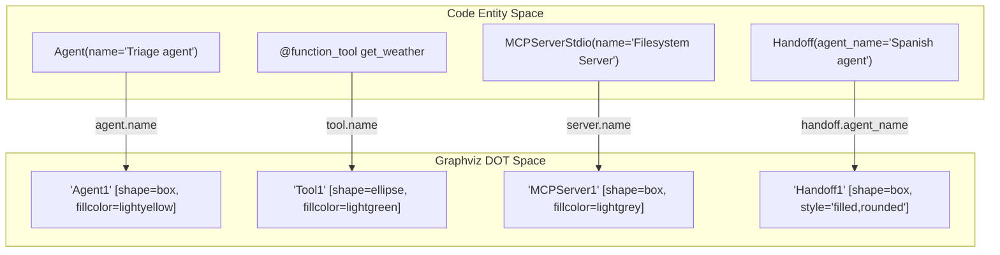
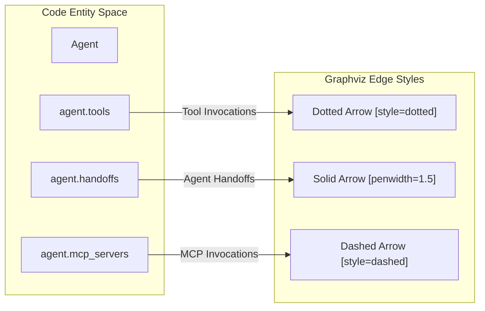

<!-- source: DeepWiki mcp.deepwiki.com · repo openai/openai-agents-python · page 15.5 Agent Visualization · fetched 2026-10-26 -->

# Agent Visualization

<details>
<summary>Relevant source files</summary>

The following files were used as context for generating this wiki page:

- [docs/visualization.md](docs/visualization.md)
- [src/agents/extensions/visualization.py](src/agents/extensions/visualization.py)
- [tests/test_visualization.py](tests/test_visualization.py)

</details>


## Purpose and Scope

This page documents the agent visualization system in the OpenAI Agents SDK, implemented in `src/agents/extensions/visualization.py` [src/agents/extensions/visualization.py:1-423](). The visualization system parses an `Agent` instance, recursively traverses its tools, MCP servers, and handoffs, and generates a structured Graphviz DOT representation or rendered graphical image (PNG). This tool helps developers debug complex multi-agent orchestrations, understand communication topologies, and inspect agent capabilities.

Sources: [src/agents/extensions/visualization.py:1-423](), [docs/visualization.md:1-4]()

## Overview

Agent visualization provides a mechanism to generate structured graphical representations of agents, their tools, and their relationships (handoffs) using **Graphviz**. 

### Visual Elements

The visualization maps SDK constructs to specific shapes, colors, and line styles:

| Entity Type | Shape | Style | Description |
| :--- | :--- | :--- | :--- |
| **Agent** | Rectangle (Box) | Yellow fill (`lightyellow`) | Primary execution units (`Agent`). |
| **Tool** | Ellipse | Green fill (`lightgreen`), Dotted edge | Functions available to the agent (`tools`). |
| **MCP Server** | Rectangle (Box) | Grey fill (`lightgrey`), Dashed edge | External Model Context Protocol servers (`mcp_servers`). |
| **Handoff** | Directed Edge | Solid line | Transfers of control between agents (`handoffs`). |
| **Start/End** | Ellipse | Light blue fill (`lightblue`) | Entry and exit points of the workflow (`__start__`, `__end__`). |

Sources: [src/agents/extensions/visualization.py:10-120](), [tests/test_visualization.py:40-72](), [docs/visualization.md:15-21]()

## Installation

To use the visualization features, install the optional `viz` dependency group, which includes the `graphviz` Python package. Graphviz system binaries must also be installed on the host operating system.

```bash
pip install "openai-agents[viz]"
```

Sources: [docs/visualization.md:7-11]()

## Core Implementation

The visualization logic is contained in `src/agents/extensions/visualization.py`. It uses a stable identifier assignment class (`_GraphNodeIds`) and recursive traversal functions to handle nested agents and avoid infinite loops in cyclic graphs.

### Key Classes and Functions

- **`_GraphNodeIds`**: Assigns stable DOT node identifiers without conflating nodes that share the same name across different types [src/agents/extensions/visualization.py:13-119]().
- **`draw_graph(agent, ...)`**: Primary entry point. Generates the DOT code via `get_main_graph()` and returns a `graphviz.Source` object. If a `filename` is provided, it triggers rendering [src/agents/extensions/visualization.py:146-168](), [tests/test_visualization.py:115-161]().
- **`get_main_graph(agent)`**: Initializes the DOT graph structure (setting splines, fonts, and pen widths) and aggregates node and edge definitions [src/agents/extensions/visualization.py:146-168]().
- **`_escape_label(name)`**: Escapes backslashes, double quotes, and line breaks to prevent malformed DOT strings [src/agents/extensions/visualization.py:121-134]().
- **`_handoff_target_agent(handoff)`**: Extracts the live `Agent` target from a `Handoff` object if available [src/agents/extensions/visualization.py:137-144]().

### Data Flow: Code Entities to Graphviz Nodes

The following diagram illustrates how code entity classes and their properties are mapped into Graphviz DOT node configurations.

**Natural Language Space to Code Entity Space: Node Mapping**

Sources: [src/agents/extensions/visualization.py:13-120](), [tests/test_visualization.py:20-72]()

## Relationship Visualization

Edges in the generated graph reflect the runtime relationships between agents, tools, MCP servers, and handoffs.

### Interaction Mapping


Sources: [src/agents/extensions/visualization.py:42-56](), [tests/test_visualization.py:103-113]()

## Usage Examples

### Basic Visualization

To generate and view a graph for an agent configuration:

```python
from agents import Agent, handoff
from agents.decorators import tool
from agents.extensions.visualization import draw_graph

@tool
def get_weather(city: str) -> str:
    return f"The weather in {city} is sunny."

agent = Agent(
    name="Weather Agent",
    tools=[get_weather],
)

graph = draw_graph(agent)
graph.view()
```
Sources: [docs/visualization.md:24-67]()

### Saving to a File

Specify a `filename` parameter to render and save the graph directly to disk (e.g., as a PNG):

```python
draw_graph(agent, filename="agent_graph")
```
Sources: [docs/visualization.md:103-107](), [tests/test_visualization.py:149-161]()

### Cycle Handling

The visualization engine safely traverses cyclic handoff topologies (e.g., Agent A handing off to Agent B, which hands off back to Agent A) by keeping track of visited agents via `id(current_agent)` checks [src/agents/extensions/visualization.py:32-36]().

```python
def test_cycle_detection():
    agent_a = Agent(name="A")
    agent_b = Agent(name="B")
    agent_a.handoffs.append(agent_b)
    agent_b.handoffs.append(agent_a)

    nodes = get_all_nodes(agent_a)
    edges = get_all_edges(agent_a)

    assert nodes.count('"A" [label="A"') == 1
    assert nodes.count('"B" [label="B"') == 1
```
Sources: [src/agents/extensions/visualization.py:32-36](), [tests/test_visualization.py:175-188]()

## Technical Details

- **Stable Identifiers (`_GraphNodeIds`)**: Distinguishes objects with identical names across different types (e.g., a tool named `"shared"` and an agent named `"shared"`) by maintaining unique tuple keys `(_NodeKey)` based on object IDs (`id(agent)`, `id(tool)`, `id(server)`, `id(handoff)`) [src/agents/extensions/visualization.py:10-120](), [tests/test_visualization.py:190-202]().
- **Terminal Nodes**: Automatically connects starting agents to `__start__` and terminating paths to `__end__` nodes [src/agents/extensions/visualization.py:146-168](), [tests/test_visualization.py:40-54]().
- **MCP Server Integration**: Processes `agent.mcp_servers` to render external Model Context Protocol integrations [src/agents/extensions/visualization.py:44-45](), [tests/test_visualization.py:35-71]().

Sources: [src/agents/extensions/visualization.py:1-168](), [tests/test_visualization.py:1-202]()

---

