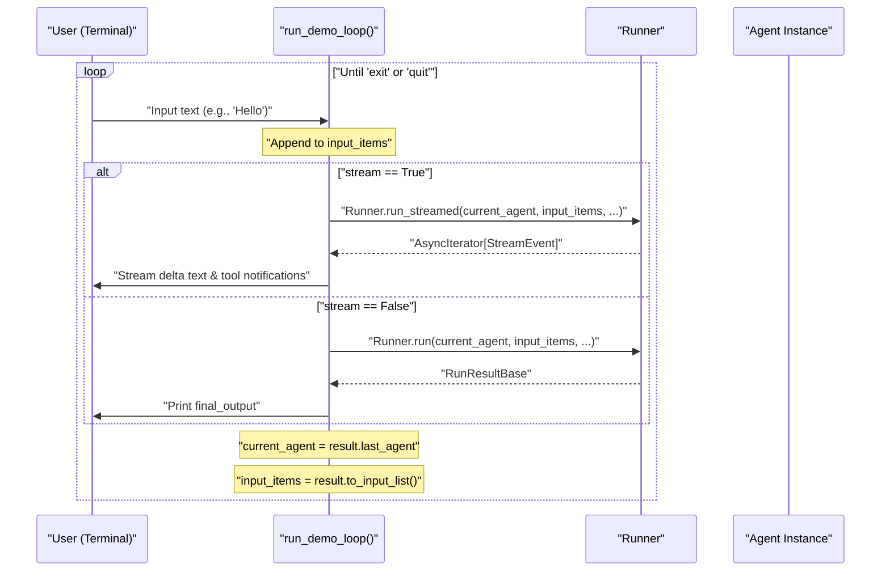
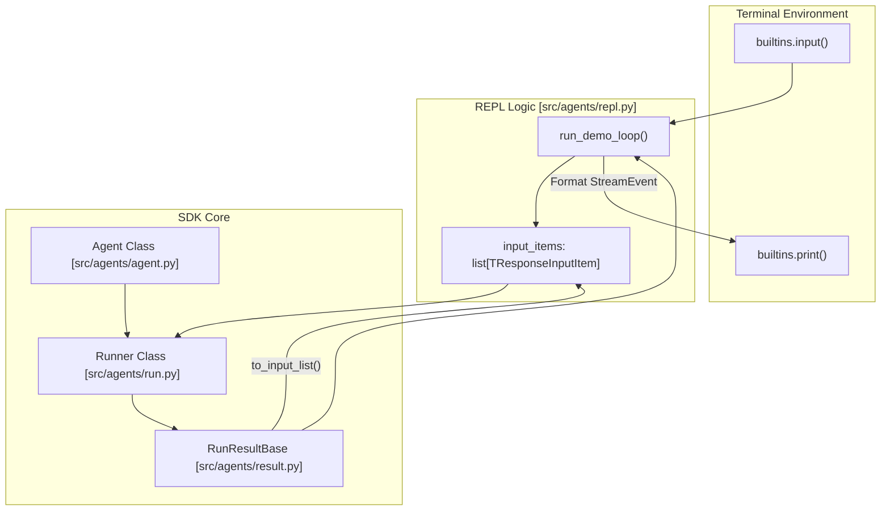

<!-- source: DeepWiki mcp.deepwiki.com · repo openai/openai-agents-python · page 15.6 REPL and Interactive Testing · fetched 2026-10-26 -->

# RElp and Interactive Testing

<details>
<summary>Relevant source files</summary>

The following files were used as context for generating this wiki page:

- [docs/ref/repl.md](docs/ref/repl.md)
- [docs/repl.md](docs/repl.md)
- [src/agents/_debug.py](src/agents/_debug.py)
- [src/agents/repl.py](src/agents/repl.py)
- [src/agents/strict_schema.py](src/agents/strict_schema.py)
- [tests/test_debug.py](tests/test_debug.py)
- [tests/test_repl.py](tests/test_repl.py)
- [tests/test_strict_schema.py](tests/test_strict_schema.py)
- [tests/test_strict_schema_oneof.py](tests/test_strict_schema_oneof.py)

</details>


The OpenAI Agents SDK provides a built-in Read-Eval-Print Loop (REPL) utility designed for rapid manual testing and debugging of agents directly from the command line. This functionality is encapsulated in the `run_demo_loop` function, which manages user input, conversation state, and real-time output streaming.

## The `run_demo_loop` Function

The primary entry point for interactive testing is `run_demo_loop`, exported from the package [src/agents/repl.py:15-21](). It abstracts the complexity of maintaining a session and allows developers to interact with an `Agent` instance as a chat participant.

### Key Features
- **Conversation State Preservation**: Automatically maintains history across multiple turns by converting `RunResultBase` items back into input items for the next iteration [src/agents/repl.py:37](), [src/agents/repl.py:76-77]().
- **Streaming Support**: Supports real-time streaming of model tokens and tool execution events [src/agents/repl.py:53-68]().
- **Agent Handoff Awareness**: If an agent hands off to another agent, the REPL tracks the `last_agent` and continues the conversation with the new agent in the next turn [src/agents/repl.py:66-67](), [src/agents/repl.py:76]().
- **Standard Termination**: Supports termination via `exit`, `quit`, or keyboard interrupts (`Ctrl-C`, `Ctrl-D`) [src/agents/repl.py:41-46]().

### Function Signature
```python
async def run_demo_loop(
    agent: Agent[Any],
    *,
    stream: bool = True,
    context: TContext | None = None,
    max_turns: int | None = DEFAULT_MAX_TURNS,
) -> None:
```
[src/agents/repl.py:15-21]()

| Parameter | Description |
| :--- | :--- |
| `agent` | The initial `Agent` instance to start the session. |
| `stream` | Boolean flag to enable/disable streaming output (defaults to `True`). |
| `context` | Optional `TContext` to pass through to tool executions and guardrails. |
| `max_turns` | Limit on internal reasoning loops per user turn. Defaults to `DEFAULT_MAX_TURNS`. |

**Sources:** [src/agents/repl.py:15-34](), [src/agents/run.py:10-10]()

## Implementation and Data Flow

The REPL operates in a `while True` loop that blocks on Python's built-in `input()` function. Once input is received, it is appended to a local `input_items` list which serves as the growing memory of the session.

### Interactive Execution Cycle

The following diagram illustrates how user input moves through the REPL and how state is preserved between the Natural Language Space (User) and the Code Entity Space (`run_demo_loop`/`Runner`).

**REPL State Transition Diagram**

**Sources:** [src/agents/repl.py:38-77](), [src/agents/run.py:372-400]()

### Handling Stream Events
When `stream=True`, `run_demo_loop` iterates over `result.stream_events()` and performs specific formatting based on the event type:
- **`RawResponsesStreamEvent`**: Extracts `ResponseTextDeltaEvent` to print tokens immediately [src/agents/repl.py:57-60]().
- **`RunItemStreamEvent`**: Intercepts `tool_call_item` and `tool_call_output_item` to print visual indicators like `[tool called]` or `[tool output: ...]` [src/agents/repl.py:61-65]().
- **`AgentUpdatedStreamEvent`**: Notifies the user when a handoff occurs, displaying the name of the new active agent [src/agents/repl.py:66-67]().

**Sources:** [src/agents/repl.py:53-68]()

## Comparison of Modes

The REPL behaves differently depending on whether streaming is enabled.

| Feature | Streaming Mode (`stream=True`) | Non-Streaming Mode (`stream=False`) |
| :--- | :--- | :--- |
| **Primary Method** | `Runner.run_streamed()` [src/agents/repl.py:54]() | `Runner.run()` [src/agents/repl.py:70]() |
| **Output Logic** | Prints deltas as they arrive via `ResponseTextDeltaEvent` [src/agents/repl.py:58-60]() | Prints the `result.final_output` string after completion [src/agents/repl.py:73-74]() |
| **Visibility** | Shows tool calls and outputs during execution [src/agents/repl.py:61-65]() | Only shows the final assistant message |
| **Handoffs** | Explicitly prints `[Agent updated: name]` [src/agents/repl.py:66-67]() | Updates internal `current_agent` silently [src/agents/repl.py:76]() |

**Sources:** [src/agents/repl.py:52-76](), [src/agents/run.py:372-446]()

## Error Handling in the REPL

The REPL utility handles standard terminal interruptions gracefully:
1. **`EOFError` / `KeyboardInterrupt`**: If the user presses `Ctrl-D` or `Ctrl-C`, the loop breaks cleanly and exits the function [src/agents/repl.py:41-44]().
2. **Empty Input**: If the user presses Enter without typing, the REPL skips the turn and prompts again [src/agents/repl.py:47-48]().
3. **Turn Limits**: The `max_turns` parameter is passed to the `Runner`. If the agent exceeds this limit within a single turn, the underlying `Runner` will raise a `MaxTurnsExceeded` exception [src/agents/repl.py:20](), [src/agents/repl.py:54](), [src/agents/repl.py:70](), [src/agents/exceptions.py:15-16]().

**Sources:** [src/agents/repl.py:41-48](), [src/agents/exceptions.py:15-16]()

## Code to System Mapping

The following diagram maps REPL implementation details to the core SDK entities.

**REPL Entity Mapping**

**Sources:** [src/agents/repl.py:15-77](), [src/agents/run.py:372-446](), [src/agents/items.py:8-73]()

---

