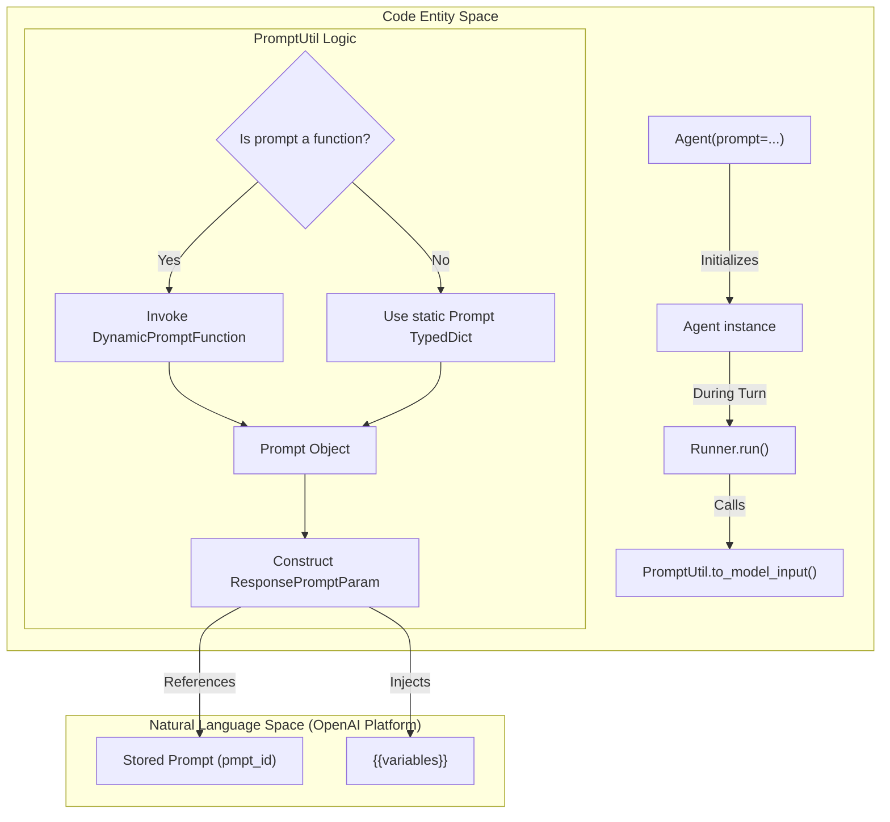
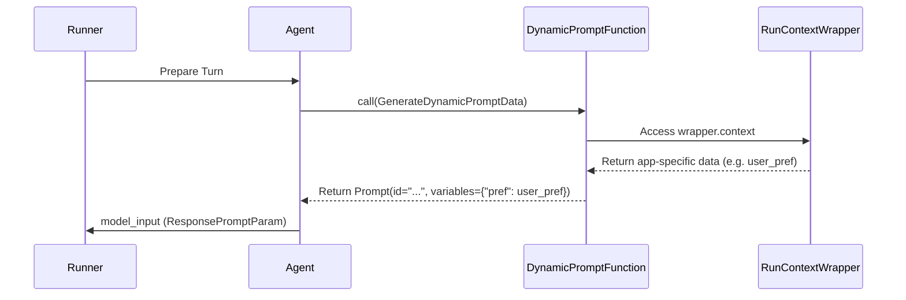

<!-- source: DeepWiki mcp.deepwiki.com · repo openai/openai-agents-python · page 15.7 Prompt Templates · fetched 2026-10-26 -->

# Prompt Templates

<details>
<summary>Relevant source files</summary>

The following files were used as context for generating this wiki page:

- [examples/agent_patterns/forcing_tool_use.py](examples/agent_patterns/forcing_tool_use.py)
- [examples/agent_patterns/human_in_the_loop_custom_rejection.py](examples/agent_patterns/human_in_the_loop_custom_rejection.py)
- [examples/basic/prompt_template.py](examples/basic/prompt_template.py)
- [examples/mcp/streamable_http_remote_example/main.py](examples/mcp/streamable_http_remote_example/main.py)
- [examples/reasoning_content/main.py](examples/reasoning_content/main.py)
- [examples/reasoning_content/runner_example.py](examples/reasoning_content/runner_example.py)
- [examples/research_bot/agents/planner_agent.py](examples/research_bot/agents/planner_agent.py)
- [examples/tools/file_search.py](examples/tools/file_search.py)
- [src/agents/agent.py](src/agents/agent.py)
- [src/agents/models/default_models.py](src/agents/models/default_models.py)
- [src/agents/run_config.py](src/agents/run_config.py)
- [src/agents/tool_context.py](src/agents/tool_context.py)
- [tests/models/test_default_models.py](tests/models/test_default_models.py)
- [tests/test_agent_as_tool.py](tests/test_agent_as_tool.py)
- [tests/test_example_workflows.py](tests/test_example_workflows.py)
- [tests/test_run_config.py](tests/test_run_config.py)
- [tests/test_source_compat_constructors.py](tests/test_source_compat_constructors.py)
- [tests/test_tool_context.py](tests/test_tool_context.py)

</details>


Prompt templates allow agents to use centrally managed prompts created and versioned in the OpenAI platform. By referencing a prompt ID instead of hardcoding system instructions, developers can decouple prompt engineering from application code. This feature is primarily supported for OpenAI models using the Responses API `[src/agents/agent.py:43-43]()`.

## Core Data Structures

The SDK defines prompts using a `TypedDict` for static configurations and a `DynamicPromptFunction` for runtime resolution `[src/agents/agent.py:43-43]()`.

### Prompt TypedDict
The `Prompt` type is a `TypedDict` that specifies the location and parameters for a stored prompt.

| Field | Type | Description |
| :--- | :--- | :--- |
| `id` | `str` | The unique identifier of the prompt (e.g., `pmpt_...`). |
| `version` | `str` | The specific version of the prompt to use. |
| `variables` | `dict[str, Any]` | Key-value pairs used for variable substitution within the template. |

### DynamicPromptFunction
For cases where prompt metadata (like variables or even the ID) depends on the run context, the SDK supports a `DynamicPromptFunction`. This function is invoked at the start of an agent turn `[src/agents/agent.py:43-43]()`.

```python
DynamicPromptFunction: TypeAlias = Callable[
    [GenerateDynamicPromptData], 
    MaybeAwaitable[Prompt | None]
]
```

Sources: `[src/agents/agent.py:43-43]()`, `[src/agents/run_config.py:60-76]()`

## Implementation and Data Flow

When an `Agent` is initialized with a `prompt`, the `Runner` resolves this configuration into a model-compatible input during the turn preparation phase `[src/agents/agent.py:186-199]()`.

### Prompt Resolution Flow
The following diagram illustrates how a `Prompt` configuration (either static or dynamic) is transformed into the final `ResponsePromptParam` sent to the OpenAI Responses API.

**Prompt Resolution Pipeline**

Sources: `[src/agents/agent.py:186-199]`, `[src/agents/run_config.py:60-76]()`

## Variable Substitution

Variable substitution happens server-side within the OpenAI Responses API. The `variables` dictionary provided in the `Prompt` object maps to the `{{variable_name}}` placeholders defined in the OpenAI platform `[src/agents/agent.py:43-43]`.

**Example: Variable Mapping**
1. **Platform Configuration**: A prompt with ID `pmpt_123` contains: `Write a poem about {{topic}} in the style of {{style}}.`
2. **Code Implementation**:
```python
agent = Agent(
    name="Poet",
    prompt={
        "id": "pmpt_123",
        "version": "1",
        "variables": {
            "topic": "recursion",
            "style": "haiku"
        }
    }
)
```
Sources: `[src/agents/agent.py:43-43]`, `[src/agents/run_config.py:60-76]()`

## Dynamic Prompts with Context

Using `DynamicPromptFunction` allows agents to select prompts or variables based on the `RunContext`. This is useful for multi-tenant applications or complex branching logic `[src/agents/agent.py:43-43]`.

**Dynamic Prompt Logic**

Sources: `[src/agents/agent.py:43-43]`, `[src/agents/run_context.h:]()`

## Integration with Agents

The `Agent` class (and its base `AgentBase`) accepts the `prompt` parameter `[src/agents/agent.py:186-199]`. If both `instructions` and `prompt` are provided, the `prompt` configuration takes precedence in the Responses API flow, as it defines the structural template for the system message.

### Key Functions
- `PromptUtil.to_model_input(prompt, data)`: The core utility that handles the logic of checking if a prompt is a callable or a static dict and returns a `ResponsePromptParam` `[src/agents/agent.py:43-43]`.
- `Agent.__init__(..., prompt=...)`: Registration point for prompt templates `[src/agents/agent.py:186-199]`.

Sources: `[src/agents/agent.py:43-199]()`

## Usage with Runner
When using `Runner.run()`, if the agent has a prompt template, the SDK ensures the request is formatted for the Responses API. This is why prompt templates are generally incompatible with the older Chat Completions API or non-OpenAI providers `[src/agents/agent.py:43-43]`.

### Model Compatibility
The `OpenAIChatCompletionsModel` explicitly checks for and warns about or raises an error for the use of `prompt` since it is a feature exclusive to the Responses API `[src/agents/agent.py:43-43]`.

| Feature | Supported | Notes |
| :--- | :--- | :--- |
| `OpenAIResponsesModel` | Yes | Native support for prompt IDs and versions `[src/agents/agent.py:43-43]()`. |
| `OpenAIChatCompletionsModel` | No | Ignores `prompt` or raises `UserError` if `strict_feature_validation` is enabled `[src/agents/agent.py:33-33]()`. |
| Streaming | Yes | Prompt-based runs support `run_streamed()` `[src/agents/agent.py:71-71]()`. |

Sources: `[src/agents/agent.py:33-71]()`

---

