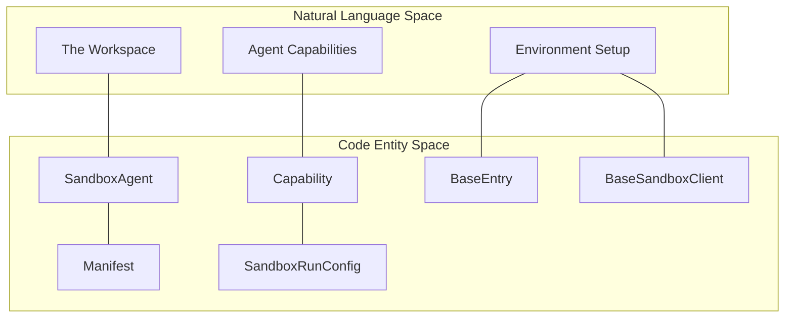
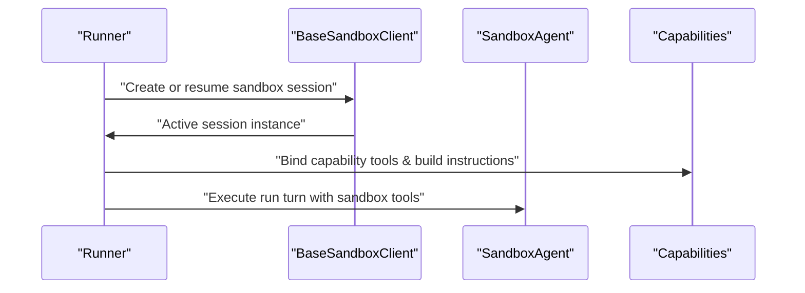

<!-- source: DeepWiki mcp.deepwiki.com · repo openai/openai-agents-python · page 16 Sandbox Agents · fetched 2026-10-26 -->

# Sandbox Agents

Relevant source files

The following files were used as context for generating this wiki page:

- [CONTRIBUTING.md](CONTRIBUTING.md)
- [SECURITY.md](SECURITY.md)
- [docs/sandbox/clients.md](docs/sandbox/clients.md)
- [docs/sandbox/guide.md](docs/sandbox/guide.md)
- [docs/sandbox/memory.md](docs/sandbox/memory.md)
- [docs/sandbox_agents.md](docs/sandbox_agents.md)
- [docs/scripts/translate_docs.py](docs/scripts/translate_docs.py)
- [src/agents/_public_agent.py](src/agents/_public_agent.py)
- [src/agents/run_internal/agent_tool_configuration.py](src/agents/run_internal/agent_tool_configuration.py)
- [src/agents/sandbox/manifest.py](src/agents/sandbox/manifest.py)
- [src/agents/sandbox/manifest_render.py](src/agents/sandbox/manifest_render.py)
- [src/agents/sandbox/runtime_agent_preparation.py](src/agents/sandbox/runtime_agent_preparation.py)
- [src/agents/sandbox/sandbox_agent.py](src/agents/sandbox/sandbox_agent.py)
- [tests/docs/test_translate_docs.py](tests/docs/test_translate_docs.py)
- [tests/sandbox/test_manifest.py](tests/sandbox/test_manifest.py)
- [tests/sandbox/test_manifest_config.py](tests/sandbox/test_manifest_config.py)
- [tests/sandbox/test_session_state_roundtrip.py](tests/sandbox/test_session_state_roundtrip.py)

!!! warning "Beta Feature"

    Sandbox agents are in beta. Expect details of the API, defaults, and supported capabilities to change before general availability, and expect more advanced features over time. [docs/sandbox/guide.md:3-5]()

The Sandbox Agents feature is a beta capability within the OpenAI Agents SDK that provides agents with an isolated, secure workspace for code execution, file manipulation, and persistent state management. Unlike standard agents that execute tools in the local process, a `SandboxAgent` operates within a defined sandbox session, allowing for complex multi-turn tasks that require a consistent filesystem and shell environment [docs/sandbox/guide.md:3-5](), [docs/sandbox_agents.md:3-6]().

Sources: [docs/sandbox/guide.md:3-5](), [docs/sandbox_agents.md:3-6]()

## High-Level Architecture

The sandbox system bridges the gap between natural language instructions and concrete execution environments. It uses a `Manifest` to declare the desired starting contents and layout of the workspace, and a `SandboxClient` to provision and manage the lifecycle of the underlying compute resource (such as a local process, Docker container, or hosted provider environment) [docs/sandbox/guide.md:16-25]().

### Natural Language to Code Entity Mapping

The following diagram illustrates how high-level sandbox concepts map to specific classes and components within the `agents` codebase.

**Sandbox Entity Mapping**

Sources: [docs/sandbox/guide.md:77-87](), [src/agents/sandbox/sandbox_agent.py:31-59]()

## Core Components

The sandbox feature is built on four primary pillars:

1. **`SandboxAgent`**: A specialized agent subclass defined in `src/agents/sandbox/sandbox_agent.py` that includes sandbox-specific configuration parameters such as `default_manifest`, `base_instructions`, `capabilities`, and `run_as` [src/agents/sandbox/sandbox_agent.py:31-59]().
2. **`Manifest`**: A declarative specification of workspace entries, local files, mounts, and environment variables defined in `src/agents/sandbox/manifest.py` [src/agents/sandbox/manifest.py:194-196]().
3. **Sandbox Clients**: Backend adapters responsible for provisioning the live execution environment, such as `UnixLocalSandboxClient` or `DockerSandboxClient` [docs/sandbox/clients.md:7-36]().
4. **Capabilities**: Modular sets of tools (Filesystem, Shell, Memory, Skills, Compaction) exposed to the model via `SandboxAgent.capabilities` [src/agents/sandbox/sandbox_agent.py:54-55]().

Sources: [src/agents/sandbox/sandbox_agent.py:31-59](), [src/agents/sandbox/manifest.py:194-196](), [docs/sandbox/clients.md:7-36]()

### Execution Flow

When a `Runner` executes a `SandboxAgent`, it inspects the provided `SandboxRunConfig` to determine how to create, resume, or connect to a sandbox session [docs/sandbox/guide.md:27-43]().

**Sandbox Execution Lifecycle**

Sources: [docs/sandbox/guide.md:27-52]()

## Feature Breakdown

Detailed information on sandbox sub-systems is covered in the following child pages:

- **[Sandbox Concepts and Architecture](#16.1)** — Compares `SandboxAgent` vs `Agent`, details the `Manifest`, session lifecycles, and `SandboxRuntime` orchestration [docs/sandbox/guide.md:13-26]().
- **[Sandbox Clients and Backends](#16.2)** — Explains `UnixLocalSandboxClient`, `DockerSandboxClient`, hosted providers (E2B, Modal, Daytona, Blaxel, Runloop, Cloudflare, Vercel), and `SandboxRunConfig` [docs/sandbox/clients.md:1-116]().
- **[Sandbox Capabilities](#16.3)** — Covers the capability system, Filesystem, Shell, Memory, Skills, and Compaction capabilities alongside their model-facing tools [docs/sandbox_agents.md:100-104]().
- **[Manifest and Workspace Setup](#16.4)** — Details the `Manifest` class, `Dir`, `LocalFile`, and `Mount` entries, mount security, environment variables, and snapshot/resume utilities [src/agents/sandbox/manifest.py:34-72]().
- **[Sandbox Memory](#16.5)** — Explains the memory capability for persisting lessons across runs, layout configurations, and token management [docs/sandbox/memory.md:1-1]().
- **[Sandbox Compatibility and Guards](#16.6)** — Covers compatibility guards, bounded reads, client option validation, and provider contract testing [src/agents/sandbox/manifest.py:55-72]().

Sources: [docs/sandbox/guide.md:13-26](), [docs/sandbox/clients.md:1-116](), [src/agents/sandbox/manifest.py:34-72]()

## Summary Table of Sandbox Entities

| Entity | Code Symbol | Responsibility |
| :--- | :--- | :--- |
| **Agent** | `SandboxAgent` | The LLM-powered agent configured with sandbox defaults and capabilities [src/agents/sandbox/sandbox_agent.py:31-36](). |
| **Manifest** | `Manifest` | Declarative specification of starting workspace contents and environment [src/agents/sandbox/manifest.py:194-196](). |
| **Client** | `BaseSandboxClient` | Provisions and manages the compute environment backend [docs/sandbox/guide.md:16-25](). |
| **Run Config** | `SandboxRunConfig` | Per-run settings defining how execution acquires its sandbox session [docs/sandbox/guide.md:16-25](). |
| **Capability** | `Capability` | Modular extension providing specialized tools and prompt instructions [src/agents/sandbox/sandbox_agent.py:54-55](). |

Sources: [src/agents/sandbox/sandbox_agent.py:31-55](), [src/agents/sandbox/manifest.py:194-196](), [docs/sandbox/guide.md:16-25]()

---

