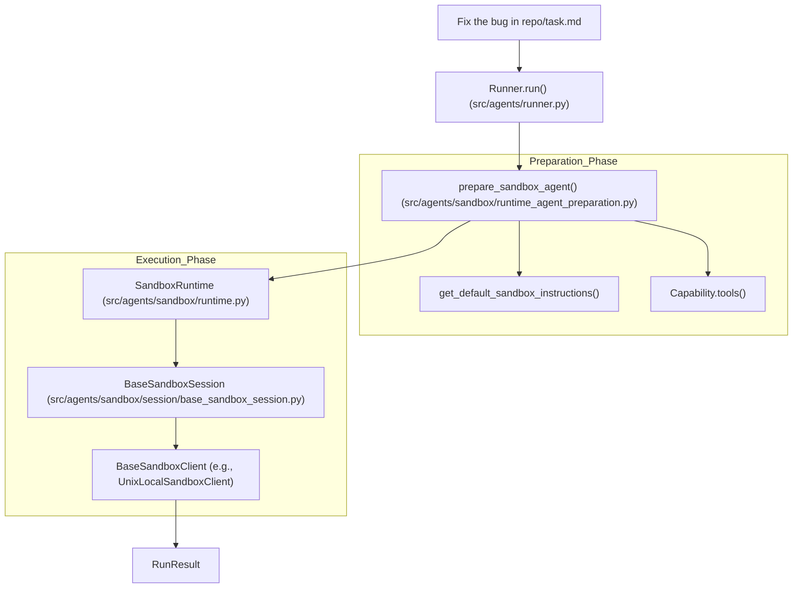
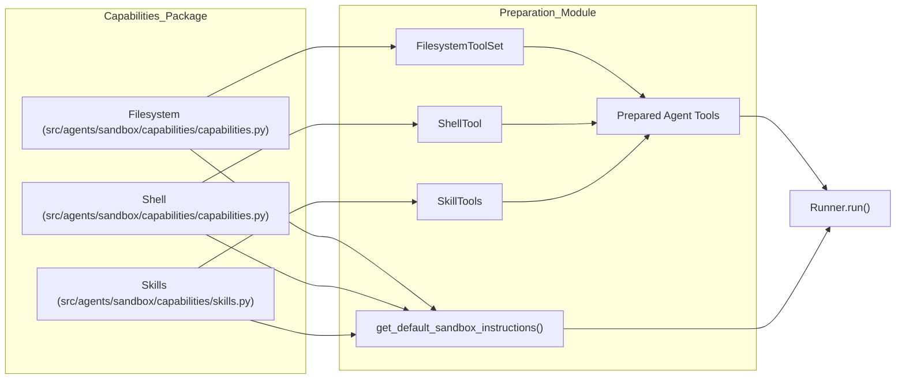
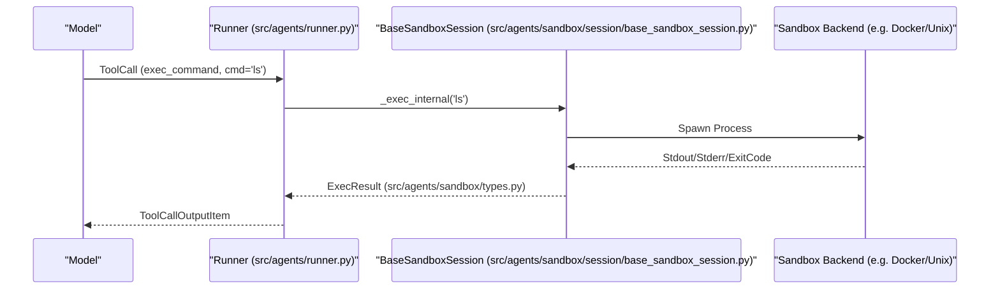

<!-- source: DeepWiki mcp.deepwiki.com · repo openai/openai-agents-python · page 16.1 Sandbox Concepts and Architecture · fetched 2026-10-26 -->

# Sandbox Concepts and Architecture

Relevant source files

The following files were used as context for generating this wiki page:

- [src/agents/_public_agent.py](src/agents/_public_agent.py)
- [src/agents/run_internal/agent_tool_configuration.py](src/agents/run_internal/agent_tool_configuration.py)
- [src/agents/sandbox/manifest.py](src/agents/sandbox/manifest.py)
- [src/agents/sandbox/manifest_render.py](src/agents/sandbox/manifest_render.py)
- [src/agents/sandbox/runtime_agent_preparation.py](src/agents/sandbox/runtime_agent_preparation.py)
- [src/agents/sandbox/sandbox_agent.py](src/agents/sandbox/sandbox_agent.py)
- [src/agents/sandbox/session/sinks.py](src/agents/sandbox/session/sinks.py)
- [src/agents/sandbox/types.py](src/agents/sandbox/types.py)
- [src/agents/sandbox/util/parse_utils.py](src/agents/sandbox/util/parse_utils.py)
- [tests/conftest.py](tests/conftest.py)
- [tests/sandbox/test_exposed_ports.py](tests/sandbox/test_exposed_ports.py)
- [tests/sandbox/test_manifest.py](tests/sandbox/test_manifest.py)
- [tests/sandbox/test_manifest_config.py](tests/sandbox/test_manifest_config.py)
- [tests/sandbox/test_parse_utils.py](tests/sandbox/test_parse_utils.py)
- [tests/sandbox/test_session_sinks.py](tests/sandbox/test_session_sinks.py)
- [tests/sandbox/test_session_state_roundtrip.py](tests/sandbox/test_session_state_roundtrip.py)
- [tests/sandbox/test_types.py](tests/sandbox/test_types.py)
- [tests/test_test_environment.py](tests/test_test_environment.py)

This page details the architectural concepts and implementation mechanics of the Sandbox Agents feature in the OpenAI Agents SDK (`openai-agents-python`). It covers the distinction between standard agents and sandbox-managed agents, workspace manifestation contracts, capabilities, execution runtimes, session instrumentation sinks, and data flow.

!!! warning "Beta feature"
    Sandbox agents are in beta. Expect details of the API, defaults, and supported capabilities to change before general availability. [docs/zh/sandbox/guide.md:7-9]()

Sandbox Agents provide a persistent, isolated workspace where models can search document sets, edit files, and run shell commands. This execution harness orchestrates file staging, sandbox lifecycle, and provider-specific glue so that developers can focus on agent logic. [docs/zh/sandbox/guide.md:11-13](), [docs/ja/sandbox_agents.md:7-9]()

## SandboxAgent vs Agent

A `SandboxAgent` is a specialized subclass of `Agent` that includes sandbox-specific configuration, default instructions, and automatic tool injection via capabilities [src/agents/sandbox/sandbox_agent.py:30-36](), [docs/zh/sandbox/guide.md:21-23]().

| Feature | `Agent` | `SandboxAgent` |
| :--- | :--- | :--- |
| **Workspace** | Transient / None | Persistent `Manifest`-defined workspace [docs/zh/sandbox/guide.md:24-25]() |
| **Base Instructions** | Optional `instructions` | Includes `base_instructions` (default sandbox prompt) [src/agents/sandbox/runtime_agent_preparation.py:28-39]() |
| **Tools** | User-defined functions | User-defined + auto-injected `Capability` tools [src/agents/sandbox/runtime_agent_preparation.py:105-107]() |
| **Identity** | Process owner | Configurable `run_as` user (`User` or `str`) for sandbox operations [src/agents/sandbox/sandbox_agent.py:57-58]() |
| **Lifecycle** | Stateless turns | Session-based (Start, Stop, Resume, Snapshot) [docs/zh/sandbox/guide.md:26-27]() |

**Sources:**
- `src/agents/sandbox/sandbox_agent.py:30-58` (Class definition and fields)
- `src/agents/sandbox/runtime_agent_preparation.py:28-135` (Agent preparation logic)
- `docs/zh/sandbox/guide.md:21-33` (Conceptual differences)

## Core Architecture and Data Flow

The architecture separates agent definition from execution configuration. The `Runner` acts as the bridge, calling `prepare_sandbox_agent()` to bind capabilities, instructions, and manifest state before delegating execution to the `SandboxRuntime` [src/agents/sandbox/runtime_agent_preparation.py:86-135](), [docs/zh/sandbox/guide.md:35-51]().

### Natural Language to Code Entity Space: Execution Flow
This diagram illustrates how a user prompt triggers a sequence of code entities to prepare and execute a sandbox-bound agent.

**Sources:**
- `src/agents/sandbox/runtime_agent_preparation.py:86-135` (Agent preparation logic)
- `src/agents/sandbox/runtime.py:10-30` (SandboxRuntime role)
- `src/agents/sandbox/session/base_sandbox_session.py:129-153` (Session interface)

## The Manifest and Workspace Setup

The `Manifest` defines the initial workspace contract. It declares what files, directories, git repositories, and environment variables should exist when a sandbox session is created [src/agents/sandbox/manifest.py:194-196]().

- **Entries**: Mappings from `Path` to `BaseEntry` objects (`File`, `Dir`, `LocalFile`, `LocalDir`, `Mount`) [src/agents/sandbox/entries/artifacts.py:52-155]().
- **Environment and Secrets**: Environment variables are managed via `Environment` and `EnvValue` subclasses such as `StrEnvValue` [src/agents/sandbox/manifest.py:85-148]().
- **Materialization**: Placing `Manifest` entries physically into the environment via `BaseSandboxSession.apply_manifest()` [src/agents/sandbox/session/base_sandbox_session.py:174-189]().
- **Rendering**: The filesystem tree can be rendered into text for model context via `render_manifest_description()` with automatic truncation handling (`_truncate_manifest_description`) [src/agents/sandbox/manifest_render.py:14-50]().
- **Path Validation**: Manifests validate all paths to ensure they do not escape the workspace root (e.g., rejecting absolute paths or directory traversal attempts like `../`) [src/agents/sandbox/manifest.py:44-72](), [src/agents/sandbox/errors.py:139-162]().

**Sources:**
- `src/agents/sandbox/manifest.py:85-196` (EnvValue and Environment definitions)
- `src/agents/sandbox/manifest_render.py:14-78` (Manifest description and rendering)
- `src/agents/sandbox/session/base_sandbox_session.py:174-195` (Manifest application)

## Sandbox Capabilities

`Capability` objects define sandbox-native behavior. They provide tools, instruction fragments, and sampling parameters that are merged into the agent during preparation [src/agents/sandbox/runtime_agent_preparation.py:97-132]().

| Capability | Purpose | Key Tools Provided |
| :--- | :--- | :--- |
| `Filesystem` | File manipulation | `read_file`, `write_file`, `ls`, `apply_patch` [src/agents/sandbox/capabilities/capabilities.py:10]() |
| `Shell` | Command execution | `exec_command` [src/agents/sandbox/capabilities/capabilities.py:10]() |
| `Skills` | Reusable task logic | `load_skill` [src/agents/sandbox/capabilities/skills.py:15-30]() |
| `Memory` | Long-term persistence | Persisting lessons across runs [src/agents/sandbox/capabilities/capabilities.py:10]() |
| `Compaction` | Context management | Summarization of history to fit context limits [src/agents/sandbox/capabilities/capabilities.py:10]() |

### Sandbox Component Mapping
This diagram maps conceptual capabilities to their implementation classes and how they are injected into the agent.

**Sources:**
- `src/agents/sandbox/runtime_agent_preparation.py:86-135` (Capability binding)
- `src/agents/sandbox/capabilities/capabilities.py:40-55` (Core capability classes)
- `src/agents/sandbox/capabilities/skills.py:15-30` (Skills capability)

## Sandbox Session Lifecycle and Sinks

The sandbox session lifecycle is managed by the `SandboxRuntime` and orchestrated through session instances [src/agents/sandbox/runtime.py:10-25]().

1. **Creation / Attachment**: The runner provisions or attaches to a session using the configured sandbox client [src/agents/sandbox/runtime_session_manager.py:15-30]().
2. **Preparation**: `prepare_sandbox_agent()` injects instructions and tools [src/agents/sandbox/runtime_agent_preparation.py:86-135]().
3. **Execution**: Tool calls (e.g., shell commands returning `ExecResult`) are executed by the session and backend [src/agents/sandbox/types.py:147-159](), [src/agents/sandbox/session/base_sandbox_session.py:129-153]().
4. **Instrumentation & Event Sinks**: Sessions emit operational events (start, finish, errors) handled by `EventSink` implementations such as `CallbackSink`, `JsonlOutboxSink`, and `WorkspaceJsonlSink` [src/agents/sandbox/session/sinks.py:42-182]().
5. **State Persistence & Shutdown**: Workspaces are snapshotted or persisted, followed by session teardown [src/agents/sandbox/session/base_sandbox_session.py:66-75]().

### Session Interaction Details
When the model requests a tool like `exec_command`, the `SandboxRuntime` routes the request through the active `BaseSandboxSession`.

**Sources:**
- `src/agents/sandbox/session/base_sandbox_session.py:66-75` (Session lifecycle methods)
- `src/agents/sandbox/session/sinks.py:42-182` (Event sinks and instrumentation)
- `src/agents/sandbox/types.py:147-159` (ExecResult definition)

---

