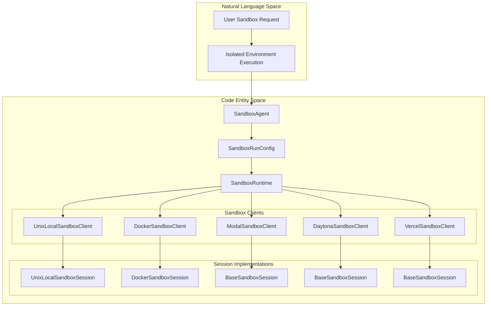
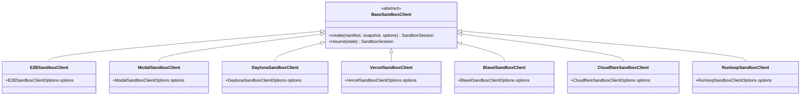

<!-- source: DeepWiki mcp.deepwiki.com · repo openai/openai-agents-python · page 16.2 Sandbox Clients and Backends · fetched 2026-10-26 -->

# Sandbox Clients and Backends

Relevant source files

The following files were used as context for generating this wiki page:

- [src/agents/extensions/sandbox/blaxel/sandbox.py](src/agents/extensions/sandbox/blaxel/sandbox.py)
- [src/agents/extensions/sandbox/cloudflare/sandbox.py](src/agents/extensions/sandbox/cloudflare/sandbox.py)
- [src/agents/extensions/sandbox/daytona/sandbox.py](src/agents/extensions/sandbox/daytona/sandbox.py)
- [src/agents/extensions/sandbox/e2b/sandbox.py](src/agents/extensions/sandbox/e2b/sandbox.py)
- [src/agents/extensions/sandbox/modal/sandbox.py](src/agents/extensions/sandbox/modal/sandbox.py)
- [src/agents/extensions/sandbox/vercel/sandbox.py](src/agents/extensions/sandbox/vercel/sandbox.py)
- [src/agents/sandbox/_mount_security.py](src/agents/sandbox/_mount_security.py)
- [src/agents/sandbox/apply_patch.py](src/agents/sandbox/apply_patch.py)
- [src/agents/sandbox/errors.py](src/agents/sandbox/errors.py)
- [src/agents/sandbox/runtime_session_manager.py](src/agents/sandbox/runtime_session_manager.py)
- [src/agents/sandbox/sandboxes/__init__.py](src/agents/sandbox/sandboxes/__init__.py)
- [src/agents/sandbox/sandboxes/_docker_removal_worker.py](src/agents/sandbox/sandboxes/_docker_removal_worker.py)
- [src/agents/sandbox/sandboxes/_unix_local_file_ops.py](src/agents/sandbox/sandboxes/_unix_local_file_ops.py)
- [src/agents/sandbox/sandboxes/docker.py](src/agents/sandbox/sandboxes/docker.py)
- [src/agents/sandbox/sandboxes/docker_removal.py](src/agents/sandbox/sandboxes/docker_removal.py)
- [src/agents/sandbox/sandboxes/unix_local.py](src/agents/sandbox/sandboxes/unix_local.py)
- [src/agents/sandbox/session/base_sandbox_session.py](src/agents/sandbox/session/base_sandbox_session.py)
- [src/agents/sandbox/session/sandbox_session.py](src/agents/sandbox/session/sandbox_session.py)
- [src/agents/sandbox/session/snapshot_lifecycle.py](src/agents/sandbox/session/snapshot_lifecycle.py)
- [src/agents/sandbox/workspace_paths.py](src/agents/sandbox/workspace_paths.py)
- [src/agents/testing/sandbox.py](src/agents/testing/sandbox.py)
- [tests/extensions/sandbox/test_blaxel.py](tests/extensions/sandbox/test_blaxel.py)
- [tests/extensions/sandbox/test_cloudflare.py](tests/extensions/sandbox/test_cloudflare.py)
- [tests/extensions/sandbox/test_daytona.py](tests/extensions/sandbox/test_daytona.py)
- [tests/extensions/sandbox/test_e2b.py](tests/extensions/sandbox/test_e2b.py)
- [tests/extensions/sandbox/test_modal.py](tests/extensions/sandbox/test_modal.py)
- [tests/extensions/sandbox/test_vercel.py](tests/extensions/sandbox/test_vercel.py)
- [tests/sandbox/_apply_patch_test_session.py](tests/sandbox/_apply_patch_test_session.py)
- [tests/sandbox/_docker_removal_helpers.py](tests/sandbox/_docker_removal_helpers.py)
- [tests/sandbox/test_apply_patch.py](tests/sandbox/test_apply_patch.py)
- [tests/sandbox/test_docker.py](tests/sandbox/test_docker.py)
- [tests/sandbox/test_docker_removal.py](tests/sandbox/test_docker_removal.py)
- [tests/sandbox/test_docker_removal_client.py](tests/sandbox/test_docker_removal_client.py)
- [tests/sandbox/test_docker_removal_worker.py](tests/sandbox/test_docker_removal_worker.py)
- [tests/sandbox/test_mount_security.py](tests/sandbox/test_mount_security.py)
- [tests/sandbox/test_runtime.py](tests/sandbox/test_runtime.py)
- [tests/sandbox/test_sandboxes_import.py](tests/sandbox/test_sandboxes_import.py)
- [tests/sandbox/test_unix_local.py](tests/sandbox/test_unix_local.py)
- [tests/sandbox/test_unix_local_create.py](tests/sandbox/test_unix_local_create.py)
- [tests/sandbox/test_unix_local_file_io.py](tests/sandbox/test_unix_local_file_io.py)
- [tests/sandbox/test_unix_local_special_files.py](tests/sandbox/test_unix_local_special_files.py)
- [tests/sandbox/test_unix_local_user_file_io.py](tests/sandbox/test_unix_local_user_file_io.py)
- [tests/sandbox/test_workspace_paths.py](tests/sandbox/test_workspace_paths.py)
- [tests/test_run_state_compatibility_corpus.py](tests/test_run_state_compatibility_corpus.py)

## Purpose and Scope

This page details the implementation, data flow, and configuration of sandbox clients and backends in the OpenAI Agents SDK. It covers local execution backends (`UnixLocalSandboxClient` and `DockerSandboxClient`), hosted infrastructure providers (E2B, Modal, Daytona, Blaxel, Runloop, Cloudflare, Vercel), and the execution configuration interface `SandboxRunConfig`. 

Sources: [src/agents/sandbox/sandboxes/unix_local.py:60-65](), [src/agents/sandbox/sandboxes/docker.py:63-74](), [src/agents/extensions/sandbox/modal/sandbox.py:67-79]()

---

## Architecture Overview

The SDK separates workspace definitions (`Manifest`) from execution environments (`BaseSandboxClient` and `BaseSandboxSession`). This abstraction allows agent workloads to shift between local and hosted infrastructures without altering agent logic.

### System Flow: Client to Backend

The following diagram bridges natural language workspace requirements to concrete codebase entities responsible for session management and execution.

Sources: [src/agents/sandbox/sandboxes/unix_local.py:60-65](), [src/agents/sandbox/sandboxes/docker.py:63-74](), [src/agents/extensions/sandbox/modal/sandbox.py:67-79](), [src/agents/extensions/sandbox/daytona/sandbox.py:58-61]()

---

## Local Sandbox Clients

Local backends execute agent tools and shell commands directly within the local machine or a local container engine.

### UnixLocalSandboxClient

The `UnixLocalSandboxClient` executes operations as local OS processes under `UnixLocalSandboxSession` [src/agents/sandbox/sandboxes/unix_local.py:28-30]().
* **Platform Restrictions**: Windows execution is blocked at import time, raising an `ImportError` [src/agents/sandbox/sandboxes/unix_local.py:3-7]().
* **Environment Inheritance**: Restricts host environment variables via `_HOST_ENVIRONMENT_ALLOWLIST` [src/agents/sandbox/sandboxes/unix_local.py:87-110]() to preserve runtime security boundaries.
* **PTY Management**: Allocates local pseudo-terminal processes for interactive command streaming using process tracking utilities [src/agents/sandbox/sandboxes/unix_local.py:55-64]().

Sources: [src/agents/sandbox/sandboxes/unix_local.py:3-110]()

### DockerSandboxClient

The `DockerSandboxClient` manages isolated container lifecycles via `DockerSandboxSession` [src/agents/sandbox/sandboxes/docker.py:63-66]().
* **SDK Integration**: Interacts with container runtimes using `DockerSDKClient` [src/agents/sandbox/sandboxes/docker.py:23-25]().
* **Stdin Framing**: Implements length-framed stdin scripts (`_LENGTH_FRAMED_STDIN_SCRIPT`) to prevent TLS pipe hangs during container file writes [src/agents/sandbox/sandboxes/docker.py:164-166]().
* **Thread Execution**: Uses `_DOCKER_EXECUTOR` thread pools for blocking stream and archive measurements [src/agents/sandbox/sandboxes/docker.py:95-99]().

Sources: [src/agents/sandbox/sandboxes/docker.py:23-166]()

Sources: [src/agents/sandbox/sandboxes/unix_local.py:3-110](), [src/agents/sandbox/sandboxes/docker.py:23-166]()

---

## Hosted Sandbox Providers

Hosted sandbox clients wrap remote infrastructure providers to execute untrusted code or manage remote developer workspaces.

| Provider | Client Class | Underlying SDK / Transport |
| :--- | :--- | :--- |
| **E2B** | `E2BSandboxClient` | E2B SDK [src/agents/extensions/sandbox/e2b/sandbox.py:66-67]() |
| **Modal** | `ModalSandboxClient` | `modal.Sandbox` [src/agents/extensions/sandbox/modal/sandbox.py:67-79]() |
| **Daytona** | `DaytonaSandboxClient` | `AsyncDaytona` [src/agents/extensions/sandbox/daytona/sandbox.py:58-61]() |
| **Blaxel** | `BlaxelSandboxClient` | Blaxel Sandbox SDK [src/agents/extensions/sandbox/blaxel/sandbox.py:48-53]() |
| **Cloudflare** | `CloudflareSandboxClient` | HTTP/WebSocket transport [src/agents/extensions/sandbox/cloudflare/sandbox.py:64-64]() |
| **Vercel** | `VercelSandboxClient` | `vercel.sandbox.AsyncSandbox` [src/agents/extensions/sandbox/vercel/sandbox.py:54-67]() |
| **Runloop** | `RunloopSandboxClient` | `AsyncRunloopSDK` [src/agents/extensions/sandbox/runloop/sandbox.py:53-54]() |

### Hosted Client Class Hierarchy

Sources: [src/agents/extensions/sandbox/e2b/sandbox.py:66-67](), [src/agents/extensions/sandbox/modal/sandbox.py:67-79](), [src/agents/extensions/sandbox/daytona/sandbox.py:58-61](), [src/agents/extensions/sandbox/vercel/sandbox.py:54-67]()

Sources: [src/agents/extensions/sandbox/e2b/sandbox.py:66-67](), [src/agents/extensions/sandbox/modal/sandbox.py:67-79](), [src/agents/extensions/sandbox/daytona/sandbox.py:58-61](), [src/agents/extensions/sandbox/vercel/sandbox.py:54-67](), [src/agents/extensions/sandbox/blaxel/sandbox.py:48-53](), [src/agents/extensions/sandbox/cloudflare/sandbox.py:64-64](), [src/agents/extensions/sandbox/runloop/sandbox.py:53-54]()

---

## Sandbox Run Configuration and Lifecycle

The `SandboxRunConfig` object binds agent execution paths to a configured sandbox client instance, dictating concurrency limits, archive size boundaries, and timeout policies.

* **Client Initialization**: Configures timeout parameters and client options passed into `BaseSandboxClient` implementations [src/agents/sandbox/session/sandbox_client.py:65-74]().
* **Session Persistence**: Sessions serialize their state into `SandboxSessionState` structures, permitting pause and resume workflows across process boundaries [src/agents/sandbox/session/sandbox_session_state.py:1-50]().
* **PTY and Command Control**: Execution results are encapsulated in `ExecResult` objects capturing `stdout`, `stderr`, and `exit_code` [src/agents/sandbox/types.py:68-68]().

Sources: [src/agents/sandbox/session/sandbox_client.py:65-74](), [src/agents/sandbox/session/sandbox_session_state.py:1-50](), [src/agents/sandbox/types.py:68-68]()

---

