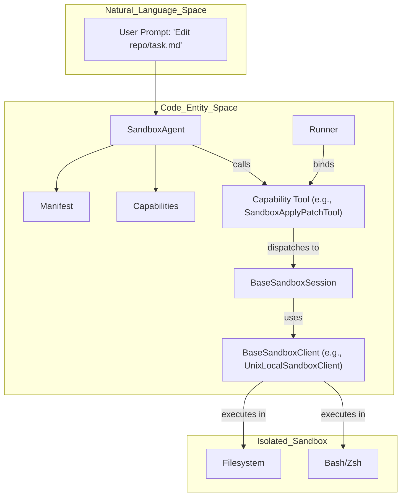
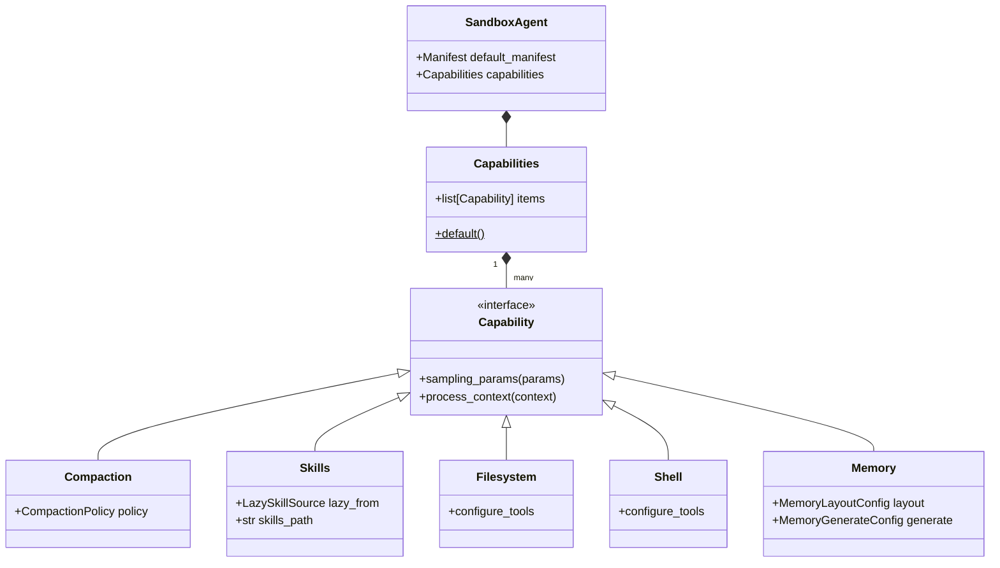

<!-- source: DeepWiki mcp.deepwiki.com · repo openai/openai-agents-python · page 16.3 Sandbox Capabilities · fetched 2026-10-26 -->

# Sandbox Capabilities

Relevant source files

The following files were used as context for generating this wiki page:

- [src/agents/run_context.py](src/agents/run_context.py)
- [src/agents/sandbox/capabilities/skills.py](src/agents/sandbox/capabilities/skills.py)
- [src/agents/sandbox/capabilities/tools/_input_errors.py](src/agents/sandbox/capabilities/tools/_input_errors.py)
- [src/agents/sandbox/capabilities/tools/apply_patch_tool.py](src/agents/sandbox/capabilities/tools/apply_patch_tool.py)
- [src/agents/sandbox/capabilities/tools/shell_tool.py](src/agents/sandbox/capabilities/tools/shell_tool.py)
- [src/agents/sandbox/capabilities/tools/view_image.py](src/agents/sandbox/capabilities/tools/view_image.py)
- [src/agents/sandbox/entries/artifacts.py](src/agents/sandbox/entries/artifacts.py)
- [src/agents/sandbox/memory/storage.py](src/agents/sandbox/memory/storage.py)
- [tests/sandbox/capabilities/test_apply_patch_preflight.py](tests/sandbox/capabilities/test_apply_patch_preflight.py)
- [tests/sandbox/capabilities/test_apply_patch_tool.py](tests/sandbox/capabilities/test_apply_patch_tool.py)
- [tests/sandbox/capabilities/test_skills_capability.py](tests/sandbox/capabilities/test_skills_capability.py)
- [tests/sandbox/capabilities/test_tool_input_errors.py](tests/sandbox/capabilities/test_tool_input_errors.py)
- [tests/sandbox/capabilities/test_view_image_tool.py](tests/sandbox/capabilities/test_view_image_tool.py)
- [tests/sandbox/test_entries.py](tests/sandbox/test_entries.py)
- [tests/sandbox/test_posix_tool_paths.py](tests/sandbox/test_posix_tool_paths.py)
- [tests/sandbox/test_view_image_content_validation.py](tests/sandbox/test_view_image_content_validation.py)
- [tests/test_run_context_approvals.py](tests/test_run_context_approvals.py)

Sandbox capabilities are specific toolsets and system interfaces exposed to a `SandboxAgent` within its isolated execution environment. Unlike standard function tools that execute in the host process, sandbox capabilities leverage the `SandboxRuntime` and session abstractions to perform actions like filesystem manipulation, shell command execution, structured image viewing, skill loading, and persistent memory management.

## Capability System Architecture

The capability system defines how high-level intentions (e.g., editing a file or inspecting an image) are translated into low-level operations within a specific sandbox backend. Capabilities are declared on the `SandboxAgent` and materialized into tools that the model can invoke.

### Data Flow: Natural Language to Sandbox Execution

The following diagram illustrates how a model's request to use a capability flows through SDK entities into the isolated runtime environment.

**Capability Execution Flow**

Sources: `src/agents/sandbox/session/base_sandbox_session.py:32-87`, `src/agents/sandbox/runtime.py:72-85`

## Core Capabilities and Tools Exposed to the Model

The SDK provides several built-in capabilities that can be configured. Each capability exposes specialized tools to the model.

### 1. Filesystem Capability and Tools (`apply_patch`, `view_image`)
The `Filesystem` capability allows the agent to interact with sandbox storage. It exposes tools for patching files and viewing images.

*   **`SandboxApplyPatchTool` (`apply_patch`):** Implemented as a `CustomTool` [tests/sandbox/capabilities/test_apply_patch_tool.py:35-44]() using a Lark grammar definition [src/agents/sandbox/capabilities/tools/apply_patch_tool.py:24-44]() for freeform file modification (`add_hunk`, `delete_hunk`, `update_hunk`) [src/agents/sandbox/capabilities/tools/apply_patch_tool.py:29-33](). It supports operation-typed approval checking (`ApplyPatchOperation`) [tests/sandbox/capabilities/test_apply_patch_tool.py:97-108]().
*   **`ViewImageTool` (`view_image`):** A `FunctionTool` that loads an image file from the workspace or an explicitly granted sandbox path, validates its size (maximum 10MB) [src/agents/sandbox/capabilities/tools/view_image.py:19-20](), detects its MIME type [src/agents/sandbox/capabilities/tools/view_image.py:24-44](), and returns a structured `ToolOutputImage` containing a base64-encoded data URL [src/agents/sandbox/capabilities/tools/view_image.py:47-49,172]().
*   **Safety:** Paths are validated against workspace policies to prevent directory traversal outside the sandbox [tests/sandbox/capabilities/test_view_image_tool.py:72-80]().

Sources: `src/agents/sandbox/capabilities/filesystem.py:1-20`, `src/agents/sandbox/capabilities/tools/apply_patch_tool.py:24-175`, `src/agents/sandbox/capabilities/tools/view_image.py:64-173`, `tests/sandbox/capabilities/test_apply_patch_tool.py:35-108`

### 2. Shell Capability (`exec_command`, `write_stdin`)
The `Shell` capability provides the agent with a terminal interface via `ExecCommandTool` and related utilities to execute shell commands within the sandbox environment [src/agents/sandbox/capabilities/tools/shell_tool.py:120-193]().

*   **Tools Exposed:** `exec_command` (supporting PTY allocation, workdir anchoring, timeouts, and output token truncation) and `write_stdin` [src/agents/sandbox/capabilities/tools/shell_tool.py:120-164]().
*   **Execution:** Commands are executed via session methods [src/agents/sandbox/capabilities/tools/shell_tool.py:114](). Workdirs are normalized and prefixed with `cd` statements before job execution [src/agents/sandbox/capabilities/tools/shell_tool.py:75-93]().
*   **Error Handling:** Non-zero exit codes and timeouts raise transport and execution errors [src/agents/sandbox/errors.py:15-22]().

Sources: `src/agents/sandbox/capabilities/shell.py:1-15`, `src/agents/sandbox/capabilities/tools/shell_tool.py:75-164`, `src/agents/sandbox/errors.py:15-22`

### 3. Skills Capability (`load_skill`)
`Skills` are specialized, reusable toolsets stored in `SKILL.md` files that can be loaded into the sandbox [src/agents/sandbox/capabilities/skills.py:29-32]().

*   **Lazy Loading:** Skills can be loaded lazily on demand via `LazySkillSource` implementations (such as `LocalDirLazySkillSource`) [src/agents/sandbox/capabilities/skills.py:132-147]() which copy or materialize skill directories into the sandbox workspace when requested by the model [tests/sandbox/capabilities/test_skills_capability.py:60-91]().
*   **Context Hygiene:** Instructions enforce progressive disclosure—agents load `SKILL.md` and specific reference files or scripts only when required [src/agents/sandbox/capabilities/skills.py:60-82]().

Sources: `src/agents/sandbox/capabilities/skills.py:29-147`, `tests/sandbox/capabilities/test_skills_capability.py:60-91`

### 4. Compaction Capability
The `Compaction` capability manages the model's context window by summarizing history or truncating old items when token counts exceed specified thresholds.

*   **Policies:** Uses static or dynamic compaction policies to determine when and how context window compression should be triggered [src/agents/sandbox/capabilities/compaction.py:132-215]().
*   **Context Processing:** Inserts compaction markers or prunes items based on policy evaluations.

Sources: `src/agents/sandbox/capabilities/compaction.py:132-215`, `src/agents/sandbox/util/token_truncation.py:1-15`

### 5. Memory Capability
`Memory` allows an agent to persist lessons learned and workspace state across separate sandbox runs.

*   **Persistence:** Serializes execution rollouts into the sandbox workspace under dedicated directories [src/agents/sandbox/memory/rollouts.py:105-139]().
*   **Consolidation:** Uses `SandboxMemoryStorage` to consolidate raw memories into permanent instruction files like `memories/MEMORY.md` [tests/sandbox/test_memory.py:145-170]().
*   **Configuration:** Configured via `MemoryLayoutConfig` and `MemoryGenerateConfig` [src/agents/sandbox/capabilities/memory.py:54-55]().

Sources: `src/agents/sandbox/capabilities/memory.py:1-25`, `src/agents/sandbox/memory/rollouts.py:61-73`, `src/agents/sandbox/memory/storage.py:70-75`

## Entity Association Diagram

The relationship between the agent, its configuration, and the runtime capability classes is defined in the capability module hierarchy.

**Capability Class Hierarchy**

Sources: `src/agents/sandbox/capabilities/capability.py:1-15`, `src/agents/sandbox/capabilities/capabilities.py:48-48`, `src/agents/sandbox/capabilities/memory.py:54-55`, `src/agents/sandbox/capabilities/skills.py:108-115`

## Summary of Capability Tools Exposed to the Model

| Capability | Tools Exposed | Purpose |
| :--- | :--- | :--- |
| **Filesystem** | `apply_patch`, `view_image` | Edit repository files via Lark patch grammars and inspect images |
| **Shell** | `exec_command`, `write_stdin` | Execute shell commands in PTY/pipes and handle interactive input |
| **Skills** | `load_skill` | On-demand discovery and loading of specialized instruction sets |
| **Memory** | N/A (Internal) | Automated cross-run rollout persistence and lesson consolidation |
| **Compaction** | N/A (Internal) | Context window compaction and token budget management |

Sources: `src/agents/sandbox/capabilities/tools/apply_patch_tool.py:175-189`, `src/agents/sandbox/capabilities/tools/shell_tool.py:167-193`, `src/agents/sandbox/capabilities/tools/view_image.py:75-112`, `src/agents/sandbox/capabilities/skills.py:132-147`

---

