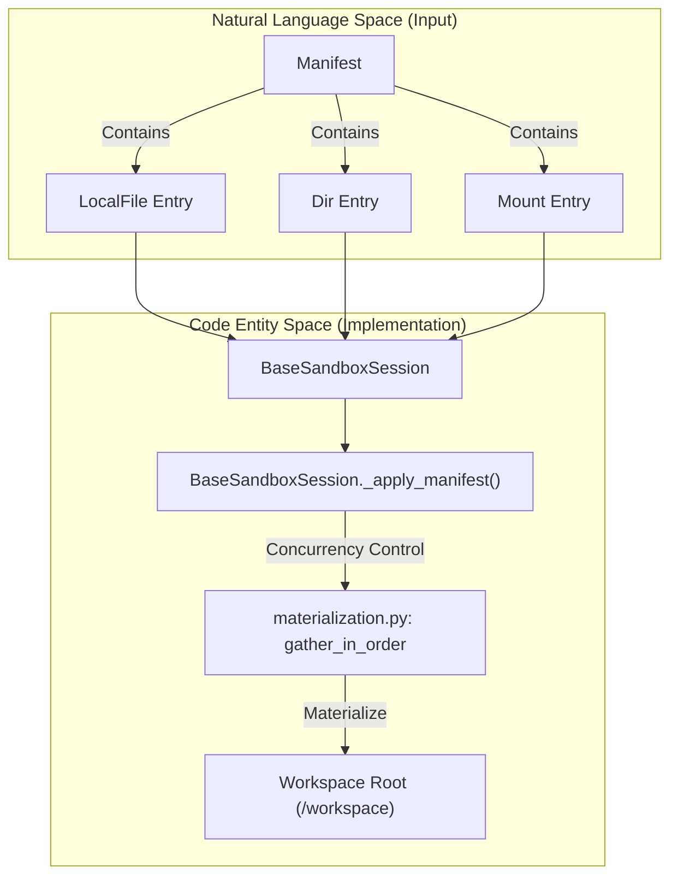
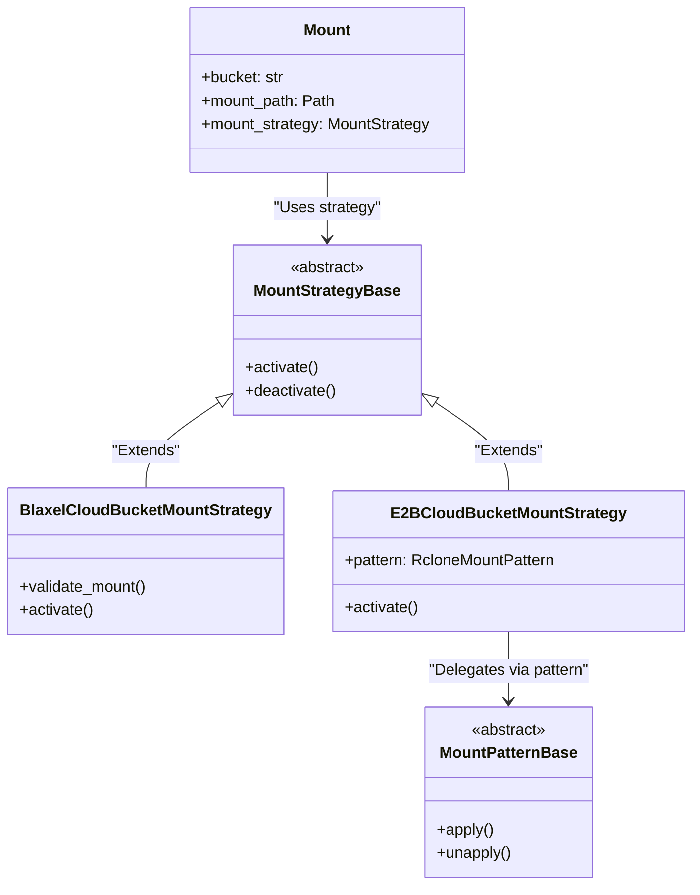
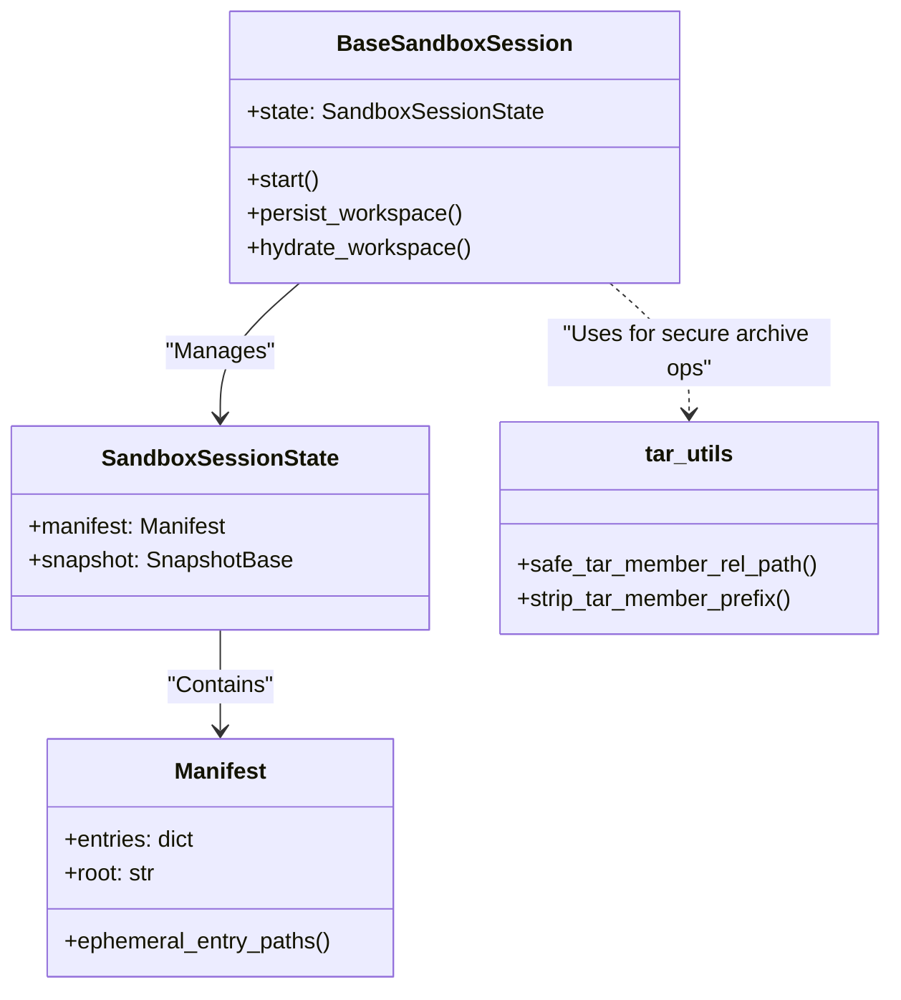

<!-- source: DeepWiki mcp.deepwiki.com · repo openai/openai-agents-python · page 16.4 Manifest and Workspace Setup · fetched 2026-10-26 -->

# Manifest and Workspace Setup

Relevant source files

The following files were used as context for generating this wiki page:

- [.agents/references/sandbox-runtime-boundary.md](.agents/references/sandbox-runtime-boundary.md)
- [src/agents/_public_agent.py](src/agents/_public_agent.py)
- [src/agents/extensions/sandbox/blaxel/mounts.py](src/agents/extensions/sandbox/blaxel/mounts.py)
- [src/agents/extensions/sandbox/daytona/mounts.py](src/agents/extensions/sandbox/daytona/mounts.py)
- [src/agents/extensions/sandbox/e2b/mounts.py](src/agents/extensions/sandbox/e2b/mounts.py)
- [src/agents/extensions/sandbox/vercel/__init__.py](src/agents/extensions/sandbox/vercel/__init__.py)
- [src/agents/extensions/sandbox/vercel/mounts.py](src/agents/extensions/sandbox/vercel/mounts.py)
- [src/agents/run_internal/agent_tool_configuration.py](src/agents/run_internal/agent_tool_configuration.py)
- [src/agents/sandbox/__init__.py](src/agents/sandbox/__init__.py)
- [src/agents/sandbox/entries/mounts/base.py](src/agents/sandbox/entries/mounts/base.py)
- [src/agents/sandbox/entries/mounts/patterns.py](src/agents/sandbox/entries/mounts/patterns.py)
- [src/agents/sandbox/manifest.py](src/agents/sandbox/manifest.py)
- [src/agents/sandbox/manifest_render.py](src/agents/sandbox/manifest_render.py)
- [src/agents/sandbox/runtime_agent_preparation.py](src/agents/sandbox/runtime_agent_preparation.py)
- [src/agents/sandbox/sandbox_agent.py](src/agents/sandbox/sandbox_agent.py)
- [src/agents/sandbox/sandboxes/_unix_local_files.py](src/agents/sandbox/sandboxes/_unix_local_files.py)
- [src/agents/sandbox/session/archive_extraction.py](src/agents/sandbox/session/archive_extraction.py)
- [src/agents/sandbox/session/archive_ops.py](src/agents/sandbox/session/archive_ops.py)
- [src/agents/sandbox/session/manifest_ops.py](src/agents/sandbox/session/manifest_ops.py)
- [src/agents/sandbox/session/runtime_helpers.py](src/agents/sandbox/session/runtime_helpers.py)
- [src/agents/sandbox/session/sandbox_client.py](src/agents/sandbox/session/sandbox_client.py)
- [src/agents/sandbox/session/tar_workspace.py](src/agents/sandbox/session/tar_workspace.py)
- [src/agents/sandbox/snapshot.py](src/agents/sandbox/snapshot.py)
- [src/agents/sandbox/util/tar_utils.py](src/agents/sandbox/util/tar_utils.py)
- [tests/extensions/sandbox/test_blaxel_mounts.py](tests/extensions/sandbox/test_blaxel_mounts.py)
- [tests/sandbox/test_extract.py](tests/sandbox/test_extract.py)
- [tests/sandbox/test_manifest.py](tests/sandbox/test_manifest.py)
- [tests/sandbox/test_manifest_config.py](tests/sandbox/test_manifest_config.py)
- [tests/sandbox/test_mounts.py](tests/sandbox/test_mounts.py)
- [tests/sandbox/test_recursive_removal_compatibility.py](tests/sandbox/test_recursive_removal_compatibility.py)
- [tests/sandbox/test_runtime_helpers.py](tests/sandbox/test_runtime_helpers.py)
- [tests/sandbox/test_session_state_roundtrip.py](tests/sandbox/test_session_state_roundtrip.py)
- [tests/sandbox/test_snapshot.py](tests/sandbox/test_snapshot.py)
- [tests/sandbox/test_tar_utils.py](tests/sandbox/test_tar_utils.py)
- [tests/sandbox/test_tar_workspace.py](tests/sandbox/test_tar_workspace.py)

The `Manifest` is the declarative configuration for a `SandboxAgent`'s execution environment. It defines the workspace layout, including files, directories, and external cloud mounts, as well as environment variables and capabilities required by the agent. This system ensures that an agent starts in a predictable state and can persist or resume work across sessions.

Sources: [src/agents/sandbox/manifest.py:1-33](), [src/agents/sandbox/sandbox_agent.py:30-43]()

## The Manifest Class

The `Manifest` class acts as a blueprint for the `SandboxRuntime`. It encapsulates everything the runtime needs to provision a workspace before the agent begins execution.

### Core Components of a Manifest

| Component | Description |
| :--- | :--- |
| **Entries** | A mapping of relative paths to `BaseEntry` objects (files, directories, mounts) to populate in the workspace. [src/agents/sandbox/manifest.py:19-23]() |
| **Root** | The base directory in the sandbox where entries are materialized (defaults to `/workspace`). [src/agents/sandbox/manifest.py:47-49]() |
| **Environment** | A dictionary of environment variables available to the shell and tools within the sandbox. [src/agents/sandbox/manifest.py:194-196]() |
| **Extra Path Grants** | Explicit permissions for the sandbox to access specific host paths during materialization. [src/agents/sandbox/sandboxes/_unix_local_files.py:27-38]() |

### Data Flow: Manifest to Workspace

The following diagram illustrates how a `Manifest` is processed by the session layer to materialize a functional workspace.

**Workspace Provisioning Flow**

Sources: [src/agents/sandbox/manifest.py:19-33](), [src/agents/sandbox/session/base_sandbox_session.py:1-49](), [tests/sandbox/test_mounts.py:43-49]()

## Workspace Entries and Mount Strategies

Workspace entries define how data is placed into the sandbox. All entries inherit from `BaseEntry`.

### File, Directory, and Mount Entries
- **`File` / `LocalFile`**: Represents files written directly or synced from the host. `LocalFile` computes SHA256 checksums to verify integrity. [tests/sandbox/test_manifest.py:11-20]()
- **`Dir` / `LocalDir`**: Represents directory structures supporting recursive copying and child mapping. [tests/sandbox/test_manifest.py:11-20]()
- **Cloud Mounts**: `S3Mount`, `GCSMount`, `AzureBlobMount`, `R2Mount`, and `BoxMount` connect external buckets via strategies like `InContainerMountStrategy` or extension-specific providers (e.g., `BlaxelCloudBucketMountStrategy`, `E2BCloudBucketMountStrategy`). [src/agents/sandbox/entries/__init__.py:1-34](), [src/agents/extensions/sandbox/blaxel/mounts.py:69-81](), [src/agents/extensions/sandbox/e2b/mounts.py:67-75]()

**Mount Strategy and Pattern Mapping**

Sources: [src/agents/extensions/sandbox/blaxel/mounts.py:69-105](), [src/agents/extensions/sandbox/e2b/mounts.py:67-79](), [src/agents/sandbox/entries/mounts/patterns.py:153-172]()

## Mount Security and Workspace Boundaries

Mount activation and runtime path resolution enforce strict security boundaries to prevent path traversal and unauthorized credential exposure.

- **Credential Boundaries**: `validate_mount_activation_credential_boundary()` checks that cloud mounts respect manifest-declared paths and avoid broad credential exposure [src/agents/extensions/sandbox/blaxel/mounts.py:90-96]().
- **Path Authorization**: `_UnixLocalFiles` and `WorkspacePathPolicy` authorize path access and validate recursive removals (`rm`) against extra path grants [src/agents/sandbox/sandboxes/_unix_local_files.py:19-48]().
- **Runtime Helper**: Shell scripts such as `_RESOLVE_WORKSPACE_PATH_SCRIPT` execute inside sandboxes to resolve symlinks and enforce grant roots safely [src/agents/sandbox/session/runtime_helpers.py:11-181]().

Sources: [src/agents/extensions/sandbox/blaxel/mounts.py:90-96](), [src/agents/sandbox/sandboxes/_unix_local_files.py:19-48](), [src/agents/sandbox/session/runtime_helpers.py:11-181]()

## Environment Variables

The `Environment` class manages sandbox environment variables, supporting simple strings, `EnvValue` subclasses (such as `StrEnvValue`), and `EnvEntry` objects with metadata like `ephemeral` flags [src/agents/sandbox/manifest.py:142-198]().

- **Resolution**: `EnvValue.resolve()` provides an asynchronous mechanism to resolve dynamic values or fetch secrets [src/agents/sandbox/manifest.py:85-91]().
- **Serialization**: Custom serializers retain subtype information using `_serialize_env_value_with_type` [src/agents/sandbox/manifest.py:150-164]().

Sources: [src/agents/sandbox/manifest.py:85-198]()

## Workspace Layout and Fingerprinting

The `Manifest` provides methods to render descriptions for LLM prompts and calculate workspace fingerprints.

- **Description Rendering**: `render_manifest_description()` generates a tree-like text representation of the workspace structure [src/agents/sandbox/manifest_render.py:1-58]().
- **Fingerprinting**: `_WORKSPACE_FINGERPRINT_SCRIPT` computes deterministic hashes of workspace contents, ignoring excluded paths and honoring manifest digests [src/agents/sandbox/session/runtime_helpers.py:183-243]().

Sources: [src/agents/sandbox/manifest_render.py:1-58](), [src/agents/sandbox/session/runtime_helpers.py:183-243]()

## Tar Utilities, Snapshot, and Resume

Workspace persistence relies heavily on tar archives, streaming snapshots, and secure extraction utilities.

- **Security Validation**: `safe_tar_member_rel_path()` checks tar entries against path traversal, absolute paths, windows drives, and unexpected symlinks [src/agents/sandbox/util/tar_utils.py:78-101]().
- **Prefix Stripping**: `strip_tar_member_prefix()` rewrites leading archive paths (such as `/tmp/stage/workspace/...`) to workspace-relative roots (`.`), enabling portable snapshots across different backend environments [src/agents/sandbox/util/tar_utils.py:103-125]().

**Snapshot and Resume Entity Map**

Sources: [src/agents/sandbox/util/tar_utils.py:78-125](), [tests/sandbox/test_tar_utils.py:77-105]()

---

