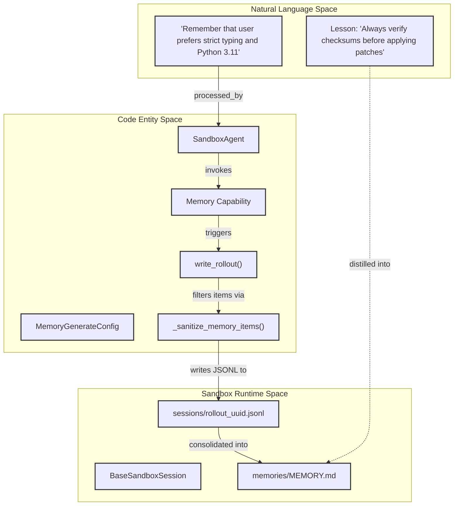
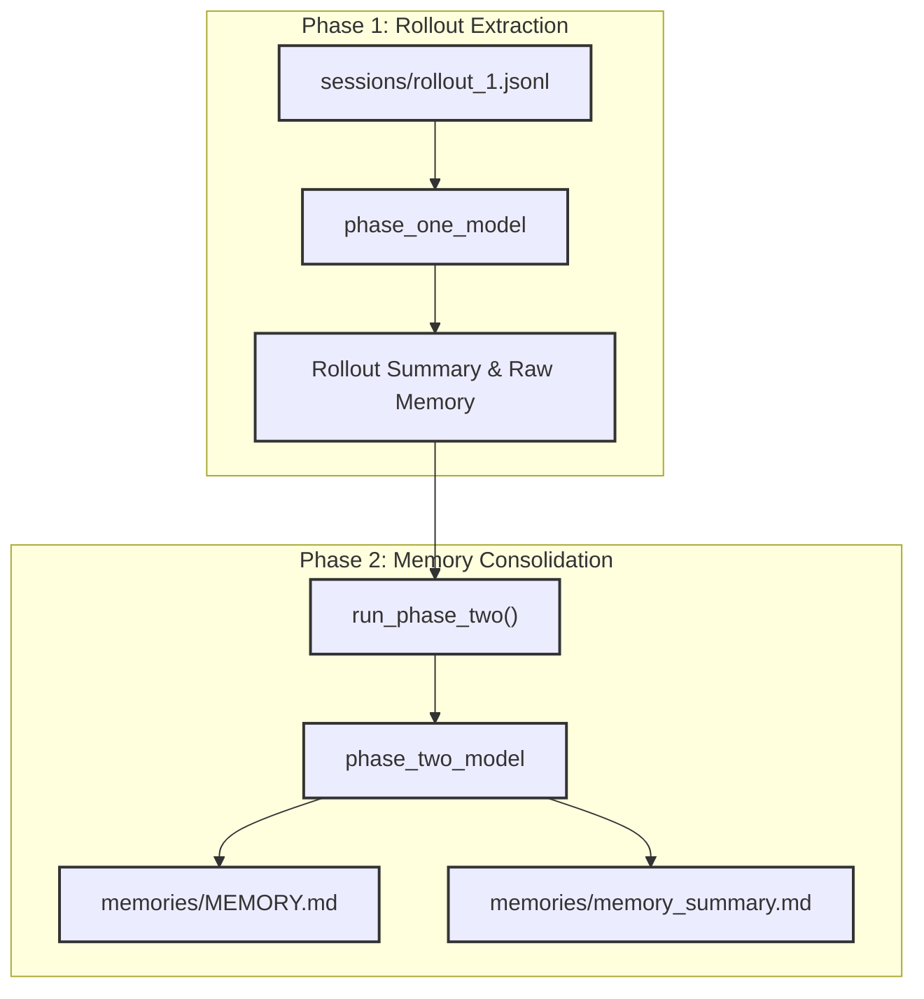
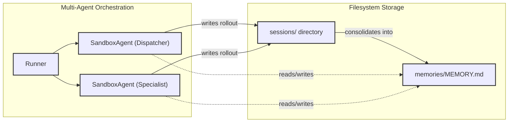

<!-- source: DeepWiki mcp.deepwiki.com · repo openai/openai-agents-python · page 16.5 Sandbox Memory · fetched 2026-10-26 -->

# Sandbox Memory

<details>
<summary>Relevant source files</summary>

The following files were used as context for generating this wiki page:

- [src/agents/sandbox/capabilities/skills.py](src/agents/sandbox/capabilities/skills.py)
- [src/agents/sandbox/config.py](src/agents/sandbox/config.py)
- [src/agents/sandbox/entries/artifacts.py](src/agents/sandbox/entries/artifacts.py)
- [src/agents/sandbox/memory/phase_two.py](src/agents/sandbox/memory/phase_two.py)
- [src/agents/sandbox/memory/rollouts.py](src/agents/sandbox/memory/rollouts.py)
- [src/agents/sandbox/memory/storage.py](src/agents/sandbox/memory/storage.py)
- [src/agents/sandbox/util/token_truncation.py](src/agents/sandbox/util/token_truncation.py)
- [tests/sandbox/capabilities/test_shell_capability.py](tests/sandbox/capabilities/test_shell_capability.py)
- [tests/sandbox/capabilities/test_skills_capability.py](tests/sandbox/capabilities/test_skills_capability.py)
- [tests/sandbox/test_entries.py](tests/sandbox/test_entries.py)
- [tests/sandbox/test_memory.py](tests/sandbox/test_memory.py)
- [tests/sandbox/test_run_cwd.py](tests/sandbox/test_run_cwd.py)
- [tests/sandbox/test_token_truncation.py](tests/sandbox/test_token_truncation.py)

</details>


## Purpose and Scope
Sandbox Memory provides long-term persistence for facts, user preferences, procedural lessons, and historical summaries across isolated `SandboxAgent` execution runs. This document details the memory capability architecture, configuration classes (`MemoryLayoutConfig`, `MemoryGenerateConfig`, `MemoryReadConfig`), rollout capture, two-phase consolidation, multi-agent memory partitioning, and token truncation policies.

---

## 1. Overview and Core Purpose

The memory subsystem bridges ephemeral sandbox executions and persistent knowledge storage. When an agent runs within a sandbox session, interaction histories are captured as session rollouts, processed into single-rollout extractions (Phase 1), and consolidated into permanent Markdown memory documents (Phase 2) stored in the workspace filesystem.

**Sources:**
- [src/agents/sandbox/config.py:27-139]()
- [src/agents/sandbox/memory/rollouts.py:105-139]()

---

## 2. Configuration Classes

Memory behavior is controlled via three primary configuration structures defined in `src/agents/sandbox/config.py` [src/agents/sandbox/config.py:27-139]():

- **`MemoryLayoutConfig`**: Defines filesystem locations for consolidated memories and per-session rollout artifacts [src/agents/sandbox/config.py:27-36]().
- **`MemoryGenerateConfig`**: Controls rollout thresholds, models, model settings, extra developer prompts, and turn limits for background consolidation [src/agents/sandbox/config.py:38-133]().
- **`MemoryReadConfig`**: Governs live updates of stale memory files during agent execution [src/agents/sandbox/config.py:134-139]().

| Configuration Class | Key Attributes | Default Value / Constraints |
| :--- | :--- | :--- |
| `MemoryLayoutConfig` | `memories_dir`, `sessions_dir` | `"memories"`, `"sessions"` [src/agents/sandbox/config.py:30-34]() |
| `MemoryGenerateConfig` | `max_raw_memories_for_consolidation`, `phase_one_model`, `phase_two_model`, `phase_two_max_turns` | `256`, `"gpt-5.4-mini"`, `"gpt-5.5"`, `505` [src/agents/sandbox/config.py:45-84]() |
| `MemoryReadConfig` | `live_update` | `True` [src/agents/sandbox/config.py:138-139]() |

```python
from agents.sandbox import MemoryLayoutConfig, MemoryGenerateConfig, MemoryReadConfig

layout_config = MemoryLayoutConfig(memories_dir="memories", sessions_dir="sessions")
generate_config = MemoryGenerateConfig(max_raw_memories_for_consolidation=256)
read_config = MemoryReadConfig(live_update=True)
```

**Sources:**
- [src/agents/sandbox/config.py:27-139]()
- [tests/sandbox/test_memory.py:154-175]()

---

## 3. Data Flow and Rollout Management

Session rollouts are recorded at the termination of each run. The `write_rollout()` function serializes interaction items into JSONL files inside the designated sessions directory [src/agents/sandbox/memory/rollouts.py:105-139](). System messages, developer prompts, and reasoning items are filtered out via `_sanitize_memory_items()` [src/agents/sandbox/memory/rollouts.py:88-102]().

### Natural Language to Code Entity Mapping



**Sources:**
- [src/agents/sandbox/memory/rollouts.py:88-139]()
- [src/agents/sandbox/session/base_sandbox_session.py:38-68]()

---

## 4. Two-Phase Consolidation Lifecycle

Memory consolidation occurs when accumulated raw memories reach the threshold configured in `MemoryGenerateConfig.max_raw_memories_for_consolidation` [src/agents/sandbox/config.py:45-46]().

1. **Phase One (Extraction)**: The `phase_one_model` parses individual rollout records to extract a rollout summary and raw memory snippet [src/agents/sandbox/memory/phase_one.py:32-37]().
2. **Phase Two (Consolidation)**: `run_phase_two()` invokes a dedicated consolidation agent using `phase_two_model` and `phase_two_model_settings` to update `memories/MEMORY.md` and summary files [src/agents/sandbox/memory/phase_two.py:10-37]().



**Sources:**
- [src/agents/sandbox/memory/phase_two.py:10-37]()
- [src/agents/sandbox/memory/prompts.py:62-63]()

---

## 5. Multi-Agent Memory Layouts

In multi-agent workflows, memory partitioning determines whether agents share a common knowledge base or maintain isolated storage pools [src/agents/sandbox/capabilities/memory.py:49-65]().

- **Shared Memory**: Multiple agents read and write to the same root memory file (`memories/MEMORY.md`), allowing triage agents to record user preferences that downstream specialist agents inherit.
- **Isolated Memory**: Partitioned by agent identifier, keeping specialized lessons scoped to individual agent roles.



**Sources:**
- [src/agents/sandbox/capabilities/memory.py:49-65]()
- [src/agents/sandbox/memory/rollouts.py:209-225]()

---

## 6. Token Truncation and Policy Enforcement

To prevent oversized memory snippets or tool outputs from overwhelming model context windows, the sandbox memory utilities implement deterministic token truncation [src/agents/sandbox/util/token_truncation.py:12-33]().

The `TruncationPolicy` class supports both byte and token limits [src/agents/sandbox/util/token_truncation.py:12-33]():

```python
@dataclass(frozen=True)
class TruncationPolicy:
    mode: TruncationMode  # "bytes" or "tokens"
    limit: int
```

- **`TruncationPolicy.bytes(limit)`**: Enforces strict byte budgets [src/agents/sandbox/util/token_truncation.py:17-19]().
- **`TruncationPolicy.tokens(limit)`**: Enforces token budgets using approximate byte conversions (`APPROX_BYTES_PER_TOKEN = 4`) [src/agents/sandbox/util/token_truncation.py:6-23]().
- **`formatted_truncate_text()`**: Prepends line counts and appends structured truncation markers (e.g., `…X tokens truncated…`) when thresholds are exceeded [src/agents/sandbox/util/token_truncation.py:39-48]().

**Sources:**
- [src/agents/sandbox/util/token_truncation.py:12-33]()
- [src/agents/sandbox/util/token_truncation.py:39-48]()
- [tests/sandbox/test_token_truncation.py:20-30]()

---

