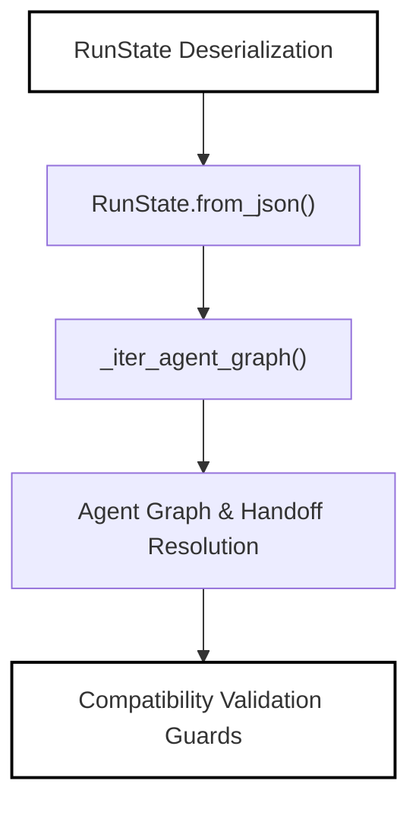
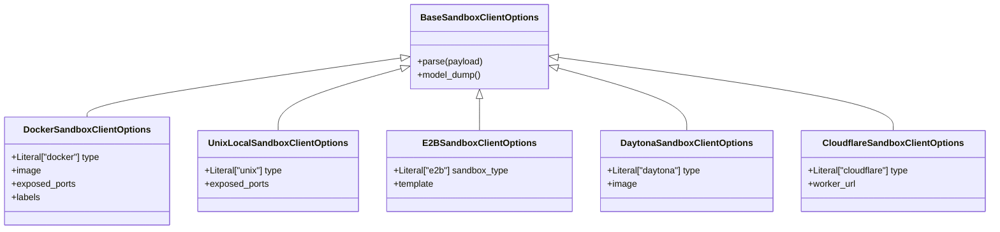
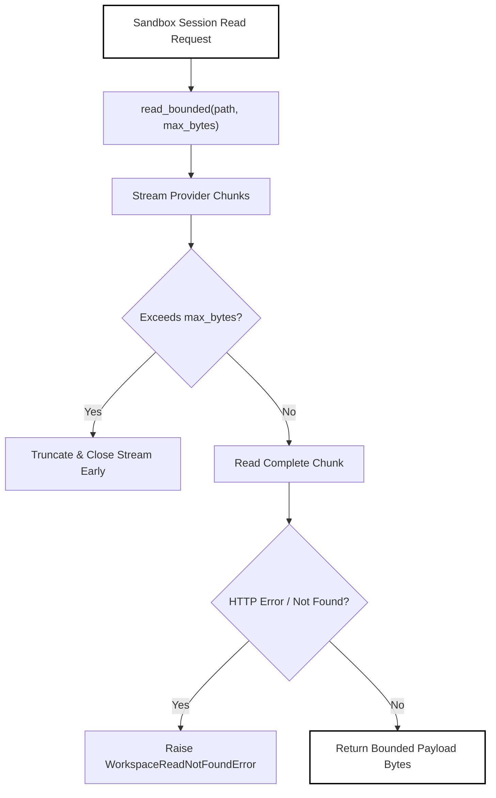
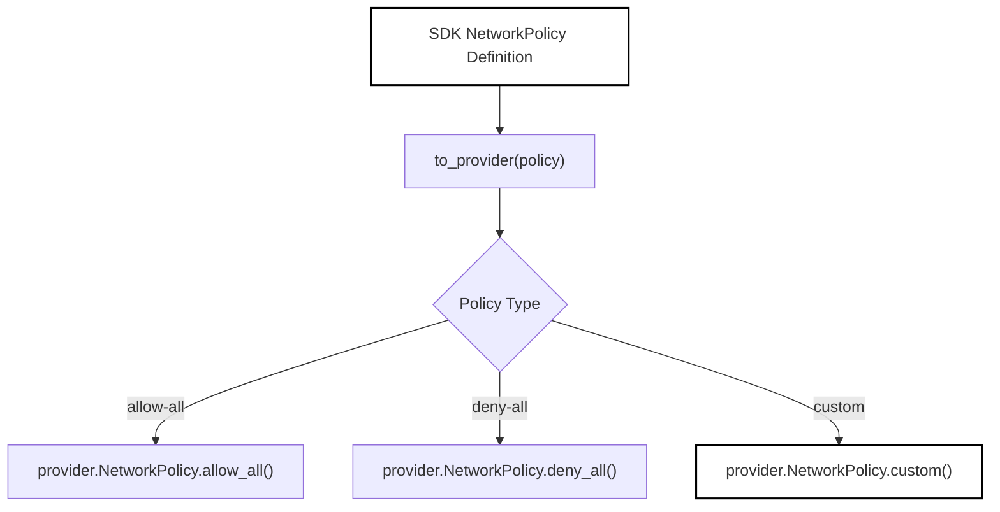
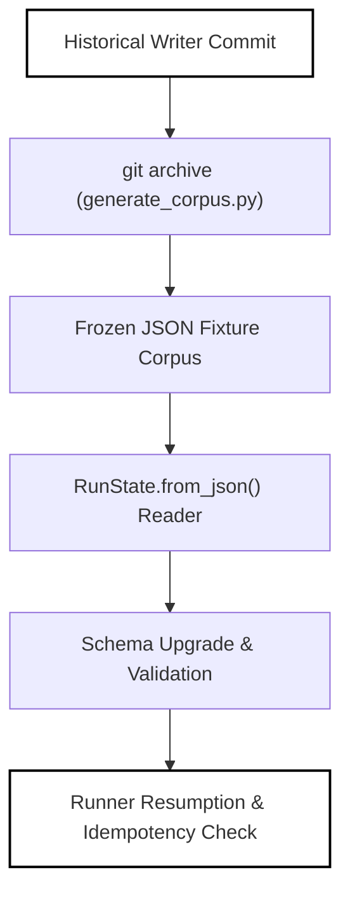

<!-- source: DeepWiki mcp.deepwiki.com · repo openai/openai-agents-python · page 16.6 Sandbox Compatibility and Guards · fetched 2026-10-26 -->

# Sandbox Compatibility and Guards

Relevant source files

The following files were used as context for generating this wiki page:

- [integration_tests/packaging/test_released_api_contract.py](integration_tests/packaging/test_released_api_contract.py)
- [src/agents/_run_state_agent_identity.py](src/agents/_run_state_agent_identity.py)
- [src/agents/extensions/sandbox/vercel/_network_policy.py](src/agents/extensions/sandbox/vercel/_network_policy.py)
- [src/agents/extensions/sandbox/vercel/_provider.py](src/agents/extensions/sandbox/vercel/_provider.py)
- [tests/extensions/sandbox/test_vercel_provider_contract.py](tests/extensions/sandbox/test_vercel_provider_contract.py)
- [tests/fixtures/run_state/README.md](tests/fixtures/run_state/README.md)
- [tests/fixtures/run_state/features/v1_17_docker_labels.json](tests/fixtures/run_state/features/v1_17_docker_labels.json)
- [tests/fixtures/run_state/features/v1_20_tool_output_guardrail_boundary.json](tests/fixtures/run_state/features/v1_20_tool_output_guardrail_boundary.json)
- [tests/fixtures/run_state/generate_corpus.py](tests/fixtures/run_state/generate_corpus.py)
- [tests/fixtures/run_state/minimal/v1_17.json](tests/fixtures/run_state/minimal/v1_17.json)
- [tests/fixtures/run_state/minimal/v1_20.json](tests/fixtures/run_state/minimal/v1_20.json)
- [tests/fixtures/run_state/sources.json](tests/fixtures/run_state/sources.json)
- [tests/sandbox/test_bounded_read.py](tests/sandbox/test_bounded_read.py)
- [tests/sandbox/test_client_options.py](tests/sandbox/test_client_options.py)
- [tests/sandbox/test_compatibility_guards.py](tests/sandbox/test_compatibility_guards.py)
- [tests/test_run_state_hook_identity.py](tests/test_run_state_hook_identity.py)

## Purpose and Scope
This page details the compatibility guards, bounded read safety measures, client option validation mechanisms, provider contracts, and the `RunState` fixture corpus governing isolated sandbox workspace executions in the OpenAI Agents SDK. It describes how the SDK guarantees backward compatibility across schema upgrades, validates runtime client configurations, safely handles stream-based workspace file reads without memory exhaustion, and verifies provider contract conformance.

---

## 1. Compatibility Guards and Public Surface Stability
The sandbox package enforces strict public export stability and agent identity tracking to ensure that serialized sessions can be safely resumed across SDK versions [tests/sandbox/test_compatibility_guards.py:92-129](). 

The agent graph structure and stable identifiers are constructed using graph traversal utilities that map agent references, handoffs, and agent-as-tool wrappers [src/agents/_run_state_agent_identity.py:30-106](). When restoring a `RunState`, compatibility guards verify that object graphs and hook configurations do not break execution semantics or approval ownership [tests/test_run_state_hook_identity.py:1-10]().

*Diagram 1: Compatibility Guard and Agent Graph Resolution Flow*

Sources: `tests/sandbox/test_compatibility_guards.py`, `src/agents/_run_state_agent_identity.py`, `tests/test_run_state_hook_identity.py`

---

## 2. Client Option Validation and Type Dispatch
Client options across different sandbox execution environments (such as Docker, Unix local, E2B, Daytona, Cloudflare, and Modal) are managed through a unified parsing layer in `BaseSandboxClientOptions` [tests/sandbox/test_client_options.py:16-51](). 

Subclasses must define a unique string discriminator for `type`, enabling robust polymorphic payload parsing, round-trip serialization, and strict rejection of unregistered or malformed options [tests/sandbox/test_client_options.py:101-125]().

*Diagram 2: Sandbox Client Options Polymorphic Architecture*

Sources: `tests/sandbox/test_client_options.py`

---

## 3. Bounded Read Implementations and Error Boundaries
To protect sandbox memory and handle large files or streams safely, sandbox sessions implement `read_bounded()` [tests/sandbox/test_bounded_read.py:143-154](). This method enforces strict byte limits, guarantees stream closure upon reaching limits or exceptions, and intercepts synthetic private responses or missing file errors [tests/sandbox/test_bounded_read.py:156-177](). 

When remote files or archive reads encounter errors or missing paths, `read_bounded()` raises `WorkspaceArchiveReadError` or `WorkspaceReadNotFoundError` without leaking raw response bodies or internal exceptions [tests/sandbox/test_bounded_read.py:158-166]().

*Diagram 3: Bounded Read Data Flow and Error Boundary*

Sources: `tests/sandbox/test_bounded_read.py`

---

## 4. Provider Contracts and Network Policy Translation
Cloud and container sandbox extensions interface with external provider SDKs via isolated translation layers [src/agents/extensions/sandbox/vercel/_network_policy.py:11-61](). For instance, the Vercel network policy translator converts SDK-agnostic configuration models (`NetworkPolicyCustom`, `NetworkPolicySubnets`) into native provider objects (`provider.NetworkPolicy`) [src/agents/extensions/sandbox/vercel/_network_policy.py:32-61](). 

Provider contract tests ensure that serialization roundtrips and policy payloads match the expected integration contract without exposing underlying driver shifts [integration_tests/packaging/test_released_api_contract.py:10-137]().

*Diagram 4: Network Policy Translation Pipeline*

Sources: `src/agents/extensions/sandbox/vercel/_network_policy.py`, `integration_tests/packaging/test_released_api_contract.py`

---

## 5. RunState Corpus and Upgrade Fixtures
The SDK maintains a rigorous backward compatibility test suite backed by a `RunState` fixture corpus located under `tests/fixtures/run_state/` [tests/fixtures/run_state/README.md:1-15](). 

The corpus consists of:
* `minimal/` fixtures covering every schema version accepted by current readers [tests/fixtures/run_state/README.md:3]().
* `features/` fixtures capturing schema-bearing behaviors introduced across versions `1.2` through `1.20` [tests/fixtures/run_state/README.md:3]().
* `resume/` and `security/` fixtures verifying pending tool approvals and sandbox credential serialization policies [tests/fixtures/run_state/README.md:3]().

Fixtures are managed via `sources.json` which tracks provenance, git commits, and generator metadata [tests/fixtures/run_state/sources.json:1-167](). Ordinary tests read frozen payloads, upgrade them to the current schema, and verify idempotency and resume accuracy [tests/fixtures/run_state/README.md:15]().

*Diagram 5: RunState Corpus Generation and Compatibility Validation*

Sources: `tests/fixtures/run_state/README.md`, `tests/fixtures/run_state/generate_corpus.py`, `tests/fixtures/run_state/sources.json`

---

