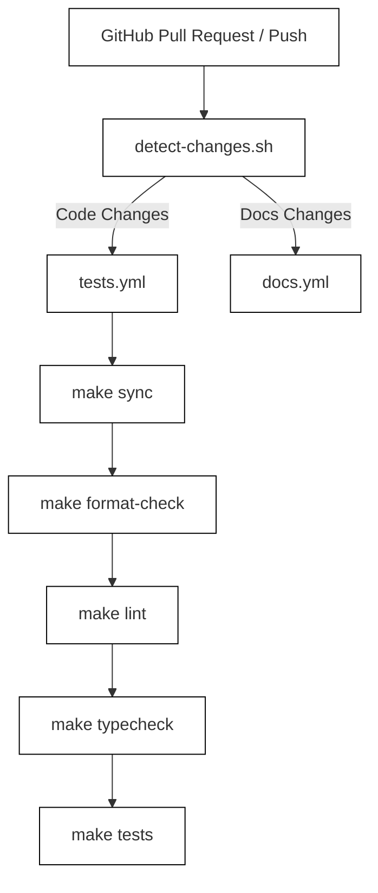
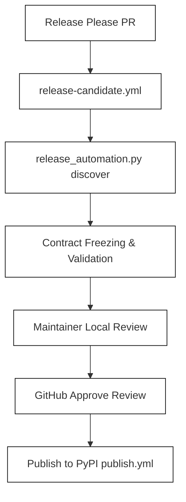

<!-- source: DeepWiki mcp.deepwiki.com · repo openai/openai-agents-python · page 17 Development, CI, and Release Process · fetched 2026-10-26 -->

# Development, CI, and Release Process

Relevant source files

The following files were used as context for generating this wiki page:

- [.github/RELEASING.md](.github/RELEASING.md)
- [.github/scripts/detect-changes.sh](.github/scripts/detect-changes.sh)
- [.github/scripts/release_automation.py](.github/scripts/release_automation.py)
- [.github/scripts/run_integration_tests.py](.github/scripts/run_integration_tests.py)
- [.github/workflows/docs.yml](.github/workflows/docs.yml)
- [.github/workflows/publish.yml](.github/workflows/publish.yml)
- [.github/workflows/release-candidate.yml](.github/workflows/release-candidate.yml)
- [.github/workflows/release-please.yml](.github/workflows/release-please.yml)
- [.github/workflows/release-readiness-refresh.yml](.github/workflows/release-readiness-refresh.yml)
- [.github/workflows/release-readiness.yml](.github/workflows/release-readiness.yml)
- [.github/workflows/tests.yml](.github/workflows/tests.yml)
- [Makefile](Makefile)
- [examples/hosted_mcp/human_in_the_loop.py](examples/hosted_mcp/human_in_the_loop.py)
- [examples/hosted_mcp/on_approval.py](examples/hosted_mcp/on_approval.py)
- [integration_tests/README.md](integration_tests/README.md)
- [integration_tests/conftest.py](integration_tests/conftest.py)
- [integration_tests/hosted/test_mcp.py](integration_tests/hosted/test_mcp.py)
- [integration_tests/packaging/test_provider_selection.py](integration_tests/packaging/test_provider_selection.py)
- [integration_tests/providers/test_any_llm.py](integration_tests/providers/test_any_llm.py)
- [integration_tests/providers/test_litellm.py](integration_tests/providers/test_litellm.py)
- [integration_tests/pytest.ini](integration_tests/pytest.ini)
- [release-please-config.json](release-please-config.json)
- [tests/test_change_detection.py](tests/test_change_detection.py)
- [tests/test_integration_runner.py](tests/test_integration_runner.py)
- [tests/test_release_automation.py](tests/test_release_automation.py)
- [tests/test_release_please.py](tests/test_release_please.py)
- [tests/test_repository_workflow_interfaces.py](tests/test_repository_workflow_interfaces.py)

## Purpose and Scope

This wiki page provides a high-level overview of the development, continuous integration (CI), testing, documentation, and release processes for the OpenAI Agents Python repository. The repository relies on `uv` for dependency management [.github/workflows/tests.yml:16-17] and `Makefile` [Makefile:1-215] targets combined with GitHub Actions workflows [.github/workflows/tests.yml:1-176] to enforce strict code quality, type safety, test coverage, and trusted release automation [.github/workflows/publish.yml:1-178]. 

As a parent page, this document outlines the overarching architecture of the development pipeline. For in-depth technical details, consult the following child pages:
- [Testing and Integration Tests](#17.1)
- [CI/CD and Release Automation](#17.2)
- [Public API Contract](#17.3)
- [Documentation and Translations](#17.4)
- [Agent Skills and Maintainer Workflows](#17.5)

---

## CI Architecture and Change Detection

The CI infrastructure is driven by modular GitHub Actions workflows [.github/workflows/tests.yml:1-176] that optimize resource utilization by selectively running checks based on detected file modifications [._github/scripts/detect-changes.sh:1-102]. The `.github/scripts/detect-changes.sh` script evaluates git diffs to determine whether code, tests, or documentation have changed, skipping redundant pipeline jobs [.github/workflows/tests.yml:25-47].

*Figure 1: CI Pipeline and Change Detection Architecture mapping workflow execution to repository verification scripts.*

Sources: [.github/workflows/tests.yml:1-47](), [.github/scripts/detect-changes.sh:1-101]()

---

## 17.1 Testing and Integration Tests

The test suite is structured into unit tests located under `tests/` and comprehensive integration suites located under `integration_tests/` [Makefile:169-204]. Test execution is managed via `Makefile` targets, supporting parallel execution via `pytest-xdist` (`make tests-parallel`), serial tests (`make tests-serial`), and asynchronous teardown stability checks (`make tests-asyncio-stability`) [Makefile:68-94].

Integration suites are organized by functional profiles (such as `core`, `providers`, `hosted`, `packaging`, `security`, and `containers`) and are orchestrated through `.github/scripts/run_integration_tests.py` [Makefile:130-172]. Containerized tests utilize `testcontainers` without requiring direct host Docker CLI interactions [tests/test_repository_workflow_interfaces.py:162-167].

For details, see [Testing and Integration Tests](#17.1).

Sources: [Makefile:68-204](), [.github/scripts/run_integration_tests.py:1-57]()

---

## 17.2 CI/CD and Release Automation

Releases are coordinated via Release Please and automated validation pipelines [.github/workflows/release-candidate.yml:1-123]. The release architecture ensures that source provenance is verified, API contracts are frozen, and maintainers review changes locally before publishing [._github/RELEASING.md:1-102]. 

*Figure 2: Release Automation Pipeline mapping GitHub workflows and release orchestration scripts to OIDC PyPI publishing.*

The `.github/scripts/release_automation.py` script governs candidate discovery, atomic contract writing, and publication verification [._github/scripts/release_automation.py:1-190]. Trusted publishing via OIDC is configured in `.github/workflows/publish.yml` [.github/workflows/publish.yml:126-159].

For details, see [CI/CD and Release Automation](#17.2).

Sources: [.github/workflows/publish.yml:126-159](), [.github/workflows/release-candidate.yml:1-122](), [.github/scripts/release_automation.py:1-190](), [.github/RELEASING.md:1-101]()

---

## 17.3 Public API Contract

Public API stability is strictly maintained across releases by tracking exported symbols and signatures in the `tests/fixtures/released_api_contract.json` fixture [.github/workflows/release-candidate.yml:84]. During release preparation, `Makefile` targets (`make update-released-api-contract` and `make check-released-api-contract`) verify that prospective code changes do not introduce unintended breaking changes or public surface modifications [Makefile:9-18].

For details, see [Public API Contract](#17.3).

Sources: [Makefile:9-18](), [.github/workflows/release-candidate.yml:72-85]()

---

## 17.4 Documentation and Translations

Documentation is built using `MkDocs` with custom ref generation scripts located under `docs/scripts/` [tests/test_change_detection.py:127]. Localized documentation for Japanese, Korean, and Chinese (`ja`/`ko`/`zh`) is maintained alongside English documentation. Automated deployment is handled by `.github/workflows/docs.yml` when changes occur in the `docs/` directory or `mkdocs.yml` [.github/workflows/docs.yml:1-96].

For details, see [Documentation and Translations](#17.4).

Sources: [.github/workflows/docs.yml:1-95](), [tests/test_change_detection.py:127]()

---

## 17.5 Agent Skills and Maintainer Workflows

The repository includes standardized agent skills under `.agents/skills/` [tests/test_repository_workflow_interfaces.py:21] to assist AI contributors and maintainers with tasks such as maintainer code review, implementation strategy planning, release candidate preparation, and code change verification [tests/test_repository_workflow_interfaces.py:47-68]. These skills adhere to strict safety boundaries and read-only analysis protocols [tests/test_repository_workflow_interfaces.py:59-68].

For details, see [Agent Skills and Maintainer Workflows](#17.5).

Sources: [tests/test_repository_workflow_interfaces.py:21-68]()

---

