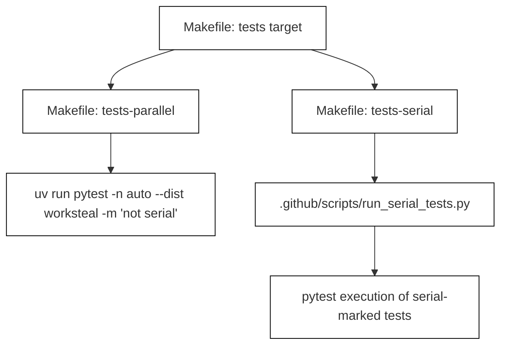

<!-- source: DeepWiki mcp.deepwiki.com · repo openai/openai-agents-python · page 17.1 Testing and Integration Tests · fetched 2026-10-26 -->

# Testing and Integration Tests

<details>
<summary>Relevant source files</summary>

The following files were used as context for generating this wiki page:

- [.github/scripts/run_examples.sh](.github/scripts/run_examples.sh)
- [.github/scripts/run_integration_tests.py](.github/scripts/run_integration_tests.py)
- [.github/scripts/run_serial_tests.py](.github/scripts/run_serial_tests.py)
- [.github/scripts/update_released_api_contract.py](.github/scripts/update_released_api_contract.py)
- [Makefile](Makefile)
- [examples/hosted_mcp/human_in_the_loop.py](examples/hosted_mcp/human_in_the_loop.py)
- [examples/hosted_mcp/on_approval.py](examples/hosted_mcp/on_approval.py)
- [examples/sandbox/extensions/README.md](examples/sandbox/extensions/README.md)
- [integration_tests/README.md](integration_tests/README.md)
- [integration_tests/_contract_support.py](integration_tests/_contract_support.py)
- [integration_tests/conftest.py](integration_tests/conftest.py)
- [integration_tests/hosted/test_mcp.py](integration_tests/hosted/test_mcp.py)
- [integration_tests/packaging/test_provider_selection.py](integration_tests/packaging/test_provider_selection.py)
- [integration_tests/providers/test_any_llm.py](integration_tests/providers/test_any_llm.py)
- [integration_tests/providers/test_litellm.py](integration_tests/providers/test_litellm.py)
- [integration_tests/pytest.ini](integration_tests/pytest.ini)
- [src/agents/extensions/sandbox/__init__.py](src/agents/extensions/sandbox/__init__.py)
- [src/agents/sandbox/session/sinks.py](src/agents/sandbox/session/sinks.py)
- [tests/README.md](tests/README.md)
- [tests/conftest.py](tests/conftest.py)
- [tests/fixtures/released_api_contract_policy.json](tests/fixtures/released_api_contract_policy.json)
- [tests/sandbox/test_session_sinks.py](tests/sandbox/test_session_sinks.py)
- [tests/test_integration_runner.py](tests/test_integration_runner.py)
- [tests/test_released_api_contract.py](tests/test_released_api_contract.py)
- [tests/test_run_serial_tests.py](tests/test_run_serial_tests.py)
- [tests/test_test_environment.py](tests/test_test_environment.py)

</details>


## Purpose and Scope
This page details the testing and integration test architecture of the `openai-agents-python` repository. It covers the unit test layout under `tests/`, global `pytest` configurations and fixtures in `tests/conftest.py`, `Makefile` targets for development and CI, parallel versus serial test execution (`pytest-xdist` and `.github/scripts/run_serial_tests.py`), and the comprehensive integration test suites located under `integration_tests/` managed by `.github/scripts/run_integration_tests.py`.

---

## 1. Unit Test Layout and Pytest Configuration (`tests/`)
The unit test suite resides in the `tests/` directory [tests/README.md:1-49](). Provider-neutral agent workflows leverage `ScriptedModel` from `agents.testing` [tests/README.md:7-8](). Test behaviors are engineered to be deterministic, avoiding real network calls or sleeps unless testing precise timing semantics [tests/README.md:27-31]().

Pytest configuration and environment hooks are centralized in `tests/conftest.py` [tests/conftest.py:1-141](). Key fixture lifecycle management includes:
- **Proxy Isolation**: Removes ambient proxy environment variables (`HTTP_PROXY`, etc.) unless `OPENAI_AGENTS_TEST_USE_PROXY` is enabled [tests/conftest.py:18-44]().
- **Trace Span Processors**: Registers `SPAN_PROCESSOR_TESTING` via `DefaultTraceProvider` during session setup and clears/flushes them between tests [tests/conftest.py:88-113]().
- **API Key Fallback**: Ensures a dummy `OPENAI_API_KEY` exists so clients can instantiate without explicit keys [tests/conftest.py:101-105]().
- **State Resets**: Resets global singleton settings (`_openai_shared._default_openai_key`, `_openai_shared._default_openai_client`, default runner) [tests/conftest.py:116-127]().
- **Model Client Guard**: Unless marked with `allow_call_model_methods`, `OpenAIResponsesModel` and `OpenAIChatCompletionsModel` methods (`get_response`, `stream_response`) are stubbed out to fail if real model calls are attempted [tests/conftest.py:130-141]().

```mermaid
graph TD
    subcode [Natural Language Space: Test Initialization]
    subcode --> TestExecutionEngine["Pytest Execution Engine"]
    TestExecutionEngine --> ConftestSetup["tests/conftest.py setup_span_processor()"]
    ConftestSetup --> TraceProvider["DefaultTraceProvider"]
    TraceProvider --> SpanProc["SPAN_PROCESSOR_TESTING"]
    TestExecutionEngine --> SafetyGuards["disable_real_model_clients()"]
    SafetyGuards --> FailMock["OpenAIResponsesModel.get_response -> pytest.fail()"]

    style TestExecutionEngine fill:#fff,stroke:#000,stroke-width:1px
    style ConftestSetup fill:#fff,stroke:#000,stroke-width:1px
    style TraceProvider fill:#fff,stroke:#000,stroke-width:1px
    style SpanProc fill:#fff,stroke:#000,stroke-width:1px
    style SafetyGuards fill:#fff,stroke:#000,stroke-width:1px
    style FailMock fill:#fff,stroke:#000,stroke-width:1px
```
*Figure 1: Pytest Configuration and Guard Initialization Flow.*

Sources: `tests/README.md`, `tests/conftest.py`

---

## 2. Makefile Targets and Execution Flow
The root `Makefile` defines standard developer workflows for testing, formatting, linting, typechecking, and running integration suites [Makefile:1-215](). 

### Key Test Makefile Targets
- `make tests`: Executes parallel tests followed by serial tests [Makefile:68-71]().
- `make tests-parallel`: Runs `pytest` using `pytest-xdist` with automatic workers or `PYTEST_XDIST_AUTO_NUM_WORKERS`, allocating work via worksteal and excluding the `serial` marker [Makefile:84-87]().
- `make tests-serial`: Invokes `.github/scripts/run_serial_tests.py` to execute tests requiring exclusive access [Makefile:92-94]().
- `make tests-review`: Runs subset testing excluding `review_optional` markers [Makefile:72-75, 88-91]().
- `make coverage`: Runs `coverage run -m pytest` with an 85% threshold check [Makefile:205-210]().


*Figure 2: Makefile Test Target Execution Architecture.*

Sources: `Makefile`

---

## 3. Serial and Parallel Test Runners
Tests requiring exclusive process-wide state, shared external resources, or timing-sensitive lifecycle boundaries are marked with `@pytest.mark.serial` [tests/README.md:13-16](). 

- **Parallel Runner (`pytest-xdist`)**: Distributed across multiple worker processes using workstealing [Makefile:86](). It safely executes shard-safe unit tests [tests/README.md:36]().
- **Serial Runner (`run_serial_tests.py`)**: Gathers and runs tests specifically flagged as `serial` sequentially after xdist workers have exited [tests/README.md:13](). This ensures process-wide resources, monkeypatched environment variables, or registry states do not collide across concurrent worker processes.

Sources: `Makefile`, `tests/README.md`

---

## 4. Integration Tests Suites (`integration_tests/`)
Integration testing handles higher-level contracts, packaged distributions, containerized environments, and live provider checks. Profiles are defined and managed through `.github/scripts/run_integration_tests.py` [.github/scripts/run_integration_tests.py:1-171]().

### Integration Profiles
Profiles enforce specific credential and environment classes via `PROFILE_CREDENTIAL_CLASSES` [.github/scripts/run_integration_tests.py:36-53]():
- **`packaging`**: Validates built wheels, sdists, and optional dependencies [.github/scripts/run_integration_tests.py:37]().
- **`containers`**: Runs tests requiring container backends (e.g., testcontainers) [.github/scripts/run_integration_tests.py:40]().
- **`security`**: Executes security-boundary and policy suites [.github/scripts/run_integration_tests.py:41]().
- **`hosted`**: Tests OpenAI-hosted capabilities and endpoints [.github/scripts/run_integration_tests.py:48]().
- **`providers`**: Verifies external and multi-provider compatibility (`litellm`, `any-llm`) [.github/scripts/run_integration_tests.py:45]().
- **`core` / `full` / `release` / `nightly`**: Comprehensive test sweeps running against live APIs [.github/scripts/run_integration_tests.py:44-52]().

```mermaid
graph TD
    subcodeSpace [Natural Language Space: Integration Suite Orchestration]
    subcodeSpace --> RunnerScript[".github/scripts/run_integration_tests.py"]
    RunnerScript --> ParseArgs["parse_args()"]
    ParseArgs --> ProfileCheck["prepare_profile_environment()"]
    ProfileCheck --> CredentialVerify{{"Credential Class Validation"}}
    CredentialVerify -->|Live Profile| LiveCheck["Require OPENAI_API_KEY_SOURCE=service-account"]
    CredentialVerify -->|Local-Only Profile| LocalCheck["Sanitize/Pop OPENAI_API_KEY"]
    LiveCheck --> UvBootstrap["bootstrap_in_uv()"]
    LocalCheck --> UvBootstrap
    UvBootstrap --> SubprocessRun["uv run python run_integration_tests.py"]

    style RunnerScript fill:#fff,stroke:#000,stroke-width:1px
    style ParseArgs fill:#fff,stroke:#000,stroke-width:1px
    style ProfileCheck fill:#fff,stroke:#000,stroke-width:1px
    style CredentialVerify fill:#fff,stroke:#000,stroke-width:1px
    style LiveCheck fill:#fff,stroke:#000,stroke-width:1px
    style LocalCheck fill:#fff,stroke:#000,stroke-width:1px
    style UvBootstrap fill:#fff,stroke:#000,stroke-width:1px
    style SubprocessRun fill:#fff,stroke:#000,stroke-width:1px
```
*Figure 3: Integration Runner Bootstrapping and Credential Validation Architecture.*

Sources: `.github/scripts/run_integration_tests.py`, `tests/test_integration_runner.py`

---

## 5. Container and Environment Runners
To ensure isolation during packaging and platform validation, integration profiles dictate strict handling of ambient credentials [.github/scripts/run_integration_tests.py:78-136]():

- **Live Credential Class**: Requires `OPENAI_API_KEY_SOURCE=service-account` to be set in the environment before execution begins, raising a `RuntimeError` otherwise [.github/scripts/run_integration_tests.py:91-97]().
- **Local-Only Credential Class**: Automatically purges `OPENAI_API_KEY` from the environment prior to spawning `uv` subprocesses or building package artifacts [.github/scripts/run_integration_tests.py:98-99, 139-162]().
- **Platform Agnostic Bootstrapping**: `bootstrap_in_uv` utilizes `os.execvpe` on Unix systems to replace the parent process with an isolated `uv run python` execution, while handling `subprocess.run` propagation cleanly on Windows [.github/scripts/run_integration_tests.py:139-162]().

Sources: `.github/scripts/run_integration_tests.py`, `tests/test_integration_runner.py`

---

