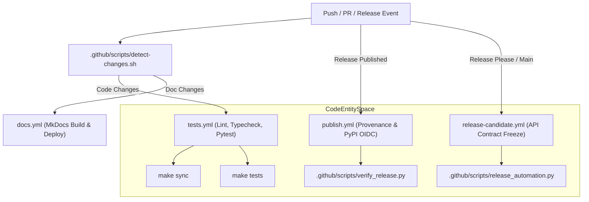
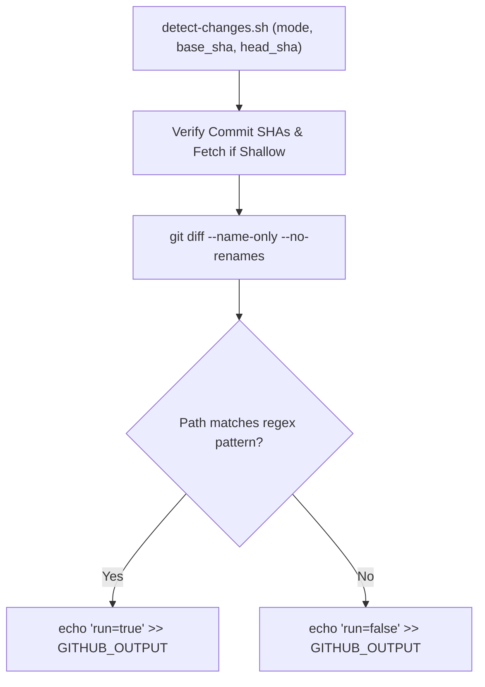
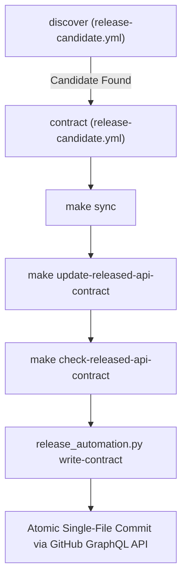

<!-- source: DeepWiki mcp.deepwiki.com · repo openai/openai-agents-python · page 17.2 CI/CD and Release Automation · fetched 2026-10-26 -->

# CI/CD and Release Automation

Relevant source files

The following files were used as context for generating this wiki page:

- [.github/RELEASING.md](.github/RELEASING.md)
- [.github/dependabot.yml](.github/dependabot.yml)
- [.github/scripts/detect-changes.sh](.github/scripts/detect-changes.sh)
- [.github/scripts/release_automation.py](.github/scripts/release_automation.py)
- [.github/workflows/codeql.yml](.github/workflows/codeql.yml)
- [.github/workflows/docs.yml](.github/workflows/docs.yml)
- [.github/workflows/issues.yml](.github/workflows/issues.yml)
- [.github/workflows/publish.yml](.github/workflows/publish.yml)
- [.github/workflows/release-candidate.yml](.github/workflows/release-candidate.yml)
- [.github/workflows/release-please.yml](.github/workflows/release-please.yml)
- [.github/workflows/release-readiness-refresh.yml](.github/workflows/release-readiness-refresh.yml)
- [.github/workflows/release-readiness.yml](.github/workflows/release-readiness.yml)
- [.github/workflows/tests.yml](.github/workflows/tests.yml)
- [.release-please-manifest.json](.release-please-manifest.json)
- [.vscode/settings.json](.vscode/settings.json)
- [CHANGELOG.md](CHANGELOG.md)
- [pyproject.toml](pyproject.toml)
- [release-please-config.json](release-please-config.json)
- [src/agents/version.py](src/agents/version.py)
- [tests/fixtures/released_api_contract.json](tests/fixtures/released_api_contract.json)
- [tests/test_change_detection.py](tests/test_change_detection.py)
- [tests/test_release_automation.py](tests/test_release_automation.py)
- [tests/test_release_please.py](tests/test_release_please.py)
- [tests/test_repository_workflow_interfaces.py](tests/test_repository_workflow_interfaces.py)
- [uv.lock](uv.lock)

## Purpose and Scope
This page details the Continuous Integration, Continuous Delivery (CI/CD), and release automation infrastructure of the `openai-agents-python` repository. It covers GitHub Actions workflow definitions, intelligent change detection (`detect-changes.sh`), release candidate preparation and API contract freezing (`release_automation.py`), API contract fixtures, and trusted OIDC PyPI publishing.

---

## 1. GitHub Actions Workflows Architecture

The repository orchestrates its verification and publishing lifecycle via several dedicated GitHub Actions workflows located in `.github/workflows/`:
*   **Tests (`tests.yml`)**: Runs linting, type-checking (including Windows-specific `mypy`), multi-version test matrices (Python 3.10–3.14), coverage reporting, and container/integration test runners [,.github/workflows/tests.yml:1-176]().
*   **Docs (`docs.yml`)**: Materializes MkDocs sites and deploys static documentation assets to the `gh-pages` branch [,.github/workflows/docs.yml:1-96]().
*   **Publish (`publish.yml`)**: Triggered upon GitHub release publication, verifying release provenance, running final sanity checks, building distribution packages, and publishing to PyPI via trusted OIDC publishing [,.github/workflows/publish.yml:1-178]().
*   **Release Candidate (`release-candidate.yml`)**: Freezes and validates prospective public API contracts whenever Release Please or main-branch tests complete [,.github/workflows/release-candidate.yml:1-123]().

### Workflow Execution and Orchestration Diagram

**Sources:** `[.github/workflows/tests.yml:1-176]()`, `[.github/workflows/docs.yml:1-95]()`, `[.github/workflows/publish.yml:1-178]`, `[.github/workflows/release-candidate.yml:1-122]()`

---

## 2. Intelligent Change Detection (`detect-changes.sh`)

To avoid redundant compute cycles on pull requests and pushes that only alter documentation or auxiliary assets, the CI pipeline relies on `[.github/scripts/detect-changes.sh]()`. This script inspects Git diff ranges and sets workflow outputs accordingly [,.github/scripts/detect-changes.sh:1-102]().

### Change Detection Modes and Regex Patterns
*   **`code` mode**: Matches source changes under `src/`, `tests/`, `integration_tests/`, workflow definitions, configuration files (`pyproject.toml`, `uv.lock`, `Makefile`), and skill definitions [,.github/scripts/detect-changes.sh:78-80]().
*   **`docs` / `docs-only` / `docs-deploy` modes**: Restricts evaluation to `docs/`, `mkdocs.yml`, or dependency updates affecting documentation builds [,.github/scripts/detect-changes.sh:67-75]().

### Change Detection Flow

**Sources:** `[.github/scripts/detect-changes.sh:1-101]()`, `[tests/test_change_detection.py:1-184]()`

---

## 3. Release Automation & API Contract Freezing

Release management combines **Release Please** PR generation with automated API contract locking via `[.github/scripts/release_automation.py]()`. This ensures that unintended public API surface modifications or breaking changes fail the release candidate verification gate.

### Contract Freezing Mechanics
The public API contract is serialized into `[tests/fixtures/released_api_contract.json]()`. During the `release-candidate.yml` workflow, `release_automation.py` updates and validates the contract against prospective changes [,.github/workflows/release-candidate.yml:72-80]().

**Sources:** `[.github/workflows/release-candidate.yml:29-86]()`, `[.github/scripts/release_automation.py:1-179]()`, `[tests/fixtures/released_api_contract.json:1-244]()`

---

## 4. Trusted PyPI Publishing and Provenance

Publishing to PyPI is automated through `[.github/workflows/publish.yml]()` using secure OpenID Connect (OIDC) trusted publishing tokens [,.github/workflows/publish.yml:126-159]().

### Publication Pipeline Steps
1.  **Provenance Verification**: The `checks` job runs `[verify_release.py]()` and `[release_automation.py verify-publication]()` to assert tag and commit authorization [,.github/workflows/publish.yml:41-53]().
2.  **Cross-Version Verification**: The codebase undergoes test suites across Python `3.10` through `3.14` using `uv` [,.github/workflows/publish.yml:67-70]().
3.  **Artifact Building**: `uv build` generates immutable source distributions and wheels [,.github/workflows/publish.yml:114-116]().
4.  **OIDC Publish**: The `publish` job uploads artifacts to PyPI using `pypa/gh-action-pypi-publish` bound to the repository's `pypi` deployment environment [,.github/workflows/publish.yml:128-159]().

**Sources:** `[.github/workflows/publish.yml:1-177]()`, `[pyproject.toml:1-154]()`

---

